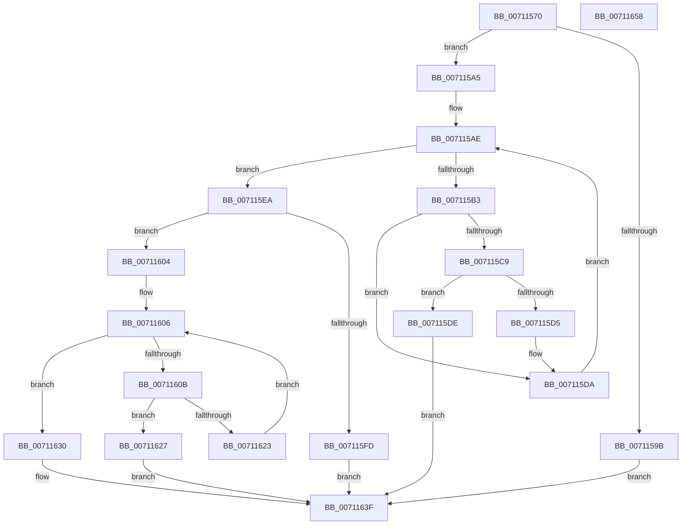

# DbgkLkmdRegisterCallback

- RVA: `0x00711570`–`0x00711659` (길이 `233` bytes)
- VA: `0x0000000140711570`
- 실행 섹션: `PAGE`
- PDB 이름 있음: `예`; PDB Function 태그: `아니요`
- unwind 정보 RVA: `0x00060300`
- 디코드: `74`개 명령, `233/233` bytes 표시
- 미해석 바이트: `0` (있으면 어셈블리에 `.byte`로 보존)

> 이 문서는 커널 이미지의 기계어와 PDB 기호를 분석해 생성했습니다. 4번과 5번은 함수 원형과 자료형을 바이너리 사용 방식에서 추정한 C 해석이며 원본 소스 복구 결과는 아닙니다.

## 1. Dependencies

- 직접 호출 지점: **6**; 고유 호출 대상: **5**
- 직접 호출자로 확인된 함수: **0**
- RIP 상대 이미지 참조: **1**

### Outgoing calls
- `0x007115BF` → [ExReferenceCallBackBlock](../../text/2F/ExReferenceCallBackBlock_function_002F0040.md) (function, `0x002F0040`)
- `0x007115D5` → [ExDereferenceCallBackBlock](../../text/44/ExDereferenceCallBackBlock_function_0044D730.md) (function, `0x0044D730`)
- `0x007115DE` → [ExDereferenceCallBackBlock](../../text/44/ExDereferenceCallBackBlock_function_0044D730.md) (function, `0x0044D730`)
- `0x007115F0` → [ExAllocateCallBack](../AA/ExAllocateCallBack_function_00AA1AE0.md) (function, `0x00AA1AE0`)
- `0x0071161A` → [ExCompareExchangeCallBack](../../text/41/ExCompareExchangeCallBack_function_0041BCD0.md) (function, `0x0041BCD0`)
- `0x00711635` → [ExFreePoolWithTag](../../poolcode/B8/ExFreePoolWithTag_function_00B82870.md) (function, `0x00B82870`)

### Direct callers
- 이 함수 시작 RVA로 연결되는 직접 call은 확인되지 않았습니다. 간접 호출은 완전히 역산할 수 없습니다.

### Static image references
- `0x007115A7` → RVA `0x00E3ECE0` (`.data`; read)

## 2. Other-region calls and transfers

- 다른 실행 섹션으로 향하는 call: **5**
  - `0x007115BF` → [ExReferenceCallBackBlock](../../text/2F/ExReferenceCallBackBlock_function_002F0040.md) (`PAGE` → `.text`)
  - `0x007115D5` → [ExDereferenceCallBackBlock](../../text/44/ExDereferenceCallBackBlock_function_0044D730.md) (`PAGE` → `.text`)
  - `0x007115DE` → [ExDereferenceCallBackBlock](../../text/44/ExDereferenceCallBackBlock_function_0044D730.md) (`PAGE` → `.text`)
  - `0x0071161A` → [ExCompareExchangeCallBack](../../text/41/ExCompareExchangeCallBack_function_0041BCD0.md) (`PAGE` → `.text`)
  - `0x00711635` → [ExFreePoolWithTag](../../poolcode/B8/ExFreePoolWithTag_function_00B82870.md) (`PAGE` → `POOLCODE`)
- 별도 외부 분기/꼬리 이동을 확인하지 못했습니다.

## 3. Assembly (complete function range)

```asm
00711570  48 89 5C 24 08                  mov qword ptr [rsp + 8], rbx
00711575  48 89 6C 24 10                  mov qword ptr [rsp + 0x10], rbp
0071157A  48 89 74 24 18                  mov qword ptr [rsp + 0x18], rsi
0071157F  57                              push rdi
00711580  41 56                           push r14
00711582  41 57                           push r15
00711584  48 83 EC 20                     sub rsp, 0x20
00711588  41 8B C0                        mov eax, r8d
0071158B  41 8B E8                        mov ebp, r8d
0071158E  83 E0 03                        and eax, 3
00711591  4C 8B F2                        mov r14, rdx
00711594  48 8B F1                        mov rsi, rcx
00711597  3C 03                           cmp al, 3
00711599  75 0A                           jne 0x1407115a5
0071159B  B8 0D 00 00 C0                  mov eax, 0xc000000d
007115A0  E9 9A 00 00 00                  jmp 0x14071163f
007115A5  33 DB                           xor ebx, ebx
007115A7  4C 8D 3D 32 D7 72 00            lea r15, [rip + 0x72d732]
007115AE  83 FB 08                        cmp ebx, 8
007115B1  73 37                           jae 0x1407115ea
007115B3  8B FB                           mov edi, ebx
007115B5  48 C1 E7 04                     shl rdi, 4
007115B9  49 03 FF                        add rdi, r15
007115BC  48 8B CF                        mov rcx, rdi
007115BF  E8 7C EA BD FF                  call 0x1402f0040
007115C4  48 85 C0                        test rax, rax
007115C7  74 11                           je 0x1407115da
007115C9  48 8B D0                        mov rdx, rax
007115CC  48 8B CF                        mov rcx, rdi
007115CF  48 3B 70 08                     cmp rsi, qword ptr [rax + 8]
007115D3  74 09                           je 0x1407115de
007115D5  E8 56 C1 D3 FF                  call 0x14044d730
007115DA  FF C3                           inc ebx
007115DC  EB D0                           jmp 0x1407115ae
007115DE  E8 4D C1 D3 FF                  call 0x14044d730
007115E3  B8 18 07 00 C0                  mov eax, 0xc0000718
007115E8  EB 55                           jmp 0x14071163f
007115EA  49 8B D6                        mov rdx, r14
007115ED  48 8B CE                        mov rcx, rsi
007115F0  E8 EB 04 39 00                  call 0x140aa1ae0
007115F5  48 8B F8                        mov rdi, rax
007115F8  48 85 C0                        test rax, rax
007115FB  75 07                           jne 0x140711604
007115FD  B8 17 00 00 C0                  mov eax, 0xc0000017
00711602  EB 3B                           jmp 0x14071163f
00711604  33 DB                           xor ebx, ebx
00711606  83 FB 08                        cmp ebx, 8
00711609  73 25                           jae 0x140711630
0071160B  8B F3                           mov esi, ebx
0071160D  45 33 C0                        xor r8d, r8d
00711610  48 03 F6                        add rsi, rsi
00711613  48 8B D7                        mov rdx, rdi
00711616  49 8D 0C F7                     lea rcx, [r15 + rsi*8]
0071161A  E8 B1 A6 D0 FF                  call 0x14041bcd0
0071161F  84 C0                           test al, al
00711621  75 04                           jne 0x140711627
00711623  FF C3                           inc ebx
00711625  EB DF                           jmp 0x140711606
00711627  41 89 6C F7 08                  mov dword ptr [r15 + rsi*8 + 8], ebp
0071162C  33 C0                           xor eax, eax
0071162E  EB 0F                           jmp 0x14071163f
00711630  33 D2                           xor edx, edx
00711632  48 8B CF                        mov rcx, rdi
00711635  E8 36 12 47 00                  call 0x140b82870
0071163A  B8 2B 04 00 C0                  mov eax, 0xc000042b
0071163F  48 8B 5C 24 40                  mov rbx, qword ptr [rsp + 0x40]
00711644  48 8B 6C 24 48                  mov rbp, qword ptr [rsp + 0x48]
00711649  48 8B 74 24 50                  mov rsi, qword ptr [rsp + 0x50]
0071164E  48 83 C4 20                     add rsp, 0x20
00711652  41 5F                           pop r15
00711654  41 5E                           pop r14
00711656  5F                              pop rdi
00711657  C3                              ret
00711658  CC                              int3
```

## 4. C-style interpretation (structured pseudocode)

```c
__int64 __fastcall DbgkLkmdRegisterCallback(__int64 a1, __int64 a2, int a3)
{
    __int64 result;
    __int64 v_rbx;
    __int64 v_rdi;
    __int64 v_rsi;
    __int64 v_rsp;
    unsigned __int64 v_stack_p10;
    unsigned __int64 v_stack_p18;
    unsigned __int64 v_stack_p8;

    v_stack_p8 = v_rbx;
    v_stack_p10 = v_rbp;
    v_stack_p18 = v_rsi;
    v_rsp = (v_rsp) - (32);
    result = (unsigned int)(((unsigned int)(a3)) & (3));
    if (((unsigned __int8)(result)) != 3) goto loc_007115A5;
    goto loc_0071163F;
loc_007115A5:
    v_rbx = 0;
loc_007115AE:
    if (0 >= 8) goto loc_007115EA;
    v_rdi = (0) << (4);
    v_rdi = (v_rdi) + (v_rip + 7526194);
    result = ExReferenceCallBackBlock(v_rdi, a2, a3, a4);
    if (result == 0) goto loc_007115DA;
    if (a1 == (*(unsigned __int64 *)(result + 8))) goto loc_007115DE;
    result = ExDereferenceCallBackBlock(v_rdi, result, a3, a4);
loc_007115DA:
    v_rbx = (unsigned int)((v_rbx) + 1);
    goto loc_007115AE;
loc_007115DE:
    result = ExDereferenceCallBackBlock(v_rdi, result, a3, a4);
    goto loc_0071163F;
loc_007115EA:
    result = ExAllocateCallBack(a1, a2, a3, a4);
    if (result != 0) goto loc_00711604;
    goto loc_0071163F;
loc_00711604:
    v_rbx = 0;
loc_00711606:
    if (0 >= 8) goto loc_00711630;
    a3 = 0;
    v_rsi = (0) + (0);
    result = ExCompareExchangeCallBack(v_rip + 7526194 + v_rsi * 8, result, a3, a4);
    if ((unsigned __int8)(result) != 0) goto loc_00711627;
    v_rbx = (unsigned int)((v_rbx) + 1);
    goto loc_00711606;
loc_00711627:
    *(unsigned int *)(v_rip + 7526194 + v_rsi * 8 + 8) = (unsigned int)((unsigned int)(a3));
    result = 0;
    goto loc_0071163F;
loc_00711630:
    a2 = 0;
    result = ExFreePoolWithTag(0, a2, a3, a4);
loc_0071163F:
    v_rsp = (v_rsp) + (32);
    return (unsigned int)(0xC000042BULL);
}
```

## 5. (Beta) C Style

```c
int64_t DbgkLkmdRegisterCallback(int64_t Arg1, int64_t Arg2, int32_t Arg3)
{
    int64_t result;
    int64_t local_rbx;
    int64_t local_rdi;
    int64_t local_rsi;
    int64_t local_rsp;
    uint64_t v_stack_p10;
    uint64_t v_stack_p18;
    uint64_t v_stack_p8;

    v_stack_p8 = local_rbx;
    v_stack_p10 = local_rbp;
    v_stack_p18 = local_rsi;
    local_rsp = (local_rsp) - (32);
    result = (uint32_t)(((uint32_t)(Arg3)) & (3));
    if (((uint8_t)(result)) != 3) goto loc_007115A5;
    goto loc_0071163F;
loc_007115A5:
    local_rbx = 0;
loc_007115AE:
    if (0 >= 8) goto loc_007115EA;
    local_rdi = (0) << (4);
    local_rdi = (local_rdi) + (v_rip + 7526194);
    result = ExReferenceCallBackBlock(local_rdi, Arg2, Arg3, a4);
    if (result == 0) goto loc_007115DA;
    if (Arg1 == (*(uint64_t *)(result + 0x8))) goto loc_007115DE;
    result = ExDereferenceCallBackBlock(local_rdi, result, Arg3, a4);
loc_007115DA:
    local_rbx = (uint32_t)((local_rbx) + 1);
    goto loc_007115AE;
loc_007115DE:
    result = ExDereferenceCallBackBlock(local_rdi, result, Arg3, a4);
    goto loc_0071163F;
loc_007115EA:
    result = ExAllocateCallBack(Arg1, Arg2, Arg3, a4);
    if (result != 0) goto loc_00711604;
    goto loc_0071163F;
loc_00711604:
    local_rbx = 0;
loc_00711606:
    if (0 >= 8) goto loc_00711630;
    Arg3 = 0;
    local_rsi = (0) + (0);
    result = ExCompareExchangeCallBack(v_rip + 7526194 + local_rsi * 8, result, Arg3, a4);
    if ((uint8_t)(result) != 0) goto loc_00711627;
    local_rbx = (uint32_t)((local_rbx) + 1);
    goto loc_00711606;
loc_00711627:
    *(uint32_t *)(v_rip + 0x72D732 + local_rsi * 8 + 0x8) = (uint32_t)((uint32_t)(Arg3));
    result = 0;
    goto loc_0071163F;
loc_00711630:
    Arg2 = 0;
    result = ExFreePoolWithTag(0, Arg2, Arg3, a4);
loc_0071163F:
    local_rsp = (local_rsp) + (32);
    return (uint32_t)(0xC000042BULL);
}
```

## 6. Execution-region graph

[열기: 2D/3D 그래프와 함수 탐색 컨트롤 패널](../../../control-panel.html?section=page&rva=0x00711570&view=graph)

- 2D 그래프는 위에서 아래로 흐르고, 3D 그래프는 빈 공간을 드래그해 회전합니다. Shift+드래그는 이동, 휠은 확대·축소, 함수 노드 선택은 대상 보고서 이동입니다.

### Static fallback


