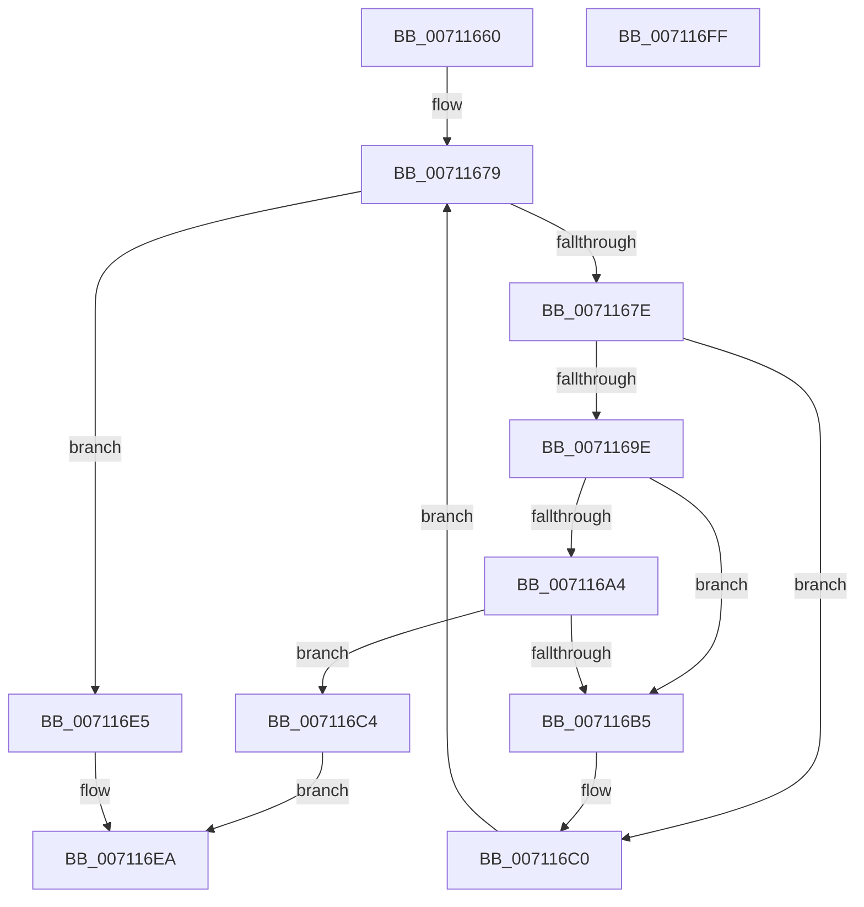

# DbgkLkmdUnregisterCallback

- RVA: `0x00711660`–`0x00711700` (길이 `160` bytes)
- VA: `0x0000000140711660`
- 실행 섹션: `PAGE`
- PDB 이름 있음: `예`; PDB Function 태그: `아니요`
- unwind 정보 RVA: `0x0005C954`
- 디코드: `49`개 명령, `160/160` bytes 표시
- 미해석 바이트: `0` (있으면 어셈블리에 `.byte`로 보존)

> 이 문서는 커널 이미지의 기계어와 PDB 기호를 분석해 생성했습니다. 4번과 5번은 함수 원형과 자료형을 바이너리 사용 방식에서 추정한 C 해석이며 원본 소스 복구 결과는 아닙니다.

## 1. Dependencies

- 직접 호출 지점: **6**; 고유 호출 대상: **5**
- 직접 호출자로 확인된 함수: **0**
- RIP 상대 이미지 참조: **1**

### Outgoing calls
- `0x00711691` → [ExReferenceCallBackBlock](../../text/2F/ExReferenceCallBackBlock_function_002F0040.md) (function, `0x002F0040`)
- `0x007116AC` → [ExCompareExchangeCallBack](../../text/41/ExCompareExchangeCallBack_function_0041BCD0.md) (function, `0x0041BCD0`)
- `0x007116BB` → [ExDereferenceCallBackBlock](../../text/44/ExDereferenceCallBackBlock_function_0044D730.md) (function, `0x0044D730`)
- `0x007116CA` → [ExDereferenceCallBackBlock](../../text/44/ExDereferenceCallBackBlock_function_0044D730.md) (function, `0x0044D730`)
- `0x007116D2` → [ExWaitForRundownProtectionRelease](../../text/2A/ExWaitForRundownProtectionRelease_function_002A4CB0.md) (function, `0x002A4CB0`)
- `0x007116DC` → [ExFreePoolWithTag](../../poolcode/B8/ExFreePoolWithTag_function_00B82870.md) (function, `0x00B82870`)

### Direct callers
- 이 함수 시작 RVA로 연결되는 직접 call은 확인되지 않았습니다. 간접 호출은 완전히 역산할 수 없습니다.

### Static image references
- `0x0071167E` → RVA `0x00E3ECE0` (`.data`; read)

## 2. Other-region calls and transfers

- 다른 실행 섹션으로 향하는 call: **6**
  - `0x00711691` → [ExReferenceCallBackBlock](../../text/2F/ExReferenceCallBackBlock_function_002F0040.md) (`PAGE` → `.text`)
  - `0x007116AC` → [ExCompareExchangeCallBack](../../text/41/ExCompareExchangeCallBack_function_0041BCD0.md) (`PAGE` → `.text`)
  - `0x007116BB` → [ExDereferenceCallBackBlock](../../text/44/ExDereferenceCallBackBlock_function_0044D730.md) (`PAGE` → `.text`)
  - `0x007116CA` → [ExDereferenceCallBackBlock](../../text/44/ExDereferenceCallBackBlock_function_0044D730.md) (`PAGE` → `.text`)
  - `0x007116D2` → [ExWaitForRundownProtectionRelease](../../text/2A/ExWaitForRundownProtectionRelease_function_002A4CB0.md) (`PAGE` → `.text`)
  - `0x007116DC` → [ExFreePoolWithTag](../../poolcode/B8/ExFreePoolWithTag_function_00B82870.md) (`PAGE` → `POOLCODE`)
- 별도 외부 분기/꼬리 이동을 확인하지 못했습니다.

## 3. Assembly (complete function range)

```asm
00711660  48 89 5C 24 08                  mov qword ptr [rsp + 8], rbx
00711665  48 89 6C 24 10                  mov qword ptr [rsp + 0x10], rbp
0071166A  48 89 74 24 18                  mov qword ptr [rsp + 0x18], rsi
0071166F  57                              push rdi
00711670  48 83 EC 20                     sub rsp, 0x20
00711674  48 8B E9                        mov rbp, rcx
00711677  33 FF                           xor edi, edi
00711679  83 FF 08                        cmp edi, 8
0071167C  73 67                           jae 0x1407116e5
0071167E  48 8D 0D 5B D6 72 00            lea rcx, [rip + 0x72d65b]
00711685  8B F7                           mov esi, edi
00711687  48 C1 E6 04                     shl rsi, 4
0071168B  48 03 F1                        add rsi, rcx
0071168E  48 8B CE                        mov rcx, rsi
00711691  E8 AA E9 BD FF                  call 0x1402f0040
00711696  48 8B D8                        mov rbx, rax
00711699  48 85 C0                        test rax, rax
0071169C  74 22                           je 0x1407116c0
0071169E  48 3B 68 08                     cmp rbp, qword ptr [rax + 8]
007116A2  75 11                           jne 0x1407116b5
007116A4  4C 8B C0                        mov r8, rax
007116A7  33 D2                           xor edx, edx
007116A9  48 8B CE                        mov rcx, rsi
007116AC  E8 1F A6 D0 FF                  call 0x14041bcd0
007116B1  84 C0                           test al, al
007116B3  75 0F                           jne 0x1407116c4
007116B5  48 8B D3                        mov rdx, rbx
007116B8  48 8B CE                        mov rcx, rsi
007116BB  E8 70 C0 D3 FF                  call 0x14044d730
007116C0  FF C7                           inc edi
007116C2  EB B5                           jmp 0x140711679
007116C4  48 8B D3                        mov rdx, rbx
007116C7  48 8B CE                        mov rcx, rsi
007116CA  E8 61 C0 D3 FF                  call 0x14044d730
007116CF  48 8B CB                        mov rcx, rbx
007116D2  E8 D9 35 B9 FF                  call 0x1402a4cb0
007116D7  33 D2                           xor edx, edx
007116D9  48 8B CB                        mov rcx, rbx
007116DC  E8 8F 11 47 00                  call 0x140b82870
007116E1  33 C0                           xor eax, eax
007116E3  EB 05                           jmp 0x1407116ea
007116E5  B8 25 02 00 C0                  mov eax, 0xc0000225
007116EA  48 8B 5C 24 30                  mov rbx, qword ptr [rsp + 0x30]
007116EF  48 8B 6C 24 38                  mov rbp, qword ptr [rsp + 0x38]
007116F4  48 8B 74 24 40                  mov rsi, qword ptr [rsp + 0x40]
007116F9  48 83 C4 20                     add rsp, 0x20
007116FD  5F                              pop rdi
007116FE  C3                              ret
007116FF  CC                              int3
```

## 4. C-style interpretation (structured pseudocode)

```c
__int64 __fastcall DbgkLkmdUnregisterCallback(__int64 a1, int a2)
{
    __int64 result;
    __int64 v_rdi;
    __int64 v_rsi;
    __int64 v_rsp;
    unsigned __int64 v_stack_p10;
    unsigned __int64 v_stack_p18;
    unsigned __int64 v_stack_p8;

    v_stack_p8 = v_rbx;
    v_stack_p10 = v_rbp;
    v_stack_p18 = v_rsi;
    v_rsp = (v_rsp) - (32);
    v_rdi = 0;
loc_00711679:
    if (0 >= 8) goto loc_007116E5;
    v_rsi = (0) << (4);
    v_rsi = (v_rsi) + (v_rip + 7525979);
    result = ExReferenceCallBackBlock(v_rsi, a2, a3, a4);
    if (result == 0) goto loc_007116C0;
    if (a1 != (*(unsigned __int64 *)(result + 8))) goto loc_007116B5;
    a2 = 0;
    result = ExCompareExchangeCallBack(v_rsi, a2, result, a4);
    if ((unsigned __int8)(result) != 0) goto loc_007116C4;
loc_007116B5:
    result = ExDereferenceCallBackBlock(v_rsi, result, result, a4);
loc_007116C0:
    v_rdi = (unsigned int)((v_rdi) + 1);
    goto loc_00711679;
loc_007116C4:
    result = ExDereferenceCallBackBlock(v_rsi, result, result, a4);
    result = ExWaitForRundownProtectionRelease(result, result, result, a4);
    a2 = 0;
    result = ExFreePoolWithTag(result, a2, result, a4);
    result = 0;
    goto loc_007116EA;
loc_007116E5:
loc_007116EA:
    v_rsp = (v_rsp) + (32);
    return (unsigned int)(0xC0000225ULL);
}
```

## 5. (Beta) C Style

```c
int64_t DbgkLkmdUnregisterCallback(int64_t Arg1, int32_t Arg2)
{
    int64_t result;
    int64_t local_rdi;
    int64_t local_rsi;
    int64_t local_rsp;
    uint64_t v_stack_p10;
    uint64_t v_stack_p18;
    uint64_t v_stack_p8;

    v_stack_p8 = local_rbx;
    v_stack_p10 = local_rbp;
    v_stack_p18 = local_rsi;
    local_rsp = (local_rsp) - (32);
    local_rdi = 0;
loc_00711679:
    if (0 >= 8) goto loc_007116E5;
    local_rsi = (0) << (4);
    local_rsi = (local_rsi) + (v_rip + 7525979);
    result = ExReferenceCallBackBlock(local_rsi, Arg2, a3, a4);
    if (result == 0) goto loc_007116C0;
    if (Arg1 != (*(uint64_t *)(result + 0x8))) goto loc_007116B5;
    Arg2 = 0;
    result = ExCompareExchangeCallBack(local_rsi, Arg2, result, a4);
    if ((uint8_t)(result) != 0) goto loc_007116C4;
loc_007116B5:
    result = ExDereferenceCallBackBlock(local_rsi, result, result, a4);
loc_007116C0:
    local_rdi = (uint32_t)((local_rdi) + 1);
    goto loc_00711679;
loc_007116C4:
    result = ExDereferenceCallBackBlock(local_rsi, result, result, a4);
    result = ExWaitForRundownProtectionRelease(result, result, result, a4);
    Arg2 = 0;
    result = ExFreePoolWithTag(result, Arg2, result, a4);
    result = 0;
    goto loc_007116EA;
loc_007116E5:
loc_007116EA:
    local_rsp = (local_rsp) + (32);
    return (uint32_t)(0xC0000225ULL);
}
```

## 6. Execution-region graph

[열기: 2D/3D 그래프와 함수 탐색 컨트롤 패널](../../../control-panel.html?section=page&rva=0x00711660&view=graph)

- 2D 그래프는 위에서 아래로 흐르고, 3D 그래프는 빈 공간을 드래그해 회전합니다. Shift+드래그는 이동, 휠은 확대·축소, 함수 노드 선택은 대상 보고서 이동입니다.

### Static fallback


