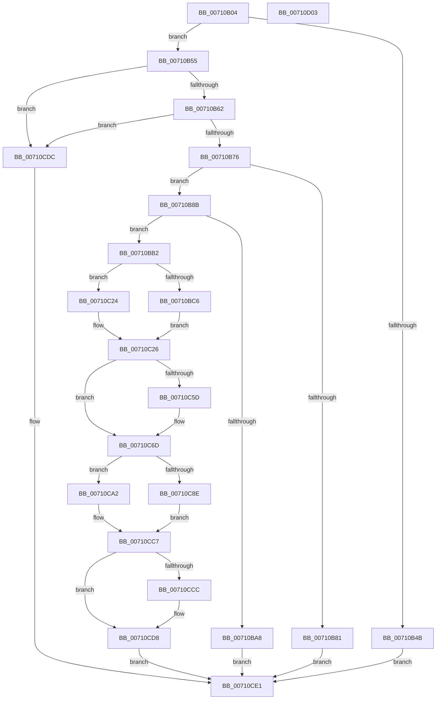

# DbgkQueueUserExceptionReport

- RVA: `0x00710B04`–`0x00710D04` (길이 `512` bytes)
- VA: `0x0000000140710B04`
- 실행 섹션: `PAGE`
- PDB 이름 있음: `예`; PDB Function 태그: `아니요`
- unwind 정보 RVA: `0x000BE160`
- 디코드: `128`개 명령, `512/512` bytes 표시
- 미해석 바이트: `0` (있으면 어셈블리에 `.byte`로 보존)

> 이 문서는 커널 이미지의 기계어와 PDB 기호를 분석해 생성했습니다. 4번과 5번은 함수 원형과 자료형을 바이너리 사용 방식에서 추정한 C 해석이며 원본 소스 복구 결과는 아닙니다.

## 1. Dependencies

- 직접 호출 지점: **13**; 고유 호출 대상: **11**
- 직접 호출자로 확인된 함수: **2**
- RIP 상대 이미지 참조: **3**

### Outgoing calls
- `0x00710B62` → [IoThreadToProcess](../../text/44/IoThreadToProcess_function_00448540.md) (function, `0x00448540`)
- `0x00710B9B` → [ExAllocatePool2](../../poolcode/B8/ExAllocatePool2_function_00B820F0.md) (function, `0x00B820F0`)
- `0x00710BB5` → [ObfReferenceObject](../../text/20/ObfReferenceObject_function_0020FA20.md) (function, `0x0020FA20`)
- `0x00710C46` → [IoThreadToProcess](../../text/44/IoThreadToProcess_function_00448540.md) (function, `0x00448540`)
- `0x00710C65` → [KeStackAttachProcess](../../text/21/KeStackAttachProcess_function_00216800.md) (function, `0x00216800`)
- `0x00710C83` → [PsSuspendThread](../A1/PsSuspendThread_function_00A110D0.md) (function, `0x00A110D0`)
- `0x00710C96` → [ExQueueWorkItem](../../text/2F/ExQueueWorkItem_function_002F9520.md) (function, `0x002F9520`)
- `0x00710C9B` → [KeLeaveCriticalRegion](../../text/25/KeLeaveCriticalRegion_function_0025D8B0.md) (function, `0x0025D8B0`)
- `0x00710CA2` → [KeLeaveCriticalRegion](../../text/25/KeLeaveCriticalRegion_function_0025D8B0.md) (function, `0x0025D8B0`)
- `0x00710CAF` → [ExFreePoolWithTag](../../poolcode/B8/ExFreePoolWithTag_function_00B82870.md) (function, `0x00B82870`)
- `0x00710CC2` → [ObfDereferenceObject](../../text/2F/ObfDereferenceObject_function_002F9350.md) (function, `0x002F9350`)
- `0x00710CD3` → [KiUnstackDetachProcess](../../text/21/KiUnstackDetachProcess_function_00217D30.md) (function, `0x00217D30`)
- `0x00710CE9` → [_security_check_cookie](../../text/6A/_security_check_cookie_function_006AC640.md) (function, `0x006AC640`)

### Direct callers
- [sub_006ED8E6](../../text/6E/Unknown_function_006ED8E6.md) at `0x006ED931`
- [MiForceCrashForInvalidAccess](../AC/MiForceCrashForInvalidAccess_function_00ACEFA4.md) at `0x00ACF089`

### Static image references
- `0x00710B16` → RVA `0x00E0A740` (`.data`; read)
- `0x00710B30` → RVA `0x00FC5384` (`ALMOSTRO`; read)
- `0x00710C34` → RVA `0x00710D10` (`DbgkUserReportWorkRoutine`; read)

## 2. Other-region calls and transfers

- 다른 실행 섹션으로 향하는 call: **12**
  - `0x00710B62` → [IoThreadToProcess](../../text/44/IoThreadToProcess_function_00448540.md) (`PAGE` → `.text`)
  - `0x00710B9B` → [ExAllocatePool2](../../poolcode/B8/ExAllocatePool2_function_00B820F0.md) (`PAGE` → `POOLCODE`)
  - `0x00710BB5` → [ObfReferenceObject](../../text/20/ObfReferenceObject_function_0020FA20.md) (`PAGE` → `.text`)
  - `0x00710C46` → [IoThreadToProcess](../../text/44/IoThreadToProcess_function_00448540.md) (`PAGE` → `.text`)
  - `0x00710C65` → [KeStackAttachProcess](../../text/21/KeStackAttachProcess_function_00216800.md) (`PAGE` → `.text`)
  - `0x00710C96` → [ExQueueWorkItem](../../text/2F/ExQueueWorkItem_function_002F9520.md) (`PAGE` → `.text`)
  - `0x00710C9B` → [KeLeaveCriticalRegion](../../text/25/KeLeaveCriticalRegion_function_0025D8B0.md) (`PAGE` → `.text`)
  - `0x00710CA2` → [KeLeaveCriticalRegion](../../text/25/KeLeaveCriticalRegion_function_0025D8B0.md) (`PAGE` → `.text`)
  - `0x00710CAF` → [ExFreePoolWithTag](../../poolcode/B8/ExFreePoolWithTag_function_00B82870.md) (`PAGE` → `POOLCODE`)
  - `0x00710CC2` → [ObfDereferenceObject](../../text/2F/ObfDereferenceObject_function_002F9350.md) (`PAGE` → `.text`)
  - `0x00710CD3` → [KiUnstackDetachProcess](../../text/21/KiUnstackDetachProcess_function_00217D30.md) (`PAGE` → `.text`)
  - `0x00710CE9` → [_security_check_cookie](../../text/6A/_security_check_cookie_function_006AC640.md) (`PAGE` → `.text`)
- 별도 외부 분기/꼬리 이동을 확인하지 못했습니다.

## 3. Assembly (complete function range)

```asm
00710B04  48 89 5C 24 10                  mov qword ptr [rsp + 0x10], rbx
00710B09  48 89 6C 24 18                  mov qword ptr [rsp + 0x18], rbp
00710B0E  56                              push rsi
00710B0F  57                              push rdi
00710B10  41 56                           push r14
00710B12  48 83 EC 60                     sub rsp, 0x60
00710B16  48 8B 05 23 9C 6F 00            mov rax, qword ptr [rip + 0x6f9c23]
00710B1D  48 33 C4                        xor rax, rsp
00710B20  48 89 44 24 50                  mov qword ptr [rsp + 0x50], rax
00710B25  0F 57 C0                        xorps xmm0, xmm0
00710B28  8B EA                           mov ebp, edx
00710B2A  45 32 F6                        xor r14b, r14b
00710B2D  49 8B F0                        mov rsi, r8
00710B30  83 3D 4D 48 8B 00 00            cmp dword ptr [rip + 0x8b484d], 0
00710B37  48 8B D9                        mov rbx, rcx
00710B3A  0F 11 44 24 20                  movups xmmword ptr [rsp + 0x20], xmm0
00710B3F  0F 11 44 24 30                  movups xmmword ptr [rsp + 0x30], xmm0
00710B44  0F 11 44 24 40                  movups xmmword ptr [rsp + 0x40], xmm0
00710B49  75 0A                           jne 0x140710b55
00710B4B  B8 56 03 00 C0                  mov eax, 0xc0000356
00710B50  E9 8C 01 00 00                  jmp 0x140710ce1
00710B55  F7 41 74 00 04 00 00            test dword ptr [rcx + 0x74], 0x400
00710B5C  0F 85 7A 01 00 00               jne 0x140710cdc
00710B62  E8 D9 79 D3 FF                  call 0x140448540
00710B67  8B 88 FC 05 00 00               mov ecx, dword ptr [rax + 0x5fc]
00710B6D  F6 C1 01                        test cl, 1
00710B70  0F 85 66 01 00 00               jne 0x140710cdc
00710B76  F0 0F BA AB A0 05 00 00 15      lock bts dword ptr [rbx + 0x5a0], 0x15
00710B7F  73 0A                           jae 0x140710b8b
00710B81  B8 04 07 00 C0                  mov eax, 0xc0000704
00710B86  E9 56 01 00 00                  jmp 0x140710ce1
00710B8B  BA D0 00 00 00                  mov edx, 0xd0
00710B90  B9 40 00 00 00                  mov ecx, 0x40
00710B95  41 B8 44 42 47 4B               mov r8d, 0x4b474244
00710B9B  E8 50 15 47 00                  call 0x140b820f0
00710BA0  48 8B F8                        mov rdi, rax
00710BA3  48 85 C0                        test rax, rax
00710BA6  75 0A                           jne 0x140710bb2
00710BA8  B8 9A 00 00 C0                  mov eax, 0xc000009a
00710BAD  E9 2F 01 00 00                  jmp 0x140710ce1
00710BB2  48 8B CB                        mov rcx, rbx
00710BB5  E8 66 EE AF FF                  call 0x14020fa20
00710BBA  48 89 1F                        mov qword ptr [rdi], rbx
00710BBD  48 89 6F 08                     mov qword ptr [rdi + 8], rbp
00710BC1  48 85 F6                        test rsi, rsi
00710BC4  74 5E                           je 0x140710c24
00710BC6  0F 10 06                        movups xmm0, xmmword ptr [rsi]
00710BC9  48 8D 4F 18                     lea rcx, [rdi + 0x18]
00710BCD  B8 80 00 00 00                  mov eax, 0x80
00710BD2  0F 11 01                        movups xmmword ptr [rcx], xmm0
00710BD5  0F 10 4E 10                     movups xmm1, xmmword ptr [rsi + 0x10]
00710BD9  0F 11 49 10                     movups xmmword ptr [rcx + 0x10], xmm1
00710BDD  0F 10 46 20                     movups xmm0, xmmword ptr [rsi + 0x20]
00710BE1  0F 11 41 20                     movups xmmword ptr [rcx + 0x20], xmm0
00710BE5  0F 10 4E 30                     movups xmm1, xmmword ptr [rsi + 0x30]
00710BE9  0F 11 49 30                     movups xmmword ptr [rcx + 0x30], xmm1
00710BED  0F 10 46 40                     movups xmm0, xmmword ptr [rsi + 0x40]
00710BF1  0F 11 41 40                     movups xmmword ptr [rcx + 0x40], xmm0
00710BF5  0F 10 4E 50                     movups xmm1, xmmword ptr [rsi + 0x50]
00710BF9  0F 11 49 50                     movups xmmword ptr [rcx + 0x50], xmm1
00710BFD  0F 10 46 60                     movups xmm0, xmmword ptr [rsi + 0x60]
00710C01  0F 11 41 60                     movups xmmword ptr [rcx + 0x60], xmm0
00710C05  48 03 C8                        add rcx, rax
00710C08  0F 10 46 70                     movups xmm0, xmmword ptr [rsi + 0x70]
00710C0C  0F 11 41 F0                     movups xmmword ptr [rcx - 0x10], xmm0
00710C10  0F 10 0C 06                     movups xmm1, xmmword ptr [rsi + rax]
00710C14  0F 11 09                        movups xmmword ptr [rcx], xmm1
00710C17  48 8B 44 06 10                  mov rax, qword ptr [rsi + rax + 0x10]
00710C1C  48 89 41 10                     mov qword ptr [rcx + 0x10], rax
00710C20  B0 01                           mov al, 1
00710C22  EB 02                           jmp 0x140710c26
00710C24  32 C0                           xor al, al
00710C26  88 47 10                        mov byte ptr [rdi + 0x10], al
00710C29  48 8D B7 B0 00 00 00            lea rsi, [rdi + 0xb0]
00710C30  48 83 26 00                     and qword ptr [rsi], 0
00710C34  48 8D 05 D5 00 00 00            lea rax, [rip + 0xd5]
00710C3B  48 8B CB                        mov rcx, rbx
00710C3E  48 89 46 10                     mov qword ptr [rsi + 0x10], rax
00710C42  48 89 7E 18                     mov qword ptr [rsi + 0x18], rdi
00710C46  E8 F5 78 D3 FF                  call 0x140448540
00710C4B  65 48 8B 0C 25 88 01 00 00      mov rcx, qword ptr gs:[0x188]
00710C54  48 3B 81 B8 00 00 00            cmp rax, qword ptr [rcx + 0xb8]
00710C5B  74 10                           je 0x140710c6d
00710C5D  48 8D 54 24 20                  lea rdx, [rsp + 0x20]
00710C62  48 8B C8                        mov rcx, rax
00710C65  E8 96 5B B0 FF                  call 0x140216800
00710C6A  41 B6 01                        mov r14b, 1
00710C6D  65 48 8B 04 25 88 01 00 00      mov rax, qword ptr gs:[0x188]
00710C76  33 D2                           xor edx, edx
00710C78  48 8B CB                        mov rcx, rbx
00710C7B  66 FF 88 E4 01 00 00            dec word ptr [rax + 0x1e4]
00710C82  90                              nop
00710C83  E8 48 04 30 00                  call 0x140a110d0
00710C88  8B E8                           mov ebp, eax
00710C8A  85 C0                           test eax, eax
00710C8C  78 14                           js 0x140710ca2
00710C8E  BA 01 00 00 00                  mov edx, 1
00710C93  48 8B CE                        mov rcx, rsi
00710C96  E8 85 88 BE FF                  call 0x1402f9520
00710C9B  E8 10 CC B4 FF                  call 0x14025d8b0
00710CA0  EB 25                           jmp 0x140710cc7
00710CA2  E8 09 CC B4 FF                  call 0x14025d8b0
00710CA7  BA 44 42 47 4B                  mov edx, 0x4b474244
00710CAC  48 8B CF                        mov rcx, rdi
00710CAF  E8 BC 1B 47 00                  call 0x140b82870
00710CB4  F0 81 A3 A0 05 00 00 FF FF DF FF  lock and dword ptr [rbx + 0x5a0], 0xffdfffff
00710CBF  48 8B CB                        mov rcx, rbx
00710CC2  E8 89 86 BE FF                  call 0x1402f9350
00710CC7  45 84 F6                        test r14b, r14b
00710CCA  74 0C                           je 0x140710cd8
00710CCC  33 D2                           xor edx, edx
00710CCE  48 8D 4C 24 20                  lea rcx, [rsp + 0x20]
00710CD3  E8 58 70 B0 FF                  call 0x140217d30
00710CD8  8B C5                           mov eax, ebp
00710CDA  EB 05                           jmp 0x140710ce1
00710CDC  B8 BB 00 00 C0                  mov eax, 0xc00000bb
00710CE1  48 8B 4C 24 50                  mov rcx, qword ptr [rsp + 0x50]
00710CE6  48 33 CC                        xor rcx, rsp
00710CE9  E8 52 B9 F9 FF                  call 0x1406ac640
00710CEE  4C 8D 5C 24 60                  lea r11, [rsp + 0x60]
00710CF3  49 8B 5B 28                     mov rbx, qword ptr [r11 + 0x28]
00710CF7  49 8B 6B 30                     mov rbp, qword ptr [r11 + 0x30]
00710CFB  49 8B E3                        mov rsp, r11
00710CFE  41 5E                           pop r14
00710D00  5F                              pop rdi
00710D01  5E                              pop rsi
00710D02  C3                              ret
00710D03  CC                              int3
```

## 4. C-style interpretation (structured pseudocode)

```c
__int64 __fastcall DbgkQueueUserExceptionReport(__int64 a1, int a2, __int64 a3)
{
    __int64 result;
    __int64 v_r14;
    __int64 v_rsp;
    unsigned __int64 v_stack_m18;
    unsigned __int64 v_stack_m28;
    unsigned __int64 v_stack_m38;
    unsigned __int64 v_stack_m48;
    unsigned __int64 v_stack_m58;
    unsigned __int64 v_stack_p10;
    unsigned __int64 v_stack_p18;

    v_stack_p10 = v_rbx;
    v_stack_p18 = v_rbp;
    v_rsp = (v_rsp) - (96);
    result = (*(unsigned __int64 *)(v_rip + 7314467)) ^ (v_rsp);
    v_stack_m28 = result;
    v_r14 = 0;
    v_stack_m58 = v_xmm0;
    v_stack_m48 = v_xmm0;
    v_stack_m38 = v_xmm0;
    if ((*(unsigned int *)(v_rip + 9128013)) != 0) goto loc_00710B55;
    goto loc_00710CE1;
loc_00710B55:
    if (((*(unsigned int *)(a1 + 116)) & (0x400ULL)) != 0) goto loc_00710CDC;
    result = IoThreadToProcess(a1, a2, a3, a4);
    if ((((unsigned __int8)((unsigned int)(*(unsigned int *)(result + 1532)))) & (1)) != 0) goto loc_00710CDC;
    if (condition_is_above_or_equal) goto loc_00710B8B;
    goto loc_00710CE1;
loc_00710B8B:
    result = ExAllocatePool2(64, 208, (unsigned int)(0x4B474244ULL), a4);
    if (result != 0) goto loc_00710BB2;
    goto loc_00710CE1;
loc_00710BB2:
    result = ObfReferenceObject(a1, 208, (unsigned int)(0x4B474244ULL), a4);
    *(unsigned __int64 *)(result) = a1;
    *(unsigned __int64 *)(result + 8) = (unsigned int)(a2);
    if (a3 == 0) goto loc_00710C24;
    *(unsigned __int64 *)(result + 24) = v_xmm0;
    *(unsigned __int64 *)(result + 24 + 16) = v_xmm1;
    *(unsigned __int64 *)(result + 24 + 32) = v_xmm0;
    *(unsigned __int64 *)(result + 24 + 48) = v_xmm1;
    *(unsigned __int64 *)(result + 24 + 64) = v_xmm0;
    *(unsigned __int64 *)(result + 24 + 80) = v_xmm1;
    *(unsigned __int64 *)(result + 24 + 96) = v_xmm0;
    a1 = (result + 24) + (128);
    *(unsigned __int64 *)(a1 - 16) = v_xmm0;
    *(unsigned __int64 *)(a1) = v_xmm1;
    *(unsigned __int64 *)(a1 + 16) = *(unsigned __int64 *)(a3 + 128 * 1 + 16);
    goto loc_00710C26;
loc_00710C24:
    result = 0;
loc_00710C26:
    *(unsigned __int8 *)(result + 16) = 0;
    *(unsigned __int64 *)(result + 176 + 16) = v_rip + 213;
    *(unsigned __int64 *)(result + 176 + 24) = 0;
    result = IoThreadToProcess(a1, 208, (unsigned int)(0x4B474244ULL), a4);
    if (result != (*(unsigned __int64 *)(*(unsigned __int64 *)(gs_base + (0 + 392)) + 184))) {
        a2 = v_stack_m58;
        a1 = result;
        result = KeStackAttachProcess(a1, a2, (unsigned int)(0x4B474244ULL), a4);
        v_r14 = 1;
    }
    a2 = 0;
    result = PsSuspendThread(a1, a2, (unsigned int)(0x4B474244ULL), a4);
    if (sign_flag) goto loc_00710CA2;
    result = ExQueueWorkItem(result + 176, 1, (unsigned int)(0x4B474244ULL), a4);
    result = KeLeaveCriticalRegion(result + 176, 1, (unsigned int)(0x4B474244ULL), a4);
    goto loc_00710CC7;
loc_00710CA2:
    result = KeLeaveCriticalRegion(result + 176, 1, (unsigned int)(0x4B474244ULL), a4);
    result = ExFreePoolWithTag(result, (unsigned int)(0x4B474244ULL), (unsigned int)(0x4B474244ULL), a4);
    result = ObfDereferenceObject(a1, (unsigned int)(0x4B474244ULL), (unsigned int)(0x4B474244ULL), a4);
loc_00710CC7:
    if ((unsigned __int8)(v_r14) != 0) {
        a2 = 0;
        a1 = v_stack_m58;
        result = KiUnstackDetachProcess(a1, a2, (unsigned int)(0x4B474244ULL), a4);
    }
    goto loc_00710CE1;
loc_00710CDC:
loc_00710CE1:
    a1 = (v_stack_m28) ^ (v_rsp);
    result = _security_check_cookie(a1, a2, (unsigned int)(0x4B474244ULL), a4);
    return result;
}
```

## 5. (Beta) C Style

```c
int64_t DbgkQueueUserExceptionReport(void *Arg1, int32_t Arg2, int64_t Arg3)
{
    uint8_t *arg1 = (uint8_t *)Arg1;

    int64_t result;
    int64_t local_r14;
    int64_t local_rsp;
    uint64_t v_stack_m18;
    uint64_t v_stack_m28;
    uint64_t v_stack_m38;
    uint64_t v_stack_m48;
    uint64_t v_stack_m58;
    uint64_t v_stack_p10;
    uint64_t v_stack_p18;

    v_stack_p10 = local_rbx;
    v_stack_p18 = local_rbp;
    local_rsp = (local_rsp) - (96);
    result = (*(uint64_t *)(v_rip + 0x6F9C23)) ^ (local_rsp);
    v_stack_m28 = result;
    local_r14 = 0;
    v_stack_m58 = v_xmm0;
    v_stack_m48 = v_xmm0;
    v_stack_m38 = v_xmm0;
    if ((*(uint32_t *)(v_rip + 0x8B484D)) != 0) goto loc_00710B55;
    goto loc_00710CE1;
loc_00710B55:
    if (((*(uint32_t *)(arg1 + 0x74)) & (0x400ULL)) != 0) goto loc_00710CDC;
    result = IoThreadToProcess(Arg1, Arg2, Arg3, a4);
    if ((((uint8_t)((uint32_t)(*(uint32_t *)(result + 0x5FC)))) & (1)) != 0) goto loc_00710CDC;
    if (condition_is_above_or_equal) goto loc_00710B8B;
    goto loc_00710CE1;
loc_00710B8B:
    result = ExAllocatePool2(64, 208, (uint32_t)(0x4B474244ULL), a4);
    if (result != 0) goto loc_00710BB2;
    goto loc_00710CE1;
loc_00710BB2:
    result = ObfReferenceObject(Arg1, 208, (uint32_t)(0x4B474244ULL), a4);
    *(void **)(result) = Arg1;
    *(uint64_t *)(result + 0x8) = (uint32_t)(Arg2);
    if (Arg3 == 0) goto loc_00710C24;
    *(uint64_t *)(result + 0x18) = v_xmm0;
    *(uint64_t *)(result + 0x18 + 0x10) = v_xmm1;
    *(uint64_t *)(result + 0x18 + 0x20) = v_xmm0;
    *(uint64_t *)(result + 0x18 + 0x30) = v_xmm1;
    *(uint64_t *)(result + 0x18 + 0x40) = v_xmm0;
    *(uint64_t *)(result + 0x18 + 0x50) = v_xmm1;
    *(uint64_t *)(result + 0x18 + 0x60) = v_xmm0;
    Arg1 = (result + 24) + (128);
    *(uint64_t *)(arg1 - 0x10) = v_xmm0;
    *(uint64_t *)(arg1) = v_xmm1;
    *(uint64_t *)(arg1 + 0x10) = *(uint64_t *)(Arg3 + 0x80 * 1 + 0x10);
    goto loc_00710C26;
loc_00710C24:
    result = 0;
loc_00710C26:
    *(uint8_t *)(result + 0x10) = 0;
    *(uint64_t *)(result + 0xB0 + 0x10) = v_rip + 213;
    *(uint64_t *)(result + 0xB0 + 0x18) = 0;
    result = IoThreadToProcess(Arg1, 208, (uint32_t)(0x4B474244ULL), a4);
    if (result != (*(uint64_t *)(*(uint64_t *)(gs_base + (0 + 0x188)) + 0xB8))) {
        Arg2 = v_stack_m58;
        Arg1 = result;
        result = KeStackAttachProcess(Arg1, Arg2, (uint32_t)(0x4B474244ULL), a4);
        local_r14 = 1;
    }
    Arg2 = 0;
    result = PsSuspendThread(Arg1, Arg2, (uint32_t)(0x4B474244ULL), a4);
    if (sign_flag) goto loc_00710CA2;
    result = ExQueueWorkItem(result + 176, 1, (uint32_t)(0x4B474244ULL), a4);
    result = KeLeaveCriticalRegion(result + 176, 1, (uint32_t)(0x4B474244ULL), a4);
    goto loc_00710CC7;
loc_00710CA2:
    result = KeLeaveCriticalRegion(result + 176, 1, (uint32_t)(0x4B474244ULL), a4);
    result = ExFreePoolWithTag(result, (uint32_t)(0x4B474244ULL), (uint32_t)(0x4B474244ULL), a4);
    result = ObfDereferenceObject(Arg1, (uint32_t)(0x4B474244ULL), (uint32_t)(0x4B474244ULL), a4);
loc_00710CC7:
    if ((uint8_t)(local_r14) != 0) {
        Arg2 = 0;
        Arg1 = v_stack_m58;
        result = KiUnstackDetachProcess(Arg1, Arg2, (uint32_t)(0x4B474244ULL), a4);
    }
    goto loc_00710CE1;
loc_00710CDC:
loc_00710CE1:
    Arg1 = (v_stack_m28) ^ (local_rsp);
    result = _security_check_cookie(Arg1, Arg2, (uint32_t)(0x4B474244ULL), a4);
    return result;
}
```

### 관측된 메모리 오프셋

구조체 형식이 확인되지 않은 접근은 인자 기준의 오프셋으로만 기록했습니다.

| 기준 인자 | 오프셋 표현 | 폭 (bit) | 접근 |
|---|---:|---:|---|
| `Arg1` | `+ 0x74` | `32` | `R` |
| `Arg1` | `+ 0x5A0` | `32` | `R/W` |

## 6. Execution-region graph

[열기: 2D/3D 그래프와 함수 탐색 컨트롤 패널](../../../control-panel.html?section=page&rva=0x00710B04&view=graph)

- 2D 그래프는 위에서 아래로 흐르고, 3D 그래프는 빈 공간을 드래그해 회전합니다. Shift+드래그는 이동, 휠은 확대·축소, 함수 노드 선택은 대상 보고서 이동입니다.

### Static fallback


