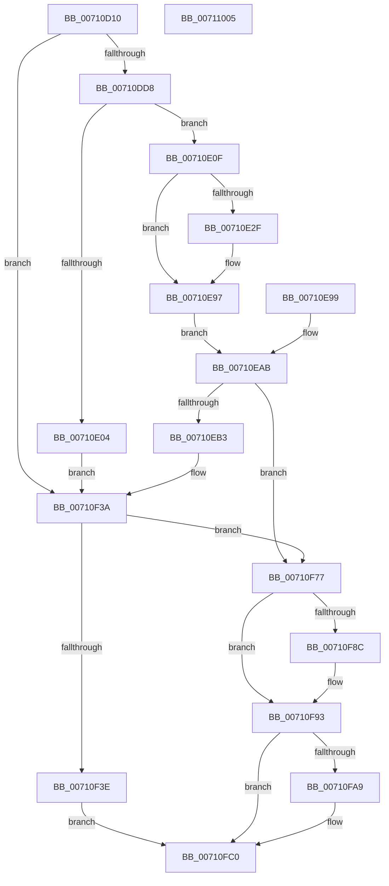

# DbgkUserReportWorkRoutine

- RVA: `0x00710D10`–`0x00711006` (길이 `758` bytes)
- VA: `0x0000000140710D10`
- 실행 섹션: `PAGE`
- PDB 이름 있음: `예`; PDB Function 태그: `아니요`
- unwind 정보 RVA: `0x000C5968`
- 디코드: `159`개 명령, `758/758` bytes 표시
- 미해석 바이트: `0` (있으면 어셈블리에 `.byte`로 보존)

> 이 문서는 커널 이미지의 기계어와 PDB 기호를 분석해 생성했습니다. 4번과 5번은 함수 원형과 자료형을 바이너리 사용 방식에서 추정한 C 해석이며 원본 소스 복구 결과는 아닙니다.

## 1. Dependencies

- 직접 호출 지점: **15**; 고유 호출 대상: **15**
- 직접 호출자로 확인된 함수: **0**
- RIP 상대 이미지 참조: **4**

### Outgoing calls
- `0x00710D8B` → [IoThreadToProcess](../../text/44/IoThreadToProcess_function_00448540.md) (function, `0x00448540`)
- `0x00710D9B` → [KeStackAttachProcess](../../text/21/KeStackAttachProcess_function_00216800.md) (function, `0x00216800`)
- `0x00710DC9` → [ObOpenObjectByPointer](../8B/ObOpenObjectByPointer_function_008B7420.md) (function, `0x008B7420`)
- `0x00710DF9` → [ZwAllocateVirtualMemory](../../text/6A/ZwAllocateVirtualMemory_function_006AD3D0.md) (function, `0x006AD3D0`)
- `0x00710F33` → [ZwCreateThreadEx](../../text/6A/ZwCreateThreadEx_function_006AE9F0.md) (function, `0x006AE9F0`)
- `0x00710F54` → [ZwSetInformationThread](../../text/6A/ZwSetInformationThread_function_006AD270.md) (function, `0x006AD270`)
- `0x00710F60` → [ZwResumeThread](../../text/6A/ZwResumeThread_function_006ADB10.md) (function, `0x006ADB10`)
- `0x00710F6A` → [ZwClose](../../text/6A/ZwClose_function_006AD2B0.md) (function, `0x006AD2B0`)
- `0x00710F8E` → [ObCloseHandle](../8A/ObCloseHandle_function_008A1870.md) (function, `0x008A1870`)
- `0x00710F9C` → [PsMultiResumeThread](../../text/20/PsMultiResumeThread_function_002027C4.md) (function, `0x002027C4`)
- `0x00710FBB` → [ZwFreeVirtualMemory](../../text/6A/ZwFreeVirtualMemory_function_006AD490.md) (function, `0x006AD490`)
- `0x00710FCA` → [KiUnstackDetachProcess](../../text/21/KiUnstackDetachProcess_function_00217D30.md) (function, `0x00217D30`)
- `0x00710FD7` → [ExFreePoolWithTag](../../poolcode/B8/ExFreePoolWithTag_function_00B82870.md) (function, `0x00B82870`)
- `0x00710FDF` → [ObfDereferenceObject](../../text/2F/ObfDereferenceObject_function_002F9350.md) (function, `0x002F9350`)
- `0x00710FEF` → [_security_check_cookie](../../text/6A/_security_check_cookie_function_006AC640.md) (function, `0x006AC640`)

### Direct callers
- 이 함수 시작 RVA로 연결되는 직접 call은 확인되지 않았습니다. 간접 호출은 완전히 역산할 수 없습니다.

### Static image references
- `0x00710D1F` → RVA `0x00E0A740` (`.data`; read)
- `0x00710DAF` → RVA `0x00FC6AC8` (`ALMOSTRO`; read)
- `0x00710F11` → RVA `0x00FC74E0` (`ALMOSTRO`; read)
- `0x00710F44` → RVA `0x00026328` (`.rdata`; read)

## 2. Other-region calls and transfers

- 다른 실행 섹션으로 향하는 call: **13**
  - `0x00710D8B` → [IoThreadToProcess](../../text/44/IoThreadToProcess_function_00448540.md) (`PAGE` → `.text`)
  - `0x00710D9B` → [KeStackAttachProcess](../../text/21/KeStackAttachProcess_function_00216800.md) (`PAGE` → `.text`)
  - `0x00710DF9` → [ZwAllocateVirtualMemory](../../text/6A/ZwAllocateVirtualMemory_function_006AD3D0.md) (`PAGE` → `.text`)
  - `0x00710F33` → [ZwCreateThreadEx](../../text/6A/ZwCreateThreadEx_function_006AE9F0.md) (`PAGE` → `.text`)
  - `0x00710F54` → [ZwSetInformationThread](../../text/6A/ZwSetInformationThread_function_006AD270.md) (`PAGE` → `.text`)
  - `0x00710F60` → [ZwResumeThread](../../text/6A/ZwResumeThread_function_006ADB10.md) (`PAGE` → `.text`)
  - `0x00710F6A` → [ZwClose](../../text/6A/ZwClose_function_006AD2B0.md) (`PAGE` → `.text`)
  - `0x00710F9C` → [PsMultiResumeThread](../../text/20/PsMultiResumeThread_function_002027C4.md) (`PAGE` → `.text`)
  - `0x00710FBB` → [ZwFreeVirtualMemory](../../text/6A/ZwFreeVirtualMemory_function_006AD490.md) (`PAGE` → `.text`)
  - `0x00710FCA` → [KiUnstackDetachProcess](../../text/21/KiUnstackDetachProcess_function_00217D30.md) (`PAGE` → `.text`)
  - `0x00710FD7` → [ExFreePoolWithTag](../../poolcode/B8/ExFreePoolWithTag_function_00B82870.md) (`PAGE` → `POOLCODE`)
  - `0x00710FDF` → [ObfDereferenceObject](../../text/2F/ObfDereferenceObject_function_002F9350.md) (`PAGE` → `.text`)
  - `0x00710FEF` → [_security_check_cookie](../../text/6A/_security_check_cookie_function_006AC640.md) (`PAGE` → `.text`)
- 별도 외부 분기/꼬리 이동을 확인하지 못했습니다.

## 3. Assembly (complete function range)

```asm
00710D10  4C 8B DC                        mov r11, rsp
00710D13  49 89 73 10                     mov qword ptr [r11 + 0x10], rsi
00710D17  57                              push rdi
00710D18  48 81 EC 00 01 00 00            sub rsp, 0x100
00710D1F  48 8B 05 1A 9A 6F 00            mov rax, qword ptr [rip + 0x6f9a1a]
00710D26  48 33 C4                        xor rax, rsp
00710D29  48 89 84 24 F0 00 00 00         mov qword ptr [rsp + 0xf0], rax
00710D31  48 8B F1                        mov rsi, rcx
00710D34  48 89 8C 24 88 00 00 00         mov qword ptr [rsp + 0x88], rcx
00710D3C  48 83 64 24 70 00               and qword ptr [rsp + 0x70], 0
00710D42  48 83 64 24 68 00               and qword ptr [rsp + 0x68], 0
00710D48  48 83 64 24 60 00               and qword ptr [rsp + 0x60], 0
00710D4E  48 C7 44 24 78 A8 00 00 00      mov qword ptr [rsp + 0x78], 0xa8
00710D57  0F 57 C0                        xorps xmm0, xmm0
00710D5A  41 0F 11 43 B8                  movups xmmword ptr [r11 - 0x48], xmm0
00710D5F  41 0F 11 43 C8                  movups xmmword ptr [r11 - 0x38], xmm0
00710D64  41 0F 11 43 D8                  movups xmmword ptr [r11 - 0x28], xmm0
00710D69  33 C0                           xor eax, eax
00710D6B  41 0F 11 43 88                  movups xmmword ptr [r11 - 0x78], xmm0
00710D70  41 0F 11 43 98                  movups xmmword ptr [r11 - 0x68], xmm0
00710D75  49 89 43 A8                     mov qword ptr [r11 - 0x58], rax
00710D79  41 89 43 B0                     mov dword ptr [r11 - 0x50], eax
00710D7D  48 8B 39                        mov rdi, qword ptr [rcx]
00710D80  48 89 BC 24 80 00 00 00         mov qword ptr [rsp + 0x80], rdi
00710D88  48 8B CF                        mov rcx, rdi
00710D8B  E8 B0 77 D3 FF                  call 0x140448540
00710D90  48 8D 94 24 C0 00 00 00         lea rdx, [rsp + 0xc0]
00710D98  48 8B C8                        mov rcx, rax
00710D9B  E8 60 5A B0 FF                  call 0x140216800
00710DA0  48 8D 44 24 70                  lea rax, [rsp + 0x70]
00710DA5  48 89 44 24 30                  mov qword ptr [rsp + 0x30], rax
00710DAA  C6 44 24 28 01                  mov byte ptr [rsp + 0x28], 1
00710DAF  48 8B 05 12 5D 8B 00            mov rax, qword ptr [rip + 0x8b5d12]
00710DB6  48 89 44 24 20                  mov qword ptr [rsp + 0x20], rax
00710DBB  41 B9 72 00 00 00               mov r9d, 0x72
00710DC1  45 33 C0                        xor r8d, r8d
00710DC4  33 D2                           xor edx, edx
00710DC6  48 8B CF                        mov rcx, rdi
00710DC9  E8 52 66 1A 00                  call 0x1408b7420
00710DCE  8B D0                           mov edx, eax
00710DD0  85 C0                           test eax, eax
00710DD2  0F 88 62 01 00 00               js 0x140710f3a
00710DD8  C7 44 24 28 04 00 00 00         mov dword ptr [rsp + 0x28], 4
00710DE0  C7 44 24 20 00 30 00 00         mov dword ptr [rsp + 0x20], 0x3000
00710DE8  4C 8D 4C 24 78                  lea r9, [rsp + 0x78]
00710DED  45 33 C0                        xor r8d, r8d
00710DF0  48 8D 54 24 60                  lea rdx, [rsp + 0x60]
00710DF5  48 83 C9 FF                     or rcx, 0xffffffffffffffff
00710DF9  E8 D2 C5 F9 FF                  call 0x1406ad3d0
00710DFE  8B D0                           mov edx, eax
00710E00  85 C0                           test eax, eax
00710E02  79 0B                           jns 0x140710e0f
00710E04  48 83 64 24 60 00               and qword ptr [rsp + 0x60], 0
00710E0A  E9 2B 01 00 00                  jmp 0x140710f3a
00710E0F  48 8B 4E 08                     mov rcx, qword ptr [rsi + 8]
00710E13  48 8B 44 24 60                  mov rax, qword ptr [rsp + 0x60]
00710E18  48 89 48 08                     mov qword ptr [rax + 8], rcx
00710E1C  48 8B 4C 24 70                  mov rcx, qword ptr [rsp + 0x70]
00710E21  48 8B 44 24 60                  mov rax, qword ptr [rsp + 0x60]
00710E26  48 89 08                        mov qword ptr [rax], rcx
00710E29  80 7E 10 00                     cmp byte ptr [rsi + 0x10], 0
00710E2D  74 68                           je 0x140710e97
00710E2F  48 8B 4C 24 60                  mov rcx, qword ptr [rsp + 0x60]
00710E34  48 8D 49 10                     lea rcx, [rcx + 0x10]
00710E38  0F 10 46 18                     movups xmm0, xmmword ptr [rsi + 0x18]
00710E3C  0F 11 01                        movups xmmword ptr [rcx], xmm0
00710E3F  0F 10 4E 28                     movups xmm1, xmmword ptr [rsi + 0x28]
00710E43  0F 11 49 10                     movups xmmword ptr [rcx + 0x10], xmm1
00710E47  0F 10 46 38                     movups xmm0, xmmword ptr [rsi + 0x38]
00710E4B  0F 11 41 20                     movups xmmword ptr [rcx + 0x20], xmm0
00710E4F  0F 10 4E 48                     movups xmm1, xmmword ptr [rsi + 0x48]
00710E53  0F 11 49 30                     movups xmmword ptr [rcx + 0x30], xmm1
00710E57  0F 10 46 58                     movups xmm0, xmmword ptr [rsi + 0x58]
00710E5B  0F 11 41 40                     movups xmmword ptr [rcx + 0x40], xmm0
00710E5F  0F 10 4E 68                     movups xmm1, xmmword ptr [rsi + 0x68]
00710E63  0F 11 49 50                     movups xmmword ptr [rcx + 0x50], xmm1
00710E67  0F 10 46 78                     movups xmm0, xmmword ptr [rsi + 0x78]
00710E6B  0F 11 41 60                     movups xmmword ptr [rcx + 0x60], xmm0
00710E6F  41 B8 80 00 00 00               mov r8d, 0x80
00710E75  0F 10 86 88 00 00 00            movups xmm0, xmmword ptr [rsi + 0x88]
00710E7C  42 0F 11 44 01 F0               movups xmmword ptr [rcx + r8 - 0x10], xmm0
00710E82  42 0F 10 4C 06 18               movups xmm1, xmmword ptr [rsi + r8 + 0x18]
00710E88  42 0F 11 0C 01                  movups xmmword ptr [rcx + r8], xmm1
00710E8D  4A 8B 44 06 28                  mov rax, qword ptr [rsi + r8 + 0x28]
00710E92  4A 89 44 01 10                  mov qword ptr [rcx + r8 + 0x10], rax
00710E97  EB 12                           jmp 0x140710eab
00710E99  8B D0                           mov edx, eax
00710E9B  48 8B BC 24 80 00 00 00         mov rdi, qword ptr [rsp + 0x80]
00710EA3  48 8B B4 24 88 00 00 00         mov rsi, qword ptr [rsp + 0x88]
00710EAB  85 D2                           test edx, edx
00710EAD  0F 88 C4 00 00 00               js 0x140710f77
00710EB3  C7 84 24 90 00 00 00 30 00 00 00  mov dword ptr [rsp + 0x90], 0x30
00710EBE  48 83 A4 24 98 00 00 00 00      and qword ptr [rsp + 0x98], 0
00710EC7  C7 84 24 A8 00 00 00 00 02 00 00  mov dword ptr [rsp + 0xa8], 0x200
00710ED2  48 83 A4 24 A0 00 00 00 00      and qword ptr [rsp + 0xa0], 0
00710EDB  0F 57 C0                        xorps xmm0, xmm0
00710EDE  F3 0F 7F 84 24 B0 00 00 00      movdqu xmmword ptr [rsp + 0xb0], xmm0
00710EE7  48 83 64 24 50 00               and qword ptr [rsp + 0x50], 0
00710EED  48 83 64 24 48 00               and qword ptr [rsp + 0x48], 0
00710EF3  48 83 64 24 40 00               and qword ptr [rsp + 0x40], 0
00710EF9  48 83 64 24 38 00               and qword ptr [rsp + 0x38], 0
00710EFF  C7 44 24 30 27 00 00 00         mov dword ptr [rsp + 0x30], 0x27
00710F07  48 8B 44 24 60                  mov rax, qword ptr [rsp + 0x60]
00710F0C  48 89 44 24 28                  mov qword ptr [rsp + 0x28], rax
00710F11  48 8B 05 C8 65 8B 00            mov rax, qword ptr [rip + 0x8b65c8]
00710F18  48 89 44 24 20                  mov qword ptr [rsp + 0x20], rax
00710F1D  49 83 C9 FF                     or r9, 0xffffffffffffffff
00710F21  4C 8D 84 24 90 00 00 00         lea r8, [rsp + 0x90]
00710F29  BA FF FF 1F 00                  mov edx, 0x1fffff
00710F2E  48 8D 4C 24 68                  lea rcx, [rsp + 0x68]
00710F33  E8 B8 DA F9 FF                  call 0x1406ae9f0
00710F38  8B D0                           mov edx, eax
00710F3A  85 D2                           test edx, edx
00710F3C  78 39                           js 0x140710f77
00710F3E  41 B9 04 00 00 00               mov r9d, 4
00710F44  4C 8D 05 DD 53 91 FF            lea r8, [rip - 0x6eac23]
00710F4B  41 8D 51 2A                     lea edx, [r9 + 0x2a]
00710F4F  48 8B 4C 24 68                  mov rcx, qword ptr [rsp + 0x68]
00710F54  E8 17 C3 F9 FF                  call 0x1406ad270
00710F59  33 D2                           xor edx, edx
00710F5B  48 8B 4C 24 68                  mov rcx, qword ptr [rsp + 0x68]
00710F60  E8 AB CB F9 FF                  call 0x1406adb10
00710F65  48 8B 4C 24 68                  mov rcx, qword ptr [rsp + 0x68]
00710F6A  E8 41 C3 F9 FF                  call 0x1406ad2b0
00710F6F  48 83 64 24 68 00               and qword ptr [rsp + 0x68], 0
00710F75  EB 49                           jmp 0x140710fc0
00710F77  F0 81 A7 A0 05 00 00 FF FF DF FF  lock and dword ptr [rdi + 0x5a0], 0xffdfffff
00710F82  48 8B 4C 24 70                  mov rcx, qword ptr [rsp + 0x70]
00710F87  48 85 C9                        test rcx, rcx
00710F8A  74 07                           je 0x140710f93
00710F8C  B2 01                           mov dl, 1
00710F8E  E8 DD 08 19 00                  call 0x1408a1870
00710F93  33 D2                           xor edx, edx
00710F95  44 8D 42 01                     lea r8d, [rdx + 1]
00710F99  48 8B CF                        mov rcx, rdi
00710F9C  E8 23 18 AF FF                  call 0x1402027c4
00710FA1  48 83 7C 24 60 00               cmp qword ptr [rsp + 0x60], 0
00710FA7  74 17                           je 0x140710fc0
00710FA9  41 B9 00 80 00 00               mov r9d, 0x8000
00710FAF  45 33 C0                        xor r8d, r8d
00710FB2  48 8D 54 24 60                  lea rdx, [rsp + 0x60]
00710FB7  48 83 C9 FF                     or rcx, 0xffffffffffffffff
00710FBB  E8 D0 C4 F9 FF                  call 0x1406ad490
00710FC0  33 D2                           xor edx, edx
00710FC2  48 8D 8C 24 C0 00 00 00         lea rcx, [rsp + 0xc0]
00710FCA  E8 61 6D B0 FF                  call 0x140217d30
00710FCF  BA 44 42 47 4B                  mov edx, 0x4b474244
00710FD4  48 8B CE                        mov rcx, rsi
00710FD7  E8 94 18 47 00                  call 0x140b82870
00710FDC  48 8B CF                        mov rcx, rdi
00710FDF  E8 6C 83 BE FF                  call 0x1402f9350
00710FE4  48 8B 8C 24 F0 00 00 00         mov rcx, qword ptr [rsp + 0xf0]
00710FEC  48 33 CC                        xor rcx, rsp
00710FEF  E8 4C B6 F9 FF                  call 0x1406ac640
00710FF4  48 8B B4 24 18 01 00 00         mov rsi, qword ptr [rsp + 0x118]
00710FFC  48 81 C4 00 01 00 00            add rsp, 0x100
00711003  5F                              pop rdi
00711004  C3                              ret
00711005  CC                              int3
```

## 4. C-style interpretation (structured pseudocode)

```c
__int64 __fastcall DbgkUserReportWorkRoutine(__int64 a1, __int64 a2, int a3)
{
    __int64 result;
    __int64 v_rsp;
    unsigned __int64 v_stack_m18;
    unsigned __int64 v_stack_m48;
    unsigned __int64 v_stack_m58;
    unsigned int v_stack_m60;
    unsigned __int64 v_stack_m68;
    unsigned __int64 v_stack_m70;
    unsigned int v_stack_m78;
    unsigned __int64 v_stack_m80;
    unsigned __int64 v_stack_m88;
    unsigned __int64 v_stack_m90;
    unsigned __int64 v_stack_m98;
    unsigned __int64 v_stack_mA0;
    unsigned __int64 v_stack_mA8;
    unsigned __int64 v_stack_mB8;
    unsigned __int64 v_stack_mC0;
    unsigned __int64 v_stack_mC8;
    unsigned __int64 v_stack_mD0;
    unsigned __int64 v_stack_mD8;
    unsigned __int8 v_stack_mE0;
    unsigned __int64 v_stack_mE8;
    unsigned __int64 v_stack_p10;

    *(unsigned __int64 *)(v_rsp + 16) = v_rsi;
    v_rsp = (v_rsp) - (256);
    result = (*(unsigned __int64 *)(v_rip + 7313946)) ^ (v_rsp);
    v_stack_m18 = result;
    v_stack_m80 = a1;
    v_stack_m90 = 168;
    *(unsigned __int64 *)(v_rsp - 72) = v_xmm0;
    *(unsigned __int64 *)(v_rsp - 56) = v_xmm0;
    *(unsigned __int64 *)(v_rsp - 40) = v_xmm0;
    result = 0;
    *(unsigned __int64 *)(v_rsp - 120) = v_xmm0;
    *(unsigned __int64 *)(v_rsp - 104) = v_xmm0;
    *(unsigned __int64 *)(v_rsp - 88) = 0;
    *(unsigned int *)(v_rsp - 80) = 0;
    v_stack_m88 = *(unsigned __int64 *)(a1);
    result = IoThreadToProcess(*(unsigned __int64 *)(a1), a2, a3, a4);
    result = KeStackAttachProcess(result, v_stack_m48, a3, a4);
    v_stack_mD8 = v_stack_m98;
    v_stack_mE0 = 1;
    v_stack_mE8 = *(unsigned __int64 *)(v_rip + 9133330);
    a3 = 0;
    a2 = 0;
    result = ObOpenObjectByPointer(*(unsigned __int64 *)(a1), a2, a3, 114);
    if (sign_flag) goto loc_00710F3A;
    v_stack_mE0 = 4;
    v_stack_mE8 = 0x3000ULL;
    a3 = 0;
    a1 = (*(unsigned __int64 *)(a1)) | (-1);
    result = ZwAllocateVirtualMemory(a1, v_stack_mA8, a3, v_stack_m90);
    if (!sign_flag) goto loc_00710E0F;
    goto loc_00710F3A;
loc_00710E0F:
    *(unsigned __int64 *)(v_stack_mA8 + 8) = *(unsigned __int64 *)(a1 + 8);
    *(unsigned __int64 *)(v_stack_mA8) = v_stack_m98;
    result = v_stack_mA8;
    if ((*(unsigned __int8 *)(a1 + 16)) != 0) {
        a1 = v_stack_mA8;
        a1 = a1 + 16;
        *(unsigned __int64 *)(a1) = v_xmm0;
        *(unsigned __int64 *)(a1 + 16) = v_xmm1;
        *(unsigned __int64 *)(a1 + 32) = v_xmm0;
        *(unsigned __int64 *)(a1 + 48) = v_xmm1;
        *(unsigned __int64 *)(a1 + 64) = v_xmm0;
        *(unsigned __int64 *)(a1 + 80) = v_xmm1;
        *(unsigned __int64 *)(a1 + 96) = v_xmm0;
        a3 = 128;
        *(unsigned __int64 *)(a1 + a3 * 1 - 16) = v_xmm0;
        *(unsigned __int64 *)(a1 + a3 * 1) = v_xmm1;
        result = *(unsigned __int64 *)(a1 + a3 * 1 + 40);
        *(unsigned __int64 *)(a1 + a3 * 1 + 16) = result;
    }
    goto loc_00710EAB;
loc_00710EAB:
    if (sign_flag) goto loc_00710F77;
    v_stack_m78 = 48;
    v_stack_m60 = 512;
    v_stack_m58 = v_xmm0;
    v_stack_mD8 = 39;
    v_stack_mE0 = v_stack_mA8;
    v_stack_mE8 = *(unsigned __int64 *)(v_rip + 9135560);
    a4 = (v_stack_m90) | (-1);
    result = ZwCreateThreadEx(v_stack_mA0, (unsigned int)(0x1FFFFFULL), v_stack_m78, a4);
loc_00710F3A:
    if (sign_flag) goto loc_00710F77;
    result = ZwSetInformationThread(v_stack_mA0, 4 + 42, v_rip - 7253027, 4);
    a2 = 0;
    result = ZwResumeThread(v_stack_mA0, a2, v_rip - 7253027, 4);
    result = ZwClose(v_stack_mA0, a2, v_rip - 7253027, 4);
    goto loc_00710FC0;
loc_00710F77:
    if (v_stack_m98 != 0) {
        a2 = 1;
        result = ObCloseHandle(v_stack_m98, a2, v_rip - 7253027, 4);
    }
    a2 = 0;
    result = PsMultiResumeThread(*(unsigned __int64 *)(a1), a2, a2 + 1, 4);
    if (v_stack_mA8 != 0) {
        a4 = 0x8000ULL;
        a3 = 0;
        a2 = v_stack_mA8;
        a1 = (*(unsigned __int64 *)(a1)) | (-1);
        result = ZwFreeVirtualMemory(a1, a2, a3, a4);
    }
    a2 = 0;
    result = KiUnstackDetachProcess(v_stack_m48, a2, a3, a4);
    result = ExFreePoolWithTag(a1, (unsigned int)(0x4B474244ULL), a3, a4);
    result = ObfDereferenceObject(*(unsigned __int64 *)(a1), (unsigned int)(0x4B474244ULL), a3, a4);
    a1 = (v_stack_m18) ^ (v_rsp);
    result = _security_check_cookie(a1, (unsigned int)(0x4B474244ULL), a3, a4);
    v_rsp = (v_rsp) + (256);
    return result;
}
```

## 5. (Beta) C Style

```c
int64_t DbgkUserReportWorkRoutine(void *Arg1, int64_t Arg2, int32_t Arg3)
{
    uint8_t *arg1 = (uint8_t *)Arg1;

    int64_t result;
    int64_t local_rsp;
    uint64_t v_stack_m18;
    uint64_t v_stack_m48;
    uint64_t v_stack_m58;
    uint32_t v_stack_m60;
    uint64_t v_stack_m68;
    uint64_t v_stack_m70;
    uint32_t v_stack_m78;
    uint64_t v_stack_m80;
    uint64_t v_stack_m88;
    uint64_t v_stack_m90;
    uint64_t v_stack_m98;
    uint64_t v_stack_mA0;
    uint64_t v_stack_mA8;
    uint64_t v_stack_mB8;
    uint64_t v_stack_mC0;
    uint64_t v_stack_mC8;
    uint64_t v_stack_mD0;
    uint64_t v_stack_mD8;
    uint8_t v_stack_mE0;
    uint64_t v_stack_mE8;
    uint64_t v_stack_p10;

    *(uint64_t *)(local_rsp + 0x10) = local_rsi;
    local_rsp = (local_rsp) - (256);
    result = (*(uint64_t *)(v_rip + 0x6F9A1A)) ^ (local_rsp);
    v_stack_m18 = result;
    v_stack_m80 = Arg1;
    v_stack_m90 = 168;
    *(uint64_t *)(local_rsp - 0x48) = v_xmm0;
    *(uint64_t *)(local_rsp - 0x38) = v_xmm0;
    *(uint64_t *)(local_rsp - 0x28) = v_xmm0;
    result = 0;
    *(uint64_t *)(local_rsp - 0x78) = v_xmm0;
    *(uint64_t *)(local_rsp - 0x68) = v_xmm0;
    *(uint64_t *)(local_rsp - 0x58) = 0;
    *(uint32_t *)(local_rsp - 0x50) = 0;
    v_stack_m88 = *(uint64_t *)(arg1);
    result = IoThreadToProcess(*(uint64_t *)(arg1), Arg2, Arg3, a4);
    result = KeStackAttachProcess(result, v_stack_m48, Arg3, a4);
    v_stack_mD8 = v_stack_m98;
    v_stack_mE0 = 1;
    v_stack_mE8 = *(uint64_t *)(v_rip + 0x8B5D12);
    Arg3 = 0;
    Arg2 = 0;
    result = ObOpenObjectByPointer(*(uint64_t *)(arg1), Arg2, Arg3, 114);
    if (sign_flag) goto loc_00710F3A;
    v_stack_mE0 = 4;
    v_stack_mE8 = 0x3000ULL;
    Arg3 = 0;
    Arg1 = (*(uint64_t *)(arg1)) | (-1);
    result = ZwAllocateVirtualMemory(Arg1, v_stack_mA8, Arg3, v_stack_m90);
    if (!sign_flag) goto loc_00710E0F;
    goto loc_00710F3A;
loc_00710E0F:
    *(uint64_t *)(v_stack_mA8 + 0x8) = *(uint64_t *)(arg1 + 0x8);
    *(uint64_t *)(v_stack_mA8) = v_stack_m98;
    result = v_stack_mA8;
    if ((*(uint8_t *)(arg1 + 0x10)) != 0) {
        Arg1 = v_stack_mA8;
        Arg1 = Arg1 + 16;
        *(uint64_t *)(arg1) = v_xmm0;
        *(uint64_t *)(arg1 + 0x10) = v_xmm1;
        *(uint64_t *)(arg1 + 0x20) = v_xmm0;
        *(uint64_t *)(arg1 + 0x30) = v_xmm1;
        *(uint64_t *)(arg1 + 0x40) = v_xmm0;
        *(uint64_t *)(arg1 + 0x50) = v_xmm1;
        *(uint64_t *)(arg1 + 0x60) = v_xmm0;
        Arg3 = 128;
        *(uint64_t *)(arg1 + Arg3 * 1 - 0x10) = v_xmm0;
        *(uint64_t *)(arg1 + Arg3 * 1) = v_xmm1;
        result = *(uint64_t *)(arg1 + Arg3 * 1 + 0x28);
        *(uint64_t *)(arg1 + Arg3 * 1 + 0x10) = result;
    }
    goto loc_00710EAB;
loc_00710EAB:
    if (sign_flag) goto loc_00710F77;
    v_stack_m78 = 48;
    v_stack_m60 = 512;
    v_stack_m58 = v_xmm0;
    v_stack_mD8 = 39;
    v_stack_mE0 = v_stack_mA8;
    v_stack_mE8 = *(uint64_t *)(v_rip + 0x8B65C8);
    a4 = (v_stack_m90) | (-1);
    result = ZwCreateThreadEx(v_stack_mA0, (uint32_t)(0x1FFFFFULL), v_stack_m78, a4);
loc_00710F3A:
    if (sign_flag) goto loc_00710F77;
    result = ZwSetInformationThread(v_stack_mA0, 4 + 42, v_rip - 7253027, 4);
    Arg2 = 0;
    result = ZwResumeThread(v_stack_mA0, Arg2, v_rip - 7253027, 4);
    result = ZwClose(v_stack_mA0, Arg2, v_rip - 7253027, 4);
    goto loc_00710FC0;
loc_00710F77:
    if (v_stack_m98 != 0) {
        Arg2 = 1;
        result = ObCloseHandle(v_stack_m98, Arg2, v_rip - 7253027, 4);
    }
    Arg2 = 0;
    result = PsMultiResumeThread(*(uint64_t *)(arg1), Arg2, Arg2 + 1, 4);
    if (v_stack_mA8 != 0) {
        a4 = 0x8000ULL;
        Arg3 = 0;
        Arg2 = v_stack_mA8;
        Arg1 = (*(uint64_t *)(arg1)) | (-1);
        result = ZwFreeVirtualMemory(Arg1, Arg2, Arg3, a4);
    }
    Arg2 = 0;
    result = KiUnstackDetachProcess(v_stack_m48, Arg2, Arg3, a4);
    result = ExFreePoolWithTag(Arg1, (uint32_t)(0x4B474244ULL), Arg3, a4);
    result = ObfDereferenceObject(*(uint64_t *)(arg1), (uint32_t)(0x4B474244ULL), Arg3, a4);
    Arg1 = (v_stack_m18) ^ (local_rsp);
    result = _security_check_cookie(Arg1, (uint32_t)(0x4B474244ULL), Arg3, a4);
    local_rsp = (local_rsp) + (256);
    return result;
}
```

### 관측된 메모리 오프셋

구조체 형식이 확인되지 않은 접근은 인자 기준의 오프셋으로만 기록했습니다.

| 기준 인자 | 오프셋 표현 | 폭 (bit) | 접근 |
|---|---:|---:|---|
| `Arg1` | `+ 0x0` | `64` | `R` |
| `Arg1` | `+ 0x8` | `64` | `R` |
| `Arg1` | `+ 0x10` | `8` | `R` |
| `Arg1` | `+ 0x18` | `128` | `R` |
| `Arg1` | `+ 0x18 + r8*1` | `128` | `R` |
| `Arg1` | `+ 0x28` | `128` | `R` |
| `Arg1` | `+ 0x28 + r8*1` | `64` | `R` |
| `Arg1` | `+ 0x38` | `128` | `R` |
| `Arg1` | `+ 0x48` | `128` | `R` |
| `Arg1` | `+ 0x58` | `128` | `R` |
| `Arg1` | `+ 0x68` | `128` | `R` |
| `Arg1` | `+ 0x78` | `128` | `R` |
| `Arg1` | `+ 0x88` | `128` | `R` |

## 6. Execution-region graph

[열기: 2D/3D 그래프와 함수 탐색 컨트롤 패널](../../../control-panel.html?section=page&rva=0x00710D10&view=graph)

- 2D 그래프는 위에서 아래로 흐르고, 3D 그래프는 빈 공간을 드래그해 회전합니다. Shift+드래그는 이동, 휠은 확대·축소, 함수 노드 선택은 대상 보고서 이동입니다.

### Static fallback


