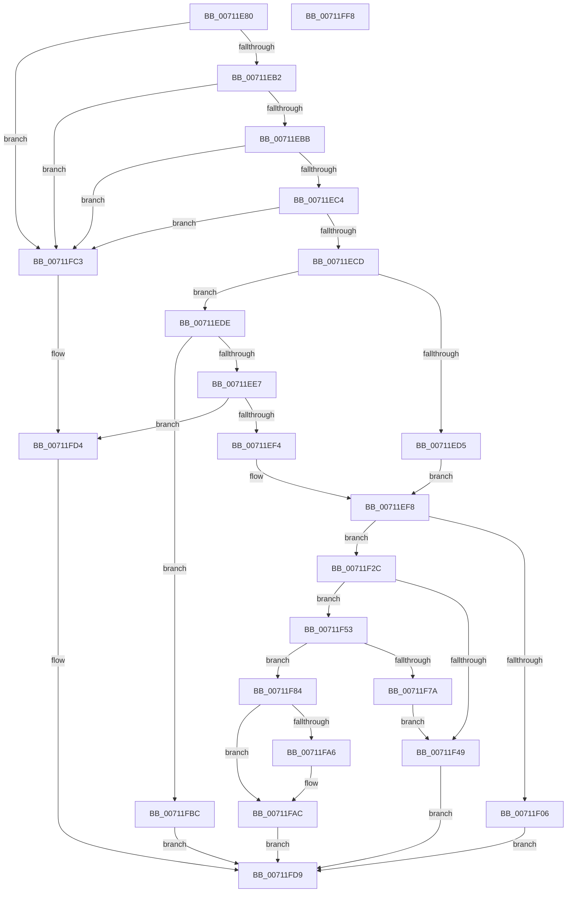

# DbgkWerAddSecondaryData

- RVA: `0x00711E80`–`0x00711FF9` (길이 `377` bytes)
- VA: `0x0000000140711E80`
- 실행 섹션: `PAGE`
- PDB 이름 있음: `예`; PDB Function 태그: `아니요`
- unwind 정보 RVA: `0x000ACFA4`
- 디코드: `100`개 명령, `377/377` bytes 표시
- 미해석 바이트: `0` (있으면 어셈블리에 `.byte`로 보존)

> 이 문서는 커널 이미지의 기계어와 PDB 기호를 분석해 생성했습니다. 4번과 5번은 함수 원형과 자료형을 바이너리 사용 방식에서 추정한 C 해석이며 원본 소스 복구 결과는 아닙니다.

## 1. Dependencies

- 직접 호출 지점: **6**; 고유 호출 대상: **4**
- 직접 호출자로 확인된 함수: **0**
- RIP 상대 이미지 참조: **2**

### Outgoing calls
- `0x00711F1D` → [DbgPrintEx](../../text/35/DbgPrintEx_function_00359290.md) (function, `0x00359290`)
- `0x00711F3C` → [ExAllocatePool2](../../poolcode/B8/ExAllocatePool2_function_00B820F0.md) (function, `0x00B820F0`)
- `0x00711F6C` → [ExAllocatePool2](../../poolcode/B8/ExAllocatePool2_function_00B820F0.md) (function, `0x00B820F0`)
- `0x00711F7D` → [DbgkpWerFreePool](DbgkpWerFreePool_function_00712450.md) (function, `0x00712450`)
- `0x00711F8D` → [memcpy](../../text/6C/memcpy_function_006C6840.md) (function, `0x006C6840`)
- `0x00711FCF` → [DbgPrintEx](../../text/35/DbgPrintEx_function_00359290.md) (function, `0x00359290`)

### Direct callers
- 이 함수 시작 RVA로 연결되는 직접 call은 확인되지 않았습니다. 간접 호출은 완전히 역산할 수 없습니다.

### Static image references
- `0x00711F0A` → RVA `0x00AFBB10` (` ?? ::NNGAKEGL::`string'`; read)
- `0x00711FC5` → RVA `0x00AFBAD0` (` ?? ::NNGAKEGL::`string'`; read)

## 2. Other-region calls and transfers

- 다른 실행 섹션으로 향하는 call: **5**
  - `0x00711F1D` → [DbgPrintEx](../../text/35/DbgPrintEx_function_00359290.md) (`PAGE` → `.text`)
  - `0x00711F3C` → [ExAllocatePool2](../../poolcode/B8/ExAllocatePool2_function_00B820F0.md) (`PAGE` → `POOLCODE`)
  - `0x00711F6C` → [ExAllocatePool2](../../poolcode/B8/ExAllocatePool2_function_00B820F0.md) (`PAGE` → `POOLCODE`)
  - `0x00711F8D` → [memcpy](../../text/6C/memcpy_function_006C6840.md) (`PAGE` → `.text`)
  - `0x00711FCF` → [DbgPrintEx](../../text/35/DbgPrintEx_function_00359290.md) (`PAGE` → `.text`)
- 별도 외부 분기/꼬리 이동을 확인하지 못했습니다.

## 3. Assembly (complete function range)

```asm
00711E80  48 8B C4                        mov rax, rsp
00711E83  48 89 58 08                     mov qword ptr [rax + 8], rbx
00711E87  48 89 68 10                     mov qword ptr [rax + 0x10], rbp
00711E8B  48 89 70 18                     mov qword ptr [rax + 0x18], rsi
00711E8F  48 89 78 20                     mov qword ptr [rax + 0x20], rdi
00711E93  41 55                           push r13
00711E95  41 56                           push r14
00711E97  41 57                           push r15
00711E99  48 83 EC 30                     sub rsp, 0x30
00711E9D  41 8B F1                        mov esi, r9d
00711EA0  4D 8B F0                        mov r14, r8
00711EA3  4C 8B FA                        mov r15, rdx
00711EA6  48 8B D9                        mov rbx, rcx
00711EA9  48 85 C9                        test rcx, rcx
00711EAC  0F 84 11 01 00 00               je 0x140711fc3
00711EB2  4D 85 C0                        test r8, r8
00711EB5  0F 84 08 01 00 00               je 0x140711fc3
00711EBB  48 85 D2                        test rdx, rdx
00711EBE  0F 84 FF 00 00 00               je 0x140711fc3
00711EC4  45 85 C9                        test r9d, r9d
00711EC7  0F 84 F6 00 00 00               je 0x140711fc3
00711ECD  8B 41 58                        mov eax, dword ptr [rcx + 0x58]
00711ED0  83 F8 01                        cmp eax, 1
00711ED3  75 09                           jne 0x140711ede
00711ED5  48 8D A9 98 00 00 00            lea rbp, [rcx + 0x98]
00711EDC  EB 1A                           jmp 0x140711ef8
00711EDE  83 F8 02                        cmp eax, 2
00711EE1  0F 85 D5 00 00 00               jne 0x140711fbc
00711EE7  48 8B 69 78                     mov rbp, qword ptr [rcx + 0x78]
00711EEB  48 85 ED                        test rbp, rbp
00711EEE  0F 84 E0 00 00 00               je 0x140711fd4
00711EF4  48 83 C5 20                     add rbp, 0x20
00711EF8  8B 49 50                        mov ecx, dword ptr [rcx + 0x50]
00711EFB  8B C1                           mov eax, ecx
00711EFD  8B 53 54                        mov edx, dword ptr [rbx + 0x54]
00711F00  2B C2                           sub eax, edx
00711F02  3B F0                           cmp esi, eax
00711F04  76 26                           jbe 0x140711f2c
00711F06  89 54 24 28                     mov dword ptr [rsp + 0x28], edx
00711F0A  4C 8D 05 FF 9B 3E 00            lea r8, [rip + 0x3e9bff]
00711F11  33 D2                           xor edx, edx
00711F13  89 4C 24 20                     mov dword ptr [rsp + 0x20], ecx
00711F17  44 8B CE                        mov r9d, esi
00711F1A  8D 4A 05                        lea ecx, [rdx + 5]
00711F1D  E8 6E 73 C4 FF                  call 0x140359290
00711F22  B8 9A 00 00 C0                  mov eax, 0xc000009a
00711F27  E9 AD 00 00 00                  jmp 0x140711fd9
00711F2C  BA 28 00 00 00                  mov edx, 0x28
00711F31  B9 00 01 00 00                  mov ecx, 0x100
00711F36  41 B8 44 62 67 57               mov r8d, 0x57676244
00711F3C  E8 AF 01 47 00                  call 0x140b820f0
00711F41  48 8B F8                        mov rdi, rax
00711F44  48 85 C0                        test rax, rax
00711F47  75 0A                           jne 0x140711f53
00711F49  B8 17 00 00 C0                  mov eax, 0xc0000017
00711F4E  E9 86 00 00 00                  jmp 0x140711fd9
00711F53  48 8D 96 FF 0F 00 00            lea rdx, [rsi + 0xfff]
00711F5A  B9 00 01 00 00                  mov ecx, 0x100
00711F5F  48 81 E2 00 F0 FF FF            and rdx, 0xfffffffffffff000
00711F66  41 B8 44 62 67 57               mov r8d, 0x57676244
00711F6C  E8 7F 01 47 00                  call 0x140b820f0
00711F71  48 89 47 10                     mov qword ptr [rdi + 0x10], rax
00711F75  48 85 C0                        test rax, rax
00711F78  75 0A                           jne 0x140711f84
00711F7A  48 8B CF                        mov rcx, rdi
00711F7D  E8 CE 04 00 00                  call 0x140712450
00711F82  EB C5                           jmp 0x140711f49
00711F84  4C 8B C6                        mov r8, rsi
00711F87  49 8B D6                        mov rdx, r14
00711F8A  48 8B C8                        mov rcx, rax
00711F8D  E8 AE 48 FB FF                  call 0x1406c6840
00711F92  41 0F 10 07                     movups xmm0, xmmword ptr [r15]
00711F96  89 77 18                        mov dword ptr [rdi + 0x18], esi
00711F99  F3 0F 7F 07                     movdqu xmmword ptr [rdi], xmm0
00711F9D  01 73 54                        add dword ptr [rbx + 0x54], esi
00711FA0  83 7B 58 01                     cmp dword ptr [rbx + 0x58], 1
00711FA4  75 06                           jne 0x140711fac
00711FA6  FF 83 A8 00 00 00               inc dword ptr [rbx + 0xa8]
00711FAC  48 8B 45 08                     mov rax, qword ptr [rbp + 8]
00711FB0  48 89 47 20                     mov qword ptr [rdi + 0x20], rax
00711FB4  33 C0                           xor eax, eax
00711FB6  48 89 7D 08                     mov qword ptr [rbp + 8], rdi
00711FBA  EB 1D                           jmp 0x140711fd9
00711FBC  B8 BB 00 00 C0                  mov eax, 0xc00000bb
00711FC1  EB 16                           jmp 0x140711fd9
00711FC3  33 D2                           xor edx, edx
00711FC5  4C 8D 05 04 9B 3E 00            lea r8, [rip + 0x3e9b04]
00711FCC  8D 4A 05                        lea ecx, [rdx + 5]
00711FCF  E8 BC 72 C4 FF                  call 0x140359290
00711FD4  B8 0D 00 00 C0                  mov eax, 0xc000000d
00711FD9  48 8B 5C 24 50                  mov rbx, qword ptr [rsp + 0x50]
00711FDE  48 8B 6C 24 58                  mov rbp, qword ptr [rsp + 0x58]
00711FE3  48 8B 74 24 60                  mov rsi, qword ptr [rsp + 0x60]
00711FE8  48 8B 7C 24 68                  mov rdi, qword ptr [rsp + 0x68]
00711FED  48 83 C4 30                     add rsp, 0x30
00711FF1  41 5F                           pop r15
00711FF3  41 5E                           pop r14
00711FF5  41 5D                           pop r13
00711FF7  C3                              ret
00711FF8  CC                              int3
```

## 4. C-style interpretation (structured pseudocode)

```c
__int64 __fastcall DbgkWerAddSecondaryData(__int64 a1, __int64 a2, __int64 a3, int a4)
{
    __int64 result;
    __int64 v_rbp;
    __int64 v_rsp;
    unsigned int v_stack_m20;
    unsigned int v_stack_m28;
    unsigned __int64 v_stack_p10;
    unsigned __int64 v_stack_p18;
    unsigned __int64 v_stack_p20;
    unsigned __int64 v_stack_p8;

    *(unsigned __int64 *)(v_rsp + 8) = v_rbx;
    *(unsigned __int64 *)(v_rsp + 16) = v_rbp;
    *(unsigned __int64 *)(v_rsp + 24) = v_rsi;
    *(unsigned __int64 *)(v_rsp + 32) = v_rdi;
    v_rsp = (v_rsp) - (48);
    if (a1 == 0) goto loc_00711FC3;
    if (a3 == 0) goto loc_00711FC3;
    if (a2 == 0) goto loc_00711FC3;
    if (a4 == 0) goto loc_00711FC3;
    if (((unsigned int)((unsigned int)(*(unsigned int *)(a1 + 88)))) != 1) goto loc_00711EDE;
    goto loc_00711EF8;
loc_00711EDE:
    if (((unsigned int)((unsigned int)(*(unsigned int *)(a1 + 88)))) != 2) goto loc_00711FBC;
    if (*(unsigned __int64 *)(a1 + 120) == 0) goto loc_00711FD4;
    v_rbp = (*(unsigned __int64 *)(a1 + 120)) + (32);
loc_00711EF8:
    result = (unsigned int)(((unsigned int)((unsigned int)((unsigned int)(*(unsigned int *)(a1 + 80))))) - ((unsigned int)((unsigned int)(*(unsigned int *)(a1 + 84)))));
    if (((unsigned int)((unsigned int)(a4))) <= ((unsigned int)(result))) goto loc_00711F2C;
    v_stack_m20 = (unsigned int)((unsigned int)(*(unsigned int *)(a1 + 84)));
    a2 = 0;
    v_stack_m28 = (unsigned int)((unsigned int)(*(unsigned int *)(a1 + 80)));
    result = DbgPrintEx(a2 + 5, a2, v_rip + 4103167, (unsigned int)((unsigned int)((unsigned int)(a4))));
    goto loc_00711FD9;
loc_00711F2C:
    result = ExAllocatePool2(256, 40, (unsigned int)(0x57676244ULL), (unsigned int)((unsigned int)((unsigned int)(a4))));
    if (result != 0) goto loc_00711F53;
loc_00711F49:
    goto loc_00711FD9;
loc_00711F53:
    a2 = ((unsigned int)(a4) + 4095) & (0xFFFFFFFFFFFFF000ULL);
    result = ExAllocatePool2(256, a2, (unsigned int)(0x57676244ULL), (unsigned int)((unsigned int)((unsigned int)(a4))));
    *(unsigned __int64 *)(result + 16) = result;
    if (result != 0) goto loc_00711F84;
    result = DbgkpWerFreePool(result, a2, (unsigned int)(0x57676244ULL), (unsigned int)((unsigned int)((unsigned int)(a4))));
    goto loc_00711F49;
loc_00711F84:
    result = memcpy(result, a3, (unsigned int)(a4), (unsigned int)((unsigned int)((unsigned int)(a4))));
    *(unsigned int *)(result + 24) = (unsigned int)((unsigned int)(a4));
    *(unsigned __int64 *)(result) = v_xmm0;
    if ((*(unsigned int *)(a1 + 88)) == 1) {
    }
    *(unsigned __int64 *)(result + 32) = *(unsigned __int64 *)(v_rbp + 8);
    result = 0;
    *(unsigned __int64 *)(v_rbp + 8) = 0;
    goto loc_00711FD9;
loc_00711FBC:
    goto loc_00711FD9;
loc_00711FC3:
    a2 = 0;
    result = DbgPrintEx(a2 + 5, a2, v_rip + 4102916, (unsigned int)((unsigned int)((unsigned int)(a4))));
loc_00711FD4:
loc_00711FD9:
    v_rsp = (v_rsp) + (48);
    return (unsigned int)(0xC000000DULL);
}
```

## 5. (Beta) C Style

```c
int64_t DbgkWerAddSecondaryData(void *Arg1, void *Arg2, int64_t Arg3, int32_t Arg4)
{
    uint8_t *arg1 = (uint8_t *)Arg1;
    uint8_t *arg2 = (uint8_t *)Arg2;

    int64_t result;
    int64_t local_rbp;
    int64_t local_rsp;
    uint32_t v_stack_m20;
    uint32_t v_stack_m28;
    uint64_t v_stack_p10;
    uint64_t v_stack_p18;
    uint64_t v_stack_p20;
    uint64_t v_stack_p8;

    *(uint64_t *)(local_rsp + 0x8) = local_rbx;
    *(uint64_t *)(local_rsp + 0x10) = local_rbp;
    *(uint64_t *)(local_rsp + 0x18) = local_rsi;
    *(uint64_t *)(local_rsp + 0x20) = local_rdi;
    local_rsp = (local_rsp) - (48);
    if (Arg1 == NULL) goto loc_00711FC3;
    if (Arg3 == 0) goto loc_00711FC3;
    if (Arg2 == NULL) goto loc_00711FC3;
    if (Arg4 == 0) goto loc_00711FC3;
    if (((uint32_t)((uint32_t)(*(uint32_t *)(arg1 + 0x58)))) != 1) goto loc_00711EDE;
    goto loc_00711EF8;
loc_00711EDE:
    if (((uint32_t)((uint32_t)(*(uint32_t *)(arg1 + 0x58)))) != 2) goto loc_00711FBC;
    if (*(uint64_t *)(arg1 + 0x78) == 0) goto loc_00711FD4;
    local_rbp = (*(uint64_t *)(arg1 + 0x78)) + (32);
loc_00711EF8:
    result = (uint32_t)(((uint32_t)((uint32_t)((uint32_t)(*(uint32_t *)(arg1 + 0x50))))) - ((uint32_t)((uint32_t)(*(uint32_t *)(arg1 + 0x54)))));
    if (((uint32_t)((uint32_t)(Arg4))) <= ((uint32_t)(result))) goto loc_00711F2C;
    v_stack_m20 = (uint32_t)((uint32_t)(*(uint32_t *)(arg1 + 0x54)));
    Arg2 = 0;
    v_stack_m28 = (uint32_t)((uint32_t)(*(uint32_t *)(arg1 + 0x50)));
    result = DbgPrintEx(Arg2 + 5, Arg2, v_rip + 4103167, (uint32_t)((uint32_t)((uint32_t)(Arg4))));
    goto loc_00711FD9;
loc_00711F2C:
    result = ExAllocatePool2(256, 40, (uint32_t)(0x57676244ULL), (uint32_t)((uint32_t)((uint32_t)(Arg4))));
    if (result != 0) goto loc_00711F53;
loc_00711F49:
    goto loc_00711FD9;
loc_00711F53:
    Arg2 = ((uint32_t)(Arg4) + 4095) & (0xFFFFFFFFFFFFF000ULL);
    result = ExAllocatePool2(256, Arg2, (uint32_t)(0x57676244ULL), (uint32_t)((uint32_t)((uint32_t)(Arg4))));
    *(uint64_t *)(result + 0x10) = result;
    if (result != 0) goto loc_00711F84;
    result = DbgkpWerFreePool(result, Arg2, (uint32_t)(0x57676244ULL), (uint32_t)((uint32_t)((uint32_t)(Arg4))));
    goto loc_00711F49;
loc_00711F84:
    result = memcpy(result, Arg3, (uint32_t)(Arg4), (uint32_t)((uint32_t)((uint32_t)(Arg4))));
    *(uint32_t *)(result + 0x18) = (uint32_t)((uint32_t)(Arg4));
    *(uint64_t *)(result) = v_xmm0;
    if ((*(uint32_t *)(arg1 + 0x58)) == 1) {
    }
    *(uint64_t *)(result + 0x20) = *(uint64_t *)(local_rbp + 0x8);
    result = 0;
    *(uint64_t *)(local_rbp + 0x8) = 0;
    goto loc_00711FD9;
loc_00711FBC:
    goto loc_00711FD9;
loc_00711FC3:
    Arg2 = 0;
    result = DbgPrintEx(Arg2 + 5, Arg2, v_rip + 4102916, (uint32_t)((uint32_t)((uint32_t)(Arg4))));
loc_00711FD4:
loc_00711FD9:
    local_rsp = (local_rsp) + (48);
    return (uint32_t)(0xC000000DULL);
}
```

### 관측된 메모리 오프셋

구조체 형식이 확인되지 않은 접근은 인자 기준의 오프셋으로만 기록했습니다.

| 기준 인자 | 오프셋 표현 | 폭 (bit) | 접근 |
|---|---:|---:|---|
| `Arg1` | `+ 0x54` | `32` | `R` |
| `Arg1` | `+ 0x54` | `32` | `R/W` |
| `Arg1` | `+ 0x58` | `32` | `R` |
| `Arg1` | `+ 0xA8` | `32` | `R/W` |
| `Arg2` | `+ 0x0` | `128` | `R` |

## 6. Execution-region graph

[열기: 2D/3D 그래프와 함수 탐색 컨트롤 패널](../../../control-panel.html?section=page&rva=0x00711E80&view=graph)

- 2D 그래프는 위에서 아래로 흐르고, 3D 그래프는 빈 공간을 드래그해 회전합니다. Shift+드래그는 이동, 휠은 확대·축소, 함수 노드 선택은 대상 보고서 이동입니다.

### Static fallback


