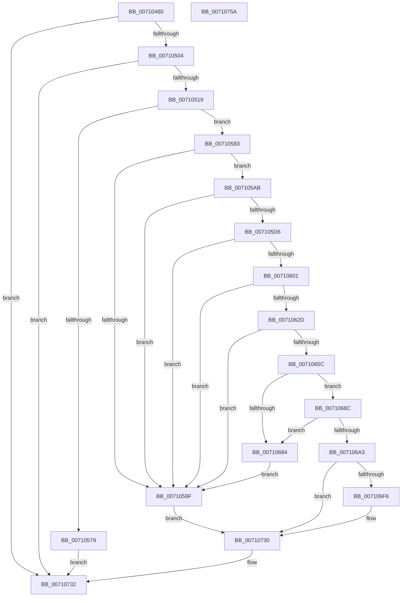

# DbgkpCreateNotificationEvent

- RVA: `0x00710480`–`0x0071075B` (길이 `731` bytes)
- VA: `0x0000000140710480`
- 실행 섹션: `PAGE`
- PDB 이름 있음: `예`; PDB Function 태그: `아니요`
- unwind 정보 RVA: `0x000C5928`
- 디코드: `184`개 명령, `731/731` bytes 표시
- 미해석 바이트: `0` (있으면 어셈블리에 `.byte`로 보존)

> 이 문서는 커널 이미지의 기계어와 PDB 기호를 분석해 생성했습니다. 4번과 5번은 함수 원형과 자료형을 바이너리 사용 방식에서 추정한 C 해석이며 원본 소스 복구 결과는 아닙니다.

## 1. Dependencies

- 직접 호출 지점: **21**; 고유 호출 대상: **12**
- 직접 호출자로 확인된 함수: **1**
- RIP 상대 이미지 참조: **7**

### Outgoing calls
- `0x007104F7` → [RtlDeriveCapabilitySidsFromName](../../text/47/RtlDeriveCapabilitySidsFromName_function_00474DC0.md) (function, `0x00474DC0`)
- `0x0071050C` → [RtlCreateSecurityDescriptor](../9F/RtlCreateSecurityDescriptor_function_009F1DF0.md) (function, `0x009F1DF0`)
- `0x00710520` → [RtlLengthSid](../../text/45/RtlLengthSid_function_0045D270.md) (function, `0x0045D270`)
- `0x0071052E` → [RtlLengthSid](../../text/45/RtlLengthSid_function_0045D270.md) (function, `0x0045D270`)
- `0x0071053C` → [RtlLengthSid](../../text/45/RtlLengthSid_function_0045D270.md) (function, `0x0045D270`)
- `0x0071054A` → [RtlLengthSid](../../text/45/RtlLengthSid_function_0045D270.md) (function, `0x0045D270`)
- `0x00710555` → [RtlLengthSid](../../text/45/RtlLengthSid_function_0045D270.md) (function, `0x0045D270`)
- `0x0071056C` → [ExAllocatePool2](../../poolcode/B8/ExAllocatePool2_function_00B820F0.md) (function, `0x00B820F0`)
- `0x00710591` → [RtlCreateAcl](../91/RtlCreateAcl_function_00916F00.md) (function, `0x00916F00`)
- `0x007105A1` → [ExFreePoolWithTag](../../poolcode/B8/ExFreePoolWithTag_function_00B82870.md) (function, `0x00B82870`)
- `0x007105C8` → [RtlpAddKnownAce](../92/RtlpAddKnownAce_function_00929A20.md) (function, `0x00929A20`)
- `0x007105F3` → [RtlpAddKnownAce](../92/RtlpAddKnownAce_function_00929A20.md) (function, `0x00929A20`)
- `0x0071061B` → [RtlpAddKnownAce](../92/RtlpAddKnownAce_function_00929A20.md) (function, `0x00929A20`)
- `0x0071064A` → [RtlpAddKnownAce](../92/RtlpAddKnownAce_function_00929A20.md) (function, `0x00929A20`)
- `0x00710679` → [RtlpAddKnownAce](../92/RtlpAddKnownAce_function_00929A20.md) (function, `0x00929A20`)
- `0x00710698` → [RtlSetDaclSecurityDescriptor](../9E/RtlSetDaclSecurityDescriptor_function_009EC210.md) (function, `0x009EC210`)
- `0x007106E1` → [ZwCreateEvent](../../text/6A/ZwCreateEvent_function_006AD9D0.md) (function, `0x006AD9D0`)
- `0x007106ED` → [ExFreePoolWithTag](../../poolcode/B8/ExFreePoolWithTag_function_00B82870.md) (function, `0x00B82870`)
- `0x0071071F` → [ObpReferenceObjectByHandleWithTag](../86/ObpReferenceObjectByHandleWithTag_function_00869650.md) (function, `0x00869650`)
- `0x0071072B` → [ZwClose](../../text/6A/ZwClose_function_006AD2B0.md) (function, `0x006AD2B0`)
- `0x00710739` → [_security_check_cookie](../../text/6A/_security_check_cookie_function_006AC640.md) (function, `0x006AC640`)

### Direct callers
- [DbgkpInitializePhase1SiloState](DbgkpInitializePhase1SiloState_function_00710774.md) at `0x00710796`

### Static image references
- `0x0071049E` → RVA `0x00E0A740` (`.data`; read)
- `0x007104C6` → RVA `0x00AFB030` (` ?? ::NNGAKEGL::`string'`; read)
- `0x00710519` → RVA `0x00E67D48` (`.data`; read)
- `0x00710525` → RVA `0x00E67D58` (`.data`; read)
- `0x00710533` → RVA `0x00E67D50` (`.data`; read)
- `0x00710541` → RVA `0x00E67D60` (`.data`; read)
- `0x007106F6` → RVA `0x00FC6B80` (`ALMOSTRO`; read)

## 2. Other-region calls and transfers

- 다른 실행 섹션으로 향하는 call: **12**
  - `0x007104F7` → [RtlDeriveCapabilitySidsFromName](../../text/47/RtlDeriveCapabilitySidsFromName_function_00474DC0.md) (`PAGE` → `.text`)
  - `0x00710520` → [RtlLengthSid](../../text/45/RtlLengthSid_function_0045D270.md) (`PAGE` → `.text`)
  - `0x0071052E` → [RtlLengthSid](../../text/45/RtlLengthSid_function_0045D270.md) (`PAGE` → `.text`)
  - `0x0071053C` → [RtlLengthSid](../../text/45/RtlLengthSid_function_0045D270.md) (`PAGE` → `.text`)
  - `0x0071054A` → [RtlLengthSid](../../text/45/RtlLengthSid_function_0045D270.md) (`PAGE` → `.text`)
  - `0x00710555` → [RtlLengthSid](../../text/45/RtlLengthSid_function_0045D270.md) (`PAGE` → `.text`)
  - `0x0071056C` → [ExAllocatePool2](../../poolcode/B8/ExAllocatePool2_function_00B820F0.md) (`PAGE` → `POOLCODE`)
  - `0x007105A1` → [ExFreePoolWithTag](../../poolcode/B8/ExFreePoolWithTag_function_00B82870.md) (`PAGE` → `POOLCODE`)
  - `0x007106E1` → [ZwCreateEvent](../../text/6A/ZwCreateEvent_function_006AD9D0.md) (`PAGE` → `.text`)
  - `0x007106ED` → [ExFreePoolWithTag](../../poolcode/B8/ExFreePoolWithTag_function_00B82870.md) (`PAGE` → `POOLCODE`)
  - `0x0071072B` → [ZwClose](../../text/6A/ZwClose_function_006AD2B0.md) (`PAGE` → `.text`)
  - `0x00710739` → [_security_check_cookie](../../text/6A/_security_check_cookie_function_006AC640.md) (`PAGE` → `.text`)
- 별도 외부 분기/꼬리 이동을 확인하지 못했습니다.

## 3. Assembly (complete function range)

```asm
00710480  48 89 5C 24 18                  mov qword ptr [rsp + 0x18], rbx
00710485  48 89 74 24 20                  mov qword ptr [rsp + 0x20], rsi
0071048A  55                              push rbp
0071048B  57                              push rdi
0071048C  41 54                           push r12
0071048E  41 56                           push r14
00710490  41 57                           push r15
00710492  48 8D 6C 24 E0                  lea rbp, [rsp - 0x20]
00710497  48 81 EC 20 01 00 00            sub rsp, 0x120
0071049E  48 8B 05 9B A2 6F 00            mov rax, qword ptr [rip + 0x6fa29b]
007104A5  48 33 C4                        xor rax, rsp
007104A8  48 89 45 10                     mov qword ptr [rbp + 0x10], rax
007104AC  33 C0                           xor eax, eax
007104AE  48 C7 44 24 48 26 00 28 00      mov qword ptr [rsp + 0x48], 0x280026
007104B7  45 33 FF                        xor r15d, r15d
007104BA  48 89 45 A8                     mov qword ptr [rbp - 0x58], rax
007104BE  0F 57 C0                        xorps xmm0, xmm0
007104C1  4C 89 7C 24 40                  mov qword ptr [rsp + 0x40], r15
007104C6  48 8D 05 63 AB 3E 00            lea rax, [rip + 0x3eab63]
007104CD  44 89 7C 24 5C                  mov dword ptr [rsp + 0x5c], r15d
007104D2  48 8B F2                        mov rsi, rdx
007104D5  48 89 44 24 50                  mov qword ptr [rsp + 0x50], rax
007104DA  4C 8B F1                        mov r14, rcx
007104DD  44 89 7C 24 74                  mov dword ptr [rsp + 0x74], r15d
007104E2  4C 8D 45 B0                     lea r8, [rbp - 0x50]
007104E6  48 8D 55 E0                     lea rdx, [rbp - 0x20]
007104EA  48 8D 4C 24 48                  lea rcx, [rsp + 0x48]
007104EF  0F 11 45 88                     movups xmmword ptr [rbp - 0x78], xmm0
007104F3  0F 11 45 98                     movups xmmword ptr [rbp - 0x68], xmm0
007104F7  E8 C4 48 D6 FF                  call 0x140474dc0
007104FC  85 C0                           test eax, eax
007104FE  0F 88 2E 02 00 00               js 0x140710732
00710504  41 8D 57 01                     lea edx, [r15 + 1]
00710508  48 8D 4D 88                     lea rcx, [rbp - 0x78]
0071050C  E8 DF 18 2E 00                  call 0x1409f1df0
00710511  85 C0                           test eax, eax
00710513  0F 88 19 02 00 00               js 0x140710732
00710519  48 8B 0D 28 78 75 00            mov rcx, qword ptr [rip + 0x757828]
00710520  E8 4B CD D4 FF                  call 0x14045d270
00710525  48 8B 0D 2C 78 75 00            mov rcx, qword ptr [rip + 0x75782c]
0071052C  8B D8                           mov ebx, eax
0071052E  E8 3D CD D4 FF                  call 0x14045d270
00710533  48 8B 0D 16 78 75 00            mov rcx, qword ptr [rip + 0x757816]
0071053A  03 D8                           add ebx, eax
0071053C  E8 2F CD D4 FF                  call 0x14045d270
00710541  48 8B 0D 18 78 75 00            mov rcx, qword ptr [rip + 0x757818]
00710548  03 D8                           add ebx, eax
0071054A  E8 21 CD D4 FF                  call 0x14045d270
0071054F  48 8D 4D B0                     lea rcx, [rbp - 0x50]
00710553  03 D8                           add ebx, eax
00710555  E8 16 CD D4 FF                  call 0x14045d270
0071055A  B9 00 01 00 00                  mov ecx, 0x100
0071055F  41 B8 44 61 63 6C               mov r8d, 0x6c636144
00710565  8D 78 44                        lea edi, [rax + 0x44]
00710568  03 FB                           add edi, ebx
0071056A  8B D7                           mov edx, edi
0071056C  E8 7F 1B 47 00                  call 0x140b820f0
00710571  48 8B D8                        mov rbx, rax
00710574  48 85 C0                        test rax, rax
00710577  75 0A                           jne 0x140710583
00710579  B8 9A 00 00 C0                  mov eax, 0xc000009a
0071057E  E9 AF 01 00 00                  jmp 0x140710732
00710583  41 BC 02 00 00 00               mov r12d, 2
00710589  8B D7                           mov edx, edi
0071058B  45 8B C4                        mov r8d, r12d
0071058E  48 8B CB                        mov rcx, rbx
00710591  E8 6A 69 20 00                  call 0x140916f00
00710596  8B F8                           mov edi, eax
00710598  48 8B CB                        mov rcx, rbx
0071059B  85 C0                           test eax, eax
0071059D  79 0C                           jns 0x1407105ab
0071059F  33 D2                           xor edx, edx
007105A1  E8 CA 22 47 00                  call 0x140b82870
007105A6  E9 85 01 00 00                  jmp 0x140710730
007105AB  48 8B 05 9E 77 75 00            mov rax, qword ptr [rip + 0x75779e]
007105B2  41 B9 01 00 12 00               mov r9d, 0x120001
007105B8  44 88 7C 24 28                  mov byte ptr [rsp + 0x28], r15b
007105BD  45 33 C0                        xor r8d, r8d
007105C0  41 8B D4                        mov edx, r12d
007105C3  48 89 44 24 20                  mov qword ptr [rsp + 0x20], rax
007105C8  E8 53 94 21 00                  call 0x140929a20
007105CD  8B F8                           mov edi, eax
007105CF  48 8B CB                        mov rcx, rbx
007105D2  85 C0                           test eax, eax
007105D4  78 C9                           js 0x14071059f
007105D6  48 8B 05 83 77 75 00            mov rax, qword ptr [rip + 0x757783]
007105DD  41 B9 01 00 12 00               mov r9d, 0x120001
007105E3  44 88 7C 24 28                  mov byte ptr [rsp + 0x28], r15b
007105E8  45 33 C0                        xor r8d, r8d
007105EB  41 8B D4                        mov edx, r12d
007105EE  48 89 44 24 20                  mov qword ptr [rsp + 0x20], rax
007105F3  E8 28 94 21 00                  call 0x140929a20
007105F8  8B F8                           mov edi, eax
007105FA  48 8B CB                        mov rcx, rbx
007105FD  85 C0                           test eax, eax
007105FF  78 9E                           js 0x14071059f
00710601  48 8D 45 B0                     lea rax, [rbp - 0x50]
00710605  44 88 7C 24 28                  mov byte ptr [rsp + 0x28], r15b
0071060A  41 B9 01 00 12 00               mov r9d, 0x120001
00710610  48 89 44 24 20                  mov qword ptr [rsp + 0x20], rax
00710615  45 33 C0                        xor r8d, r8d
00710618  41 8B D4                        mov edx, r12d
0071061B  E8 00 94 21 00                  call 0x140929a20
00710620  8B F8                           mov edi, eax
00710622  48 8B CB                        mov rcx, rbx
00710625  85 C0                           test eax, eax
00710627  0F 88 72 FF FF FF               js 0x14071059f
0071062D  48 8B 05 24 77 75 00            mov rax, qword ptr [rip + 0x757724]
00710634  41 B9 03 00 1F 00               mov r9d, 0x1f0003
0071063A  44 88 7C 24 28                  mov byte ptr [rsp + 0x28], r15b
0071063F  45 33 C0                        xor r8d, r8d
00710642  41 8B D4                        mov edx, r12d
00710645  48 89 44 24 20                  mov qword ptr [rsp + 0x20], rax
0071064A  E8 D1 93 21 00                  call 0x140929a20
0071064F  8B F8                           mov edi, eax
00710651  48 8B CB                        mov rcx, rbx
00710654  85 C0                           test eax, eax
00710656  0F 88 43 FF FF FF               js 0x14071059f
0071065C  48 8B 05 E5 76 75 00            mov rax, qword ptr [rip + 0x7576e5]
00710663  41 B9 01 00 12 00               mov r9d, 0x120001
00710669  44 88 7C 24 28                  mov byte ptr [rsp + 0x28], r15b
0071066E  45 33 C0                        xor r8d, r8d
00710671  41 8B D4                        mov edx, r12d
00710674  48 89 44 24 20                  mov qword ptr [rsp + 0x20], rax
00710679  E8 A2 93 21 00                  call 0x140929a20
0071067E  8B F8                           mov edi, eax
00710680  85 C0                           test eax, eax
00710682  79 08                           jns 0x14071068c
00710684  48 8B CB                        mov rcx, rbx
00710687  E9 13 FF FF FF                  jmp 0x14071059f
0071068C  45 33 C9                        xor r9d, r9d
0071068F  48 8D 4D 88                     lea rcx, [rbp - 0x78]
00710693  4C 8B C3                        mov r8, rbx
00710696  B2 01                           mov dl, 1
00710698  E8 73 BB 2D 00                  call 0x1409ec210
0071069D  8B F8                           mov edi, eax
0071069F  85 C0                           test eax, eax
007106A1  78 E1                           js 0x140710684
007106A3  48 8D 45 88                     lea rax, [rbp - 0x78]
007106A7  C7 44 24 58 30 00 00 00         mov dword ptr [rsp + 0x58], 0x30
007106AF  45 33 C9                        xor r9d, r9d
007106B2  48 89 44 24 78                  mov qword ptr [rsp + 0x78], rax
007106B7  4C 8D 44 24 58                  lea r8, [rsp + 0x58]
007106BC  4C 89 7C 24 60                  mov qword ptr [rsp + 0x60], r15
007106C1  BA 03 00 1F 00                  mov edx, 0x1f0003
007106C6  C7 44 24 70 10 02 00 00         mov dword ptr [rsp + 0x70], 0x210
007106CE  48 8D 4C 24 40                  lea rcx, [rsp + 0x40]
007106D3  4C 89 74 24 68                  mov qword ptr [rsp + 0x68], r14
007106D8  4C 89 7D 80                     mov qword ptr [rbp - 0x80], r15
007106DC  44 88 7C 24 20                  mov byte ptr [rsp + 0x20], r15b
007106E1  E8 EA D2 F9 FF                  call 0x1406ad9d0
007106E6  33 D2                           xor edx, edx
007106E8  48 8B CB                        mov rcx, rbx
007106EB  8B F8                           mov edi, eax
007106ED  E8 7E 21 47 00                  call 0x140b82870
007106F2  85 FF                           test edi, edi
007106F4  78 3A                           js 0x140710730
007106F6  4C 8B 05 83 64 8B 00            mov r8, qword ptr [rip + 0x8b6483]
007106FD  45 33 C9                        xor r9d, r9d
00710700  48 8B 4C 24 40                  mov rcx, qword ptr [rsp + 0x40]
00710705  41 8B D4                        mov edx, r12d
00710708  4C 89 7C 24 38                  mov qword ptr [rsp + 0x38], r15
0071070D  4C 89 7C 24 30                  mov qword ptr [rsp + 0x30], r15
00710712  48 89 74 24 28                  mov qword ptr [rsp + 0x28], rsi
00710717  C7 44 24 20 44 62 67 6B         mov dword ptr [rsp + 0x20], 0x6b676244
0071071F  E8 2C 8F 15 00                  call 0x140869650
00710724  48 8B 4C 24 40                  mov rcx, qword ptr [rsp + 0x40]
00710729  8B F8                           mov edi, eax
0071072B  E8 80 CB F9 FF                  call 0x1406ad2b0
00710730  8B C7                           mov eax, edi
00710732  48 8B 4D 10                     mov rcx, qword ptr [rbp + 0x10]
00710736  48 33 CC                        xor rcx, rsp
00710739  E8 02 BF F9 FF                  call 0x1406ac640
0071073E  4C 8D 9C 24 20 01 00 00         lea r11, [rsp + 0x120]
00710746  49 8B 5B 40                     mov rbx, qword ptr [r11 + 0x40]
0071074A  49 8B 73 48                     mov rsi, qword ptr [r11 + 0x48]
0071074E  49 8B E3                        mov rsp, r11
00710751  41 5F                           pop r15
00710753  41 5E                           pop r14
00710755  41 5C                           pop r12
00710757  5F                              pop rdi
00710758  5D                              pop rbp
00710759  C3                              ret
0071075A  CC                              int3
```

## 4. C-style interpretation (structured pseudocode)

```c
__int64 __fastcall DbgkpCreateNotificationEvent(__int64 a1, __int64 a2)
{
    __int64 result;
    __int64 v_r15;
    __int64 v_rbx;
    __int64 v_rdi;
    __int64 v_rsp;
    unsigned __int64 v_stack_m100;
    unsigned __int64 v_stack_m108;
    unsigned __int64 v_stack_m110;
    unsigned __int64 v_stack_m118;
    unsigned __int8 v_stack_m120;
    unsigned __int64 v_stack_m128;
    unsigned __int64 v_stack_m28;
    unsigned __int64 v_stack_m38;
    unsigned __int64 v_stack_m48;
    unsigned __int64 v_stack_m68;
    unsigned __int64 v_stack_m98;
    unsigned __int64 v_stack_mA0;
    unsigned __int64 v_stack_mB0;
    unsigned __int64 v_stack_mC0;
    unsigned __int64 v_stack_mC8;
    unsigned __int64 v_stack_mD0;
    unsigned int v_stack_mD4;
    unsigned int v_stack_mD8;
    unsigned __int64 v_stack_mE0;
    unsigned __int64 v_stack_mE8;
    unsigned int v_stack_mEC;
    unsigned int v_stack_mF0;
    unsigned __int64 v_stack_mF8;
    unsigned __int64 v_stack_p18;
    unsigned __int64 v_stack_p20;

    v_stack_p18 = v_rbx;
    v_stack_p20 = v_rsi;
    v_rsp = (v_rsp) - (288);
    result = (*(unsigned __int64 *)(v_rip + 7316123)) ^ (v_rsp);
    v_stack_m38 = result;
    result = 0;
    v_stack_m100 = 0x280026ULL;
    v_r15 = 0;
    v_stack_mA0 = 0;
    v_stack_m108 = 0;
    v_stack_mEC = 0;
    v_stack_mF8 = v_rip + 4107107;
    v_stack_mD4 = 0;
    v_stack_mC0 = v_xmm0;
    v_stack_mB0 = v_xmm0;
    result = RtlDeriveCapabilitySidsFromName(v_stack_m100, v_stack_m68, v_stack_m98, a4);
    if (sign_flag) goto loc_00710732;
    result = RtlCreateSecurityDescriptor(v_stack_mC0, v_r15 + 1, v_stack_m98, a4);
    if (sign_flag) goto loc_00710732;
    result = RtlLengthSid(*(unsigned __int64 *)(v_rip + 7698472), v_r15 + 1, v_stack_m98, a4);
    result = RtlLengthSid(*(unsigned __int64 *)(v_rip + 7698476), v_r15 + 1, v_stack_m98, a4);
    v_rbx = (unsigned int)(((unsigned int)((unsigned int)(result))) + ((unsigned int)(result)));
    result = RtlLengthSid(*(unsigned __int64 *)(v_rip + 7698454), v_r15 + 1, v_stack_m98, a4);
    v_rbx = (unsigned int)((v_rbx) + ((unsigned int)(result)));
    result = RtlLengthSid(*(unsigned __int64 *)(v_rip + 7698456), v_r15 + 1, v_stack_m98, a4);
    v_rbx = (unsigned int)((v_rbx) + ((unsigned int)(result)));
    result = RtlLengthSid(v_stack_m98, v_r15 + 1, v_stack_m98, a4);
    v_rdi = (unsigned int)((result + 68) + ((unsigned int)(v_rbx)));
    result = ExAllocatePool2(256, (unsigned int)((unsigned int)(v_rdi)), (unsigned int)(0x6C636144ULL), a4);
    if (result != 0) goto loc_00710583;
    goto loc_00710732;
loc_00710583:
    result = RtlCreateAcl(result, (unsigned int)((unsigned int)(v_rdi)), 2, a4);
    if (!sign_flag) goto loc_007105AB;
loc_0071059F:
    a2 = 0;
    result = ExFreePoolWithTag(result, a2, 2, a4);
    goto loc_00710730;
loc_007105AB:
    v_stack_m120 = 0;
    a3 = 0;
    v_stack_m128 = *(unsigned __int64 *)(v_rip + 7698334);
    result = RtlpAddKnownAce(result, 2, a3, (unsigned int)(0x120001ULL));
    if (sign_flag) goto loc_0071059F;
    v_stack_m120 = 0;
    a3 = 0;
    v_stack_m128 = *(unsigned __int64 *)(v_rip + 7698307);
    result = RtlpAddKnownAce(result, 2, a3, (unsigned int)(0x120001ULL));
    if (sign_flag) goto loc_0071059F;
    v_stack_m120 = 0;
    v_stack_m128 = v_stack_m98;
    a3 = 0;
    result = RtlpAddKnownAce(result, 2, a3, (unsigned int)(0x120001ULL));
    if (sign_flag) goto loc_0071059F;
    v_stack_m120 = 0;
    a3 = 0;
    v_stack_m128 = *(unsigned __int64 *)(v_rip + 7698212);
    result = RtlpAddKnownAce(result, 2, a3, (unsigned int)(0x1F0003ULL));
    if (sign_flag) goto loc_0071059F;
    v_stack_m120 = 0;
    a3 = 0;
    v_stack_m128 = *(unsigned __int64 *)(v_rip + 7698149);
    result = RtlpAddKnownAce(result, 2, a3, (unsigned int)(0x120001ULL));
    if (!sign_flag) goto loc_0071068C;
loc_00710684:
    goto loc_0071059F;
loc_0071068C:
    a4 = 0;
    result = RtlSetDaclSecurityDescriptor(v_stack_mC0, 1, result, a4);
    if (sign_flag) goto loc_00710684;
    v_stack_mF0 = 48;
    a4 = 0;
    v_stack_mD0 = v_stack_mC0;
    v_stack_mE8 = 0;
    v_stack_mD8 = 528;
    v_stack_mE0 = a1;
    v_stack_mC8 = 0;
    v_stack_m128 = 0;
    result = ZwCreateEvent(v_stack_m108, (unsigned int)(0x1F0003ULL), v_stack_mF0, a4);
    a2 = 0;
    result = ExFreePoolWithTag(result, a2, v_stack_mF0, a4);
    v_rdi = (unsigned int)((unsigned int)(result));
    if (!(sign_flag)) {
        a3 = *(unsigned __int64 *)(v_rip + 9135235);
        a4 = 0;
        a1 = v_stack_m108;
        a2 = 2;
        v_stack_m110 = 0;
        v_stack_m118 = 0;
        v_stack_m120 = a2;
        v_stack_m128 = 0x6B676244ULL;
        result = ObpReferenceObjectByHandleWithTag(a1, a2, a3, a4);
        a1 = v_stack_m108;
        v_rdi = (unsigned int)(result);
        result = ZwClose(a1, a2, a3, a4);
    }
loc_00710732:
    a1 = (v_stack_m38) ^ (v_rsp);
    result = _security_check_cookie(a1, a2, a3, a4);
    return result;
}
```

## 5. (Beta) C Style

```c
int64_t DbgkpCreateNotificationEvent(int64_t Arg1, int64_t Arg2)
{
    int64_t result;
    int64_t local_r15;
    int64_t local_rbx;
    int64_t local_rdi;
    int64_t local_rsp;
    uint64_t v_stack_m100;
    uint64_t v_stack_m108;
    uint64_t v_stack_m110;
    uint64_t v_stack_m118;
    uint8_t v_stack_m120;
    uint64_t v_stack_m128;
    uint64_t v_stack_m28;
    uint64_t v_stack_m38;
    uint64_t v_stack_m48;
    uint64_t v_stack_m68;
    uint64_t v_stack_m98;
    uint64_t v_stack_mA0;
    uint64_t v_stack_mB0;
    uint64_t v_stack_mC0;
    uint64_t v_stack_mC8;
    uint64_t v_stack_mD0;
    uint32_t v_stack_mD4;
    uint32_t v_stack_mD8;
    uint64_t v_stack_mE0;
    uint64_t v_stack_mE8;
    uint32_t v_stack_mEC;
    uint32_t v_stack_mF0;
    uint64_t v_stack_mF8;
    uint64_t v_stack_p18;
    uint64_t v_stack_p20;

    v_stack_p18 = local_rbx;
    v_stack_p20 = local_rsi;
    local_rsp = (local_rsp) - (288);
    result = (*(uint64_t *)(v_rip + 0x6FA29B)) ^ (local_rsp);
    v_stack_m38 = result;
    result = 0;
    v_stack_m100 = 0x280026ULL;
    local_r15 = 0;
    v_stack_mA0 = 0;
    v_stack_m108 = 0;
    v_stack_mEC = 0;
    v_stack_mF8 = v_rip + 4107107;
    v_stack_mD4 = 0;
    v_stack_mC0 = v_xmm0;
    v_stack_mB0 = v_xmm0;
    result = RtlDeriveCapabilitySidsFromName(v_stack_m100, v_stack_m68, v_stack_m98, a4);
    if (sign_flag) goto loc_00710732;
    result = RtlCreateSecurityDescriptor(v_stack_mC0, local_r15 + 1, v_stack_m98, a4);
    if (sign_flag) goto loc_00710732;
    result = RtlLengthSid(*(uint64_t *)(v_rip + 0x757828), local_r15 + 1, v_stack_m98, a4);
    result = RtlLengthSid(*(uint64_t *)(v_rip + 0x75782C), local_r15 + 1, v_stack_m98, a4);
    local_rbx = (uint32_t)(((uint32_t)((uint32_t)(result))) + ((uint32_t)(result)));
    result = RtlLengthSid(*(uint64_t *)(v_rip + 0x757816), local_r15 + 1, v_stack_m98, a4);
    local_rbx = (uint32_t)((local_rbx) + ((uint32_t)(result)));
    result = RtlLengthSid(*(uint64_t *)(v_rip + 0x757818), local_r15 + 1, v_stack_m98, a4);
    local_rbx = (uint32_t)((local_rbx) + ((uint32_t)(result)));
    result = RtlLengthSid(v_stack_m98, local_r15 + 1, v_stack_m98, a4);
    local_rdi = (uint32_t)((result + 68) + ((uint32_t)(local_rbx)));
    result = ExAllocatePool2(256, (uint32_t)((uint32_t)(local_rdi)), (uint32_t)(0x6C636144ULL), a4);
    if (result != 0) goto loc_00710583;
    goto loc_00710732;
loc_00710583:
    result = RtlCreateAcl(result, (uint32_t)((uint32_t)(local_rdi)), 2, a4);
    if (!sign_flag) goto loc_007105AB;
loc_0071059F:
    Arg2 = 0;
    result = ExFreePoolWithTag(result, Arg2, 2, a4);
    goto loc_00710730;
loc_007105AB:
    v_stack_m120 = 0;
    a3 = 0;
    v_stack_m128 = *(uint64_t *)(v_rip + 0x75779E);
    result = RtlpAddKnownAce(result, 2, a3, (uint32_t)(0x120001ULL));
    if (sign_flag) goto loc_0071059F;
    v_stack_m120 = 0;
    a3 = 0;
    v_stack_m128 = *(uint64_t *)(v_rip + 0x757783);
    result = RtlpAddKnownAce(result, 2, a3, (uint32_t)(0x120001ULL));
    if (sign_flag) goto loc_0071059F;
    v_stack_m120 = 0;
    v_stack_m128 = v_stack_m98;
    a3 = 0;
    result = RtlpAddKnownAce(result, 2, a3, (uint32_t)(0x120001ULL));
    if (sign_flag) goto loc_0071059F;
    v_stack_m120 = 0;
    a3 = 0;
    v_stack_m128 = *(uint64_t *)(v_rip + 0x757724);
    result = RtlpAddKnownAce(result, 2, a3, (uint32_t)(0x1F0003ULL));
    if (sign_flag) goto loc_0071059F;
    v_stack_m120 = 0;
    a3 = 0;
    v_stack_m128 = *(uint64_t *)(v_rip + 0x7576E5);
    result = RtlpAddKnownAce(result, 2, a3, (uint32_t)(0x120001ULL));
    if (!sign_flag) goto loc_0071068C;
loc_00710684:
    goto loc_0071059F;
loc_0071068C:
    a4 = 0;
    result = RtlSetDaclSecurityDescriptor(v_stack_mC0, 1, result, a4);
    if (sign_flag) goto loc_00710684;
    v_stack_mF0 = 48;
    a4 = 0;
    v_stack_mD0 = v_stack_mC0;
    v_stack_mE8 = 0;
    v_stack_mD8 = 528;
    v_stack_mE0 = Arg1;
    v_stack_mC8 = 0;
    v_stack_m128 = 0;
    result = ZwCreateEvent(v_stack_m108, (uint32_t)(0x1F0003ULL), v_stack_mF0, a4);
    Arg2 = 0;
    result = ExFreePoolWithTag(result, Arg2, v_stack_mF0, a4);
    local_rdi = (uint32_t)((uint32_t)(result));
    if (!(sign_flag)) {
        a3 = *(uint64_t *)(v_rip + 0x8B6483);
        a4 = 0;
        Arg1 = v_stack_m108;
        Arg2 = 2;
        v_stack_m110 = 0;
        v_stack_m118 = 0;
        v_stack_m120 = Arg2;
        v_stack_m128 = 0x6B676244ULL;
        result = ObpReferenceObjectByHandleWithTag(Arg1, Arg2, a3, a4);
        Arg1 = v_stack_m108;
        local_rdi = (uint32_t)(result);
        result = ZwClose(Arg1, Arg2, a3, a4);
    }
loc_00710732:
    Arg1 = (v_stack_m38) ^ (local_rsp);
    result = _security_check_cookie(Arg1, Arg2, a3, a4);
    return result;
}
```

## 6. Execution-region graph

[열기: 2D/3D 그래프와 함수 탐색 컨트롤 패널](../../../control-panel.html?section=page&rva=0x00710480&view=graph)

- 2D 그래프는 위에서 아래로 흐르고, 3D 그래프는 빈 공간을 드래그해 회전합니다. Shift+드래그는 이동, 휠은 확대·축소, 함수 노드 선택은 대상 보고서 이동입니다.

### Static fallback


