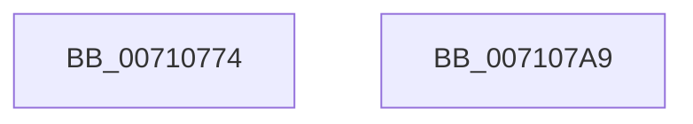

# DbgkpInitializePhase1SiloState

- RVA: `0x00710774`–`0x007107AA` (길이 `54` bytes)
- VA: `0x0000000140710774`
- 실행 섹션: `PAGE`
- PDB 이름 있음: `예`; PDB Function 태그: `아니요`
- unwind 정보 RVA: `0x0005D2F4`
- 디코드: `14`개 명령, `54/54` bytes 표시
- 미해석 바이트: `0` (있으면 어셈블리에 `.byte`로 보존)

> 이 문서는 커널 이미지의 기계어와 PDB 기호를 분석해 생성했습니다. 4번과 5번은 함수 원형과 자료형을 바이너리 사용 방식에서 추정한 C 해석이며 원본 소스 복구 결과는 아닙니다.

## 1. Dependencies

- 직접 호출 지점: **1**; 고유 호출 대상: **1**
- 직접 호출자로 확인된 함수: **2**
- RIP 상대 이미지 참조: **1**

### Outgoing calls
- `0x00710796` → [DbgkpCreateNotificationEvent](DbgkpCreateNotificationEvent_function_00710480.md) (function, `0x00710480`)

### Direct callers
- [PspInitializeServerSiloDeferred](../77/PspInitializeServerSiloDeferred_function_0077FEE0.md) at `0x007800CC`
- [DbgkInitialize](../../init/C2/DbgkInitialize_function_00C261E4.md) at `0x00C2621C`

### Static image references
- `0x00710778` → RVA `0x00AFB060` (` ?? ::NNGAKEGL::`string'`; read)

## 2. Other-region calls and transfers

- 다른 실행 섹션으로 향하는 call: **0**
- 별도 외부 분기/꼬리 이동을 확인하지 못했습니다.

## 3. Assembly (complete function range)

```asm
00710774  48 83 EC 38                     sub rsp, 0x38
00710778  48 8D 05 E1 A8 3E 00            lea rax, [rip + 0x3ea8e1]
0071077F  48 C7 44 24 20 46 00 48 00      mov qword ptr [rsp + 0x20], 0x480046
00710788  48 8D 51 18                     lea rdx, [rcx + 0x18]
0071078C  48 89 44 24 28                  mov qword ptr [rsp + 0x28], rax
00710791  48 8D 4C 24 20                  lea rcx, [rsp + 0x20]
00710796  E8 E5 FC FF FF                  call 0x140710480
0071079B  33 C9                           xor ecx, ecx
0071079D  85 C0                           test eax, eax
0071079F  0F 48 C8                        cmovs ecx, eax
007107A2  8B C1                           mov eax, ecx
007107A4  48 83 C4 38                     add rsp, 0x38
007107A8  C3                              ret
007107A9  CC                              int3
```

## 4. C-style interpretation (structured pseudocode)

```c
__int64 __fastcall DbgkpInitializePhase1SiloState(__int64 a1)
{
    __int64 result;
    __int64 v_rsp;
    unsigned __int64 v_stack_m10;
    unsigned __int64 v_stack_m18;

    v_rsp = (v_rsp) - (56);
    v_stack_m18 = 0x480046ULL;
    v_stack_m10 = v_rip + 4106465;
    result = DbgkpCreateNotificationEvent(v_stack_m18, a1 + 24, a3, a4);
    a1 = 0;
    if (sign_flag) { a1 = (unsigned int)(result); }
    v_rsp = (v_rsp) + (56);
    return (unsigned int)((unsigned int)(a1));
}
```

## 5. (Beta) C Style

```c
int64_t DbgkpInitializePhase1SiloState(void *Arg1)
{
    uint8_t *arg1 = (uint8_t *)Arg1;

    int64_t result;
    int64_t local_rsp;
    uint64_t v_stack_m10;
    uint64_t v_stack_m18;

    local_rsp = (local_rsp) - (56);
    v_stack_m18 = 0x480046ULL;
    v_stack_m10 = v_rip + 4106465;
    result = DbgkpCreateNotificationEvent(v_stack_m18, Arg1 + 24, a3, a4);
    Arg1 = 0;
    if (sign_flag) { Arg1 = (uint32_t)(result); }
    local_rsp = (local_rsp) + (56);
    return (uint32_t)((uint32_t)(Arg1));
}
```

### 관측된 메모리 오프셋

구조체 형식이 확인되지 않은 접근은 인자 기준의 오프셋으로만 기록했습니다.

| 기준 인자 | 오프셋 표현 | 폭 (bit) | 접근 |
|---|---:|---:|---|
| `Arg1` | `+ 0x18` | `64` | `R` |

## 6. Execution-region graph

[열기: 2D/3D 그래프와 함수 탐색 컨트롤 패널](../../../control-panel.html?section=page&rva=0x00710774&view=graph)

- 2D 그래프는 위에서 아래로 흐르고, 3D 그래프는 빈 공간을 드래그해 회전합니다. Shift+드래그는 이동, 휠은 확대·축소, 함수 노드 선택은 대상 보고서 이동입니다.

### Static fallback


