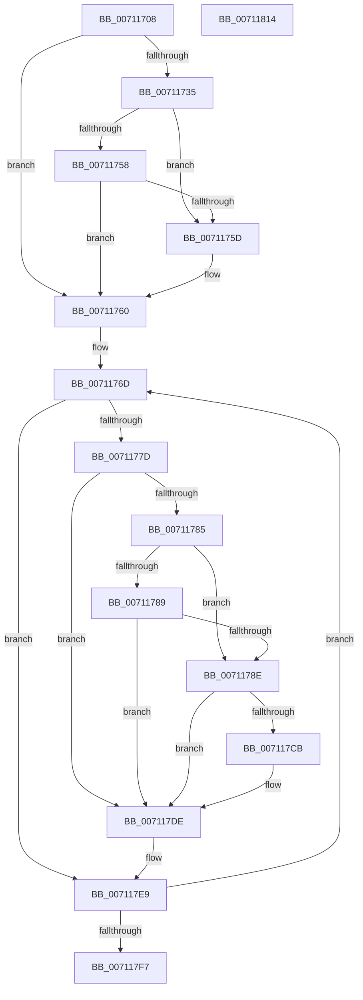

# DbgkpLkmdFireCallbacks

- RVA: `0x00711708`–`0x00711815` (길이 `269` bytes)
- VA: `0x0000000140711708`
- 실행 섹션: `PAGE`
- PDB 이름 있음: `예`; PDB Function 태그: `아니요`
- unwind 정보 RVA: `0x0008C20C`
- 디코드: `73`개 명령, `269/269` bytes 표시
- 미해석 바이트: `0` (있으면 어셈블리에 `.byte`로 보존)

> 이 문서는 커널 이미지의 기계어와 PDB 기호를 분석해 생성했습니다. 4번과 5번은 함수 원형과 자료형을 바이너리 사용 방식에서 추정한 C 해석이며 원본 소스 복구 결과는 아닙니다.

## 1. Dependencies

- 직접 호출 지점: **7**; 고유 호출 대상: **4**
- 직접 호출자로 확인된 함수: **1**
- RIP 상대 이미지 참조: **3**

### Outgoing calls
- `0x00711745` → [PsGetProcessSessionIdEx](../../text/22/PsGetProcessSessionIdEx_function_0022F8F0.md) (function, `0x0022F8F0`)
- `0x0071174F` → [PsGetProcessSessionIdEx](../../text/22/PsGetProcessSessionIdEx_function_0022F8F0.md) (function, `0x0022F8F0`)
- `0x00711770` → [ExReferenceCallBackBlock](../../text/2F/ExReferenceCallBackBlock_function_002F0040.md) (function, `0x002F0040`)
- `0x007117A0` → [guard_dispatch_icall](../../text/6B/guard_dispatch_icall_function_006BAAD0.md) (function, `0x006BAAD0`)
- `0x007117C2` → [guard_dispatch_icall](../../text/6B/guard_dispatch_icall_function_006BAAD0.md) (function, `0x006BAAD0`)
- `0x007117D9` → [guard_dispatch_icall](../../text/6B/guard_dispatch_icall_function_006BAAD0.md) (function, `0x006BAAD0`)
- `0x007117E4` → [ExDereferenceCallBackBlock](../../text/44/ExDereferenceCallBackBlock_function_0044D730.md) (function, `0x0044D730`)

### Direct callers
- [DbgkCaptureLiveDump](DbgkCaptureLiveDump_function_0071113C.md) at `0x007113E6`
- [DbgkCaptureLiveDump](DbgkCaptureLiveDump_function_0071113C.md) at `0x00711441`

### Static image references
- `0x00711760` → RVA `0x00E3ECE0` (`.data`; read)
- `0x007117A9` → RVA `0x00711820` (`DbgkpLkmdIsMemoryBlockPresentFromCallback`; read)
- `0x007117B8` → RVA `0x0057FDB0` (`DbgkpLkmdSnapData`; read)

## 2. Other-region calls and transfers

- 다른 실행 섹션으로 향하는 call: **7**
  - `0x00711745` → [PsGetProcessSessionIdEx](../../text/22/PsGetProcessSessionIdEx_function_0022F8F0.md) (`PAGE` → `.text`)
  - `0x0071174F` → [PsGetProcessSessionIdEx](../../text/22/PsGetProcessSessionIdEx_function_0022F8F0.md) (`PAGE` → `.text`)
  - `0x00711770` → [ExReferenceCallBackBlock](../../text/2F/ExReferenceCallBackBlock_function_002F0040.md) (`PAGE` → `.text`)
  - `0x007117A0` → [guard_dispatch_icall](../../text/6B/guard_dispatch_icall_function_006BAAD0.md) (`PAGE` → `.text`)
  - `0x007117C2` → [guard_dispatch_icall](../../text/6B/guard_dispatch_icall_function_006BAAD0.md) (`PAGE` → `.text`)
  - `0x007117D9` → [guard_dispatch_icall](../../text/6B/guard_dispatch_icall_function_006BAAD0.md) (`PAGE` → `.text`)
  - `0x007117E4` → [ExDereferenceCallBackBlock](../../text/44/ExDereferenceCallBackBlock_function_0044D730.md) (`PAGE` → `.text`)
- 별도 외부 분기/꼬리 이동을 확인하지 못했습니다.

## 3. Assembly (complete function range)

```asm
00711708  48 89 5C 24 08                  mov qword ptr [rsp + 8], rbx
0071170D  48 89 6C 24 10                  mov qword ptr [rsp + 0x10], rbp
00711712  48 89 74 24 18                  mov qword ptr [rsp + 0x18], rsi
00711717  57                              push rdi
00711718  41 54                           push r12
0071171A  41 55                           push r13
0071171C  41 56                           push r14
0071171E  41 57                           push r15
00711720  48 83 EC 30                     sub rsp, 0x30
00711724  40 B6 01                        mov sil, 1
00711727  4D 8B E0                        mov r12, r8
0071172A  44 8B FA                        mov r15d, edx
0071172D  4C 8B E9                        mov r13, rcx
00711730  40 84 D6                        test sil, dl
00711733  74 2B                           je 0x140711760
00711735  65 48 8B 0C 25 88 01 00 00      mov rcx, qword ptr gs:[0x188]
0071173E  48 8B 89 B8 00 00 00            mov rcx, qword ptr [rcx + 0xb8]
00711745  E8 A6 E1 B1 FF                  call 0x14022f8f0
0071174A  49 8B CC                        mov rcx, r12
0071174D  8B D8                           mov ebx, eax
0071174F  E8 9C E1 B1 FF                  call 0x14022f8f0
00711754  3B D8                           cmp ebx, eax
00711756  75 05                           jne 0x14071175d
00711758  83 FB FF                        cmp ebx, -1
0071175B  75 03                           jne 0x140711760
0071175D  40 32 F6                        xor sil, sil
00711760  48 8D 3D 79 D5 72 00            lea rdi, [rip + 0x72d579]
00711767  41 BE 08 00 00 00               mov r14d, 8
0071176D  48 8B CF                        mov rcx, rdi
00711770  E8 CB E8 BD FF                  call 0x1402f0040
00711775  48 8B E8                        mov rbp, rax
00711778  48 85 C0                        test rax, rax
0071177B  74 6C                           je 0x1407117e9
0071177D  8B 47 08                        mov eax, dword ptr [rdi + 8]
00711780  41 85 C7                        test r15d, eax
00711783  74 59                           je 0x1407117de
00711785  A8 04                           test al, 4
00711787  74 05                           je 0x14071178e
00711789  40 84 F6                        test sil, sil
0071178C  74 50                           je 0x1407117de
0071178E  49 8B 85 48 40 00 00            mov rax, qword ptr [r13 + 0x4048]
00711795  49 8D 8D 00 40 00 00            lea rcx, [r13 + 0x4000]
0071179C  48 8B 5D 08                     mov rbx, qword ptr [rbp + 8]
007117A0  E8 2B 93 FA FF                  call 0x1406baad0
007117A5  4C 8B 4D 10                     mov r9, qword ptr [rbp + 0x10]
007117A9  48 8D 15 70 00 00 00            lea rdx, [rip + 0x70]
007117B0  4D 8B C5                        mov r8, r13
007117B3  4C 89 64 24 20                  mov qword ptr [rsp + 0x20], r12
007117B8  48 8D 0D F1 E5 E6 FF            lea rcx, [rip - 0x191a0f]
007117BF  48 8B C3                        mov rax, rbx
007117C2  E8 09 93 FA FF                  call 0x1406baad0
007117C7  85 C0                           test eax, eax
007117C9  79 13                           jns 0x1407117de
007117CB  49 8B 85 50 40 00 00            mov rax, qword ptr [r13 + 0x4050]
007117D2  49 8D 8D 00 40 00 00            lea rcx, [r13 + 0x4000]
007117D9  E8 F2 92 FA FF                  call 0x1406baad0
007117DE  48 8B D5                        mov rdx, rbp
007117E1  48 8B CF                        mov rcx, rdi
007117E4  E8 47 BF D3 FF                  call 0x14044d730
007117E9  48 83 C7 10                     add rdi, 0x10
007117ED  49 83 EE 01                     sub r14, 1
007117F1  0F 85 76 FF FF FF               jne 0x14071176d
007117F7  48 8B 5C 24 60                  mov rbx, qword ptr [rsp + 0x60]
007117FC  48 8B 6C 24 68                  mov rbp, qword ptr [rsp + 0x68]
00711801  48 8B 74 24 70                  mov rsi, qword ptr [rsp + 0x70]
00711806  48 83 C4 30                     add rsp, 0x30
0071180A  41 5F                           pop r15
0071180C  41 5E                           pop r14
0071180E  41 5D                           pop r13
00711810  41 5C                           pop r12
00711812  5F                              pop rdi
00711813  C3                              ret
00711814  CC                              int3
```

## 4. C-style interpretation (structured pseudocode)

```c
__int64 __fastcall DbgkpLkmdFireCallbacks(__int64 a1, int a2, __int64 a3)
{
    __int64 result;
    __int64 v_r14;
    __int64 v_rdi;
    __int64 v_rsi;
    __int64 v_rsp;
    unsigned __int64 v_stack_m38;
    unsigned __int64 v_stack_p10;
    unsigned __int64 v_stack_p18;
    unsigned __int64 v_stack_p8;

    v_stack_p8 = v_rbx;
    v_stack_p10 = v_rbp;
    v_stack_p18 = v_rsi;
    v_rsp = (v_rsp) - (48);
    if (((1) & ((unsigned __int8)(a2))) == 0) goto loc_00711760;
    result = PsGetProcessSessionIdEx(*(unsigned __int64 *)(*(unsigned __int64 *)(gs_base + (0 + 392)) + 184), a2, a3, a4);
    result = PsGetProcessSessionIdEx(a3, a2, a3, a4);
    if (((unsigned int)((unsigned int)((unsigned int)(result)))) != ((unsigned int)(result))) goto loc_0071175D;
    v_rsi = 1;
    if (((unsigned int)((unsigned int)((unsigned int)(result)))) == -1) {
        v_rsi = 0;
    }
loc_0071176D:
    result = ExReferenceCallBackBlock(v_rip + 7525753, a2, a3, a4);
    if (result == 0) goto loc_007117E9;
    if ((((unsigned int)((unsigned int)(a2))) & ((unsigned int)((unsigned int)(*(unsigned int *)(v_rip + 7525753 + 8))))) == 0) goto loc_007117DE;
    if ((((unsigned __int8)((unsigned int)(*(unsigned int *)(v_rip + 7525753 + 8)))) & (4)) == 0) goto loc_0071178E;
    if (0 == 0) goto loc_007117DE;
loc_0071178E:
    result = guard_dispatch_icall(a1 + 16384, a2, a3, a4);
    v_stack_m38 = a3;
    result = guard_dispatch_icall(v_rip - 1645071, v_rip + 112, a1, *(unsigned __int64 *)(result + 16));
    if (sign_flag) {
        result = *(unsigned __int64 *)(a1 + 16464);
        a1 = a1 + 16384;
        result = guard_dispatch_icall(a1, v_rip + 112, a1, *(unsigned __int64 *)(result + 16));
    }
    result = ExDereferenceCallBackBlock(v_rip + 7525753, result, a1, *(unsigned __int64 *)(result + 16));
loc_007117E9:
    v_rdi = (v_rip + 7525753) + (16);
    v_r14 = (8) - (1);
    if (condition_is_not_equal) goto loc_0071176D;
    v_rsp = (v_rsp) + (48);
    return result;
}
```

## 5. (Beta) C Style

```c
int64_t DbgkpLkmdFireCallbacks(void *Arg1, int32_t Arg2, int64_t Arg3)
{
    uint8_t *arg1 = (uint8_t *)Arg1;

    int64_t result;
    int64_t local_r14;
    int64_t local_rdi;
    int64_t local_rsi;
    int64_t local_rsp;
    uint64_t v_stack_m38;
    uint64_t v_stack_p10;
    uint64_t v_stack_p18;
    uint64_t v_stack_p8;

    v_stack_p8 = local_rbx;
    v_stack_p10 = local_rbp;
    v_stack_p18 = local_rsi;
    local_rsp = (local_rsp) - (48);
    if (((1) & ((uint8_t)(Arg2))) == 0) goto loc_00711760;
    result = PsGetProcessSessionIdEx(*(uint64_t *)(*(uint64_t *)(gs_base + (0 + 0x188)) + 0xB8), Arg2, Arg3, a4);
    result = PsGetProcessSessionIdEx(Arg3, Arg2, Arg3, a4);
    if (((uint32_t)((uint32_t)((uint32_t)(result)))) != ((uint32_t)(result))) goto loc_0071175D;
    local_rsi = 1;
    if (((uint32_t)((uint32_t)((uint32_t)(result)))) == -1) {
        local_rsi = 0;
    }
loc_0071176D:
    result = ExReferenceCallBackBlock(v_rip + 7525753, Arg2, Arg3, a4);
    if (result == 0) goto loc_007117E9;
    if ((((uint32_t)((uint32_t)(Arg2))) & ((uint32_t)((uint32_t)(*(uint32_t *)(v_rip + 0x72D579 + 0x8))))) == 0) goto loc_007117DE;
    if ((((uint8_t)((uint32_t)(*(uint32_t *)(v_rip + 0x72D579 + 0x8)))) & (4)) == 0) goto loc_0071178E;
    if (0 == 0) goto loc_007117DE;
loc_0071178E:
    result = guard_dispatch_icall(Arg1 + 16384, Arg2, Arg3, a4);
    v_stack_m38 = Arg3;
    result = guard_dispatch_icall(v_rip - 1645071, v_rip + 112, Arg1, *(uint64_t *)(result + 0x10));
    if (sign_flag) {
        result = *(uint64_t *)(arg1 + 0x4050);
        Arg1 = Arg1 + 16384;
        result = guard_dispatch_icall(Arg1, v_rip + 112, Arg1, *(uint64_t *)(result + 0x10));
    }
    result = ExDereferenceCallBackBlock(v_rip + 7525753, result, Arg1, *(uint64_t *)(result + 0x10));
loc_007117E9:
    local_rdi = (v_rip + 7525753) + (16);
    local_r14 = (8) - (1);
    if (condition_is_not_equal) goto loc_0071176D;
    local_rsp = (local_rsp) + (48);
    return result;
}
```

### 관측된 메모리 오프셋

구조체 형식이 확인되지 않은 접근은 인자 기준의 오프셋으로만 기록했습니다.

| 기준 인자 | 오프셋 표현 | 폭 (bit) | 접근 |
|---|---:|---:|---|
| `Arg1` | `+ 0x4000` | `64` | `R` |
| `Arg1` | `+ 0x4048` | `64` | `R` |
| `Arg1` | `+ 0x4050` | `64` | `R` |

## 6. Execution-region graph

[열기: 2D/3D 그래프와 함수 탐색 컨트롤 패널](../../../control-panel.html?section=page&rva=0x00711708&view=graph)

- 2D 그래프는 위에서 아래로 흐르고, 3D 그래프는 빈 공간을 드래그해 회전합니다. Shift+드래그는 이동, 휠은 확대·축소, 함수 노드 선택은 대상 보고서 이동입니다.

### Static fallback


