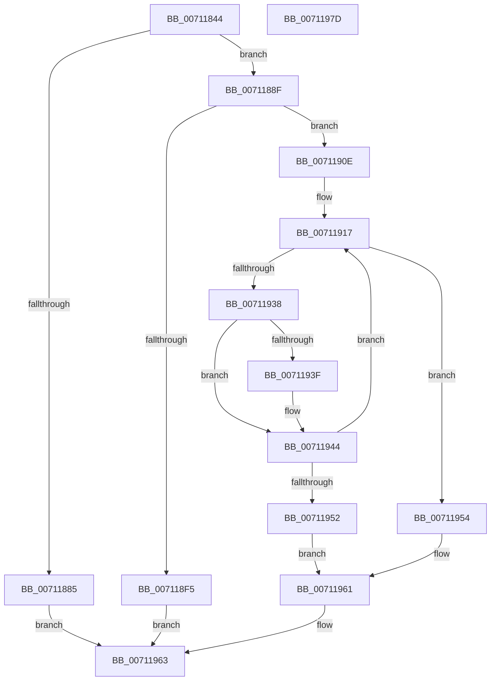

# DbgkpLkmdLaunchSnapApc

- RVA: `0x00711844`–`0x0071197E` (길이 `314` bytes)
- VA: `0x0000000140711844`
- 실행 섹션: `PAGE`
- PDB 이름 있음: `예`; PDB Function 태그: `아니요`
- unwind 정보 RVA: `0x0007EE78`
- 디코드: `84`개 명령, `314/314` bytes 표시
- 미해석 바이트: `0` (있으면 어셈블리에 `.byte`로 보존)

> 이 문서는 커널 이미지의 기계어와 PDB 기호를 분석해 생성했습니다. 4번과 5번은 함수 원형과 자료형을 바이너리 사용 방식에서 추정한 C 해석이며 원본 소스 복구 결과는 아닙니다.

## 1. Dependencies

- 직접 호출 지점: **7**; 고유 호출 대상: **6**
- 직접 호출자로 확인된 함수: **1**
- RIP 상대 이미지 참조: **1**

### Outgoing calls
- `0x00711878` → [ExAllocatePoolWithTag](../../poolcode/B8/ExAllocatePoolWithTag_function_00B82010.md) (function, `0x00B82010`)
- `0x007118AC` → [KeInitializeEvent](../../text/40/KeInitializeEvent_function_0040DD10.md) (function, `0x0040DD10`)
- `0x007118D8` → [KeInitializeApc](../../text/42/KeInitializeApc_function_00428510.md) (function, `0x00428510`)
- `0x007118EC` → [KeInsertQueueApc](../../text/20/KeInsertQueueApc_function_00203F10.md) (function, `0x00203F10`)
- `0x007118FD` → [ExFreePoolWithTag](../../poolcode/B8/ExFreePoolWithTag_function_00B82870.md) (function, `0x00B82870`)
- `0x0071192D` → [KeWaitForSingleObject](../../text/20/KeWaitForSingleObject_function_0020E6B0.md) (function, `0x0020E6B0`)
- `0x0071195C` → [ExFreePoolWithTag](../../poolcode/B8/ExFreePoolWithTag_function_00B82870.md) (function, `0x00B82870`)

### Direct callers
- [DbgkpLkmdSnapThread](../../text/58/DbgkpLkmdSnapThread_function_00580174.md) at `0x005801B5`

### Static image references
- `0x007118B7` → RVA `0x00711AC0` (`DbgkpLkmdSnapThreadApc`; read)

## 2. Other-region calls and transfers

- 다른 실행 섹션으로 향하는 call: **7**
  - `0x00711878` → [ExAllocatePoolWithTag](../../poolcode/B8/ExAllocatePoolWithTag_function_00B82010.md) (`PAGE` → `POOLCODE`)
  - `0x007118AC` → [KeInitializeEvent](../../text/40/KeInitializeEvent_function_0040DD10.md) (`PAGE` → `.text`)
  - `0x007118D8` → [KeInitializeApc](../../text/42/KeInitializeApc_function_00428510.md) (`PAGE` → `.text`)
  - `0x007118EC` → [KeInsertQueueApc](../../text/20/KeInsertQueueApc_function_00203F10.md) (`PAGE` → `.text`)
  - `0x007118FD` → [ExFreePoolWithTag](../../poolcode/B8/ExFreePoolWithTag_function_00B82870.md) (`PAGE` → `POOLCODE`)
  - `0x0071192D` → [KeWaitForSingleObject](../../text/20/KeWaitForSingleObject_function_0020E6B0.md) (`PAGE` → `.text`)
  - `0x0071195C` → [ExFreePoolWithTag](../../poolcode/B8/ExFreePoolWithTag_function_00B82870.md) (`PAGE` → `POOLCODE`)
- 별도 외부 분기/꼬리 이동을 확인하지 못했습니다.

## 3. Assembly (complete function range)

```asm
00711844  48 89 5C 24 08                  mov qword ptr [rsp + 8], rbx
00711849  48 89 6C 24 10                  mov qword ptr [rsp + 0x10], rbp
0071184E  48 89 74 24 18                  mov qword ptr [rsp + 0x18], rsi
00711853  57                              push rdi
00711854  41 56                           push r14
00711856  41 57                           push r15
00711858  48 83 EC 50                     sub rsp, 0x50
0071185C  49 8B F0                        mov rsi, r8
0071185F  48 8B EA                        mov rbp, rdx
00711862  4C 8B F9                        mov r15, rcx
00711865  BA 90 00 00 00                  mov edx, 0x90
0071186A  B9 00 06 00 00                  mov ecx, 0x600
0071186F  41 B8 4B 53 4E 70               mov r8d, 0x704e534b
00711875  49 8B F9                        mov rdi, r9
00711878  E8 93 07 47 00                  call 0x140b82010
0071187D  48 8B D8                        mov rbx, rax
00711880  48 85 C0                        test rax, rax
00711883  75 0A                           jne 0x14071188f
00711885  B8 17 00 00 C0                  mov eax, 0xc0000017
0071188A  E9 D4 00 00 00                  jmp 0x140711963
0071188F  4C 8D 70 58                     lea r14, [rax + 0x58]
00711893  4C 89 78 60                     mov qword ptr [rax + 0x60], r15
00711897  41 83 26 00                     and dword ptr [r14], 0
0071189B  48 8D 48 78                     lea rcx, [rax + 0x78]
0071189F  45 33 C0                        xor r8d, r8d
007118A2  48 89 68 68                     mov qword ptr [rax + 0x68], rbp
007118A6  33 D2                           xor edx, edx
007118A8  48 89 78 70                     mov qword ptr [rax + 0x70], rdi
007118AC  E8 5F C4 CF FF                  call 0x14040dd10
007118B1  48 83 64 24 38 00               and qword ptr [rsp + 0x38], 0
007118B7  4C 8D 0D 02 02 00 00            lea r9, [rip + 0x202]
007118BE  C6 44 24 30 00                  mov byte ptr [rsp + 0x30], 0
007118C3  45 33 C0                        xor r8d, r8d
007118C6  48 83 64 24 28 00               and qword ptr [rsp + 0x28], 0
007118CC  48 8B D6                        mov rdx, rsi
007118CF  48 83 64 24 20 00               and qword ptr [rsp + 0x20], 0
007118D5  48 8B CB                        mov rcx, rbx
007118D8  E8 33 6C D1 FF                  call 0x140428510
007118DD  41 B9 02 00 00 00               mov r9d, 2
007118E3  4D 8B C6                        mov r8, r14
007118E6  48 8B D3                        mov rdx, rbx
007118E9  48 8B CB                        mov rcx, rbx
007118EC  E8 1F 26 AF FF                  call 0x140203f10
007118F1  84 C0                           test al, al
007118F3  75 19                           jne 0x14071190e
007118F5  BA 4B 53 4E 70                  mov edx, 0x704e534b
007118FA  48 8B CB                        mov rcx, rbx
007118FD  E8 6E 0F 47 00                  call 0x140b82870
00711902  0F BA 6F 04 0E                  bts dword ptr [rdi + 4], 0xe
00711907  B8 01 00 00 C0                  mov eax, 0xc0000001
0071190C  EB 55                           jmp 0x140711963
0071190E  48 C7 44 24 40 80 0F 05 FD      mov qword ptr [rsp + 0x40], 0xfffffffffd050f80
00711917  48 8D 44 24 40                  lea rax, [rsp + 0x40]
0071191C  45 33 C9                        xor r9d, r9d
0071191F  45 33 C0                        xor r8d, r8d
00711922  48 89 44 24 20                  mov qword ptr [rsp + 0x20], rax
00711927  33 D2                           xor edx, edx
00711929  48 8D 4B 78                     lea rcx, [rbx + 0x78]
0071192D  E8 7E CD AF FF                  call 0x14020e6b0
00711932  8B F0                           mov esi, eax
00711934  85 C0                           test eax, eax
00711936  74 1C                           je 0x140711954
00711938  3D 02 01 00 00                  cmp eax, 0x102
0071193D  75 05                           jne 0x140711944
0071193F  0F BA 6F 04 0F                  bts dword ptr [rdi + 4], 0xf
00711944  B9 01 00 00 00                  mov ecx, 1
00711949  33 C0                           xor eax, eax
0071194B  F0 41 0F B1 0E                  lock cmpxchg dword ptr [r14], ecx
00711950  75 C5                           jne 0x140711917
00711952  EB 0D                           jmp 0x140711961
00711954  BA 4B 53 4E 70                  mov edx, 0x704e534b
00711959  48 8B CB                        mov rcx, rbx
0071195C  E8 0F 0F 47 00                  call 0x140b82870
00711961  8B C6                           mov eax, esi
00711963  4C 8D 5C 24 50                  lea r11, [rsp + 0x50]
00711968  49 8B 5B 20                     mov rbx, qword ptr [r11 + 0x20]
0071196C  49 8B 6B 28                     mov rbp, qword ptr [r11 + 0x28]
00711970  49 8B 73 30                     mov rsi, qword ptr [r11 + 0x30]
00711974  49 8B E3                        mov rsp, r11
00711977  41 5F                           pop r15
00711979  41 5E                           pop r14
0071197B  5F                              pop rdi
0071197C  C3                              ret
0071197D  CC                              int3
```

## 4. C-style interpretation (structured pseudocode)

```c
__int64 __fastcall DbgkpLkmdLaunchSnapApc(__int64 a1, __int64 a2, __int64 a3, __int64 a4)
{
    __int64 result;
    __int64 v_rsp;
    unsigned __int64 v_stack_m18;
    unsigned __int64 v_stack_m28;
    unsigned __int64 v_stack_m30;
    unsigned __int8 v_stack_m38;
    unsigned __int64 v_stack_m40;
    unsigned __int64 v_stack_m48;
    unsigned __int64 v_stack_p10;
    unsigned __int64 v_stack_p18;
    unsigned __int64 v_stack_p8;

    v_stack_p8 = v_rbx;
    v_stack_p10 = v_rbp;
    v_stack_p18 = v_rsi;
    v_rsp = (v_rsp) - (80);
    result = ExAllocatePoolWithTag((unsigned int)(0x600ULL), 144, (unsigned int)(0x704E534BULL), a4);
    if (result != 0) goto loc_0071188F;
    goto loc_00711963;
loc_0071188F:
    *(unsigned __int64 *)((unsigned int)(0xC0000017ULL) + 96) = a1;
    a3 = 0;
    *(unsigned __int64 *)((unsigned int)(0xC0000017ULL) + 104) = a2;
    a2 = 0;
    *(unsigned __int64 *)((unsigned int)(0xC0000017ULL) + 112) = a4;
    result = KeInitializeEvent((unsigned int)(0xC0000017ULL) + 120, a2, a3, a4);
    v_stack_m38 = 0;
    a3 = 0;
    result = KeInitializeApc(result, 0, a3, v_rip + 514);
    result = KeInsertQueueApc(result, result, (unsigned int)(0xC0000017ULL) + 88, 2);
    if ((unsigned __int8)(result) != 0) goto loc_0071190E;
    result = ExFreePoolWithTag(result, (unsigned int)(0x704E534BULL), (unsigned int)(0xC0000017ULL) + 88, 2);
    goto loc_00711963;
loc_0071190E:
    v_stack_m28 = 0xFFFFFFFFFD050F80ULL;
loc_00711917:
    a4 = 0;
    a3 = 0;
    v_stack_m48 = v_stack_m28;
    a2 = 0;
    result = KeWaitForSingleObject(result + 120, a2, a3, a4);
    if ((unsigned int)(result) == 0) goto loc_00711954;
    if (((unsigned int)(result)) == 258) {
    }
    result = 0;
    if (condition_is_not_equal) goto loc_00711917;
    goto loc_00711961;
loc_00711954:
    result = ExFreePoolWithTag(0, (unsigned int)(0x704E534BULL), a3, a4);
loc_00711961:
loc_00711963:
    return (unsigned int)((unsigned int)((unsigned int)((unsigned int)(result))));
}
```

## 5. (Beta) C Style

```c
int64_t DbgkpLkmdLaunchSnapApc(int64_t Arg1, int64_t Arg2, int64_t Arg3, void *Arg4)
{
    uint8_t *arg4 = (uint8_t *)Arg4;

    int64_t result;
    int64_t local_rsp;
    uint64_t v_stack_m18;
    uint64_t v_stack_m28;
    uint64_t v_stack_m30;
    uint8_t v_stack_m38;
    uint64_t v_stack_m40;
    uint64_t v_stack_m48;
    uint64_t v_stack_p10;
    uint64_t v_stack_p18;
    uint64_t v_stack_p8;

    v_stack_p8 = local_rbx;
    v_stack_p10 = local_rbp;
    v_stack_p18 = local_rsi;
    local_rsp = (local_rsp) - (80);
    result = ExAllocatePoolWithTag((uint32_t)(0x600ULL), 144, (uint32_t)(0x704E534BULL), Arg4);
    if (result != 0) goto loc_0071188F;
    goto loc_00711963;
loc_0071188F:
    *(uint64_t *)((uint32_t)(0xC0000017ULL) + 0x60) = Arg1;
    Arg3 = 0;
    *(uint64_t *)((uint32_t)(0xC0000017ULL) + 0x68) = Arg2;
    Arg2 = 0;
    *(void **)((uint32_t)(0xC0000017ULL) + 0x70) = Arg4;
    result = KeInitializeEvent((uint32_t)(0xC0000017ULL) + 120, Arg2, Arg3, Arg4);
    v_stack_m38 = 0;
    Arg3 = 0;
    result = KeInitializeApc(result, 0, Arg3, v_rip + 514);
    result = KeInsertQueueApc(result, result, (uint32_t)(0xC0000017ULL) + 88, 2);
    if ((uint8_t)(result) != 0) goto loc_0071190E;
    result = ExFreePoolWithTag(result, (uint32_t)(0x704E534BULL), (uint32_t)(0xC0000017ULL) + 88, 2);
    goto loc_00711963;
loc_0071190E:
    v_stack_m28 = 0xFFFFFFFFFD050F80ULL;
loc_00711917:
    Arg4 = 0;
    Arg3 = 0;
    v_stack_m48 = v_stack_m28;
    Arg2 = 0;
    result = KeWaitForSingleObject(result + 120, Arg2, Arg3, Arg4);
    if ((uint32_t)(result) == 0) goto loc_00711954;
    if (((uint32_t)(result)) == 258) {
    }
    result = 0;
    if (condition_is_not_equal) goto loc_00711917;
    goto loc_00711961;
loc_00711954:
    result = ExFreePoolWithTag(0, (uint32_t)(0x704E534BULL), Arg3, Arg4);
loc_00711961:
loc_00711963:
    return (uint32_t)((uint32_t)((uint32_t)((uint32_t)(result))));
}
```

### 관측된 메모리 오프셋

구조체 형식이 확인되지 않은 접근은 인자 기준의 오프셋으로만 기록했습니다.

| 기준 인자 | 오프셋 표현 | 폭 (bit) | 접근 |
|---|---:|---:|---|
| `Arg4` | `+ 0x4` | `32` | `R/W` |

## 6. Execution-region graph

[열기: 2D/3D 그래프와 함수 탐색 컨트롤 패널](../../../control-panel.html?section=page&rva=0x00711844&view=graph)

- 2D 그래프는 위에서 아래로 흐르고, 3D 그래프는 빈 공간을 드래그해 회전합니다. Shift+드래그는 이동, 휠은 확대·축소, 함수 노드 선택은 대상 보고서 이동입니다.

### Static fallback


