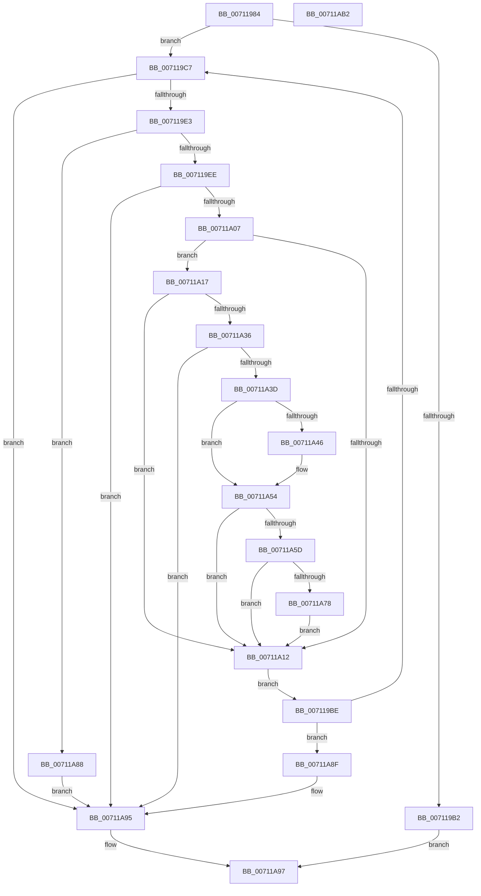

# DbgkpLkmdSnapPendingIrps

- RVA: `0x00711984`–`0x00711AB3` (길이 `303` bytes)
- VA: `0x0000000140711984`
- 실행 섹션: `PAGE`
- PDB 이름 있음: `예`; PDB Function 태그: `아니요`
- unwind 정보 RVA: `0x0005E6B4`
- 디코드: `81`개 명령, `303/303` bytes 표시
- 미해석 바이트: `0` (있으면 어셈블리에 `.byte`로 보존)

> 이 문서는 커널 이미지의 기계어와 PDB 기호를 분석해 생성했습니다. 4번과 5번은 함수 원형과 자료형을 바이너리 사용 방식에서 추정한 C 해석이며 원본 소스 복구 결과는 아닙니다.

## 1. Dependencies

- 직접 호출 지점: **6**; 고유 호출 대상: **2**
- 직접 호출자로 확인된 함수: **1**
- RIP 상대 이미지 참조: **0**

### Outgoing calls
- `0x007119D6` → [DbgkpLkmdSnapData](../../text/57/DbgkpLkmdSnapData_function_0057FDB0.md) (function, `0x0057FDB0`)
- `0x007119FA` → [DbgkpLkmdSnapData](../../text/57/DbgkpLkmdSnapData_function_0057FDB0.md) (function, `0x0057FDB0`)
- `0x00711A2A` → [DbgkpLkmdSnapData](../../text/57/DbgkpLkmdSnapData_function_0057FDB0.md) (function, `0x0057FDB0`)
- `0x00711A4F` → [DbgkpLkmdSnapObject](../../text/58/DbgkpLkmdSnapObject_function_00580094.md) (function, `0x00580094`)
- `0x00711A66` → [DbgkpLkmdSnapObject](../../text/58/DbgkpLkmdSnapObject_function_00580094.md) (function, `0x00580094`)
- `0x00711A81` → [DbgkpLkmdSnapObject](../../text/58/DbgkpLkmdSnapObject_function_00580094.md) (function, `0x00580094`)

### Direct callers
- [DbgkpLkmdSnapThreadApc](DbgkpLkmdSnapThreadApc_function_00711AC0.md) at `0x00711B0A`

### Static image references
- 디코드된 RIP-relative 메모리 참조가 없습니다.

## 2. Other-region calls and transfers

- 다른 실행 섹션으로 향하는 call: **6**
  - `0x007119D6` → [DbgkpLkmdSnapData](../../text/57/DbgkpLkmdSnapData_function_0057FDB0.md) (`PAGE` → `.text`)
  - `0x007119FA` → [DbgkpLkmdSnapData](../../text/57/DbgkpLkmdSnapData_function_0057FDB0.md) (`PAGE` → `.text`)
  - `0x00711A2A` → [DbgkpLkmdSnapData](../../text/57/DbgkpLkmdSnapData_function_0057FDB0.md) (`PAGE` → `.text`)
  - `0x00711A4F` → [DbgkpLkmdSnapObject](../../text/58/DbgkpLkmdSnapObject_function_00580094.md) (`PAGE` → `.text`)
  - `0x00711A66` → [DbgkpLkmdSnapObject](../../text/58/DbgkpLkmdSnapObject_function_00580094.md) (`PAGE` → `.text`)
  - `0x00711A81` → [DbgkpLkmdSnapObject](../../text/58/DbgkpLkmdSnapObject_function_00580094.md) (`PAGE` → `.text`)
- 별도 외부 분기/꼬리 이동을 확인하지 못했습니다.

## 3. Assembly (complete function range)

```asm
00711984  48 8B C4                        mov rax, rsp
00711987  48 89 58 08                     mov qword ptr [rax + 8], rbx
0071198B  48 89 68 10                     mov qword ptr [rax + 0x10], rbp
0071198F  48 89 70 18                     mov qword ptr [rax + 0x18], rsi
00711993  48 89 78 20                     mov qword ptr [rax + 0x20], rdi
00711997  41 56                           push r14
00711999  48 83 EC 20                     sub rsp, 0x20
0071199D  4C 8D B2 40 05 00 00            lea r14, [rdx + 0x540]
007119A4  49 8B F8                        mov rdi, r8
007119A7  49 8B 1E                        mov rbx, qword ptr [r14]
007119AA  48 8B E9                        mov rbp, rcx
007119AD  49 3B DE                        cmp rbx, r14
007119B0  75 15                           jne 0x1407119c7
007119B2  41 83 48 04 08                  or dword ptr [r8 + 4], 8
007119B7  33 C0                           xor eax, eax
007119B9  E9 D9 00 00 00                  jmp 0x140711a97
007119BE  49 3B DE                        cmp rbx, r14
007119C1  0F 84 C8 00 00 00               je 0x140711a8f
007119C7  FF 47 08                        inc dword ptr [rdi + 8]
007119CA  41 B8 10 00 00 00               mov r8d, 0x10
007119D0  48 8B D3                        mov rdx, rbx
007119D3  48 8B CD                        mov rcx, rbp
007119D6  E8 D5 E3 E6 FF                  call 0x14057fdb0
007119DB  85 C0                           test eax, eax
007119DD  0F 88 B2 00 00 00               js 0x140711a95
007119E3  66 83 7B E0 06                  cmp word ptr [rbx - 0x20], 6
007119E8  0F 85 9A 00 00 00               jne 0x140711a88
007119EE  44 0F B7 43 E2                  movzx r8d, word ptr [rbx - 0x1e]
007119F3  48 8D 53 E0                     lea rdx, [rbx - 0x20]
007119F7  48 8B CD                        mov rcx, rbp
007119FA  E8 B1 E3 E6 FF                  call 0x14057fdb0
007119FF  85 C0                           test eax, eax
00711A01  0F 88 8E 00 00 00               js 0x140711a95
00711A07  FF 47 0C                        inc dword ptr [rdi + 0xc]
00711A0A  8A 43 22                        mov al, byte ptr [rbx + 0x22]
00711A0D  38 43 23                        cmp byte ptr [rbx + 0x23], al
00711A10  7E 05                           jle 0x140711a17
00711A12  48 8B 1B                        mov rbx, qword ptr [rbx]
00711A15  EB A7                           jmp 0x1407119be
00711A17  48 8B B3 98 00 00 00            mov rsi, qword ptr [rbx + 0x98]
00711A1E  41 B8 48 00 00 00               mov r8d, 0x48
00711A24  48 8B D6                        mov rdx, rsi
00711A27  48 8B CD                        mov rcx, rbp
00711A2A  E8 81 E3 E6 FF                  call 0x14057fdb0
00711A2F  3D 05 00 00 C0                  cmp eax, 0xc0000005
00711A34  74 DC                           je 0x140711a12
00711A36  3D 9A 00 00 C0                  cmp eax, 0xc000009a
00711A3B  74 58                           je 0x140711a95
00711A3D  48 8B 56 30                     mov rdx, qword ptr [rsi + 0x30]
00711A41  48 85 D2                        test rdx, rdx
00711A44  74 0E                           je 0x140711a54
00711A46  41 B8 05 00 00 00               mov r8d, 5
00711A4C  48 8B CD                        mov rcx, rbp
00711A4F  E8 40 E6 E6 FF                  call 0x140580094
00711A54  48 8B 56 28                     mov rdx, qword ptr [rsi + 0x28]
00711A58  48 85 D2                        test rdx, rdx
00711A5B  74 B5                           je 0x140711a12
00711A5D  41 B8 03 00 00 00               mov r8d, 3
00711A63  48 8B CD                        mov rcx, rbp
00711A66  E8 29 E6 E6 FF                  call 0x140580094
00711A6B  48 8B 46 28                     mov rax, qword ptr [rsi + 0x28]
00711A6F  48 8B 50 08                     mov rdx, qword ptr [rax + 8]
00711A73  48 85 D2                        test rdx, rdx
00711A76  74 9A                           je 0x140711a12
00711A78  41 B8 04 00 00 00               mov r8d, 4
00711A7E  48 8B CD                        mov rcx, rbp
00711A81  E8 0E E6 E6 FF                  call 0x140580094
00711A86  EB 8A                           jmp 0x140711a12
00711A88  B8 41 01 00 C0                  mov eax, 0xc0000141
00711A8D  EB 06                           jmp 0x140711a95
00711A8F  83 4F 04 08                     or dword ptr [rdi + 4], 8
00711A93  33 C0                           xor eax, eax
00711A95  89 07                           mov dword ptr [rdi], eax
00711A97  48 8B 5C 24 30                  mov rbx, qword ptr [rsp + 0x30]
00711A9C  48 8B 6C 24 38                  mov rbp, qword ptr [rsp + 0x38]
00711AA1  48 8B 74 24 40                  mov rsi, qword ptr [rsp + 0x40]
00711AA6  48 8B 7C 24 48                  mov rdi, qword ptr [rsp + 0x48]
00711AAB  48 83 C4 20                     add rsp, 0x20
00711AAF  41 5E                           pop r14
00711AB1  C3                              ret
00711AB2  CC                              int3
```

## 4. C-style interpretation (structured pseudocode)

```c
__int64 __fastcall DbgkpLkmdSnapPendingIrps(__int64 a1, __int64 a2, __int64 a3)
{
    __int64 result;
    __int64 v_rsp;
    unsigned __int64 v_stack_p10;
    unsigned __int64 v_stack_p18;
    unsigned __int64 v_stack_p20;
    unsigned __int64 v_stack_p8;

    *(unsigned __int64 *)(v_rsp + 8) = v_rbx;
    *(unsigned __int64 *)(v_rsp + 16) = v_rbp;
    *(unsigned __int64 *)(v_rsp + 24) = v_rsi;
    *(unsigned __int64 *)(v_rsp + 32) = v_rdi;
    v_rsp = (v_rsp) - (32);
    if ((*(unsigned __int64 *)(a2 + 1344)) != (a2 + 1344)) goto loc_007119C7;
    result = 0;
    goto loc_00711A97;
loc_007119BE:
    if ((*(unsigned __int64 *)(a2 + 1344)) == (a2 + 1344)) goto loc_00711A8F;
loc_007119C7:
    result = DbgkpLkmdSnapData(a1, *(unsigned __int64 *)(a2 + 1344), 16, a4);
    if (sign_flag) goto loc_00711A95;
    if ((*(unsigned __int16 *)(*(unsigned __int64 *)(a2 + 1344) - 32)) != 6) goto loc_00711A88;
    result = DbgkpLkmdSnapData(a1, *(unsigned __int64 *)(a2 + 1344) - 32, *(unsigned __int16 *)(*(unsigned __int64 *)(a2 + 1344) - 30), a4);
    if (sign_flag) goto loc_00711A95;
    if ((*(unsigned __int8 *)(*(unsigned __int64 *)(a2 + 1344) + 35)) <= ((unsigned __int8)(*(unsigned __int8 *)(*(unsigned __int64 *)(a2 + 1344) + 34)))) goto loc_00711A17;
loc_00711A12:
    goto loc_007119BE;
loc_00711A17:
    result = DbgkpLkmdSnapData(a1, *(unsigned __int64 *)(*(unsigned __int64 *)(*(unsigned __int64 *)(a2 + 1344)) + 152), 72, a4);
    if (((unsigned int)(result)) == 0xC0000005ULL) goto loc_00711A12;
    if (((unsigned int)(result)) == 0xC000009AULL) goto loc_00711A95;
    if (*(unsigned __int64 *)(*(unsigned __int64 *)(*(unsigned __int64 *)(*(unsigned __int64 *)(a2 + 1344)) + 152) + 48) != 0) {
        a3 = 5;
        a1 = a1;
        result = DbgkpLkmdSnapObject(a1, *(unsigned __int64 *)(*(unsigned __int64 *)(*(unsigned __int64 *)(*(unsigned __int64 *)(a2 + 1344)) + 152) + 48), a3, a4);
    }
    if (*(unsigned __int64 *)(*(unsigned __int64 *)(*(unsigned __int64 *)(*(unsigned __int64 *)(a2 + 1344)) + 152) + 40) == 0) goto loc_00711A12;
    result = DbgkpLkmdSnapObject(a1, *(unsigned __int64 *)(*(unsigned __int64 *)(*(unsigned __int64 *)(*(unsigned __int64 *)(a2 + 1344)) + 152) + 40), 3, a4);
    if (*(unsigned __int64 *)(*(unsigned __int64 *)(*(unsigned __int64 *)(*(unsigned __int64 *)(*(unsigned __int64 *)(a2 + 1344)) + 152) + 40) + 8) == 0) goto loc_00711A12;
    result = DbgkpLkmdSnapObject(a1, *(unsigned __int64 *)(*(unsigned __int64 *)(*(unsigned __int64 *)(*(unsigned __int64 *)(*(unsigned __int64 *)(a2 + 1344)) + 152) + 40) + 8), 4, a4);
    goto loc_00711A12;
loc_00711A88:
    goto loc_00711A95;
loc_00711A8F:
    result = 0;
loc_00711A95:
    *(unsigned int *)(a3) = 0;
loc_00711A97:
    v_rsp = (v_rsp) + (32);
    return result;
}
```

## 5. (Beta) C Style

```c
int64_t DbgkpLkmdSnapPendingIrps(int64_t Arg1, void *Arg2, void *Arg3)
{
    uint8_t *arg2 = (uint8_t *)Arg2;
    uint8_t *arg3 = (uint8_t *)Arg3;

    int64_t result;
    int64_t local_rsp;
    uint64_t v_stack_p10;
    uint64_t v_stack_p18;
    uint64_t v_stack_p20;
    uint64_t v_stack_p8;

    *(uint64_t *)(local_rsp + 0x8) = local_rbx;
    *(uint64_t *)(local_rsp + 0x10) = local_rbp;
    *(uint64_t *)(local_rsp + 0x18) = local_rsi;
    *(uint64_t *)(local_rsp + 0x20) = local_rdi;
    local_rsp = (local_rsp) - (32);
    if ((*(uint64_t *)(arg2 + 0x540)) != (Arg2 + 1344)) goto loc_007119C7;
    result = 0;
    goto loc_00711A97;
loc_007119BE:
    if ((*(uint64_t *)(arg2 + 0x540)) == (Arg2 + 1344)) goto loc_00711A8F;
loc_007119C7:
    result = DbgkpLkmdSnapData(Arg1, *(uint64_t *)(arg2 + 0x540), 16, a4);
    if (sign_flag) goto loc_00711A95;
    if ((*(uint16_t *)(*(uint64_t *)(arg2 + 0x540) - 0x20)) != 6) goto loc_00711A88;
    result = DbgkpLkmdSnapData(Arg1, *(uint64_t *)(arg2 + 0x540) - 32, *(uint16_t *)(*(uint64_t *)(arg2 + 0x540) - 0x1E), a4);
    if (sign_flag) goto loc_00711A95;
    if ((*(uint8_t *)(*(uint64_t *)(arg2 + 0x540) + 0x23)) <= ((uint8_t)(*(uint8_t *)(*(uint64_t *)(arg2 + 0x540) + 0x22)))) goto loc_00711A17;
loc_00711A12:
    goto loc_007119BE;
loc_00711A17:
    result = DbgkpLkmdSnapData(Arg1, *(uint64_t *)(*(uint64_t *)(*(uint64_t *)(arg2 + 0x540)) + 0x98), 72, a4);
    if (((uint32_t)(result)) == 0xC0000005ULL) goto loc_00711A12;
    if (((uint32_t)(result)) == 0xC000009AULL) goto loc_00711A95;
    if (*(uint64_t *)(*(uint64_t *)(*(uint64_t *)(*(uint64_t *)(arg2 + 0x540)) + 0x98) + 0x30) != 0) {
        Arg3 = 5;
        Arg1 = Arg1;
        result = DbgkpLkmdSnapObject(Arg1, *(uint64_t *)(*(uint64_t *)(*(uint64_t *)(*(uint64_t *)(arg2 + 0x540)) + 0x98) + 0x30), Arg3, a4);
    }
    if (*(uint64_t *)(*(uint64_t *)(*(uint64_t *)(*(uint64_t *)(arg2 + 0x540)) + 0x98) + 0x28) == 0) goto loc_00711A12;
    result = DbgkpLkmdSnapObject(Arg1, *(uint64_t *)(*(uint64_t *)(*(uint64_t *)(*(uint64_t *)(arg2 + 0x540)) + 0x98) + 0x28), 3, a4);
    if (*(uint64_t *)(*(uint64_t *)(*(uint64_t *)(*(uint64_t *)(*(uint64_t *)(arg2 + 0x540)) + 0x98) + 0x28) + 0x8) == 0) goto loc_00711A12;
    result = DbgkpLkmdSnapObject(Arg1, *(uint64_t *)(*(uint64_t *)(*(uint64_t *)(*(uint64_t *)(*(uint64_t *)(arg2 + 0x540)) + 0x98) + 0x28) + 0x8), 4, a4);
    goto loc_00711A12;
loc_00711A88:
    goto loc_00711A95;
loc_00711A8F:
    result = 0;
loc_00711A95:
    *(uint32_t *)(arg3) = 0;
loc_00711A97:
    local_rsp = (local_rsp) + (32);
    return result;
}
```

### 관측된 메모리 오프셋

구조체 형식이 확인되지 않은 접근은 인자 기준의 오프셋으로만 기록했습니다.

| 기준 인자 | 오프셋 표현 | 폭 (bit) | 접근 |
|---|---:|---:|---|
| `Arg2` | `+ 0x0` | `64` | `R` |
| `Arg2` | `+ 0x540` | `64` | `R` |
| `Arg3` | `+ 0x0` | `32` | `W` |
| `Arg3` | `+ 0x4` | `32` | `R/W` |
| `Arg3` | `+ 0x8` | `32` | `R/W` |
| `Arg3` | `+ 0xC` | `32` | `R/W` |

## 6. Execution-region graph

[열기: 2D/3D 그래프와 함수 탐색 컨트롤 패널](../../../control-panel.html?section=page&rva=0x00711984&view=graph)

- 2D 그래프는 위에서 아래로 흐르고, 3D 그래프는 빈 공간을 드래그해 회전합니다. Shift+드래그는 이동, 휠은 확대·축소, 함수 노드 선택은 대상 보고서 이동입니다.

### Static fallback


