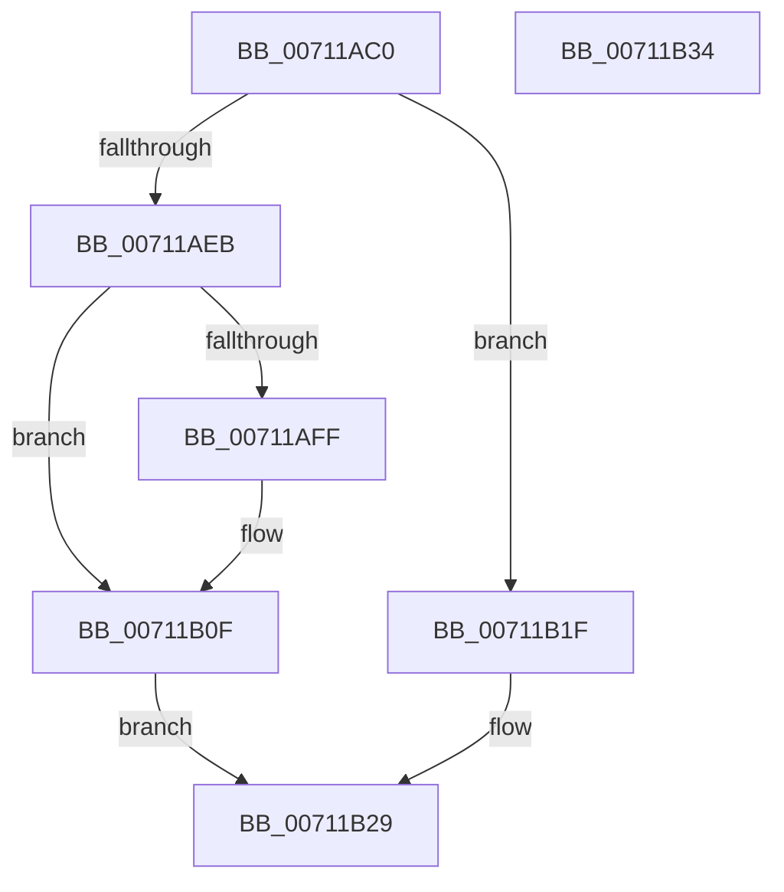

# DbgkpLkmdSnapThreadApc

- RVA: `0x00711AC0`–`0x00711B35` (길이 `117` bytes)
- VA: `0x0000000140711AC0`
- 실행 섹션: `PAGE`
- PDB 이름 있음: `예`; PDB Function 태그: `아니요`
- unwind 정보 RVA: `0x0005CAAC`
- 디코드: `33`개 명령, `117/117` bytes 표시
- 미해석 바이트: `0` (있으면 어셈블리에 `.byte`로 보존)

> 이 문서는 커널 이미지의 기계어와 PDB 기호를 분석해 생성했습니다. 4번과 5번은 함수 원형과 자료형을 바이너리 사용 방식에서 추정한 C 해석이며 원본 소스 복구 결과는 아닙니다.

## 1. Dependencies

- 직접 호출 지점: **4**; 고유 호출 대상: **4**
- 직접 호출자로 확인된 함수: **0**
- RIP 상대 이미지 참조: **0**

### Outgoing calls
- `0x00711AF6` → [DbgkpLkmdSnapThreadInContext](DbgkpLkmdSnapThreadInContext_function_00711B3C.md) (function, `0x00711B3C`)
- `0x00711B0A` → [DbgkpLkmdSnapPendingIrps](DbgkpLkmdSnapPendingIrps_function_00711984.md) (function, `0x00711984`)
- `0x00711B18` → [KeSetEvent](../../text/33/KeSetEvent_function_0033F310.md) (function, `0x0033F310`)
- `0x00711B24` → [ExFreePoolWithTag](../../poolcode/B8/ExFreePoolWithTag_function_00B82870.md) (function, `0x00B82870`)

### Direct callers
- 이 함수 시작 RVA로 연결되는 직접 call은 확인되지 않았습니다. 간접 호출은 완전히 역산할 수 없습니다.

### Static image references
- 디코드된 RIP-relative 메모리 참조가 없습니다.

## 2. Other-region calls and transfers

- 다른 실행 섹션으로 향하는 call: **2**
  - `0x00711B18` → [KeSetEvent](../../text/33/KeSetEvent_function_0033F310.md) (`PAGE` → `.text`)
  - `0x00711B24` → [ExFreePoolWithTag](../../poolcode/B8/ExFreePoolWithTag_function_00B82870.md) (`PAGE` → `POOLCODE`)
- 별도 외부 분기/꼬리 이동을 확인하지 못했습니다.

## 3. Assembly (complete function range)

```asm
00711AC0  48 89 5C 24 08                  mov qword ptr [rsp + 8], rbx
00711AC5  57                              push rdi
00711AC6  48 83 EC 20                     sub rsp, 0x20
00711ACA  48 8B 44 24 50                  mov rax, qword ptr [rsp + 0x50]
00711ACF  BA 02 00 00 00                  mov edx, 2
00711AD4  65 48 8B 3C 25 88 01 00 00      mov rdi, qword ptr gs:[0x188]
00711ADD  49 8B 09                        mov rcx, qword ptr [r9]
00711AE0  48 8B 18                        mov rbx, qword ptr [rax]
00711AE3  33 C0                           xor eax, eax
00711AE5  F0 0F B1 13                     lock cmpxchg dword ptr [rbx], edx
00711AE9  75 34                           jne 0x140711b1f
00711AEB  4C 8B 43 18                     mov r8, qword ptr [rbx + 0x18]
00711AEF  48 8B D7                        mov rdx, rdi
00711AF2  48 8B 4B 08                     mov rcx, qword ptr [rbx + 8]
00711AF6  E8 41 00 00 00                  call 0x140711b3c
00711AFB  85 C0                           test eax, eax
00711AFD  78 10                           js 0x140711b0f
00711AFF  4C 8B 43 18                     mov r8, qword ptr [rbx + 0x18]
00711B03  48 8B D7                        mov rdx, rdi
00711B06  48 8B 4B 08                     mov rcx, qword ptr [rbx + 8]
00711B0A  E8 75 FE FF FF                  call 0x140711984
00711B0F  48 8D 4B 20                     lea rcx, [rbx + 0x20]
00711B13  45 33 C0                        xor r8d, r8d
00711B16  33 D2                           xor edx, edx
00711B18  E8 F3 D7 C2 FF                  call 0x14033f310
00711B1D  EB 0A                           jmp 0x140711b29
00711B1F  BA 4B 53 4E 70                  mov edx, 0x704e534b
00711B24  E8 47 0D 47 00                  call 0x140b82870
00711B29  48 8B 5C 24 30                  mov rbx, qword ptr [rsp + 0x30]
00711B2E  48 83 C4 20                     add rsp, 0x20
00711B32  5F                              pop rdi
00711B33  C3                              ret
00711B34  CC                              int3
```

## 4. C-style interpretation (structured pseudocode)

```c
__int64 __fastcall DbgkpLkmdSnapThreadApc(__int64 a1, __int64 a2, __int64 a3, __int64 a4, __int64 a5)
{
    __int64 result;
    __int64 v_rsp;
    unsigned __int64 v_stack_p8;

    v_stack_p8 = v_rbx;
    v_rsp = (v_rsp) - (32);
    result = 0;
    if (condition_is_not_equal) goto loc_00711B1F;
    result = DbgkpLkmdSnapThreadInContext(*(unsigned __int64 *)(*(unsigned __int64 *)(a5) + 8), *(unsigned __int64 *)(gs_base + (0 + 392)), *(unsigned __int64 *)(*(unsigned __int64 *)(a5) + 24), a4);
    if (!(sign_flag)) {
        a3 = *(unsigned __int64 *)(*(unsigned __int64 *)(a5) + 24);
        a2 = *(unsigned __int64 *)(gs_base + (0 + 392));
        a1 = *(unsigned __int64 *)(*(unsigned __int64 *)(a5) + 8);
        result = DbgkpLkmdSnapPendingIrps(a1, a2, a3, a4);
    }
    a3 = 0;
    a2 = 0;
    result = KeSetEvent(*(unsigned __int64 *)(a5) + 32, a2, a3, a4);
    goto loc_00711B29;
loc_00711B1F:
    result = ExFreePoolWithTag(*(unsigned __int64 *)(a5) + 32, (unsigned int)(0x704E534BULL), a3, a4);
loc_00711B29:
    v_rsp = (v_rsp) + (32);
    return result;
}
```

## 5. (Beta) C Style

```c
int64_t DbgkpLkmdSnapThreadApc(int64_t Arg1, int64_t Arg2, int64_t Arg3, void *Arg4, void *Arg5)
{
    uint8_t *arg4 = (uint8_t *)Arg4;
    uint8_t *arg5 = (uint8_t *)Arg5;

    int64_t result;
    int64_t local_rsp;
    uint64_t v_stack_p8;

    v_stack_p8 = local_rbx;
    local_rsp = (local_rsp) - (32);
    result = 0;
    if (condition_is_not_equal) goto loc_00711B1F;
    result = DbgkpLkmdSnapThreadInContext(*(uint64_t *)(*(uint64_t *)(arg5) + 0x8), *(uint64_t *)(gs_base + (0 + 0x188)), *(uint64_t *)(*(uint64_t *)(arg5) + 0x18), Arg4);
    if (!(sign_flag)) {
        Arg3 = *(uint64_t *)(*(uint64_t *)(arg5) + 0x18);
        Arg2 = *(uint64_t *)(gs_base + (0 + 0x188));
        Arg1 = *(uint64_t *)(*(uint64_t *)(arg5) + 0x8);
        result = DbgkpLkmdSnapPendingIrps(Arg1, Arg2, Arg3, Arg4);
    }
    Arg3 = 0;
    Arg2 = 0;
    result = KeSetEvent(*(uint64_t *)(arg5) + 32, Arg2, Arg3, Arg4);
    goto loc_00711B29;
loc_00711B1F:
    result = ExFreePoolWithTag(*(uint64_t *)(arg5) + 32, (uint32_t)(0x704E534BULL), Arg3, Arg4);
loc_00711B29:
    local_rsp = (local_rsp) + (32);
    return result;
}
```

### 관측된 메모리 오프셋

구조체 형식이 확인되지 않은 접근은 인자 기준의 오프셋으로만 기록했습니다.

| 기준 인자 | 오프셋 표현 | 폭 (bit) | 접근 |
|---|---:|---:|---|
| `Arg4` | `+ 0x0` | `64` | `R` |
| `Arg5` | `+ 0x0` | `64` | `R` |

## 6. Execution-region graph

[열기: 2D/3D 그래프와 함수 탐색 컨트롤 패널](../../../control-panel.html?section=page&rva=0x00711AC0&view=graph)

- 2D 그래프는 위에서 아래로 흐르고, 3D 그래프는 빈 공간을 드래그해 회전합니다. Shift+드래그는 이동, 휠은 확대·축소, 함수 노드 선택은 대상 보고서 이동입니다.

### Static fallback


