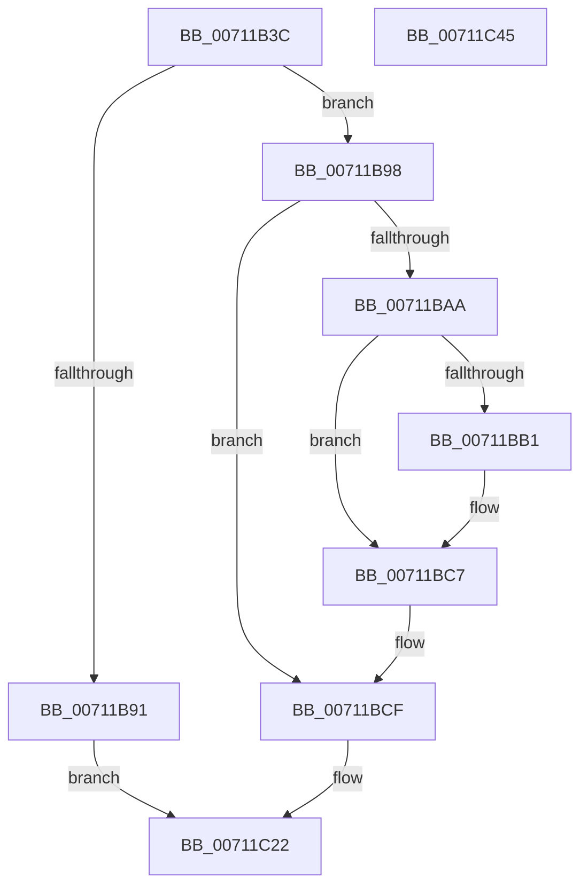

# DbgkpLkmdSnapThreadInContext

- RVA: `0x00711B3C`–`0x00711C46` (길이 `266` bytes)
- VA: `0x0000000140711B3C`
- 실행 섹션: `PAGE`
- PDB 이름 있음: `예`; PDB Function 태그: `아니요`
- unwind 정보 RVA: `0x000C59BC`
- 디코드: `63`개 명령, `266/266` bytes 표시
- 미해석 바이트: `0` (있으면 어셈블리에 `.byte`로 보존)

> 이 문서는 커널 이미지의 기계어와 PDB 기호를 분석해 생성했습니다. 4번과 5번은 함수 원형과 자료형을 바이너리 사용 방식에서 추정한 C 해석이며 원본 소스 복구 결과는 아닙니다.

## 1. Dependencies

- 직접 호출 지점: **5**; 고유 호출 대상: **4**
- 직접 호출자로 확인된 함수: **1**
- RIP 상대 이미지 참조: **1**

### Outgoing calls
- `0x00711B88` → [DbgkpLkmdSnapDataEx](../../text/57/DbgkpLkmdSnapDataEx_function_0057FDD4.md) (function, `0x0057FDD4`)
- `0x00711BD4` → [RtlCaptureContext](../../text/4F/RtlCaptureContext_function_004FE570.md) (function, `0x004FE570`)
- `0x00711BF9` → [DbgkpLkmdSnapDataEx](../../text/57/DbgkpLkmdSnapDataEx_function_0057FDD4.md) (function, `0x0057FDD4`)
- `0x00711C1B` → [DbgkpLkmdSnapKernelStack](../../text/57/DbgkpLkmdSnapKernelStack_function_0057FED8.md) (function, `0x0057FED8`)
- `0x00711C2D` → [_security_check_cookie](../../text/6A/_security_check_cookie_function_006AC640.md) (function, `0x006AC640`)

### Direct callers
- [DbgkpLkmdSnapThreadApc](DbgkpLkmdSnapThreadApc_function_00711AC0.md) at `0x00711AF6`

### Static image references
- `0x00711B4B` → RVA `0x00E0A740` (`.data`; read)

## 2. Other-region calls and transfers

- 다른 실행 섹션으로 향하는 call: **5**
  - `0x00711B88` → [DbgkpLkmdSnapDataEx](../../text/57/DbgkpLkmdSnapDataEx_function_0057FDD4.md) (`PAGE` → `.text`)
  - `0x00711BD4` → [RtlCaptureContext](../../text/4F/RtlCaptureContext_function_004FE570.md) (`PAGE` → `.text`)
  - `0x00711BF9` → [DbgkpLkmdSnapDataEx](../../text/57/DbgkpLkmdSnapDataEx_function_0057FDD4.md) (`PAGE` → `.text`)
  - `0x00711C1B` → [DbgkpLkmdSnapKernelStack](../../text/57/DbgkpLkmdSnapKernelStack_function_0057FED8.md) (`PAGE` → `.text`)
  - `0x00711C2D` → [_security_check_cookie](../../text/6A/_security_check_cookie_function_006AC640.md) (`PAGE` → `.text`)
- 별도 외부 분기/꼬리 이동을 확인하지 못했습니다.

## 3. Assembly (complete function range)

```asm
00711B3C  48 89 5C 24 20                  mov qword ptr [rsp + 0x20], rbx
00711B41  55                              push rbp
00711B42  56                              push rsi
00711B43  57                              push rdi
00711B44  48 81 EC 20 05 00 00            sub rsp, 0x520
00711B4B  48 8B 05 EE 8B 6F 00            mov rax, qword ptr [rip + 0x6f8bee]
00711B52  48 33 C4                        xor rax, rsp
00711B55  48 89 84 24 10 05 00 00         mov qword ptr [rsp + 0x510], rax
00711B5D  48 83 64 24 30 00               and qword ptr [rsp + 0x30], 0
00711B63  48 8D 44 24 30                  lea rax, [rsp + 0x30]
00711B68  49 8B D8                        mov rbx, r8
00711B6B  48 89 44 24 28                  mov qword ptr [rsp + 0x28], rax
00711B70  48 83 64 24 20 00               and qword ptr [rsp + 0x20], 0
00711B76  41 B9 03 00 00 00               mov r9d, 3
00711B7C  41 B8 98 07 00 00               mov r8d, 0x798
00711B82  48 8B EA                        mov rbp, rdx
00711B85  48 8B F1                        mov rsi, rcx
00711B88  E8 47 E2 E6 FF                  call 0x14057fdd4
00711B8D  85 C0                           test eax, eax
00711B8F  79 07                           jns 0x140711b98
00711B91  89 03                           mov dword ptr [rbx], eax
00711B93  E9 8A 00 00 00                  jmp 0x140711c22
00711B98  83 23 00                        and dword ptr [rbx], 0
00711B9B  40 B7 01                        mov dil, 1
00711B9E  83 4B 04 01                     or dword ptr [rbx + 4], 1
00711BA2  48 8B 0E                        mov rcx, qword ptr [rsi]
00711BA5  48 85 C9                        test rcx, rcx
00711BA8  74 25                           je 0x140711bcf
00711BAA  48 83 79 08 00                  cmp qword ptr [rcx + 8], 0
00711BAF  75 16                           jne 0x140711bc7
00711BB1  48 89 69 08                     mov qword ptr [rcx + 8], rbp
00711BB5  40 32 FF                        xor dil, dil
00711BB8  48 8B 44 24 30                  mov rax, qword ptr [rsp + 0x30]
00711BBD  C7 80 18 02 00 00 00 00 00 00   mov dword ptr [rax + 0x218], 0
00711BC7  48 83 A1 C0 8F 00 00 00         and qword ptr [rcx + 0x8fc0], 0
00711BCF  48 8D 4C 24 40                  lea rcx, [rsp + 0x40]
00711BD4  E8 97 C9 DE FF                  call 0x1404fe570
00711BD9  48 83 64 24 28 00               and qword ptr [rsp + 0x28], 0
00711BDF  48 8D 54 24 40                  lea rdx, [rsp + 0x40]
00711BE4  48 83 64 24 20 00               and qword ptr [rsp + 0x20], 0
00711BEA  41 B9 01 00 00 00               mov r9d, 1
00711BF0  41 B8 D0 04 00 00               mov r8d, 0x4d0
00711BF6  48 8B CE                        mov rcx, rsi
00711BF9  E8 D6 E1 E6 FF                  call 0x14057fdd4
00711BFE  4C 8B 44 24 30                  mov r8, qword ptr [rsp + 0x30]
00711C03  48 8D 44 24 40                  lea rax, [rsp + 0x40]
00711C08  48 89 5C 24 28                  mov qword ptr [rsp + 0x28], rbx
00711C0D  44 8A CF                        mov r9b, dil
00711C10  48 8B D5                        mov rdx, rbp
00711C13  48 89 44 24 20                  mov qword ptr [rsp + 0x20], rax
00711C18  48 8B CE                        mov rcx, rsi
00711C1B  E8 B8 E2 E6 FF                  call 0x14057fed8
00711C20  33 C0                           xor eax, eax
00711C22  48 8B 8C 24 10 05 00 00         mov rcx, qword ptr [rsp + 0x510]
00711C2A  48 33 CC                        xor rcx, rsp
00711C2D  E8 0E AA F9 FF                  call 0x1406ac640
00711C32  48 8B 9C 24 58 05 00 00         mov rbx, qword ptr [rsp + 0x558]
00711C3A  48 81 C4 20 05 00 00            add rsp, 0x520
00711C41  5F                              pop rdi
00711C42  5E                              pop rsi
00711C43  5D                              pop rbp
00711C44  C3                              ret
00711C45  CC                              int3
```

## 4. C-style interpretation (structured pseudocode)

```c
__int64 __fastcall DbgkpLkmdSnapThreadInContext(__int64 a1, __int64 a2, __int64 a3)
{
    __int64 result;
    __int64 v_rdi;
    __int64 v_rsp;
    unsigned __int64 v_stack_m28;
    unsigned __int64 v_stack_m4F8;
    unsigned __int64 v_stack_m508;
    unsigned __int64 v_stack_m510;
    unsigned __int64 v_stack_m518;
    unsigned __int64 v_stack_p20;

    v_stack_p20 = v_rbx;
    v_rsp = (v_rsp) - (0x520ULL);
    result = (*(unsigned __int64 *)(v_rip + 7310318)) ^ (v_rsp);
    v_stack_m28 = result;
    v_stack_m510 = v_stack_m508;
    result = DbgkpLkmdSnapDataEx(a1, a2, (unsigned int)(0x798ULL), 3);
    if (!sign_flag) goto loc_00711B98;
    *(unsigned int *)(a3) = (unsigned int)(result);
    goto loc_00711C22;
loc_00711B98:
    if (*(unsigned __int64 *)(a1) == 0) goto loc_00711BCF;
    v_rdi = 1;
    if ((*(unsigned __int64 *)(*(unsigned __int64 *)(a1) + 8)) == 0) {
        *(unsigned __int64 *)(*(unsigned __int64 *)(a1) + 8) = a2;
        v_rdi = 0;
        result = v_stack_m508;
        *(unsigned int *)(result + 536) = 0;
    }
loc_00711BCF:
    result = RtlCaptureContext(v_stack_m4F8, a2, (unsigned int)(0x798ULL), 3);
    result = DbgkpLkmdSnapDataEx(a1, v_stack_m4F8, (unsigned int)(0x4D0ULL), 1);
    v_stack_m510 = a3;
    v_stack_m518 = v_stack_m4F8;
    result = DbgkpLkmdSnapKernelStack(a1, a2, v_stack_m508, 0);
    result = 0;
loc_00711C22:
    a1 = (v_stack_m28) ^ (v_rsp);
    result = _security_check_cookie(a1, a2, v_stack_m508, 0);
    v_rsp = (v_rsp) + (0x520ULL);
    return result;
}
```

## 5. (Beta) C Style

```c
int64_t DbgkpLkmdSnapThreadInContext(void *Arg1, int64_t Arg2, void *Arg3)
{
    uint8_t *arg1 = (uint8_t *)Arg1;
    uint8_t *arg3 = (uint8_t *)Arg3;

    int64_t result;
    int64_t local_rdi;
    int64_t local_rsp;
    uint64_t v_stack_m28;
    uint64_t v_stack_m4F8;
    uint64_t v_stack_m508;
    uint64_t v_stack_m510;
    uint64_t v_stack_m518;
    uint64_t v_stack_p20;

    v_stack_p20 = local_rbx;
    local_rsp = (local_rsp) - (0x520ULL);
    result = (*(uint64_t *)(v_rip + 0x6F8BEE)) ^ (local_rsp);
    v_stack_m28 = result;
    v_stack_m510 = v_stack_m508;
    result = DbgkpLkmdSnapDataEx(Arg1, Arg2, (uint32_t)(0x798ULL), 3);
    if (!sign_flag) goto loc_00711B98;
    *(uint32_t *)(arg3) = (uint32_t)(result);
    goto loc_00711C22;
loc_00711B98:
    if (*(uint64_t *)(arg1) == 0) goto loc_00711BCF;
    local_rdi = 1;
    if ((*(uint64_t *)(*(uint64_t *)(arg1) + 0x8)) == 0) {
        *(uint64_t *)(*(uint64_t *)(arg1) + 0x8) = Arg2;
        local_rdi = 0;
        result = v_stack_m508;
        *(uint32_t *)(result + 0x218) = 0;
    }
loc_00711BCF:
    result = RtlCaptureContext(v_stack_m4F8, Arg2, (uint32_t)(0x798ULL), 3);
    result = DbgkpLkmdSnapDataEx(Arg1, v_stack_m4F8, (uint32_t)(0x4D0ULL), 1);
    v_stack_m510 = Arg3;
    v_stack_m518 = v_stack_m4F8;
    result = DbgkpLkmdSnapKernelStack(Arg1, Arg2, v_stack_m508, 0);
    result = 0;
loc_00711C22:
    Arg1 = (v_stack_m28) ^ (local_rsp);
    result = _security_check_cookie(Arg1, Arg2, v_stack_m508, 0);
    local_rsp = (local_rsp) + (0x520ULL);
    return result;
}
```

### 관측된 메모리 오프셋

구조체 형식이 확인되지 않은 접근은 인자 기준의 오프셋으로만 기록했습니다.

| 기준 인자 | 오프셋 표현 | 폭 (bit) | 접근 |
|---|---:|---:|---|
| `Arg1` | `+ 0x0` | `64` | `R` |
| `Arg3` | `+ 0x0` | `32` | `R/W` |
| `Arg3` | `+ 0x0` | `32` | `W` |
| `Arg3` | `+ 0x4` | `32` | `R/W` |

## 6. Execution-region graph

[열기: 2D/3D 그래프와 함수 탐색 컨트롤 패널](../../../control-panel.html?section=page&rva=0x00711B3C&view=graph)

- 2D 그래프는 위에서 아래로 흐르고, 3D 그래프는 빈 공간을 드래그해 회전합니다. Shift+드래그는 이동, 휠은 확대·축소, 함수 노드 선택은 대상 보고서 이동입니다.

### Static fallback


