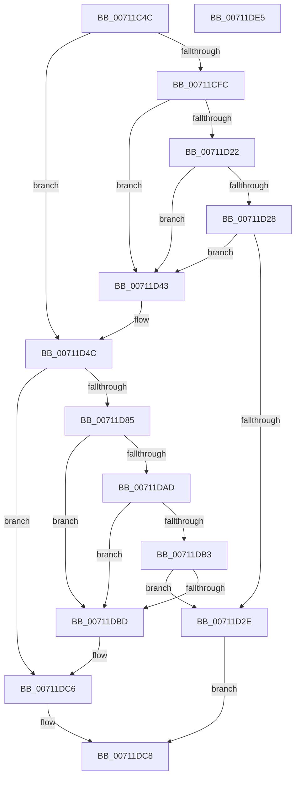

# DbgkpLkmdSqmIsOptedIn

- RVA: `0x00711C4C`–`0x00711DE6` (길이 `410` bytes)
- VA: `0x0000000140711C4C`
- 실행 섹션: `PAGE`
- PDB 이름 있음: `예`; PDB Function 태그: `아니요`
- unwind 정보 RVA: `0x000C5A1C`
- 디코드: `96`개 명령, `410/410` bytes 표시
- 미해석 바이트: `0` (있으면 어셈블리에 `.byte`로 보존)

> 이 문서는 커널 이미지의 기계어와 PDB 기호를 분석해 생성했습니다. 4번과 5번은 함수 원형과 자료형을 바이너리 사용 방식에서 추정한 C 해석이며 원본 소스 복구 결과는 아닙니다.

## 1. Dependencies

- 직접 호출 지점: **8**; 고유 호출 대상: **4**
- 직접 호출자로 확인된 함수: **1**
- RIP 상대 이미지 참조: **4**

### Outgoing calls
- `0x00711CF3` → [ZwOpenKey](../../text/6A/ZwOpenKey_function_006AD310.md) (function, `0x006AD310`)
- `0x00711D19` → [ZwQueryValueKey](../../text/6A/ZwQueryValueKey_function_006AD3B0.md) (function, `0x006AD3B0`)
- `0x00711D32` → [ZwClose](../../text/6A/ZwClose_function_006AD2B0.md) (function, `0x006AD2B0`)
- `0x00711D47` → [ZwClose](../../text/6A/ZwClose_function_006AD2B0.md) (function, `0x006AD2B0`)
- `0x00711D7C` → [ZwOpenKey](../../text/6A/ZwOpenKey_function_006AD310.md) (function, `0x006AD310`)
- `0x00711DA4` → [ZwQueryValueKey](../../text/6A/ZwQueryValueKey_function_006AD3B0.md) (function, `0x006AD3B0`)
- `0x00711DC1` → [ZwClose](../../text/6A/ZwClose_function_006AD2B0.md) (function, `0x006AD2B0`)
- `0x00711DCF` → [_security_check_cookie](../../text/6A/_security_check_cookie_function_006AC640.md) (function, `0x006AC640`)

### Direct callers
- [DbgkCaptureLiveDump](DbgkCaptureLiveDump_function_0071113C.md) at `0x007111C9`

### Static image references
- `0x00711C5E` → RVA `0x00E0A740` (`.data`; read)
- `0x00711CA2` → RVA `0x00AFB0D0` (` ?? ::NNGAKEGL::`string'`; read)
- `0x00711CAD` → RVA `0x00AFB150` (` ?? ::NNGAKEGL::`string'`; read)
- `0x00711CB8` → RVA `0x00AFB0B0` (` ?? ::NNGAKEGL::`string'`; read)

## 2. Other-region calls and transfers

- 다른 실행 섹션으로 향하는 call: **8**
  - `0x00711CF3` → [ZwOpenKey](../../text/6A/ZwOpenKey_function_006AD310.md) (`PAGE` → `.text`)
  - `0x00711D19` → [ZwQueryValueKey](../../text/6A/ZwQueryValueKey_function_006AD3B0.md) (`PAGE` → `.text`)
  - `0x00711D32` → [ZwClose](../../text/6A/ZwClose_function_006AD2B0.md) (`PAGE` → `.text`)
  - `0x00711D47` → [ZwClose](../../text/6A/ZwClose_function_006AD2B0.md) (`PAGE` → `.text`)
  - `0x00711D7C` → [ZwOpenKey](../../text/6A/ZwOpenKey_function_006AD310.md) (`PAGE` → `.text`)
  - `0x00711DA4` → [ZwQueryValueKey](../../text/6A/ZwQueryValueKey_function_006AD3B0.md) (`PAGE` → `.text`)
  - `0x00711DC1` → [ZwClose](../../text/6A/ZwClose_function_006AD2B0.md) (`PAGE` → `.text`)
  - `0x00711DCF` → [_security_check_cookie](../../text/6A/_security_check_cookie_function_006AC640.md) (`PAGE` → `.text`)
- 별도 외부 분기/꼬리 이동을 확인하지 못했습니다.

## 3. Assembly (complete function range)

```asm
00711C4C  48 89 7C 24 08                  mov qword ptr [rsp + 8], rdi
00711C51  55                              push rbp
00711C52  48 8D 6C 24 A9                  lea rbp, [rsp - 0x57]
00711C57  48 81 EC C0 00 00 00            sub rsp, 0xc0
00711C5E  48 8B 05 DB 8A 6F 00            mov rax, qword ptr [rip + 0x6f8adb]
00711C65  48 33 C4                        xor rax, rsp
00711C68  48 89 45 4F                     mov qword ptr [rbp + 0x4f], rax
00711C6C  48 83 65 C7 00                  and qword ptr [rbp - 0x39], 0
00711C71  4C 8D 45 07                     lea r8, [rbp + 7]
00711C75  83 65 CF 00                     and dword ptr [rbp - 0x31], 0
00711C79  48 8D 4D C7                     lea rcx, [rbp - 0x39]
00711C7D  48 83 65 0F 00                  and qword ptr [rbp + 0xf], 0
00711C82  33 C0                           xor eax, eax
00711C84  21 45 23                        and dword ptr [rbp + 0x23], eax
00711C87  0F 57 C0                        xorps xmm0, xmm0
00711C8A  89 45 47                        mov dword ptr [rbp + 0x47], eax
00711C8D  BA 19 00 02 00                  mov edx, 0x20019
00711C92  48 C7 45 07 30 00 00 00         mov qword ptr [rbp + 7], 0x30
00711C9A  BF 14 00 00 00                  mov edi, 0x14
00711C9F  21 45 0B                        and dword ptr [rbp + 0xb], eax
00711CA2  48 8D 05 27 94 3E 00            lea rax, [rip + 0x3e9427]
00711CA9  48 89 45 EF                     mov qword ptr [rbp - 0x11], rax
00711CAD  48 8D 05 9C 94 3E 00            lea rax, [rip + 0x3e949c]
00711CB4  48 89 45 FF                     mov qword ptr [rbp - 1], rax
00711CB8  48 8D 05 F1 93 3E 00            lea rax, [rip + 0x3e93f1]
00711CBF  48 89 45 DF                     mov qword ptr [rbp - 0x21], rax
00711CC3  48 8D 45 E7                     lea rax, [rbp - 0x19]
00711CC7  48 89 45 17                     mov qword ptr [rbp + 0x17], rax
00711CCB  0F 11 45 37                     movups xmmword ptr [rbp + 0x37], xmm0
00711CCF  48 C7 45 E7 7E 00 80 00         mov qword ptr [rbp - 0x19], 0x80007e
00711CD7  48 C7 45 F7 6C 00 6E 00         mov qword ptr [rbp - 9], 0x6e006c
00711CDF  48 C7 45 D7 14 00 16 00         mov qword ptr [rbp - 0x29], 0x160014
00711CE7  C7 45 1F 40 02 00 00            mov dword ptr [rbp + 0x1f], 0x240
00711CEE  F3 0F 7F 45 27                  movdqu xmmword ptr [rbp + 0x27], xmm0
00711CF3  E8 18 B6 F9 FF                  call 0x1406ad310
00711CF8  85 C0                           test eax, eax
00711CFA  78 50                           js 0x140711d4c
00711CFC  48 8B 4D C7                     mov rcx, qword ptr [rbp - 0x39]
00711D00  48 8D 45 CF                     lea rax, [rbp - 0x31]
00711D04  48 89 44 24 28                  mov qword ptr [rsp + 0x28], rax
00711D09  4C 8D 4D 37                     lea r9, [rbp + 0x37]
00711D0D  44 8D 47 EE                     lea r8d, [rdi - 0x12]
00711D11  89 7C 24 20                     mov dword ptr [rsp + 0x20], edi
00711D15  48 8D 55 D7                     lea rdx, [rbp - 0x29]
00711D19  E8 92 B6 F9 FF                  call 0x1406ad3b0
00711D1E  85 C0                           test eax, eax
00711D20  78 21                           js 0x140711d43
00711D22  83 7D 3B 04                     cmp dword ptr [rbp + 0x3b], 4
00711D26  75 1B                           jne 0x140711d43
00711D28  83 7D 3F 04                     cmp dword ptr [rbp + 0x3f], 4
00711D2C  75 15                           jne 0x140711d43
00711D2E  48 8B 4D C7                     mov rcx, qword ptr [rbp - 0x39]
00711D32  E8 79 B5 F9 FF                  call 0x1406ad2b0
00711D37  83 7D 43 01                     cmp dword ptr [rbp + 0x43], 1
00711D3B  0F 94 C0                        sete al
00711D3E  E9 85 00 00 00                  jmp 0x140711dc8
00711D43  48 8B 4D C7                     mov rcx, qword ptr [rbp - 0x39]
00711D47  E8 64 B5 F9 FF                  call 0x1406ad2b0
00711D4C  48 83 65 0F 00                  and qword ptr [rbp + 0xf], 0
00711D51  48 8D 45 F7                     lea rax, [rbp - 9]
00711D55  0F 57 C0                        xorps xmm0, xmm0
00711D58  48 89 45 17                     mov qword ptr [rbp + 0x17], rax
00711D5C  4C 8D 45 07                     lea r8, [rbp + 7]
00711D60  C7 45 07 30 00 00 00            mov dword ptr [rbp + 7], 0x30
00711D67  BA 19 00 02 00                  mov edx, 0x20019
00711D6C  C7 45 1F 40 02 00 00            mov dword ptr [rbp + 0x1f], 0x240
00711D73  48 8D 4D C7                     lea rcx, [rbp - 0x39]
00711D77  F3 0F 7F 45 27                  movdqu xmmword ptr [rbp + 0x27], xmm0
00711D7C  E8 8F B5 F9 FF                  call 0x1406ad310
00711D81  85 C0                           test eax, eax
00711D83  78 41                           js 0x140711dc6
00711D85  48 8B 4D C7                     mov rcx, qword ptr [rbp - 0x39]
00711D89  48 8D 45 CF                     lea rax, [rbp - 0x31]
00711D8D  48 89 44 24 28                  mov qword ptr [rsp + 0x28], rax
00711D92  4C 8D 4D 37                     lea r9, [rbp + 0x37]
00711D96  41 B8 02 00 00 00               mov r8d, 2
00711D9C  89 7C 24 20                     mov dword ptr [rsp + 0x20], edi
00711DA0  48 8D 55 D7                     lea rdx, [rbp - 0x29]
00711DA4  E8 07 B6 F9 FF                  call 0x1406ad3b0
00711DA9  85 C0                           test eax, eax
00711DAB  78 10                           js 0x140711dbd
00711DAD  83 7D 3B 04                     cmp dword ptr [rbp + 0x3b], 4
00711DB1  75 0A                           jne 0x140711dbd
00711DB3  83 7D 3F 04                     cmp dword ptr [rbp + 0x3f], 4
00711DB7  0F 84 71 FF FF FF               je 0x140711d2e
00711DBD  48 8B 4D C7                     mov rcx, qword ptr [rbp - 0x39]
00711DC1  E8 EA B4 F9 FF                  call 0x1406ad2b0
00711DC6  32 C0                           xor al, al
00711DC8  48 8B 4D 4F                     mov rcx, qword ptr [rbp + 0x4f]
00711DCC  48 33 CC                        xor rcx, rsp
00711DCF  E8 6C A8 F9 FF                  call 0x1406ac640
00711DD4  48 8B BC 24 D0 00 00 00         mov rdi, qword ptr [rsp + 0xd0]
00711DDC  48 81 C4 C0 00 00 00            add rsp, 0xc0
00711DE3  5D                              pop rbp
00711DE4  C3                              ret
00711DE5  CC                              int3
```

## 4. C-style interpretation (structured pseudocode)

```c
__int64 __fastcall DbgkpLkmdSqmIsOptedIn(void)
{
    __int64 result;
    __int64 v_rsp;
    unsigned __int64 v_stack_m10;
    unsigned int v_stack_m18;
    unsigned int v_stack_m1C;
    unsigned int v_stack_m20;
    unsigned int v_stack_m24;
    unsigned __int64 v_stack_m28;
    unsigned __int64 v_stack_m38;
    unsigned int v_stack_m3C;
    unsigned int v_stack_m40;
    unsigned __int64 v_stack_m48;
    unsigned __int64 v_stack_m50;
    unsigned int v_stack_m54;
    unsigned __int64 v_stack_m58;
    unsigned __int64 v_stack_m5F;
    unsigned __int64 v_stack_m60;
    unsigned __int64 v_stack_m68;
    unsigned __int64 v_stack_m70;
    unsigned __int64 v_stack_m78;
    unsigned __int64 v_stack_m80;
    unsigned __int64 v_stack_m88;
    unsigned int v_stack_m90;
    unsigned __int64 v_stack_m98;
    unsigned __int64 v_stack_mA0;
    unsigned int v_stack_mA8;
    unsigned __int64 v_stack_p8;

    v_stack_p8 = v_rdi;
    v_rsp = (v_rsp) - (192);
    result = (*(unsigned __int64 *)(v_rip + 7310043)) ^ (v_rsp);
    v_stack_m10 = result;
    result = 0;
    v_stack_m18 = 0;
    v_stack_m58 = 48;
    v_stack_m70 = v_rip + 4101159;
    v_stack_m60 = v_rip + 4101276;
    v_stack_m80 = v_rip + 4101105;
    v_stack_m48 = v_stack_m78;
    v_stack_m28 = v_xmm0;
    v_stack_m78 = 0x80007EULL;
    v_stack_m68 = 0x6E006CULL;
    v_stack_m88 = 0x160014ULL;
    v_stack_m40 = 576;
    v_stack_m38 = v_xmm0;
    result = ZwOpenKey(v_stack_m98, (unsigned int)(0x20019ULL), v_stack_m58, a4);
    if (sign_flag) goto loc_00711D4C;
    v_stack_mA0 = v_stack_m90;
    v_stack_mA8 = 20;
    result = ZwQueryValueKey(v_stack_m98, v_stack_m88, 20 - 18, v_stack_m28);
    if (sign_flag) goto loc_00711D43;
    if (v_stack_m24 != 4) goto loc_00711D43;
    if (v_stack_m20 != 4) goto loc_00711D43;
loc_00711D2E:
    result = ZwClose(v_stack_m98, v_stack_m88, 20 - 18, v_stack_m28);
    result = (v_stack_m1C == 1) ? 1 : 0;
    goto loc_00711DC8;
loc_00711D43:
    result = ZwClose(v_stack_m98, v_stack_m88, 20 - 18, v_stack_m28);
loc_00711D4C:
    v_stack_m48 = v_stack_m68;
    v_stack_m58 = 48;
    v_stack_m40 = 576;
    v_stack_m38 = v_xmm0;
    result = ZwOpenKey(v_stack_m98, (unsigned int)(0x20019ULL), v_stack_m58, v_stack_m28);
    if (sign_flag) goto loc_00711DC6;
    v_stack_mA0 = v_stack_m90;
    v_stack_mA8 = 20;
    result = ZwQueryValueKey(v_stack_m98, v_stack_m88, 2, v_stack_m28);
    if (sign_flag) goto loc_00711DBD;
    if (v_stack_m24 != 4) goto loc_00711DBD;
    if (v_stack_m20 == 4) goto loc_00711D2E;
loc_00711DBD:
    result = ZwClose(v_stack_m98, v_stack_m88, 2, v_stack_m28);
loc_00711DC6:
    result = 0;
loc_00711DC8:
    a1 = (v_stack_m10) ^ (v_rsp);
    result = _security_check_cookie(a1, v_stack_m88, 2, v_stack_m28);
    v_rsp = (v_rsp) + (192);
    return result;
}
```

## 5. (Beta) C Style

```c
void DbgkpLkmdSqmIsOptedIn(void)
{
    int64_t result;
    int64_t local_rsp;
    uint64_t v_stack_m10;
    uint32_t v_stack_m18;
    uint32_t v_stack_m1C;
    uint32_t v_stack_m20;
    uint32_t v_stack_m24;
    uint64_t v_stack_m28;
    uint64_t v_stack_m38;
    uint32_t v_stack_m3C;
    uint32_t v_stack_m40;
    uint64_t v_stack_m48;
    uint64_t v_stack_m50;
    uint32_t v_stack_m54;
    uint64_t v_stack_m58;
    uint64_t v_stack_m5F;
    uint64_t v_stack_m60;
    uint64_t v_stack_m68;
    uint64_t v_stack_m70;
    uint64_t v_stack_m78;
    uint64_t v_stack_m80;
    uint64_t v_stack_m88;
    uint32_t v_stack_m90;
    uint64_t v_stack_m98;
    uint64_t v_stack_mA0;
    uint32_t v_stack_mA8;
    uint64_t v_stack_p8;

    v_stack_p8 = local_rdi;
    local_rsp = (local_rsp) - (192);
    result = (*(uint64_t *)(v_rip + 0x6F8ADB)) ^ (local_rsp);
    v_stack_m10 = result;
    result = 0;
    v_stack_m18 = 0;
    v_stack_m58 = 48;
    v_stack_m70 = v_rip + 4101159;
    v_stack_m60 = v_rip + 4101276;
    v_stack_m80 = v_rip + 4101105;
    v_stack_m48 = v_stack_m78;
    v_stack_m28 = v_xmm0;
    v_stack_m78 = 0x80007EULL;
    v_stack_m68 = 0x6E006CULL;
    v_stack_m88 = 0x160014ULL;
    v_stack_m40 = 576;
    v_stack_m38 = v_xmm0;
    result = ZwOpenKey(v_stack_m98, (uint32_t)(0x20019ULL), v_stack_m58, a4);
    if (sign_flag) goto loc_00711D4C;
    v_stack_mA0 = v_stack_m90;
    v_stack_mA8 = 20;
    result = ZwQueryValueKey(v_stack_m98, v_stack_m88, 20 - 18, v_stack_m28);
    if (sign_flag) goto loc_00711D43;
    if (v_stack_m24 != 4) goto loc_00711D43;
    if (v_stack_m20 != 4) goto loc_00711D43;
loc_00711D2E:
    result = ZwClose(v_stack_m98, v_stack_m88, 20 - 18, v_stack_m28);
    result = (v_stack_m1C == 1) ? 1 : 0;
    goto loc_00711DC8;
loc_00711D43:
    result = ZwClose(v_stack_m98, v_stack_m88, 20 - 18, v_stack_m28);
loc_00711D4C:
    v_stack_m48 = v_stack_m68;
    v_stack_m58 = 48;
    v_stack_m40 = 576;
    v_stack_m38 = v_xmm0;
    result = ZwOpenKey(v_stack_m98, (uint32_t)(0x20019ULL), v_stack_m58, v_stack_m28);
    if (sign_flag) goto loc_00711DC6;
    v_stack_mA0 = v_stack_m90;
    v_stack_mA8 = 20;
    result = ZwQueryValueKey(v_stack_m98, v_stack_m88, 2, v_stack_m28);
    if (sign_flag) goto loc_00711DBD;
    if (v_stack_m24 != 4) goto loc_00711DBD;
    if (v_stack_m20 == 4) goto loc_00711D2E;
loc_00711DBD:
    result = ZwClose(v_stack_m98, v_stack_m88, 2, v_stack_m28);
loc_00711DC6:
    result = 0;
loc_00711DC8:
    a1 = (v_stack_m10) ^ (local_rsp);
    result = _security_check_cookie(a1, v_stack_m88, 2, v_stack_m28);
    local_rsp = (local_rsp) + (192);
    return result;
}
```

## 6. Execution-region graph

[열기: 2D/3D 그래프와 함수 탐색 컨트롤 패널](../../../control-panel.html?section=page&rva=0x00711C4C&view=graph)

- 2D 그래프는 위에서 아래로 흐르고, 3D 그래프는 빈 공간을 드래그해 회전합니다. Shift+드래그는 이동, 휠은 확대·축소, 함수 노드 선택은 대상 보고서 이동입니다.

### Static fallback


