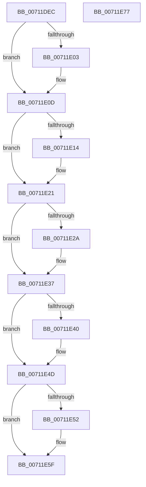

# DbgkpLkmdSqmStatus

- RVA: `0x00711DEC`–`0x00711E78` (길이 `140` bytes)
- VA: `0x0000000140711DEC`
- 실행 섹션: `PAGE`
- PDB 이름 있음: `예`; PDB Function 태그: `아니요`
- unwind 정보 RVA: `0x0005CAAC`
- 디코드: `39`개 명령, `140/140` bytes 표시
- 미해석 바이트: `0` (있으면 어셈블리에 `.byte`로 보존)

> 이 문서는 커널 이미지의 기계어와 PDB 기호를 분석해 생성했습니다. 4번과 5번은 함수 원형과 자료형을 바이너리 사용 방식에서 추정한 C 해석이며 원본 소스 복구 결과는 아닙니다.

## 1. Dependencies

- 직접 호출 지점: **6**; 고유 호출 대상: **1**
- 직접 호출자로 확인된 함수: **1**
- RIP 상대 이미지 참조: **0**

### Outgoing calls
- `0x00711E08` → [DbgkpLkmdSqmIncrementDword](../../text/58/DbgkpLkmdSqmIncrementDword_function_005801D8.md) (function, `0x005801D8`)
- `0x00711E1C` → [DbgkpLkmdSqmIncrementDword](../../text/58/DbgkpLkmdSqmIncrementDword_function_005801D8.md) (function, `0x005801D8`)
- `0x00711E32` → [DbgkpLkmdSqmIncrementDword](../../text/58/DbgkpLkmdSqmIncrementDword_function_005801D8.md) (function, `0x005801D8`)
- `0x00711E48` → [DbgkpLkmdSqmIncrementDword](../../text/58/DbgkpLkmdSqmIncrementDword_function_005801D8.md) (function, `0x005801D8`)
- `0x00711E5A` → [DbgkpLkmdSqmIncrementDword](../../text/58/DbgkpLkmdSqmIncrementDword_function_005801D8.md) (function, `0x005801D8`)
- `0x00711E67` → [DbgkpLkmdSqmIncrementDword](../../text/58/DbgkpLkmdSqmIncrementDword_function_005801D8.md) (function, `0x005801D8`)

### Direct callers
- [DbgkCaptureLiveDump](DbgkCaptureLiveDump_function_0071113C.md) at `0x00711369`
- [DbgkCaptureLiveDump](DbgkCaptureLiveDump_function_0071113C.md) at `0x007113F7`

### Static image references
- 디코드된 RIP-relative 메모리 참조가 없습니다.

## 2. Other-region calls and transfers

- 다른 실행 섹션으로 향하는 call: **6**
  - `0x00711E08` → [DbgkpLkmdSqmIncrementDword](../../text/58/DbgkpLkmdSqmIncrementDword_function_005801D8.md) (`PAGE` → `.text`)
  - `0x00711E1C` → [DbgkpLkmdSqmIncrementDword](../../text/58/DbgkpLkmdSqmIncrementDword_function_005801D8.md) (`PAGE` → `.text`)
  - `0x00711E32` → [DbgkpLkmdSqmIncrementDword](../../text/58/DbgkpLkmdSqmIncrementDword_function_005801D8.md) (`PAGE` → `.text`)
  - `0x00711E48` → [DbgkpLkmdSqmIncrementDword](../../text/58/DbgkpLkmdSqmIncrementDword_function_005801D8.md) (`PAGE` → `.text`)
  - `0x00711E5A` → [DbgkpLkmdSqmIncrementDword](../../text/58/DbgkpLkmdSqmIncrementDword_function_005801D8.md) (`PAGE` → `.text`)
  - `0x00711E67` → [DbgkpLkmdSqmIncrementDword](../../text/58/DbgkpLkmdSqmIncrementDword_function_005801D8.md) (`PAGE` → `.text`)
- 별도 외부 분기/꼬리 이동을 확인하지 못했습니다.

## 3. Assembly (complete function range)

```asm
00711DEC  48 89 5C 24 08                  mov qword ptr [rsp + 8], rbx
00711DF1  57                              push rdi
00711DF2  48 83 EC 20                     sub rsp, 0x20
00711DF6  8B 42 04                        mov eax, dword ptr [rdx + 4]
00711DF9  48 8B FA                        mov rdi, rdx
00711DFC  48 8B D9                        mov rbx, rcx
00711DFF  A8 02                           test al, 2
00711E01  74 0A                           je 0x140711e0d
00711E03  BA E1 0C 00 00                  mov edx, 0xce1
00711E08  E8 CB E3 E6 FF                  call 0x1405801d8
00711E0D  8B 47 04                        mov eax, dword ptr [rdi + 4]
00711E10  A8 08                           test al, 8
00711E12  74 0D                           je 0x140711e21
00711E14  BA E2 0C 00 00                  mov edx, 0xce2
00711E19  48 8B CB                        mov rcx, rbx
00711E1C  E8 B7 E3 E6 FF                  call 0x1405801d8
00711E21  F7 47 04 00 40 00 00            test dword ptr [rdi + 4], 0x4000
00711E28  74 0D                           je 0x140711e37
00711E2A  BA DE 0C 00 00                  mov edx, 0xcde
00711E2F  48 8B CB                        mov rcx, rbx
00711E32  E8 A1 E3 E6 FF                  call 0x1405801d8
00711E37  F7 47 04 00 80 00 00            test dword ptr [rdi + 4], 0x8000
00711E3E  74 0D                           je 0x140711e4d
00711E40  BA DF 0C 00 00                  mov edx, 0xcdf
00711E45  48 8B CB                        mov rcx, rbx
00711E48  E8 8B E3 E6 FF                  call 0x1405801d8
00711E4D  83 3F 00                        cmp dword ptr [rdi], 0
00711E50  7C 0D                           jl 0x140711e5f
00711E52  BA E0 0C 00 00                  mov edx, 0xce0
00711E57  48 8B CB                        mov rcx, rbx
00711E5A  E8 79 E3 E6 FF                  call 0x1405801d8
00711E5F  BA DD 0C 00 00                  mov edx, 0xcdd
00711E64  48 8B CB                        mov rcx, rbx
00711E67  E8 6C E3 E6 FF                  call 0x1405801d8
00711E6C  48 8B 5C 24 30                  mov rbx, qword ptr [rsp + 0x30]
00711E71  48 83 C4 20                     add rsp, 0x20
00711E75  5F                              pop rdi
00711E76  C3                              ret
00711E77  CC                              int3
```

## 4. C-style interpretation (structured pseudocode)

```c
__int64 __fastcall DbgkpLkmdSqmStatus(__int64 a1, __int64 a2)
{
    __int64 result;
    __int64 v_rsp;
    unsigned __int64 v_stack_p8;

    v_stack_p8 = v_rbx;
    v_rsp = (v_rsp) - (32);
    result = (unsigned int)(*(unsigned int *)(a2 + 4));
    if ((((unsigned __int8)((unsigned int)(*(unsigned int *)(a2 + 4)))) & (2)) != 0) {
        a2 = 0xCE1ULL;
        result = DbgkpLkmdSqmIncrementDword(a1, a2, a3, a4);
    }
    result = (unsigned int)(*(unsigned int *)(a2 + 4));
    if ((((unsigned __int8)((unsigned int)(*(unsigned int *)(a2 + 4)))) & (8)) != 0) {
        a2 = 0xCE2ULL;
        a1 = a1;
        result = DbgkpLkmdSqmIncrementDword(a1, a2, a3, a4);
    }
    if (((*(unsigned int *)(a2 + 4)) & (0x4000ULL)) != 0) {
        a2 = 0xCDEULL;
        a1 = a1;
        result = DbgkpLkmdSqmIncrementDword(a1, a2, a3, a4);
    }
    if (((*(unsigned int *)(a2 + 4)) & (0x8000ULL)) != 0) {
        a2 = 0xCDFULL;
        a1 = a1;
        result = DbgkpLkmdSqmIncrementDword(a1, a2, a3, a4);
    }
    if ((*(unsigned int *)(a2)) >= 0) {
        a2 = 0xCE0ULL;
        a1 = a1;
        result = DbgkpLkmdSqmIncrementDword(a1, a2, a3, a4);
    }
    result = DbgkpLkmdSqmIncrementDword(a1, (unsigned int)(0xCDDULL), a3, a4);
    v_rsp = (v_rsp) + (32);
    return result;
}
```

## 5. (Beta) C Style

```c
int64_t DbgkpLkmdSqmStatus(int64_t Arg1, void *Arg2)
{
    uint8_t *arg2 = (uint8_t *)Arg2;

    int64_t result;
    int64_t local_rsp;
    uint64_t v_stack_p8;

    v_stack_p8 = local_rbx;
    local_rsp = (local_rsp) - (32);
    result = (uint32_t)(*(uint32_t *)(arg2 + 0x4));
    if ((((uint8_t)((uint32_t)(*(uint32_t *)(arg2 + 0x4)))) & (2)) != 0) {
        Arg2 = 0xCE1ULL;
        result = DbgkpLkmdSqmIncrementDword(Arg1, Arg2, a3, a4);
    }
    result = (uint32_t)(*(uint32_t *)(arg2 + 0x4));
    if ((((uint8_t)((uint32_t)(*(uint32_t *)(arg2 + 0x4)))) & (8)) != 0) {
        Arg2 = 0xCE2ULL;
        Arg1 = Arg1;
        result = DbgkpLkmdSqmIncrementDword(Arg1, Arg2, a3, a4);
    }
    if (((*(uint32_t *)(arg2 + 0x4)) & (0x4000ULL)) != 0) {
        Arg2 = 0xCDEULL;
        Arg1 = Arg1;
        result = DbgkpLkmdSqmIncrementDword(Arg1, Arg2, a3, a4);
    }
    if (((*(uint32_t *)(arg2 + 0x4)) & (0x8000ULL)) != 0) {
        Arg2 = 0xCDFULL;
        Arg1 = Arg1;
        result = DbgkpLkmdSqmIncrementDword(Arg1, Arg2, a3, a4);
    }
    if ((*(uint32_t *)(arg2)) >= 0) {
        Arg2 = 0xCE0ULL;
        Arg1 = Arg1;
        result = DbgkpLkmdSqmIncrementDword(Arg1, Arg2, a3, a4);
    }
    result = DbgkpLkmdSqmIncrementDword(Arg1, (uint32_t)(0xCDDULL), a3, a4);
    local_rsp = (local_rsp) + (32);
    return result;
}
```

### 관측된 메모리 오프셋

구조체 형식이 확인되지 않은 접근은 인자 기준의 오프셋으로만 기록했습니다.

| 기준 인자 | 오프셋 표현 | 폭 (bit) | 접근 |
|---|---:|---:|---|
| `Arg2` | `+ 0x0` | `32` | `R` |
| `Arg2` | `+ 0x4` | `32` | `R` |

## 6. Execution-region graph

[열기: 2D/3D 그래프와 함수 탐색 컨트롤 패널](../../../control-panel.html?section=page&rva=0x00711DEC&view=graph)

- 2D 그래프는 위에서 아래로 흐르고, 3D 그래프는 빈 공간을 드래그해 회전합니다. Shift+드래그는 이동, 휠은 확대·축소, 함수 노드 선택은 대상 보고서 이동입니다.

### Static fallback


