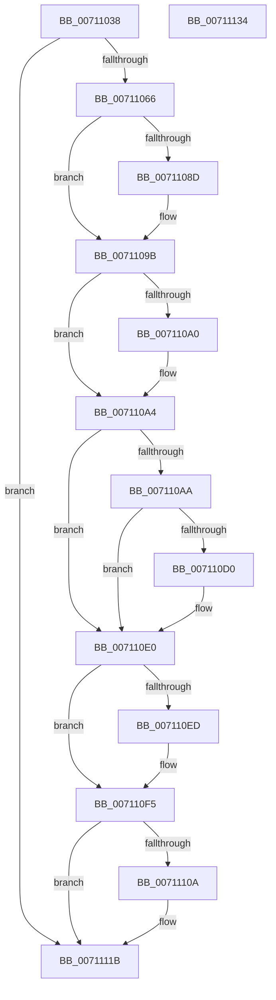

# DbgkpRemoveErrorPort

- RVA: `0x00711038`–`0x00711135` (길이 `253` bytes)
- VA: `0x0000000140711038`
- 실행 섹션: `PAGE`
- PDB 이름 있음: `예`; PDB Function 태그: `아니요`
- unwind 정보 RVA: `0x00060300`
- 디코드: `68`개 명령, `253/253` bytes 표시
- 미해석 바이트: `0` (있으면 어셈블리에 `.byte`로 보존)

> 이 문서는 커널 이미지의 기계어와 PDB 기호를 분석해 생성했습니다. 4번과 5번은 함수 원형과 자료형을 바이너리 사용 방식에서 추정한 C 해석이며 원본 소스 복구 결과는 아닙니다.

## 1. Dependencies

- 직접 호출 지점: **9**; 고유 호출 대상: **9**
- 직접 호출자로 확인된 함수: **2**
- RIP 상대 이미지 참조: **1**

### Outgoing calls
- `0x0071107D` → [KeAbPreAcquire](../../text/21/KeAbPreAcquire_function_00210230.md) (function, `0x00210230`)
- `0x00711096` → [ExfAcquirePushLockExclusiveEx](../../text/20/ExfAcquirePushLockExclusiveEx_function_0020FC90.md) (function, `0x0020FC90`)
- `0x007110B8` → [HalAdjustResourceList](../../text/48/HalAdjustResourceList_function_0048FDC0.md) (function, `0x0048FDC0`)
- `0x007110C0` → [PsGetServerSiloGlobals](../../text/22/PsGetServerSiloGlobals_function_002250A0.md) (function, `0x002250A0`)
- `0x007110F0` → [ExfTryToWakePushLock](../../text/26/ExfTryToWakePushLock_function_00265DD0.md) (function, `0x00265DD0`)
- `0x007110F8` → [KeAbPostRelease](../../text/2E/KeAbPostRelease_function_002E1600.md) (function, `0x002E1600`)
- `0x00711100` → [KeLeaveCriticalRegionThread](../../text/25/KeLeaveCriticalRegionThread_function_0025EFF0.md) (function, `0x0025EFF0`)
- `0x0071110D` → [DbgkpDereferenceErrorPort](../../text/57/DbgkpDereferenceErrorPort_function_0057FD58.md) (function, `0x0057FD58`)
- `0x00711116` → [KeResetEvent](../../text/24/KeResetEvent_function_00248350.md) (function, `0x00248350`)

### Direct callers
- [DbgkpSendErrorMessage](../92/DbgkpSendErrorMessage_function_009210A8.md) at `0x009214A0`
- [sub_00B20C44](../B2/Unknown_function_00B20C44.md) at `0x00B20CD3`

### Static image references
- `0x007110D0` → RVA `0x00FC5008` (`ALMOSTRO`; read)

## 2. Other-region calls and transfers

- 다른 실행 섹션으로 향하는 call: **9**
  - `0x0071107D` → [KeAbPreAcquire](../../text/21/KeAbPreAcquire_function_00210230.md) (`PAGE` → `.text`)
  - `0x00711096` → [ExfAcquirePushLockExclusiveEx](../../text/20/ExfAcquirePushLockExclusiveEx_function_0020FC90.md) (`PAGE` → `.text`)
  - `0x007110B8` → [HalAdjustResourceList](../../text/48/HalAdjustResourceList_function_0048FDC0.md) (`PAGE` → `.text`)
  - `0x007110C0` → [PsGetServerSiloGlobals](../../text/22/PsGetServerSiloGlobals_function_002250A0.md) (`PAGE` → `.text`)
  - `0x007110F0` → [ExfTryToWakePushLock](../../text/26/ExfTryToWakePushLock_function_00265DD0.md) (`PAGE` → `.text`)
  - `0x007110F8` → [KeAbPostRelease](../../text/2E/KeAbPostRelease_function_002E1600.md) (`PAGE` → `.text`)
  - `0x00711100` → [KeLeaveCriticalRegionThread](../../text/25/KeLeaveCriticalRegionThread_function_0025EFF0.md) (`PAGE` → `.text`)
  - `0x0071110D` → [DbgkpDereferenceErrorPort](../../text/57/DbgkpDereferenceErrorPort_function_0057FD58.md) (`PAGE` → `.text`)
  - `0x00711116` → [KeResetEvent](../../text/24/KeResetEvent_function_00248350.md) (`PAGE` → `.text`)
- 별도 외부 분기/꼬리 이동을 확인하지 못했습니다.

## 3. Assembly (complete function range)

```asm
00711038  48 89 5C 24 08                  mov qword ptr [rsp + 8], rbx
0071103D  48 89 6C 24 10                  mov qword ptr [rsp + 0x10], rbp
00711042  48 89 74 24 18                  mov qword ptr [rsp + 0x18], rsi
00711047  57                              push rdi
00711048  41 56                           push r14
0071104A  41 57                           push r15
0071104C  48 83 EC 20                     sub rsp, 0x20
00711050  F0 41 0F BA 68 04 00            lock bts dword ptr [r8 + 4], 0
00711057  49 8B F0                        mov rsi, r8
0071105A  48 8B FA                        mov rdi, rdx
0071105D  4C 8B F1                        mov r14, rcx
00711060  0F 82 B5 00 00 00               jb 0x14071111b
00711066  48 83 CB FF                     or rbx, 0xffffffffffffffff
0071106A  45 33 C0                        xor r8d, r8d
0071106D  66 01 99 E4 01 00 00            add word ptr [rcx + 0x1e4], bx
00711074  33 D2                           xor edx, edx
00711076  48 8B CF                        mov rcx, rdi
00711079  45 33 FF                        xor r15d, r15d
0071107C  90                              nop
0071107D  E8 AE F1 AF FF                  call 0x140210230
00711082  F0 48 0F BA 2F 00               lock bts qword ptr [rdi], 0
00711088  48 8B E8                        mov rbp, rax
0071108B  73 0E                           jae 0x14071109b
0071108D  4C 8B C7                        mov r8, rdi
00711090  48 8B D0                        mov rdx, rax
00711093  48 8B CF                        mov rcx, rdi
00711096  E8 F5 EB AF FF                  call 0x14020fc90
0071109B  48 85 ED                        test rbp, rbp
0071109E  74 04                           je 0x1407110a4
007110A0  C6 45 0A 01                     mov byte ptr [rbp + 0xa], 1
007110A4  48 39 77 08                     cmp qword ptr [rdi + 8], rsi
007110A8  75 36                           jne 0x1407110e0
007110AA  4C 21 7F 10                     and qword ptr [rdi + 0x10], r15
007110AE  4C 21 7F 08                     and qword ptr [rdi + 8], r15
007110B2  41 BF 01 00 00 00               mov r15d, 1
007110B8  E8 03 ED D7 FF                  call 0x14048fdc0
007110BD  48 8B C8                        mov rcx, rax
007110C0  E8 DB 3F B1 FF                  call 0x1402250a0
007110C5  48 05 A8 03 00 00               add rax, 0x3a8
007110CB  48 3B F8                        cmp rdi, rax
007110CE  75 10                           jne 0x1407110e0
007110D0  48 8B 05 31 3F 8B 00            mov rax, qword ptr [rip + 0x8b3f31]
007110D7  F0 0F BA B0 F0 02 00 00 00      lock btr dword ptr [rax + 0x2f0], 0
007110E0  F0 48 0F C1 1F                  lock xadd qword ptr [rdi], rbx
007110E5  80 E3 06                        and bl, 6
007110E8  80 FB 02                        cmp bl, 2
007110EB  75 08                           jne 0x1407110f5
007110ED  48 8B CF                        mov rcx, rdi
007110F0  E8 DB 4C B5 FF                  call 0x140265dd0
007110F5  48 8B CF                        mov rcx, rdi
007110F8  E8 03 05 BD FF                  call 0x1402e1600
007110FD  49 8B CE                        mov rcx, r14
00711100  E8 EB DE B4 FF                  call 0x14025eff0
00711105  45 85 FF                        test r15d, r15d
00711108  74 11                           je 0x14071111b
0071110A  48 8B CE                        mov rcx, rsi
0071110D  E8 46 EC E6 FF                  call 0x14057fd58
00711112  48 8B 4F 18                     mov rcx, qword ptr [rdi + 0x18]
00711116  E8 35 72 B3 FF                  call 0x140248350
0071111B  48 8B 5C 24 40                  mov rbx, qword ptr [rsp + 0x40]
00711120  48 8B 6C 24 48                  mov rbp, qword ptr [rsp + 0x48]
00711125  48 8B 74 24 50                  mov rsi, qword ptr [rsp + 0x50]
0071112A  48 83 C4 20                     add rsp, 0x20
0071112E  41 5F                           pop r15
00711130  41 5E                           pop r14
00711132  5F                              pop rdi
00711133  C3                              ret
00711134  CC                              int3
```

## 4. C-style interpretation (structured pseudocode)

```c
__int64 __fastcall DbgkpRemoveErrorPort(__int64 a1, __int64 a2, __int64 a3)
{
    __int64 result;
    __int64 v_r15;
    __int64 v_rbx;
    __int64 v_rsp;
    unsigned __int64 v_stack_p10;
    unsigned __int64 v_stack_p18;
    unsigned __int64 v_stack_p8;

    v_stack_p8 = v_rbx;
    v_stack_p10 = v_rbp;
    v_stack_p18 = v_rsi;
    v_rsp = (v_rsp) - (32);
    if (condition_is_below) goto loc_0071111B;
    v_rbx = (v_rbx) | (-1);
    a3 = 0;
    a2 = 0;
    v_r15 = 0;
    result = KeAbPreAcquire(0, a2, a3, a4);
    if (!(condition_is_above_or_equal)) {
        a3 = 0;
        a2 = result;
        a1 = a2;
        result = ExfAcquirePushLockExclusiveEx(a1, a2, a3, a4);
    }
    if (result != 0) {
        *(unsigned __int8 *)(result + 10) = 1;
    }
    if ((*(unsigned __int64 *)(a2 + 8)) != a3) goto loc_007110E0;
    result = HalAdjustResourceList(a1, a2, a3, a4);
    result = PsGetServerSiloGlobals(result, a2, a3, a4);
    result = (result) + (936);
    if (a2 == result) {
        result = *(unsigned __int64 *)(v_rip + 9125681);
    }
    v_rbx = (unsigned __int8)((v_rbx) & (6));
    if (((unsigned __int8)(v_rbx)) == 2) {
        a1 = a2;
        result = ExfTryToWakePushLock(a1, a2, a3, a4);
    }
    result = KeAbPostRelease(a2, a2, a3, a4);
    result = KeLeaveCriticalRegionThread(a1, a2, a3, a4);
    if (1 != 0) {
        a1 = a3;
        result = DbgkpDereferenceErrorPort(a1, a2, a3, a4);
        a1 = *(unsigned __int64 *)(a2 + 24);
        result = KeResetEvent(a1, a2, a3, a4);
    }
    v_rsp = (v_rsp) + (32);
    return result;
}
```

## 5. (Beta) C Style

```c
int64_t DbgkpRemoveErrorPort(void *Arg1, void *Arg2, void *Arg3)
{
    uint8_t *arg1 = (uint8_t *)Arg1;
    uint8_t *arg2 = (uint8_t *)Arg2;
    uint8_t *arg3 = (uint8_t *)Arg3;

    int64_t result;
    int64_t local_r15;
    int64_t local_rbx;
    int64_t local_rsp;
    uint64_t v_stack_p10;
    uint64_t v_stack_p18;
    uint64_t v_stack_p8;

    v_stack_p8 = local_rbx;
    v_stack_p10 = local_rbp;
    v_stack_p18 = local_rsi;
    local_rsp = (local_rsp) - (32);
    if (condition_is_below) goto loc_0071111B;
    local_rbx = (local_rbx) | (-1);
    Arg3 = 0;
    Arg2 = 0;
    local_r15 = 0;
    result = KeAbPreAcquire(0, Arg2, Arg3, a4);
    if (!(condition_is_above_or_equal)) {
        Arg3 = 0;
        Arg2 = result;
        Arg1 = Arg2;
        result = ExfAcquirePushLockExclusiveEx(Arg1, Arg2, Arg3, a4);
    }
    if (result != 0) {
        *(uint8_t *)(result + 0xA) = 1;
    }
    if ((*(uint64_t *)(arg2 + 0x8)) != Arg3) goto loc_007110E0;
    result = HalAdjustResourceList(Arg1, Arg2, Arg3, a4);
    result = PsGetServerSiloGlobals(result, Arg2, Arg3, a4);
    result = (result) + (936);
    if (Arg2 == result) {
        result = *(uint64_t *)(v_rip + 0x8B3F31);
    }
    local_rbx = (uint8_t)((local_rbx) & (6));
    if (((uint8_t)(local_rbx)) == 2) {
        Arg1 = Arg2;
        result = ExfTryToWakePushLock(Arg1, Arg2, Arg3, a4);
    }
    result = KeAbPostRelease(Arg2, Arg2, Arg3, a4);
    result = KeLeaveCriticalRegionThread(Arg1, Arg2, Arg3, a4);
    if (1 != 0) {
        Arg1 = Arg3;
        result = DbgkpDereferenceErrorPort(Arg1, Arg2, Arg3, a4);
        Arg1 = *(uint64_t *)(arg2 + 0x18);
        result = KeResetEvent(Arg1, Arg2, Arg3, a4);
    }
    local_rsp = (local_rsp) + (32);
    return result;
}
```

### 관측된 메모리 오프셋

구조체 형식이 확인되지 않은 접근은 인자 기준의 오프셋으로만 기록했습니다.

| 기준 인자 | 오프셋 표현 | 폭 (bit) | 접근 |
|---|---:|---:|---|
| `Arg1` | `+ 0x1E4` | `16` | `R/W` |
| `Arg2` | `+ 0x0` | `64` | `R/W` |
| `Arg2` | `+ 0x8` | `64` | `R` |
| `Arg2` | `+ 0x8` | `64` | `R/W` |
| `Arg2` | `+ 0x10` | `64` | `R/W` |
| `Arg3` | `+ 0x4` | `32` | `R/W` |

## 6. Execution-region graph

[열기: 2D/3D 그래프와 함수 탐색 컨트롤 패널](../../../control-panel.html?section=page&rva=0x00711038&view=graph)

- 2D 그래프는 위에서 아래로 흐르고, 3D 그래프는 빈 공간을 드래그해 회전합니다. Shift+드래그는 이동, 휠은 확대·축소, 함수 노드 선택은 대상 보고서 이동입니다.

### Static fallback


