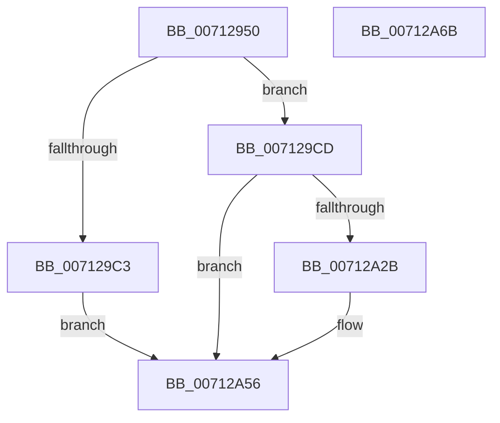

# DbgkpTriageDumpFillHeaders

- RVA: `0x00712950`–`0x00712A6C` (길이 `284` bytes)
- VA: `0x0000000140712950`
- 실행 섹션: `PAGE`
- PDB 이름 있음: `예`; PDB Function 태그: `아니요`
- unwind 정보 RVA: `0x000C5AAC`
- 디코드: `64`개 명령, `284/284` bytes 표시
- 미해석 바이트: `0` (있으면 어셈블리에 `.byte`로 보존)

> 이 문서는 커널 이미지의 기계어와 PDB 기호를 분석해 생성했습니다. 4번과 5번은 함수 원형과 자료형을 바이너리 사용 방식에서 추정한 C 해석이며 원본 소스 복구 결과는 아닙니다.

## 1. Dependencies

- 직접 호출 지점: **2**; 고유 호출 대상: **2**
- 직접 호출자로 확인된 함수: **0**
- RIP 상대 이미지 참조: **1**

### Outgoing calls
- `0x0071299F` → [IoFillDumpHeader](../../text/59/IoFillDumpHeader_function_00591ECC.md) (function, `0x00591ECC`)
- `0x00712A22` → [IoFillTriageDumpBuffer](../../text/59/IoFillTriageDumpBuffer_function_005921CC.md) (function, `0x005921CC`)

### Direct callers
- 이 함수 시작 RVA로 연결되는 직접 call은 확인되지 않았습니다. 간접 호출은 완전히 역산할 수 없습니다.

### Static image references
- `0x007129FF` → RVA `0x00FC41C0` (`.data`; read)

## 2. Other-region calls and transfers

- 다른 실행 섹션으로 향하는 call: **2**
  - `0x0071299F` → [IoFillDumpHeader](../../text/59/IoFillDumpHeader_function_00591ECC.md) (`PAGE` → `.text`)
  - `0x00712A22` → [IoFillTriageDumpBuffer](../../text/59/IoFillTriageDumpBuffer_function_005921CC.md) (`PAGE` → `.text`)
- 별도 외부 분기/꼬리 이동을 확인하지 못했습니다.

## 3. Assembly (complete function range)

```asm
00712950  4C 8B DC                        mov r11, rsp
00712953  49 89 5B 10                     mov qword ptr [r11 + 0x10], rbx
00712957  49 89 73 18                     mov qword ptr [r11 + 0x18], rsi
0071295B  57                              push rdi
0071295C  48 81 EC 80 00 00 00            sub rsp, 0x80
00712963  49 83 63 B0 00                  and qword ptr [r11 - 0x50], 0
00712968  48 8B F9                        mov rdi, rcx
0071296B  48 8B 31                        mov rsi, qword ptr [rcx]
0071296E  48 8B 84 24 B8 00 00 00         mov rax, qword ptr [rsp + 0xb8]
00712976  48 8B CE                        mov rcx, rsi
00712979  49 89 43 A8                     mov qword ptr [r11 - 0x58], rax
0071297D  48 8B 84 24 B0 00 00 00         mov rax, qword ptr [rsp + 0xb0]
00712985  49 89 43 A0                     mov qword ptr [r11 - 0x60], rax
00712989  48 8D 9E 00 20 00 00            lea rbx, [rsi + 0x2000]
00712990  4D 89 4B 98                     mov qword ptr [r11 - 0x68], r9
00712994  4D 8B C8                        mov r9, r8
00712997  44 8B C2                        mov r8d, edx
0071299A  BA 04 00 00 00                  mov edx, 4
0071299F  E8 28 F5 E7 FF                  call 0x140591ecc
007129A4  8B 4F 08                        mov ecx, dword ptr [rdi + 8]
007129A7  83 64 24 70 00                  and dword ptr [rsp + 0x70], 0
007129AC  83 A4 24 90 00 00 00 00         and dword ptr [rsp + 0x90], 0
007129B4  83 8E 50 10 00 00 10            or dword ptr [rsi + 0x1050], 0x10
007129BB  81 F9 00 20 00 00               cmp ecx, 0x2000
007129C1  73 0A                           jae 0x1407129cd
007129C3  B8 9A 00 00 C0                  mov eax, 0xc000009a
007129C8  E9 89 00 00 00                  jmp 0x140712a56
007129CD  48 8D 44 24 70                  lea rax, [rsp + 0x70]
007129D2  81 C1 00 E0 FF FF               add ecx, 0xffffe000
007129D8  48 89 44 24 60                  mov qword ptr [rsp + 0x60], rax
007129DD  41 B9 40 04 00 00               mov r9d, 0x440
007129E3  48 83 64 24 58 00               and qword ptr [rsp + 0x58], 0
007129E9  45 33 C0                        xor r8d, r8d
007129EC  48 83 64 24 50 00               and qword ptr [rsp + 0x50], 0
007129F2  48 8B D3                        mov rdx, rbx
007129F5  83 64 24 48 00                  and dword ptr [rsp + 0x48], 0
007129FA  83 64 24 40 00                  and dword ptr [rsp + 0x40], 0
007129FF  8B 05 BB 17 8B 00               mov eax, dword ptr [rip + 0x8b17bb]
00712A05  89 44 24 38                     mov dword ptr [rsp + 0x38], eax
00712A09  48 8D 84 24 90 00 00 00         lea rax, [rsp + 0x90]
00712A11  48 83 64 24 30 00               and qword ptr [rsp + 0x30], 0
00712A17  48 83 64 24 28 00               and qword ptr [rsp + 0x28], 0
00712A1D  48 89 44 24 20                  mov qword ptr [rsp + 0x20], rax
00712A22  E8 A5 F7 E7 FF                  call 0x1405921cc
00712A27  85 C0                           test eax, eax
00712A29  78 2B                           js 0x140712a56
00712A2B  8B 84 24 90 00 00 00            mov eax, dword ptr [rsp + 0x90]
00712A32  89 86 38 10 00 00               mov dword ptr [rsi + 0x1038], eax
00712A38  8B 44 24 70                     mov eax, dword ptr [rsp + 0x70]
00712A3C  05 07 20 00 00                  add eax, 0x2007
00712A41  83 E0 F8                        and eax, 0xfffffff8
00712A44  89 47 18                        mov dword ptr [rdi + 0x18], eax
00712A47  8B 47 08                        mov eax, dword ptr [rdi + 8]
00712A4A  83 63 7C 00                     and dword ptr [rbx + 0x7c], 0
00712A4E  83 E8 04                        sub eax, 4
00712A51  89 43 78                        mov dword ptr [rbx + 0x78], eax
00712A54  33 C0                           xor eax, eax
00712A56  4C 8D 9C 24 80 00 00 00         lea r11, [rsp + 0x80]
00712A5E  49 8B 5B 18                     mov rbx, qword ptr [r11 + 0x18]
00712A62  49 8B 73 20                     mov rsi, qword ptr [r11 + 0x20]
00712A66  49 8B E3                        mov rsp, r11
00712A69  5F                              pop rdi
00712A6A  C3                              ret
00712A6B  CC                              int3
```

## 4. C-style interpretation (structured pseudocode)

```c
__int64 __fastcall DbgkpTriageDumpFillHeaders(__int64 a1, int a2, __int64 a3, __int64 a4, __int64 a5, __int64 a6)
{
    __int64 result;
    __int64 v_rsp;
    unsigned int v_stack_m18;
    unsigned __int64 v_stack_m28;
    unsigned __int64 v_stack_m30;
    unsigned __int64 v_stack_m38;
    unsigned int v_stack_m40;
    unsigned int v_stack_m48;
    unsigned int v_stack_m50;
    unsigned __int64 v_stack_m58;
    unsigned __int64 v_stack_m60;
    unsigned __int64 v_stack_m68;
    unsigned __int64 v_stack_m8;
    unsigned int v_stack_p8;

    *(unsigned __int64 *)(v_rsp + 16) = v_rbx;
    *(unsigned __int64 *)(v_rsp + 24) = v_rsi;
    v_rsp = (v_rsp) - (128);
    *(unsigned __int64 *)(v_rsp - 88) = a6;
    *(unsigned __int64 *)(v_rsp - 96) = a5;
    *(unsigned __int64 *)(v_rsp - 104) = a4;
    result = IoFillDumpHeader(*(unsigned __int64 *)(a1), 4, (unsigned int)(a2), a3);
    if (((unsigned int)((unsigned int)(*(unsigned int *)(a1 + 8)))) >= 0x2000ULL) goto loc_007129CD;
    goto loc_00712A56;
loc_007129CD:
    a1 = (unsigned int)(((unsigned int)(*(unsigned int *)(a1 + 8))) + (0xFFFFE000ULL));
    v_stack_m28 = v_stack_m18;
    a3 = 0;
    v_stack_m50 = (unsigned int)((unsigned int)(*(unsigned int *)(v_rip + 9115579)));
    v_stack_m68 = v_stack_p8;
    result = IoFillTriageDumpBuffer(a1, *(unsigned __int64 *)(a1) + 8192, a3, (unsigned int)(0x440ULL));
    if (!(sign_flag)) {
        result = v_stack_p8;
        *(unsigned int *)(*(unsigned __int64 *)(a1) + 4152) = (unsigned int)(result);
        result = v_stack_m18;
        result = (unsigned int)((result) + (0x2007ULL));
        result = (unsigned int)((result) & (0xFFFFFFF8ULL));
        *(unsigned int *)(a1 + 24) = (unsigned int)(result);
        result = *(unsigned int *)(a1 + 8);
        result = (unsigned int)((result) - (4));
        *(unsigned int *)(*(unsigned __int64 *)(a1) + 8192 + 120) = (unsigned int)(result);
        result = 0;
    }
    return result;
}
```

## 5. (Beta) C Style

```c
int64_t DbgkpTriageDumpFillHeaders(void *Arg1, int32_t Arg2, int64_t Arg3, int64_t Arg4, int64_t Arg5, int64_t Arg6)
{
    uint8_t *arg1 = (uint8_t *)Arg1;

    int64_t result;
    int64_t local_rsp;
    uint32_t v_stack_m18;
    uint64_t v_stack_m28;
    uint64_t v_stack_m30;
    uint64_t v_stack_m38;
    uint32_t v_stack_m40;
    uint32_t v_stack_m48;
    uint32_t v_stack_m50;
    uint64_t v_stack_m58;
    uint64_t v_stack_m60;
    uint64_t v_stack_m68;
    uint64_t v_stack_m8;
    uint32_t v_stack_p8;

    *(uint64_t *)(local_rsp + 0x10) = local_rbx;
    *(uint64_t *)(local_rsp + 0x18) = local_rsi;
    local_rsp = (local_rsp) - (128);
    *(uint64_t *)(local_rsp - 0x58) = Arg6;
    *(uint64_t *)(local_rsp - 0x60) = Arg5;
    *(uint64_t *)(local_rsp - 0x68) = Arg4;
    result = IoFillDumpHeader(*(uint64_t *)(arg1), 4, (uint32_t)(Arg2), Arg3);
    if (((uint32_t)((uint32_t)(*(uint32_t *)(arg1 + 0x8)))) >= 0x2000ULL) goto loc_007129CD;
    goto loc_00712A56;
loc_007129CD:
    Arg1 = (uint32_t)(((uint32_t)(*(uint32_t *)(arg1 + 0x8))) + (0xFFFFE000ULL));
    v_stack_m28 = v_stack_m18;
    Arg3 = 0;
    v_stack_m50 = (uint32_t)((uint32_t)(*(uint32_t *)(v_rip + 0x8B17BB)));
    v_stack_m68 = v_stack_p8;
    result = IoFillTriageDumpBuffer(Arg1, *(uint64_t *)(arg1) + 8192, Arg3, (uint32_t)(0x440ULL));
    if (!(sign_flag)) {
        result = v_stack_p8;
        *(uint32_t *)(*(uint64_t *)(arg1) + 0x1038) = (uint32_t)(result);
        result = v_stack_m18;
        result = (uint32_t)((result) + (0x2007ULL));
        result = (uint32_t)((result) & (0xFFFFFFF8ULL));
        *(uint32_t *)(arg1 + 0x18) = (uint32_t)(result);
        result = *(uint32_t *)(arg1 + 0x8);
        result = (uint32_t)((result) - (4));
        *(uint32_t *)(*(uint64_t *)(arg1) + 0x2000 + 0x78) = (uint32_t)(result);
        result = 0;
    }
    return result;
}
```

### 관측된 메모리 오프셋

구조체 형식이 확인되지 않은 접근은 인자 기준의 오프셋으로만 기록했습니다.

| 기준 인자 | 오프셋 표현 | 폭 (bit) | 접근 |
|---|---:|---:|---|
| `Arg1` | `+ 0x0` | `64` | `R` |
| `Arg1` | `+ 0x8` | `32` | `R` |
| `Arg1` | `+ 0x18` | `32` | `W` |

## 6. Execution-region graph

[열기: 2D/3D 그래프와 함수 탐색 컨트롤 패널](../../../control-panel.html?section=page&rva=0x00712950&view=graph)

- 2D 그래프는 위에서 아래로 흐르고, 3D 그래프는 빈 공간을 드래그해 회전합니다. Shift+드래그는 이동, 휠은 확대·축소, 함수 노드 선택은 대상 보고서 이동입니다.

### Static fallback


