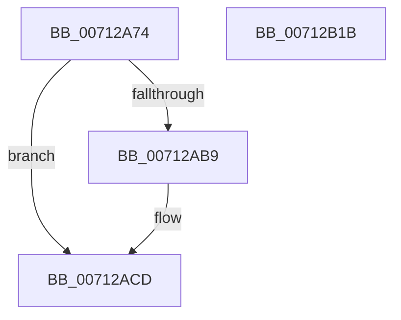

# DbgkpTriageDumpInitialize

- RVA: `0x00712A74`–`0x00712B1C` (길이 `168` bytes)
- VA: `0x0000000140712A74`
- 실행 섹션: `PAGE`
- PDB 이름 있음: `예`; PDB Function 태그: `아니요`
- unwind 정보 RVA: `0x0005CAAC`
- 디코드: `41`개 명령, `168/168` bytes 표시
- 미해석 바이트: `0` (있으면 어셈블리에 `.byte`로 보존)

> 이 문서는 커널 이미지의 기계어와 PDB 기호를 분석해 생성했습니다. 4번과 5번은 함수 원형과 자료형을 바이너리 사용 방식에서 추정한 C 해석이며 원본 소스 복구 결과는 아닙니다.

## 1. Dependencies

- 직접 호출 지점: **2**; 고유 호출 대상: **2**
- 직접 호출자로 확인된 함수: **1**
- RIP 상대 이미지 참조: **6**

### Outgoing calls
- `0x00712AAB` → [ExAllocatePoolWithTag](../../poolcode/B8/ExAllocatePoolWithTag_function_00B82010.md) (function, `0x00B82010`)
- `0x00712AC4` → [memset](../../text/6C/memset_function_006C6C40.md) (function, `0x006C6C40`)

### Direct callers
- [DbgkCaptureLiveDump](DbgkCaptureLiveDump_function_0071113C.md) at `0x0071123A`

### Static image references
- `0x00712ACD` → RVA `0x00712950` (`DbgkpTriageDumpFillHeaders`; read)
- `0x00712AD7` → RVA `0x005806E0` (`DbgkpTriageDumpSnapData`; read)
- `0x00712AE2` → RVA `0x00712B30` (`DbgkpTriageDumpIsMemoryBlockPresent`; read)
- `0x00712AED` → RVA `0x00712BD0` (`DbgkpTriageDumpSaveState`; read)
- `0x00712AF8` → RVA `0x00712BA0` (`DbgkpTriageDumpRestoreState`; read)
- `0x00712B03` → RVA `0x00712C00` (`DbgkpTriageDumpWrite`; read)

## 2. Other-region calls and transfers

- 다른 실행 섹션으로 향하는 call: **2**
  - `0x00712AAB` → [ExAllocatePoolWithTag](../../poolcode/B8/ExAllocatePoolWithTag_function_00B82010.md) (`PAGE` → `POOLCODE`)
  - `0x00712AC4` → [memset](../../text/6C/memset_function_006C6C40.md) (`PAGE` → `.text`)
- 별도 외부 분기/꼬리 이동을 확인하지 못했습니다.

## 3. Assembly (complete function range)

```asm
00712A74  48 89 5C 24 08                  mov qword ptr [rsp + 8], rbx
00712A79  57                              push rdi
00712A7A  48 83 EC 20                     sub rsp, 0x20
00712A7E  83 61 0C 00                     and dword ptr [rcx + 0xc], 0
00712A82  48 8B F9                        mov rdi, rcx
00712A85  83 61 10 00                     and dword ptr [rcx + 0x10], 0
00712A89  49 8B D9                        mov rbx, r9
00712A8C  83 61 14 00                     and dword ptr [rcx + 0x14], 0
00712A90  83 61 18 00                     and dword ptr [rcx + 0x18], 0
00712A94  48 89 11                        mov qword ptr [rcx], rdx
00712A97  BA 98 6F 00 00                  mov edx, 0x6f98
00712A9C  44 89 41 08                     mov dword ptr [rcx + 8], r8d
00712AA0  B9 00 06 00 00                  mov ecx, 0x600
00712AA5  41 B8 54 44 57 4D               mov r8d, 0x4d574454
00712AAB  E8 60 F5 46 00                  call 0x140b82010
00712AB0  48 89 47 20                     mov qword ptr [rdi + 0x20], rax
00712AB4  48 85 C0                        test rax, rax
00712AB7  74 14                           je 0x140712acd
00712AB9  33 D2                           xor edx, edx
00712ABB  41 B8 98 6F 00 00               mov r8d, 0x6f98
00712AC1  48 8B C8                        mov rcx, rax
00712AC4  E8 77 41 FB FF                  call 0x1406c6c40
00712AC9  83 67 28 00                     and dword ptr [rdi + 0x28], 0
00712ACD  48 8D 05 7C FE FF FF            lea rax, [rip - 0x184]
00712AD4  48 89 03                        mov qword ptr [rbx], rax
00712AD7  48 8D 05 02 DC E6 FF            lea rax, [rip - 0x1923fe]
00712ADE  48 89 43 10                     mov qword ptr [rbx + 0x10], rax
00712AE2  48 8D 05 47 00 00 00            lea rax, [rip + 0x47]
00712AE9  48 89 43 08                     mov qword ptr [rbx + 8], rax
00712AED  48 8D 05 DC 00 00 00            lea rax, [rip + 0xdc]
00712AF4  48 89 43 18                     mov qword ptr [rbx + 0x18], rax
00712AF8  48 8D 05 A1 00 00 00            lea rax, [rip + 0xa1]
00712AFF  48 89 43 20                     mov qword ptr [rbx + 0x20], rax
00712B03  48 8D 05 F6 00 00 00            lea rax, [rip + 0xf6]
00712B0A  48 89 43 28                     mov qword ptr [rbx + 0x28], rax
00712B0E  33 C0                           xor eax, eax
00712B10  48 8B 5C 24 30                  mov rbx, qword ptr [rsp + 0x30]
00712B15  48 83 C4 20                     add rsp, 0x20
00712B19  5F                              pop rdi
00712B1A  C3                              ret
00712B1B  CC                              int3
```

## 4. C-style interpretation (structured pseudocode)

```c
__int64 __fastcall DbgkpTriageDumpInitialize(__int64 a1, __int64 a2, int a3, __int64 a4)
{
    __int64 result;
    __int64 v_rsp;
    unsigned __int64 v_stack_p8;

    v_stack_p8 = v_rbx;
    v_rsp = (v_rsp) - (32);
    *(unsigned __int64 *)(a1) = a2;
    *(unsigned int *)(a1 + 8) = a3;
    result = ExAllocatePoolWithTag((unsigned int)(0x600ULL), (unsigned int)(0x6F98ULL), (unsigned int)(0x4D574454ULL), a4);
    *(unsigned __int64 *)(a1 + 32) = result;
    if (result != 0) {
        a2 = 0;
        a3 = 0x6F98ULL;
        a1 = result;
        result = memset(a1, a2, a3, a4);
    }
    *(unsigned __int64 *)(a4) = v_rip - 388;
    *(unsigned __int64 *)(a4 + 16) = v_rip - 1647614;
    *(unsigned __int64 *)(a4 + 8) = v_rip + 71;
    *(unsigned __int64 *)(a4 + 24) = v_rip + 220;
    *(unsigned __int64 *)(a4 + 32) = v_rip + 161;
    *(unsigned __int64 *)(a4 + 40) = v_rip + 246;
    result = 0;
    v_rsp = (v_rsp) + (32);
    return result;
}
```

## 5. (Beta) C Style

```c
int64_t DbgkpTriageDumpInitialize(void *Arg1, int64_t Arg2, int32_t Arg3, void *Arg4)
{
    uint8_t *arg1 = (uint8_t *)Arg1;
    uint8_t *arg4 = (uint8_t *)Arg4;

    int64_t result;
    int64_t local_rsp;
    uint64_t v_stack_p8;

    v_stack_p8 = local_rbx;
    local_rsp = (local_rsp) - (32);
    *(uint64_t *)(arg1) = Arg2;
    *(uint32_t *)(arg1 + 0x8) = Arg3;
    result = ExAllocatePoolWithTag((uint32_t)(0x600ULL), (uint32_t)(0x6F98ULL), (uint32_t)(0x4D574454ULL), Arg4);
    *(uint64_t *)(arg1 + 0x20) = result;
    if (result != 0) {
        Arg2 = 0;
        Arg3 = 0x6F98ULL;
        Arg1 = result;
        result = memset(Arg1, Arg2, Arg3, Arg4);
    }
    *(uint64_t *)(arg4) = v_rip - 388;
    *(uint64_t *)(arg4 + 0x10) = v_rip - 1647614;
    *(uint64_t *)(arg4 + 0x8) = v_rip + 71;
    *(uint64_t *)(arg4 + 0x18) = v_rip + 220;
    *(uint64_t *)(arg4 + 0x20) = v_rip + 161;
    *(uint64_t *)(arg4 + 0x28) = v_rip + 246;
    result = 0;
    local_rsp = (local_rsp) + (32);
    return result;
}
```

### 관측된 메모리 오프셋

구조체 형식이 확인되지 않은 접근은 인자 기준의 오프셋으로만 기록했습니다.

| 기준 인자 | 오프셋 표현 | 폭 (bit) | 접근 |
|---|---:|---:|---|
| `Arg1` | `+ 0x0` | `64` | `W` |
| `Arg1` | `+ 0x8` | `32` | `W` |
| `Arg1` | `+ 0xC` | `32` | `R/W` |
| `Arg1` | `+ 0x10` | `32` | `R/W` |
| `Arg1` | `+ 0x14` | `32` | `R/W` |
| `Arg1` | `+ 0x18` | `32` | `R/W` |
| `Arg1` | `+ 0x20` | `64` | `W` |
| `Arg1` | `+ 0x28` | `32` | `R/W` |
| `Arg4` | `+ 0x0` | `64` | `W` |
| `Arg4` | `+ 0x8` | `64` | `W` |
| `Arg4` | `+ 0x10` | `64` | `W` |
| `Arg4` | `+ 0x18` | `64` | `W` |
| `Arg4` | `+ 0x20` | `64` | `W` |
| `Arg4` | `+ 0x28` | `64` | `W` |

## 6. Execution-region graph

[열기: 2D/3D 그래프와 함수 탐색 컨트롤 패널](../../../control-panel.html?section=page&rva=0x00712A74&view=graph)

- 2D 그래프는 위에서 아래로 흐르고, 3D 그래프는 빈 공간을 드래그해 회전합니다. Shift+드래그는 이동, 휠은 확대·축소, 함수 노드 선택은 대상 보고서 이동입니다.

### Static fallback


