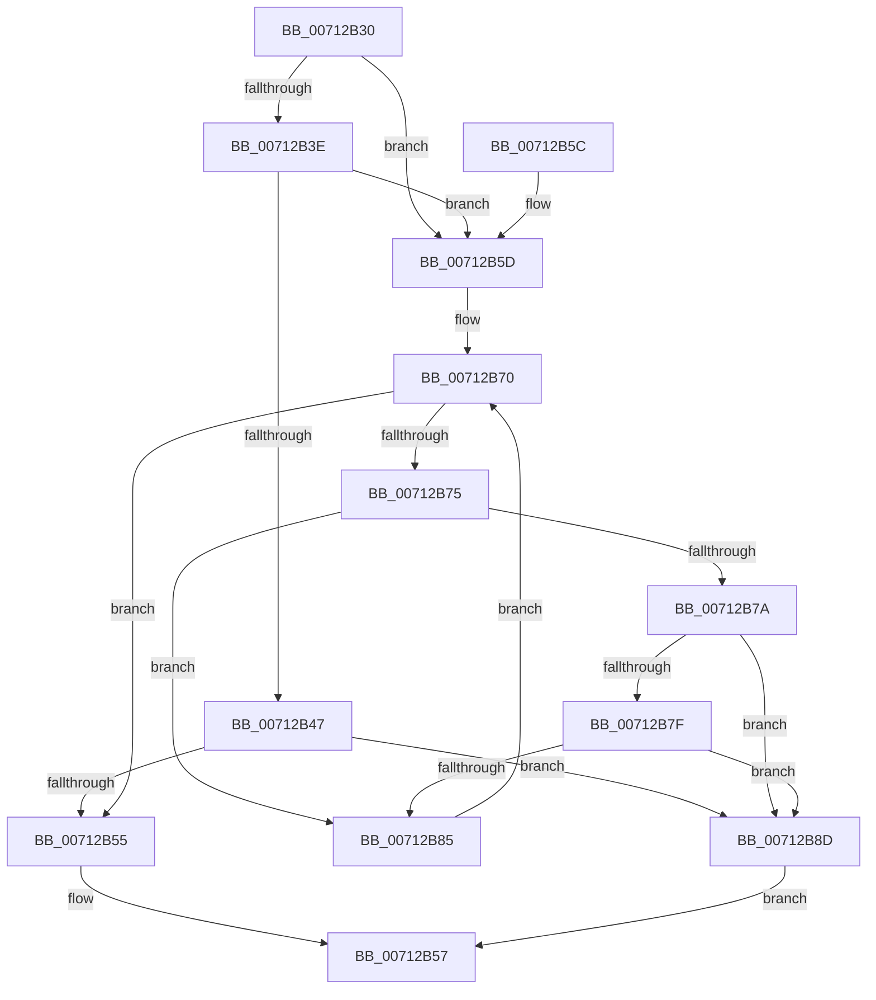

# DbgkpTriageDumpIsMemoryBlockPresent

- RVA: `0x00712B30`–`0x00712B91` (길이 `97` bytes)
- VA: `0x0000000140712B30`
- 실행 섹션: `PAGE`
- PDB 이름 있음: `예`; PDB Function 태그: `아니요`
- unwind 정보 RVA: `0x000B9D74`
- 디코드: `31`개 명령, `97/97` bytes 표시
- 미해석 바이트: `0` (있으면 어셈블리에 `.byte`로 보존)

> 이 문서는 커널 이미지의 기계어와 PDB 기호를 분석해 생성했습니다. 4번과 5번은 함수 원형과 자료형을 바이너리 사용 방식에서 추정한 C 해석이며 원본 소스 복구 결과는 아닙니다.

## 1. Dependencies

- 직접 호출 지점: **1**; 고유 호출 대상: **1**
- 직접 호출자로 확인된 함수: **0**
- RIP 상대 이미지 참조: **0**

### Outgoing calls
- `0x00712B4C` → [DbgkpTriageDumpCheckPresentHashTable](../../text/58/DbgkpTriageDumpCheckPresentHashTable_function_00580660.md) (function, `0x00580660`)

### Direct callers
- 이 함수 시작 RVA로 연결되는 직접 call은 확인되지 않았습니다. 간접 호출은 완전히 역산할 수 없습니다.

### Static image references
- 디코드된 RIP-relative 메모리 참조가 없습니다.

## 2. Other-region calls and transfers

- 다른 실행 섹션으로 향하는 call: **1**
  - `0x00712B4C` → [DbgkpTriageDumpCheckPresentHashTable](../../text/58/DbgkpTriageDumpCheckPresentHashTable_function_00580660.md) (`PAGE` → `.text`)
- 별도 외부 분기/꼬리 이동을 확인하지 못했습니다.

## 3. Assembly (complete function range)

```asm
00712B30  48 83 EC 28                     sub rsp, 0x28
00712B34  48 83 79 20 00                  cmp qword ptr [rcx + 0x20], 0
00712B39  4C 8B 09                        mov r9, qword ptr [rcx]
00712B3C  74 1F                           je 0x140712b5d
00712B3E  81 79 28 F9 06 00 00            cmp dword ptr [rcx + 0x28], 0x6f9
00712B45  73 16                           jae 0x140712b5d
00712B47  4C 8D 4C 24 30                  lea r9, [rsp + 0x30]
00712B4C  E8 0F DB E6 FF                  call 0x140580660
00712B51  84 C0                           test al, al
00712B53  75 38                           jne 0x140712b8d
00712B55  32 C0                           xor al, al
00712B57  48 83 C4 28                     add rsp, 0x28
00712B5B  C3                              ret
00712B5C  CC                              int3
00712B5D  41 8B 81 78 20 00 00            mov eax, dword ptr [r9 + 0x2078]
00712B64  45 8B 91 7C 20 00 00            mov r10d, dword ptr [r9 + 0x207c]
00712B6B  49 03 C1                        add rax, r9
00712B6E  33 C9                           xor ecx, ecx
00712B70  41 3B CA                        cmp ecx, r10d
00712B73  73 E0                           jae 0x140712b55
00712B75  48 39 10                        cmp qword ptr [rax], rdx
00712B78  75 0B                           jne 0x140712b85
00712B7A  45 85 C0                        test r8d, r8d
00712B7D  74 0E                           je 0x140712b8d
00712B7F  44 39 40 0C                     cmp dword ptr [rax + 0xc], r8d
00712B83  74 08                           je 0x140712b8d
00712B85  48 83 C0 10                     add rax, 0x10
00712B89  FF C1                           inc ecx
00712B8B  EB E3                           jmp 0x140712b70
00712B8D  B0 01                           mov al, 1
00712B8F  EB C6                           jmp 0x140712b57
```

## 4. C-style interpretation (structured pseudocode)

```c
__int64 __fastcall DbgkpTriageDumpIsMemoryBlockPresent(__int64 a1, __int64 a2, int a3)
{
    __int64 result;
    __int64 v_rsp;
    unsigned __int64 v_stack_p8;

    v_rsp = (v_rsp) - (40);
    if ((*(unsigned __int64 *)(a1 + 32)) == 0) goto loc_00712B5D;
    if ((*(unsigned int *)(a1 + 40)) >= 0x6F9ULL) goto loc_00712B5D;
    result = DbgkpTriageDumpCheckPresentHashTable(a1, a2, a3, v_stack_p8);
    if ((unsigned __int8)(result) != 0) goto loc_00712B8D;
loc_00712B55:
    result = 0;
loc_00712B57:
    v_rsp = (v_rsp) + (40);
    return result;
loc_00712B5D:
    result = ((unsigned int)(*(unsigned int *)(v_stack_p8 + 8312))) + (v_stack_p8);
    a1 = 0;
loc_00712B70:
    if (0 >= ((unsigned int)((unsigned int)(*(unsigned int *)(v_stack_p8 + 8316))))) goto loc_00712B55;
    if ((*(unsigned __int64 *)(result)) != a2) goto loc_00712B85;
    if (a3 == 0) goto loc_00712B8D;
    if ((*(unsigned int *)(result + 12)) == a3) goto loc_00712B8D;
loc_00712B85:
    result = (result) + (16);
    a1 = (unsigned int)((a1) + 1);
    goto loc_00712B70;
loc_00712B8D:
    goto loc_00712B57;
}
```

## 5. (Beta) C Style

```c
int64_t DbgkpTriageDumpIsMemoryBlockPresent(void *Arg1, int64_t Arg2, int32_t Arg3)
{
    uint8_t *arg1 = (uint8_t *)Arg1;

    int64_t result;
    int64_t local_rsp;
    uint64_t v_stack_p8;

    local_rsp = (local_rsp) - (40);
    if ((*(uint64_t *)(arg1 + 0x20)) == 0) goto loc_00712B5D;
    if ((*(uint32_t *)(arg1 + 0x28)) >= 0x6F9ULL) goto loc_00712B5D;
    result = DbgkpTriageDumpCheckPresentHashTable(Arg1, Arg2, Arg3, v_stack_p8);
    if ((uint8_t)(result) != 0) goto loc_00712B8D;
loc_00712B55:
    result = 0;
loc_00712B57:
    local_rsp = (local_rsp) + (40);
    return result;
loc_00712B5D:
    result = ((uint32_t)(*(uint32_t *)(v_stack_p8 + 0x2078))) + (v_stack_p8);
    Arg1 = 0;
loc_00712B70:
    if (0 >= ((uint32_t)((uint32_t)(*(uint32_t *)(v_stack_p8 + 0x207C))))) goto loc_00712B55;
    if ((*(uint64_t *)(result)) != Arg2) goto loc_00712B85;
    if (Arg3 == 0) goto loc_00712B8D;
    if ((*(uint32_t *)(result + 0xC)) == Arg3) goto loc_00712B8D;
loc_00712B85:
    result = (result) + (16);
    Arg1 = (uint32_t)((Arg1) + 1);
    goto loc_00712B70;
loc_00712B8D:
    goto loc_00712B57;
}
```

### 관측된 메모리 오프셋

구조체 형식이 확인되지 않은 접근은 인자 기준의 오프셋으로만 기록했습니다.

| 기준 인자 | 오프셋 표현 | 폭 (bit) | 접근 |
|---|---:|---:|---|
| `Arg1` | `+ 0x0` | `64` | `R` |
| `Arg1` | `+ 0x20` | `64` | `R` |
| `Arg1` | `+ 0x28` | `32` | `R` |

## 6. Execution-region graph

[열기: 2D/3D 그래프와 함수 탐색 컨트롤 패널](../../../control-panel.html?section=page&rva=0x00712B30&view=graph)

- 2D 그래프는 위에서 아래로 흐르고, 3D 그래프는 빈 공간을 드래그해 회전합니다. Shift+드래그는 이동, 휠은 확대·축소, 함수 노드 선택은 대상 보고서 이동입니다.

### Static fallback


