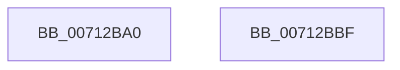

# DbgkpTriageDumpRestoreState

- RVA: `0x00712BA0`–`0x00712BC0` (길이 `32` bytes)
- VA: `0x0000000140712BA0`
- 실행 섹션: `PAGE`
- PDB 이름 있음: `예`; PDB Function 태그: `아니요`
- unwind 정보 RVA: `0x000DB714`
- 디코드: `10`개 명령, `32/32` bytes 표시
- 미해석 바이트: `0` (있으면 어셈블리에 `.byte`로 보존)

> 이 문서는 커널 이미지의 기계어와 PDB 기호를 분석해 생성했습니다. 4번과 5번은 함수 원형과 자료형을 바이너리 사용 방식에서 추정한 C 해석이며 원본 소스 복구 결과는 아닙니다.

## 1. Dependencies

- 직접 호출 지점: **0**; 고유 호출 대상: **0**
- 직접 호출자로 확인된 함수: **0**
- RIP 상대 이미지 참조: **0**

### Outgoing calls
- 직접 디코드된 call 명령이 없습니다.

### Direct callers
- 이 함수 시작 RVA로 연결되는 직접 call은 확인되지 않았습니다. 간접 호출은 완전히 역산할 수 없습니다.

### Static image references
- 디코드된 RIP-relative 메모리 참조가 없습니다.

## 2. Other-region calls and transfers

- 다른 실행 섹션으로 향하는 call: **0**
- 별도 외부 분기/꼬리 이동을 확인하지 못했습니다.

## 3. Assembly (complete function range)

```asm
00712BA0  8B 41 0C                        mov eax, dword ptr [rcx + 0xc]
00712BA3  48 8B 11                        mov rdx, qword ptr [rcx]
00712BA6  89 41 18                        mov dword ptr [rcx + 0x18], eax
00712BA9  8B 41 10                        mov eax, dword ptr [rcx + 0x10]
00712BAC  89 82 78 20 00 00               mov dword ptr [rdx + 0x2078], eax
00712BB2  48 8B 11                        mov rdx, qword ptr [rcx]
00712BB5  8B 41 14                        mov eax, dword ptr [rcx + 0x14]
00712BB8  89 82 7C 20 00 00               mov dword ptr [rdx + 0x207c], eax
00712BBE  C3                              ret
00712BBF  CC                              int3
```

## 4. C-style interpretation (structured pseudocode)

```c
__int64 __fastcall DbgkpTriageDumpRestoreState(__int64 a1)
{
    *(unsigned int *)(a1 + 24) = (unsigned int)((unsigned int)(*(unsigned int *)(a1 + 12)));
    *(unsigned int *)(*(unsigned __int64 *)(a1) + 8312) = (unsigned int)((unsigned int)(*(unsigned int *)(a1 + 16)));
    *(unsigned int *)(*(unsigned __int64 *)(a1) + 8316) = (unsigned int)((unsigned int)(*(unsigned int *)(a1 + 20)));
    return (unsigned int)(*(unsigned int *)(a1 + 20));
}
```

## 5. (Beta) C Style

```c
int64_t DbgkpTriageDumpRestoreState(void *Arg1)
{
    uint8_t *arg1 = (uint8_t *)Arg1;

    *(uint32_t *)(arg1 + 0x18) = (uint32_t)((uint32_t)(*(uint32_t *)(arg1 + 0xC)));
    *(uint32_t *)(*(uint64_t *)(arg1) + 0x2078) = (uint32_t)((uint32_t)(*(uint32_t *)(arg1 + 0x10)));
    *(uint32_t *)(*(uint64_t *)(arg1) + 0x207C) = (uint32_t)((uint32_t)(*(uint32_t *)(arg1 + 0x14)));
    return (uint32_t)(*(uint32_t *)(arg1 + 0x14));
}
```

### 관측된 메모리 오프셋

구조체 형식이 확인되지 않은 접근은 인자 기준의 오프셋으로만 기록했습니다.

| 기준 인자 | 오프셋 표현 | 폭 (bit) | 접근 |
|---|---:|---:|---|
| `Arg1` | `+ 0x0` | `64` | `R` |
| `Arg1` | `+ 0xC` | `32` | `R` |
| `Arg1` | `+ 0x10` | `32` | `R` |
| `Arg1` | `+ 0x14` | `32` | `R` |
| `Arg1` | `+ 0x18` | `32` | `W` |

## 6. Execution-region graph

[열기: 2D/3D 그래프와 함수 탐색 컨트롤 패널](../../../control-panel.html?section=page&rva=0x00712BA0&view=graph)

- 2D 그래프는 위에서 아래로 흐르고, 3D 그래프는 빈 공간을 드래그해 회전합니다. Shift+드래그는 이동, 휠은 확대·축소, 함수 노드 선택은 대상 보고서 이동입니다.

### Static fallback


