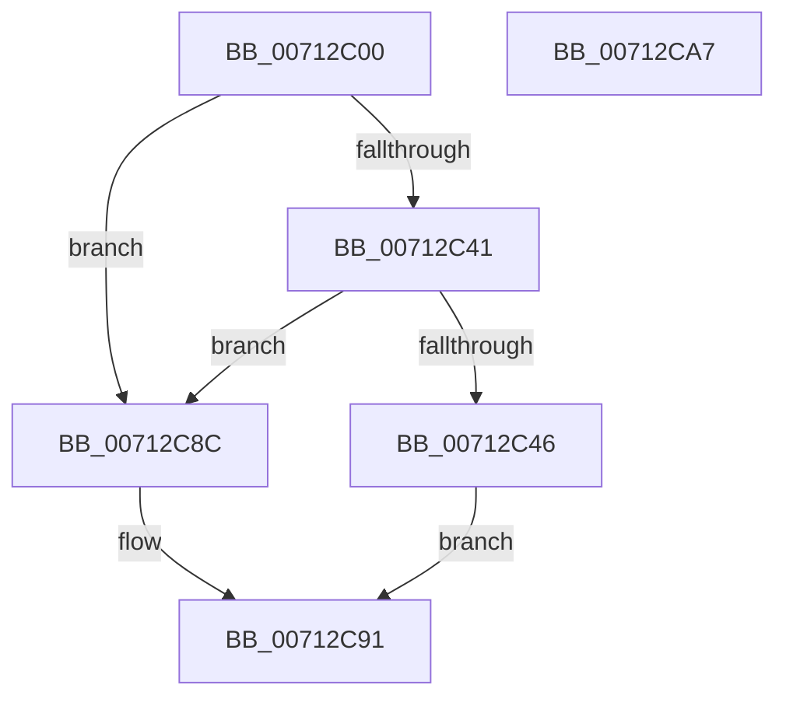

# DbgkpTriageDumpWrite

- RVA: `0x00712C00`–`0x00712CA8` (길이 `168` bytes)
- VA: `0x0000000140712C00`
- 실행 섹션: `PAGE`
- PDB 이름 있음: `예`; PDB Function 태그: `아니요`
- unwind 정보 RVA: `0x0006F978`
- 디코드: `44`개 명령, `168/168` bytes 표시
- 미해석 바이트: `0` (있으면 어셈블리에 `.byte`로 보존)

> 이 문서는 커널 이미지의 기계어와 PDB 기호를 분석해 생성했습니다. 4번과 5번은 함수 원형과 자료형을 바이너리 사용 방식에서 추정한 C 해석이며 원본 소스 복구 결과는 아닙니다.

## 1. Dependencies

- 직접 호출 지점: **1**; 고유 호출 대상: **1**
- 직접 호출자로 확인된 함수: **0**
- RIP 상대 이미지 참조: **0**

### Outgoing calls
- `0x00712C55` → [memcpy](../../text/6C/memcpy_function_006C6840.md) (function, `0x006C6840`)

### Direct callers
- 이 함수 시작 RVA로 연결되는 직접 call은 확인되지 않았습니다. 간접 호출은 완전히 역산할 수 없습니다.

### Static image references
- 디코드된 RIP-relative 메모리 참조가 없습니다.

## 2. Other-region calls and transfers

- 다른 실행 섹션으로 향하는 call: **1**
  - `0x00712C55` → [memcpy](../../text/6C/memcpy_function_006C6840.md) (`PAGE` → `.text`)
- 별도 외부 분기/꼬리 이동을 확인하지 못했습니다.

## 3. Assembly (complete function range)

```asm
00712C00  48 89 5C 24 08                  mov qword ptr [rsp + 8], rbx
00712C05  48 89 74 24 10                  mov qword ptr [rsp + 0x10], rsi
00712C0A  48 89 7C 24 18                  mov qword ptr [rsp + 0x18], rdi
00712C0F  41 56                           push r14
00712C11  48 83 EC 20                     sub rsp, 0x20
00712C15  48 8B 19                        mov rbx, qword ptr [rcx]
00712C18  48 8B F1                        mov rsi, rcx
00712C1B  83 22 00                        and dword ptr [rdx], 0
00712C1E  4C 8B F2                        mov r14, rdx
00712C21  81 8B 38 10 00 00 FF 00 00 00   or dword ptr [rbx + 0x1038], 0xff
00712C2B  8B 49 18                        mov ecx, dword ptr [rcx + 0x18]
00712C2E  8B BB 7C 20 00 00               mov edi, dword ptr [rbx + 0x207c]
00712C34  C1 E7 04                        shl edi, 4
00712C37  83 C7 04                        add edi, 4
00712C3A  8D 04 39                        lea eax, [rcx + rdi]
00712C3D  3B C1                           cmp eax, ecx
00712C3F  72 4B                           jb 0x140712c8c
00712C41  3B 46 08                        cmp eax, dword ptr [rsi + 8]
00712C44  77 46                           ja 0x140712c8c
00712C46  8B 93 78 20 00 00               mov edx, dword ptr [rbx + 0x2078]
00712C4C  48 03 CB                        add rcx, rbx
00712C4F  48 03 D3                        add rdx, rbx
00712C52  44 8B C7                        mov r8d, edi
00712C55  E8 E6 3B FB FF                  call 0x1406c6840
00712C5A  8B 46 18                        mov eax, dword ptr [rsi + 0x18]
00712C5D  89 83 78 20 00 00               mov dword ptr [rbx + 0x2078], eax
00712C63  8D 0C 38                        lea ecx, [rax + rdi]
00712C66  8B C1                           mov eax, ecx
00712C68  89 8B 04 20 00 00               mov dword ptr [rbx + 0x2004], ecx
00712C6E  48 89 83 A0 0F 00 00            mov qword ptr [rbx + 0xfa0], rax
00712C75  8D 41 FC                        lea eax, [rcx - 4]
00712C78  89 83 08 20 00 00               mov dword ptr [rbx + 0x2008], eax
00712C7E  C7 04 18 54 52 47 44            mov dword ptr [rax + rbx], 0x44475254
00712C85  33 C0                           xor eax, eax
00712C87  41 89 0E                        mov dword ptr [r14], ecx
00712C8A  EB 05                           jmp 0x140712c91
00712C8C  B8 9A 00 00 C0                  mov eax, 0xc000009a
00712C91  48 8B 5C 24 30                  mov rbx, qword ptr [rsp + 0x30]
00712C96  48 8B 74 24 38                  mov rsi, qword ptr [rsp + 0x38]
00712C9B  48 8B 7C 24 40                  mov rdi, qword ptr [rsp + 0x40]
00712CA0  48 83 C4 20                     add rsp, 0x20
00712CA4  41 5E                           pop r14
00712CA6  C3                              ret
00712CA7  CC                              int3
```

## 4. C-style interpretation (structured pseudocode)

```c
__int64 __fastcall DbgkpTriageDumpWrite(__int64 a1, __int64 a2)
{
    __int64 result;
    __int64 v_rdi;
    __int64 v_rsp;
    unsigned __int64 v_stack_p10;
    unsigned __int64 v_stack_p18;
    unsigned __int64 v_stack_p8;

    v_stack_p8 = v_rbx;
    v_stack_p10 = v_rsi;
    v_stack_p18 = v_rdi;
    v_rsp = (v_rsp) - (32);
    v_rdi = (unsigned int)(((unsigned int)(*(unsigned int *)(*(unsigned __int64 *)(a1) + 8316))) << (4));
    v_rdi = (unsigned int)((v_rdi) + (4));
    if (((unsigned int)((unsigned int)(*(unsigned int *)(a1 + 24)) + v_rdi * 1)) < ((unsigned int)((unsigned int)(*(unsigned int *)(a1 + 24))))) goto loc_00712C8C;
    if (((unsigned int)((unsigned int)(*(unsigned int *)(a1 + 24)) + v_rdi * 1)) > (*(unsigned int *)(a1 + 8))) goto loc_00712C8C;
    a1 = ((unsigned int)(*(unsigned int *)(a1 + 24))) + (*(unsigned __int64 *)(a1));
    a2 = ((unsigned int)(*(unsigned int *)(*(unsigned __int64 *)(a1) + 8312))) + (*(unsigned __int64 *)(a1));
    result = memcpy(a1, a2, (unsigned int)((unsigned int)(v_rdi)), a4);
    *(unsigned int *)(*(unsigned __int64 *)(a1) + 8312) = (unsigned int)((unsigned int)(*(unsigned int *)(a1 + 24)));
    *(unsigned int *)(*(unsigned __int64 *)(a1) + 8196) = (unsigned int)((unsigned int)(*(unsigned int *)(a1 + 24)) + v_rdi * 1);
    *(unsigned __int64 *)(*(unsigned __int64 *)(a1) + 4000) = (unsigned int)((unsigned int)((unsigned int)(*(unsigned int *)(a1 + 24)) + v_rdi * 1));
    *(unsigned int *)(*(unsigned __int64 *)(a1) + 8200) = (unsigned int)((unsigned int)(*(unsigned int *)(a1 + 24)) + v_rdi * 1 - 4);
    *(unsigned int *)((unsigned int)(*(unsigned int *)(a1 + 24)) + v_rdi * 1 - 4 + *(unsigned __int64 *)(a1) * 1) = 0x44475254ULL;
    result = 0;
    *(unsigned int *)(a2) = (unsigned int)((unsigned int)(*(unsigned int *)(a1 + 24)) + v_rdi * 1);
    goto loc_00712C91;
loc_00712C8C:
loc_00712C91:
    v_rsp = (v_rsp) + (32);
    return (unsigned int)(0xC000009AULL);
}
```

## 5. (Beta) C Style

```c
int64_t DbgkpTriageDumpWrite(void *Arg1, void *Arg2)
{
    uint8_t *arg1 = (uint8_t *)Arg1;
    uint8_t *arg2 = (uint8_t *)Arg2;

    int64_t result;
    int64_t local_rdi;
    int64_t local_rsp;
    uint64_t v_stack_p10;
    uint64_t v_stack_p18;
    uint64_t v_stack_p8;

    v_stack_p8 = local_rbx;
    v_stack_p10 = local_rsi;
    v_stack_p18 = local_rdi;
    local_rsp = (local_rsp) - (32);
    local_rdi = (uint32_t)(((uint32_t)(*(uint32_t *)(*(uint64_t *)(arg1) + 0x207C))) << (4));
    local_rdi = (uint32_t)((local_rdi) + (4));
    if (((uint32_t)((uint32_t)(*(uint32_t *)(arg1 + 0x18)) + local_rdi * 1)) < ((uint32_t)((uint32_t)(*(uint32_t *)(arg1 + 0x18))))) goto loc_00712C8C;
    if (((uint32_t)((uint32_t)(*(uint32_t *)(arg1 + 0x18)) + local_rdi * 1)) > (*(uint32_t *)(arg1 + 0x8))) goto loc_00712C8C;
    Arg1 = ((uint32_t)(*(uint32_t *)(arg1 + 0x18))) + (*(uint64_t *)(arg1));
    Arg2 = ((uint32_t)(*(uint32_t *)(*(uint64_t *)(arg1) + 0x2078))) + (*(uint64_t *)(arg1));
    result = memcpy(Arg1, Arg2, (uint32_t)((uint32_t)(local_rdi)), a4);
    *(uint32_t *)(*(uint64_t *)(arg1) + 0x2078) = (uint32_t)((uint32_t)(*(uint32_t *)(arg1 + 0x18)));
    *(uint32_t *)(*(uint64_t *)(arg1) + 0x2004) = (uint32_t)((uint32_t)(*(uint32_t *)(arg1 + 0x18)) + local_rdi * 1);
    *(uint64_t *)(*(uint64_t *)(arg1) + 0xFA0) = (uint32_t)((uint32_t)((uint32_t)(*(uint32_t *)(arg1 + 0x18)) + local_rdi * 1));
    *(uint32_t *)(*(uint64_t *)(arg1) + 0x2008) = (uint32_t)((uint32_t)(*(uint32_t *)(arg1 + 0x18)) + local_rdi * 1 - 4);
    *(uint32_t *)((uint32_t)(*(uint32_t *)(arg1 + 0x18)) + local_rdi * 1 - 0x4 + *(uint64_t *)(arg1) * 1) = 0x44475254ULL;
    result = 0;
    *(uint32_t *)(arg2) = (uint32_t)((uint32_t)(*(uint32_t *)(arg1 + 0x18)) + local_rdi * 1);
    goto loc_00712C91;
loc_00712C8C:
loc_00712C91:
    local_rsp = (local_rsp) + (32);
    return (uint32_t)(0xC000009AULL);
}
```

### 관측된 메모리 오프셋

구조체 형식이 확인되지 않은 접근은 인자 기준의 오프셋으로만 기록했습니다.

| 기준 인자 | 오프셋 표현 | 폭 (bit) | 접근 |
|---|---:|---:|---|
| `Arg1` | `+ 0x0` | `64` | `R` |
| `Arg1` | `+ 0x8` | `32` | `R` |
| `Arg1` | `+ 0x18` | `32` | `R` |
| `Arg2` | `+ 0x0` | `32` | `R/W` |
| `Arg2` | `+ 0x0` | `32` | `W` |

## 6. Execution-region graph

[열기: 2D/3D 그래프와 함수 탐색 컨트롤 패널](../../../control-panel.html?section=page&rva=0x00712C00&view=graph)

- 2D 그래프는 위에서 아래로 흐르고, 3D 그래프는 빈 공간을 드래그해 회전합니다. Shift+드래그는 이동, 휠은 확대·축소, 함수 노드 선택은 대상 보고서 이동입니다.

### Static fallback


