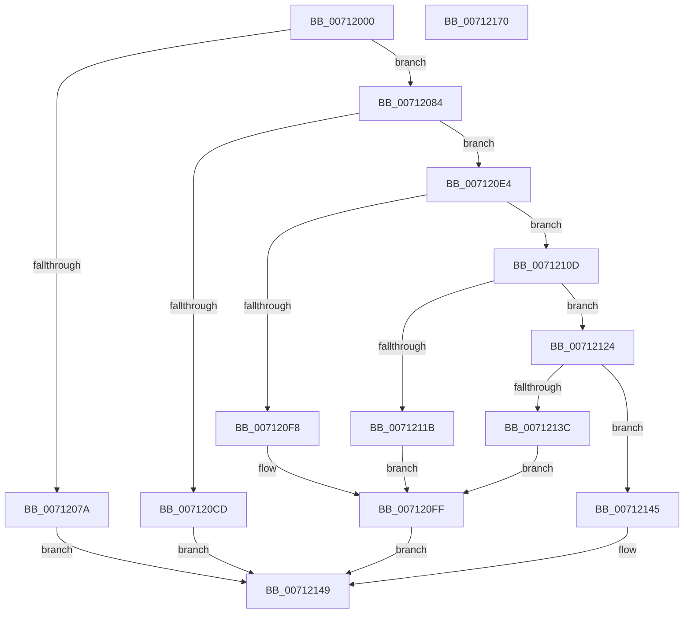

# DbgkpWerCaptureLiveTriageDump

- RVA: `0x00712000`–`0x00712171` (길이 `369` bytes)
- VA: `0x0000000140712000`
- 실행 섹션: `PAGE`
- PDB 이름 있음: `예`; PDB Function 태그: `아니요`
- unwind 정보 RVA: `0x000C5A8C`
- 디코드: `91`개 명령, `369/369` bytes 표시
- 미해석 바이트: `0` (있으면 어셈블리에 `.byte`로 보존)

> 이 문서는 커널 이미지의 기계어와 PDB 기호를 분석해 생성했습니다. 4번과 5번은 함수 원형과 자료형을 바이너리 사용 방식에서 추정한 C 해석이며 원본 소스 복구 결과는 아닙니다.

## 1. Dependencies

- 직접 호출 지점: **11**; 고유 호출 대상: **9**
- 직접 호출자로 확인된 함수: **1**
- RIP 상대 이미지 참조: **7**

### Outgoing calls
- `0x0071203B` → [DbgPrintEx](../../text/35/DbgPrintEx_function_00359290.md) (function, `0x00359290`)
- `0x00712054` → [memset](../../text/6C/memset_function_006C6C40.md) (function, `0x006C6C40`)
- `0x00712069` → [ExAllocatePool2](../../poolcode/B8/ExAllocatePool2_function_00B820F0.md) (function, `0x00B820F0`)
- `0x00712089` → [RtlCaptureContext](../../text/4F/RtlCaptureContext_function_004FE570.md) (function, `0x004FE570`)
- `0x007120C4` → [KeCapturePersistentThreadState](../../text/43/KeCapturePersistentThreadState_function_00435D90.md) (function, `0x00435D90`)
- `0x007120D8` → [DbgPrintEx](../../text/35/DbgPrintEx_function_00359290.md) (function, `0x00359290`)
- `0x007120ED` → [DbgkpWerInvokeCallbacks](../AB/DbgkpWerInvokeCallbacks_function_00AB0FC4.md) (function, `0x00AB0FC4`)
- `0x00712106` → [DbgPrintEx](../../text/35/DbgPrintEx_function_00359290.md) (function, `0x00359290`)
- `0x00712110` → [DbgkpWerWriteTriageDump](DbgkpWerWriteTriageDump_function_00712860.md) (function, `0x00712860`)
- `0x0071212A` → `ext-ms-win-ntos-werkernel-l1-1-1.dll!WerLiveKernelSubmitReport` (import, 간접 대상; import `ext-ms-win-ntos-werkernel-l1-1-1.dll!WerLiveKernelSubmitReport`)
- `0x00712156` → [_security_check_cookie](../../text/6A/_security_check_cookie_function_006AC640.md) (function, `0x006AC640`)

### Direct callers
- [DbgkpWerProcessPolicyResult](DbgkpWerProcessPolicyResult_function_00712578.md) at `0x00712594`

### Static image references
- `0x00712012` → RVA `0x00E0A740` (`.data`; read)
- `0x00712029` → RVA `0x00AFB230` (` ?? ::NNGAKEGL::`string'`; read)
- `0x007120CD` → RVA `0x00AFB270` (` ?? ::NNGAKEGL::`string'`; read)
- `0x007120F8` → RVA `0x00AFB3E0` (` ?? ::NNGAKEGL::`string'`; read)
- `0x0071211B` → RVA `0x00AFB420` (` ?? ::NNGAKEGL::`string'`; read)
- `0x0071212A` → RVA `0x00151640` (`ext-ms-win-ntos-werkernel-l1-1-1.dll!WerLiveKernelSubmitReport (IAT)`; read)
- `0x0071213C` → RVA `0x00AFB340` (` ?? ::NNGAKEGL::`string'`; read)

## 2. Other-region calls and transfers

- 다른 실행 섹션으로 향하는 call: **8**
  - `0x0071203B` → [DbgPrintEx](../../text/35/DbgPrintEx_function_00359290.md) (`PAGE` → `.text`)
  - `0x00712054` → [memset](../../text/6C/memset_function_006C6C40.md) (`PAGE` → `.text`)
  - `0x00712069` → [ExAllocatePool2](../../poolcode/B8/ExAllocatePool2_function_00B820F0.md) (`PAGE` → `POOLCODE`)
  - `0x00712089` → [RtlCaptureContext](../../text/4F/RtlCaptureContext_function_004FE570.md) (`PAGE` → `.text`)
  - `0x007120C4` → [KeCapturePersistentThreadState](../../text/43/KeCapturePersistentThreadState_function_00435D90.md) (`PAGE` → `.text`)
  - `0x007120D8` → [DbgPrintEx](../../text/35/DbgPrintEx_function_00359290.md) (`PAGE` → `.text`)
  - `0x00712106` → [DbgPrintEx](../../text/35/DbgPrintEx_function_00359290.md) (`PAGE` → `.text`)
  - `0x00712156` → [_security_check_cookie](../../text/6A/_security_check_cookie_function_006AC640.md) (`PAGE` → `.text`)
- 별도 외부 분기/꼬리 이동을 확인하지 못했습니다.

## 3. Assembly (complete function range)

```asm
00712000  48 89 5C 24 10                  mov qword ptr [rsp + 0x10], rbx
00712005  48 89 74 24 18                  mov qword ptr [rsp + 0x18], rsi
0071200A  57                              push rdi
0071200B  48 81 EC 20 05 00 00            sub rsp, 0x520
00712012  48 8B 05 27 87 6F 00            mov rax, qword ptr [rip + 0x6f8727]
00712019  48 33 C4                        xor rax, rsp
0071201C  48 89 84 24 10 05 00 00         mov qword ptr [rsp + 0x510], rax
00712024  BA 03 00 00 00                  mov edx, 3
00712029  4C 8D 05 00 92 3E 00            lea r8, [rip + 0x3e9200]
00712030  48 8B F9                        mov rdi, rcx
00712033  4C 8B C9                        mov r9, rcx
00712036  8D 72 02                        lea esi, [rdx + 2]
00712039  8B CE                           mov ecx, esi
0071203B  E8 50 72 C4 FF                  call 0x140359290
00712040  33 D2                           xor edx, edx
00712042  C7 47 50 FC FF FF 03            mov dword ptr [rdi + 0x50], 0x3fffffc
00712049  41 B8 D0 04 00 00               mov r8d, 0x4d0
0071204F  48 8D 4C 24 40                  lea rcx, [rsp + 0x40]
00712054  E8 E7 4B FB FF                  call 0x1406c6c40
00712059  BA 00 00 04 00                  mov edx, 0x40000
0071205E  B9 00 01 00 00                  mov ecx, 0x100
00712063  41 B8 44 62 67 57               mov r8d, 0x57676244
00712069  E8 82 00 47 00                  call 0x140b820f0
0071206E  48 89 87 88 00 00 00            mov qword ptr [rdi + 0x88], rax
00712075  48 85 C0                        test rax, rax
00712078  75 0A                           jne 0x140712084
0071207A  BB 17 00 00 C0                  mov ebx, 0xc0000017
0071207F  E9 C5 00 00 00                  jmp 0x140712149
00712084  48 8D 4C 24 40                  lea rcx, [rsp + 0x40]
00712089  E8 E2 C4 DE FF                  call 0x1404fe570
0071208E  48 8B 87 88 00 00 00            mov rax, qword ptr [rdi + 0x88]
00712095  48 8D 4C 24 40                  lea rcx, [rsp + 0x40]
0071209A  4C 8B 4F 28                     mov r9, qword ptr [rdi + 0x28]
0071209E  33 D2                           xor edx, edx
007120A0  44 8B 47 20                     mov r8d, dword ptr [rdi + 0x20]
007120A4  48 89 44 24 38                  mov qword ptr [rsp + 0x38], rax
007120A9  48 8B 47 40                     mov rax, qword ptr [rdi + 0x40]
007120AD  48 89 44 24 30                  mov qword ptr [rsp + 0x30], rax
007120B2  48 8B 47 38                     mov rax, qword ptr [rdi + 0x38]
007120B6  48 89 44 24 28                  mov qword ptr [rsp + 0x28], rax
007120BB  48 8B 47 30                     mov rax, qword ptr [rdi + 0x30]
007120BF  48 89 44 24 20                  mov qword ptr [rsp + 0x20], rax
007120C4  E8 C7 3C D2 FF                  call 0x140435d90
007120C9  85 C0                           test eax, eax
007120CB  75 17                           jne 0x1407120e4
007120CD  4C 8D 05 9C 91 3E 00            lea r8, [rip + 0x3e919c]
007120D4  33 D2                           xor edx, edx
007120D6  8B CE                           mov ecx, esi
007120D8  E8 B3 71 C4 FF                  call 0x140359290
007120DD  BB 01 00 00 C0                  mov ebx, 0xc0000001
007120E2  EB 65                           jmp 0x140712149
007120E4  48 8B CF                        mov rcx, rdi
007120E7  89 87 90 00 00 00               mov dword ptr [rdi + 0x90], eax
007120ED  E8 D2 EE 39 00                  call 0x140ab0fc4
007120F2  8B D8                           mov ebx, eax
007120F4  85 C0                           test eax, eax
007120F6  79 15                           jns 0x14071210d
007120F8  4C 8D 05 E1 92 3E 00            lea r8, [rip + 0x3e92e1]
007120FF  44 8B C8                        mov r9d, eax
00712102  33 D2                           xor edx, edx
00712104  8B CE                           mov ecx, esi
00712106  E8 85 71 C4 FF                  call 0x140359290
0071210B  EB 3C                           jmp 0x140712149
0071210D  48 8B CF                        mov rcx, rdi
00712110  E8 4B 07 00 00                  call 0x140712860
00712115  8B D8                           mov ebx, eax
00712117  85 C0                           test eax, eax
00712119  79 09                           jns 0x140712124
0071211B  4C 8D 05 FE 92 3E 00            lea r8, [rip + 0x3e92fe]
00712122  EB DB                           jmp 0x1407120ff
00712124  48 8B 4F 60                     mov rcx, qword ptr [rdi + 0x60]
00712128  33 D2                           xor edx, edx
0071212A  48 FF 15 0F F5 A3 FF            call qword ptr [rip - 0x5c0af1]
00712131  0F 1F 44 00 00                  nop dword ptr [rax + rax]
00712136  8B D8                           mov ebx, eax
00712138  85 C0                           test eax, eax
0071213A  79 09                           jns 0x140712145
0071213C  4C 8D 05 FD 91 3E 00            lea r8, [rip + 0x3e91fd]
00712143  EB BA                           jmp 0x1407120ff
00712145  83 4F 68 01                     or dword ptr [rdi + 0x68], 1
00712149  8B C3                           mov eax, ebx
0071214B  48 8B 8C 24 10 05 00 00         mov rcx, qword ptr [rsp + 0x510]
00712153  48 33 CC                        xor rcx, rsp
00712156  E8 E5 A4 F9 FF                  call 0x1406ac640
0071215B  4C 8D 9C 24 20 05 00 00         lea r11, [rsp + 0x520]
00712163  49 8B 5B 18                     mov rbx, qword ptr [r11 + 0x18]
00712167  49 8B 73 20                     mov rsi, qword ptr [r11 + 0x20]
0071216B  49 8B E3                        mov rsp, r11
0071216E  5F                              pop rdi
0071216F  C3                              ret
00712170  CC                              int3
```

## 4. C-style interpretation (structured pseudocode)

```c
__int64 __fastcall DbgkpWerCaptureLiveTriageDump(__int64 a1)
{
    __int64 result;
    __int64 v_rsp;
    unsigned __int64 v_stack_m18;
    unsigned __int64 v_stack_m4E8;
    unsigned __int64 v_stack_m4F0;
    unsigned __int64 v_stack_m4F8;
    unsigned __int64 v_stack_m500;
    unsigned __int64 v_stack_m508;
    unsigned __int64 v_stack_m8;
    unsigned __int64 v_stack_p10;
    unsigned __int64 v_stack_p18;

    v_stack_p10 = v_rbx;
    v_stack_p18 = v_rsi;
    v_rsp = (v_rsp) - (0x520ULL);
    result = (*(unsigned __int64 *)(v_rip + 7309095)) ^ (v_rsp);
    v_stack_m18 = result;
    result = DbgPrintEx((unsigned int)((unsigned int)(3 + 2)), 3, v_rip + 4100608, a1);
    a2 = 0;
    *(unsigned int *)(a1 + 80) = 0x3FFFFFCULL;
    result = memset(v_stack_m4E8, a2, (unsigned int)(0x4D0ULL), a1);
    result = ExAllocatePool2(256, (unsigned int)(0x40000ULL), (unsigned int)(0x57676244ULL), a1);
    *(unsigned __int64 *)(a1 + 136) = result;
    if (result != 0) goto loc_00712084;
    goto loc_00712149;
loc_00712084:
    result = RtlCaptureContext(v_stack_m4E8, (unsigned int)(0x40000ULL), (unsigned int)(0x57676244ULL), a1);
    a2 = 0;
    v_stack_m4F0 = *(unsigned __int64 *)(a1 + 136);
    v_stack_m4F8 = *(unsigned __int64 *)(a1 + 64);
    v_stack_m500 = *(unsigned __int64 *)(a1 + 56);
    v_stack_m508 = *(unsigned __int64 *)(a1 + 48);
    result = KeCapturePersistentThreadState(v_stack_m4E8, a2, (unsigned int)(*(unsigned int *)(a1 + 32)), *(unsigned __int64 *)(a1 + 40));
    if ((unsigned int)(result) != 0) goto loc_007120E4;
    a2 = 0;
    result = DbgPrintEx((unsigned int)((unsigned int)(3 + 2)), a2, v_rip + 4100508, *(unsigned __int64 *)(a1 + 40));
    goto loc_00712149;
loc_007120E4:
    *(unsigned int *)(a1 + 144) = (unsigned int)(result);
    result = DbgkpWerInvokeCallbacks(a1, a2, v_rip + 4100508, *(unsigned __int64 *)(a1 + 40));
    if (!sign_flag) goto loc_0071210D;
loc_007120FF:
    a2 = 0;
    result = DbgPrintEx((unsigned int)((unsigned int)(3 + 2)), a2, v_rip + 4100833, (unsigned int)((unsigned int)(result)));
    goto loc_00712149;
loc_0071210D:
    result = DbgkpWerWriteTriageDump(a1, a2, v_rip + 4100833, (unsigned int)((unsigned int)(result)));
    if (!sign_flag) goto loc_00712124;
    goto loc_007120FF;
loc_00712124:
    a2 = 0;
    result = ext_ms_win_ntos_werkernel_l1_1_1_dll_WerLiveKernelSubmitReport(*(unsigned __int64 *)(a1 + 96), a2, v_rip + 4100862, (unsigned int)((unsigned int)(result)));
    if (!sign_flag) goto loc_00712145;
    goto loc_007120FF;
loc_00712145:
loc_00712149:
    a1 = (v_stack_m18) ^ (v_rsp);
    result = _security_check_cookie(a1, a2, v_rip + 4100605, (unsigned int)((unsigned int)(result)));
    return result;
}
```

## 5. (Beta) C Style

```c
int64_t DbgkpWerCaptureLiveTriageDump(void *Arg1)
{
    uint8_t *arg1 = (uint8_t *)Arg1;

    int64_t result;
    int64_t local_rsp;
    uint64_t v_stack_m18;
    uint64_t v_stack_m4E8;
    uint64_t v_stack_m4F0;
    uint64_t v_stack_m4F8;
    uint64_t v_stack_m500;
    uint64_t v_stack_m508;
    uint64_t v_stack_m8;
    uint64_t v_stack_p10;
    uint64_t v_stack_p18;

    v_stack_p10 = local_rbx;
    v_stack_p18 = local_rsi;
    local_rsp = (local_rsp) - (0x520ULL);
    result = (*(uint64_t *)(v_rip + 0x6F8727)) ^ (local_rsp);
    v_stack_m18 = result;
    result = DbgPrintEx((uint32_t)((uint32_t)(3 + 2)), 3, v_rip + 4100608, Arg1);
    a2 = 0;
    *(uint32_t *)(arg1 + 0x50) = 0x3FFFFFCULL;
    result = memset(v_stack_m4E8, a2, (uint32_t)(0x4D0ULL), Arg1);
    result = ExAllocatePool2(256, (uint32_t)(0x40000ULL), (uint32_t)(0x57676244ULL), Arg1);
    *(uint64_t *)(arg1 + 0x88) = result;
    if (result != 0) goto loc_00712084;
    goto loc_00712149;
loc_00712084:
    result = RtlCaptureContext(v_stack_m4E8, (uint32_t)(0x40000ULL), (uint32_t)(0x57676244ULL), Arg1);
    a2 = 0;
    v_stack_m4F0 = *(uint64_t *)(arg1 + 0x88);
    v_stack_m4F8 = *(uint64_t *)(arg1 + 0x40);
    v_stack_m500 = *(uint64_t *)(arg1 + 0x38);
    v_stack_m508 = *(uint64_t *)(arg1 + 0x30);
    result = KeCapturePersistentThreadState(v_stack_m4E8, a2, (uint32_t)(*(uint32_t *)(arg1 + 0x20)), *(uint64_t *)(arg1 + 0x28));
    if ((uint32_t)(result) != 0) goto loc_007120E4;
    a2 = 0;
    result = DbgPrintEx((uint32_t)((uint32_t)(3 + 2)), a2, v_rip + 4100508, *(uint64_t *)(arg1 + 0x28));
    goto loc_00712149;
loc_007120E4:
    *(uint32_t *)(arg1 + 0x90) = (uint32_t)(result);
    result = DbgkpWerInvokeCallbacks(Arg1, a2, v_rip + 4100508, *(uint64_t *)(arg1 + 0x28));
    if (!sign_flag) goto loc_0071210D;
loc_007120FF:
    a2 = 0;
    result = DbgPrintEx((uint32_t)((uint32_t)(3 + 2)), a2, v_rip + 4100833, (uint32_t)((uint32_t)(result)));
    goto loc_00712149;
loc_0071210D:
    result = DbgkpWerWriteTriageDump(Arg1, a2, v_rip + 4100833, (uint32_t)((uint32_t)(result)));
    if (!sign_flag) goto loc_00712124;
    goto loc_007120FF;
loc_00712124:
    a2 = 0;
    result = kernel_indirect_call(*(uint64_t *)(arg1 + 0x60), a2, v_rip + 4100862, (uint32_t)((uint32_t)(result)));
    if (!sign_flag) goto loc_00712145;
    goto loc_007120FF;
loc_00712145:
loc_00712149:
    Arg1 = (v_stack_m18) ^ (local_rsp);
    result = _security_check_cookie(Arg1, a2, v_rip + 4100605, (uint32_t)((uint32_t)(result)));
    return result;
}
```

### 관측된 메모리 오프셋

구조체 형식이 확인되지 않은 접근은 인자 기준의 오프셋으로만 기록했습니다.

| 기준 인자 | 오프셋 표현 | 폭 (bit) | 접근 |
|---|---:|---:|---|
| `Arg1` | `+ 0x20` | `32` | `R` |
| `Arg1` | `+ 0x28` | `64` | `R` |
| `Arg1` | `+ 0x30` | `64` | `R` |
| `Arg1` | `+ 0x38` | `64` | `R` |
| `Arg1` | `+ 0x40` | `64` | `R` |
| `Arg1` | `+ 0x50` | `32` | `W` |
| `Arg1` | `+ 0x60` | `64` | `R` |
| `Arg1` | `+ 0x68` | `32` | `R/W` |
| `Arg1` | `+ 0x88` | `64` | `R` |
| `Arg1` | `+ 0x88` | `64` | `W` |
| `Arg1` | `+ 0x90` | `32` | `W` |

## 6. Execution-region graph

[열기: 2D/3D 그래프와 함수 탐색 컨트롤 패널](../../../control-panel.html?section=page&rva=0x00712000&view=graph)

- 2D 그래프는 위에서 아래로 흐르고, 3D 그래프는 빈 공간을 드래그해 회전합니다. Shift+드래그는 이동, 휠은 확대·축소, 함수 노드 선택은 대상 보고서 이동입니다.

### Static fallback


