# DbgkpWerCleanupContext

- RVA: `0x00712178`–`0x00712334` (길이 `444` bytes)
- VA: `0x0000000140712178`
- 실행 섹션: `PAGE`
- PDB 이름 있음: `예`; PDB Function 태그: `아니요`
- unwind 정보 RVA: `0x00060BC4`
- 디코드: `115`개 명령, `444/444` bytes 표시
- 미해석 바이트: `0` (있으면 어셈블리에 `.byte`로 보존)

> 이 문서는 커널 이미지의 기계어와 PDB 기호를 분석해 생성했습니다. 4번과 5번은 함수 원형과 자료형을 바이너리 사용 방식에서 추정한 C 해석이며 원본 소스 복구 결과는 아닙니다.

## 1. Dependencies

- 직접 호출 지점: **16**; 고유 호출 대상: **7**
- 직접 호출자로 확인된 함수: **2**
- RIP 상대 이미지 참조: **6**

### Outgoing calls
- `0x0071219C` → [DbgPrintEx](../../text/35/DbgPrintEx_function_00359290.md) (function, `0x00359290`)
- `0x007121B6` → [IoDiscardDeferredLiveDumpData](../../text/59/IoDiscardDeferredLiveDumpData_function_00598AC8.md) (function, `0x00598AC8`)
- `0x007121CE` → [DbgPrintEx](../../text/35/DbgPrintEx_function_00359290.md) (function, `0x00359290`)
- `0x007121E4` → [DbgkpWerFreePool](DbgkpWerFreePool_function_00712450.md) (function, `0x00712450`)
- `0x00712200` → [ObfDereferenceObject](../../text/2F/ObfDereferenceObject_function_002F9350.md) (function, `0x002F9350`)
- `0x0071221B` → [ZwClose](../../text/6A/ZwClose_function_006AD2B0.md) (function, `0x006AD2B0`)
- `0x00712248` → [DbgkpWerFreePool](DbgkpWerFreePool_function_00712450.md) (function, `0x00712450`)
- `0x00712250` → [DbgkpWerFreePool](DbgkpWerFreePool_function_00712450.md) (function, `0x00712450`)
- `0x00712261` → [DbgkpWerFreePool](DbgkpWerFreePool_function_00712450.md) (function, `0x00712450`)
- `0x00712277` → [DbgkpWerFreePool](DbgkpWerFreePool_function_00712450.md) (function, `0x00712450`)
- `0x007122A5` → [DbgkpWerFreePool](DbgkpWerFreePool_function_00712450.md) (function, `0x00712450`)
- `0x007122AD` → [DbgkpWerFreePool](DbgkpWerFreePool_function_00712450.md) (function, `0x00712450`)
- `0x007122D0` → `ext-ms-win-ntos-werkernel-l1-1-1.dll!WerLiveKernelCancelReport` (import, 간접 대상; import `ext-ms-win-ntos-werkernel-l1-1-1.dll!WerLiveKernelCancelReport`)
- `0x007122EF` → [DbgPrintEx](../../text/35/DbgPrintEx_function_00359290.md) (function, `0x00359290`)
- `0x007122F8` → `ext-ms-win-ntos-werkernel-l1-1-1.dll!WerLiveKernelCloseHandle` (import, 간접 대상; import `ext-ms-win-ntos-werkernel-l1-1-1.dll!WerLiveKernelCloseHandle`)
- `0x00712319` → [DbgPrintEx](../../text/35/DbgPrintEx_function_00359290.md) (function, `0x00359290`)

### Direct callers
- [DbgkpWerDeferredWriteRoutine](DbgkpWerDeferredWriteRoutine_function_00712340.md) at `0x00712424`
- [DbgkWerCaptureLiveKernelDump2](../AC/DbgkWerCaptureLiveKernelDump2_function_00AC1F10.md) at `0x00AC2105`

### Static image references
- `0x0071218C` → RVA `0x00AFB1C0` (` ?? ::NNGAKEGL::`string'`; read)
- `0x007121C1` → RVA `0x00AFB1F0` (` ?? ::NNGAKEGL::`string'`; read)
- `0x007122D0` → RVA `0x00151638` (`ext-ms-win-ntos-werkernel-l1-1-1.dll!WerLiveKernelCancelReport (IAT)`; read)
- `0x007122E3` → RVA `0x00AFB2A0` (` ?? ::NNGAKEGL::`string'`; read)
- `0x007122F8` → RVA `0x00151628` (`ext-ms-win-ntos-werkernel-l1-1-1.dll!WerLiveKernelCloseHandle (IAT)`; read)
- `0x0071230B` → RVA `0x00AFB2F0` (` ?? ::NNGAKEGL::`string'`; read)

## 2. Other-region calls and transfers

- 다른 실행 섹션으로 향하는 call: **7**
  - `0x0071219C` → [DbgPrintEx](../../text/35/DbgPrintEx_function_00359290.md) (`PAGE` → `.text`)
  - `0x007121B6` → [IoDiscardDeferredLiveDumpData](../../text/59/IoDiscardDeferredLiveDumpData_function_00598AC8.md) (`PAGE` → `.text`)
  - `0x007121CE` → [DbgPrintEx](../../text/35/DbgPrintEx_function_00359290.md) (`PAGE` → `.text`)
  - `0x00712200` → [ObfDereferenceObject](../../text/2F/ObfDereferenceObject_function_002F9350.md) (`PAGE` → `.text`)
  - `0x0071221B` → [ZwClose](../../text/6A/ZwClose_function_006AD2B0.md) (`PAGE` → `.text`)
  - `0x007122EF` → [DbgPrintEx](../../text/35/DbgPrintEx_function_00359290.md) (`PAGE` → `.text`)
  - `0x00712319` → [DbgPrintEx](../../text/35/DbgPrintEx_function_00359290.md) (`PAGE` → `.text`)
- 별도 외부 분기/꼬리 이동을 확인하지 못했습니다.

## 3. Assembly (complete function range)

```asm
00712178  48 89 5C 24 08                  mov qword ptr [rsp + 8], rbx
0071217D  48 89 74 24 10                  mov qword ptr [rsp + 0x10], rsi
00712182  57                              push rdi
00712183  48 83 EC 20                     sub rsp, 0x20
00712187  BA 03 00 00 00                  mov edx, 3
0071218C  4C 8D 05 2D 90 3E 00            lea r8, [rip + 0x3e902d]
00712193  48 8B D9                        mov rbx, rcx
00712196  4C 8B C9                        mov r9, rcx
00712199  8D 4A 02                        lea ecx, [rdx + 2]
0071219C  E8 EF 70 C4 FF                  call 0x140359290
007121A1  48 85 DB                        test rbx, rbx
007121A4  0F 84 79 01 00 00               je 0x140712323
007121AA  48 8B 8B 80 00 00 00            mov rcx, qword ptr [rbx + 0x80]
007121B1  48 85 C9                        test rcx, rcx
007121B4  74 25                           je 0x1407121db
007121B6  E8 0D 69 E8 FF                  call 0x140598ac8
007121BB  85 C0                           test eax, eax
007121BD  79 14                           jns 0x1407121d3
007121BF  33 D2                           xor edx, edx
007121C1  4C 8D 05 28 90 3E 00            lea r8, [rip + 0x3e9028]
007121C8  44 8B C8                        mov r9d, eax
007121CB  8D 4A 05                        lea ecx, [rdx + 5]
007121CE  E8 BD 70 C4 FF                  call 0x140359290
007121D3  48 83 A3 80 00 00 00 00         and qword ptr [rbx + 0x80], 0
007121DB  48 8B 4B 70                     mov rcx, qword ptr [rbx + 0x70]
007121DF  48 85 C9                        test rcx, rcx
007121E2  74 0A                           je 0x1407121ee
007121E4  E8 67 02 00 00                  call 0x140712450
007121E9  48 83 63 70 00                  and qword ptr [rbx + 0x70], 0
007121EE  48 8B 43 78                     mov rax, qword ptr [rbx + 0x78]
007121F2  48 85 C0                        test rax, rax
007121F5  74 74                           je 0x14071226b
007121F7  48 8B 48 10                     mov rcx, qword ptr [rax + 0x10]
007121FB  48 85 C9                        test rcx, rcx
007121FE  74 0E                           je 0x14071220e
00712200  E8 4B 71 BE FF                  call 0x1402f9350
00712205  48 8B 43 78                     mov rax, qword ptr [rbx + 0x78]
00712209  48 83 60 10 00                  and qword ptr [rax + 0x10], 0
0071220E  48 8B 43 78                     mov rax, qword ptr [rbx + 0x78]
00712212  48 8B 48 08                     mov rcx, qword ptr [rax + 8]
00712216  48 85 C9                        test rcx, rcx
00712219  74 0E                           je 0x140712229
0071221B  E8 90 B0 F9 FF                  call 0x1406ad2b0
00712220  48 8B 43 78                     mov rax, qword ptr [rbx + 0x78]
00712224  48 83 60 08 00                  and qword ptr [rax + 8], 0
00712229  48 8B 43 78                     mov rax, qword ptr [rbx + 0x78]
0071222D  48 8B 78 28                     mov rdi, qword ptr [rax + 0x28]
00712231  48 83 60 28 00                  and qword ptr [rax + 0x28], 0
00712236  48 85 FF                        test rdi, rdi
00712239  74 22                           je 0x14071225d
0071223B  48 8B 4F 10                     mov rcx, qword ptr [rdi + 0x10]
0071223F  48 8B 77 20                     mov rsi, qword ptr [rdi + 0x20]
00712243  48 85 C9                        test rcx, rcx
00712246  74 05                           je 0x14071224d
00712248  E8 03 02 00 00                  call 0x140712450
0071224D  48 8B CF                        mov rcx, rdi
00712250  E8 FB 01 00 00                  call 0x140712450
00712255  48 8B FE                        mov rdi, rsi
00712258  48 85 F6                        test rsi, rsi
0071225B  75 DE                           jne 0x14071223b
0071225D  48 8B 4B 78                     mov rcx, qword ptr [rbx + 0x78]
00712261  E8 EA 01 00 00                  call 0x140712450
00712266  48 83 63 78 00                  and qword ptr [rbx + 0x78], 0
0071226B  48 8B 8B 88 00 00 00            mov rcx, qword ptr [rbx + 0x88]
00712272  48 85 C9                        test rcx, rcx
00712275  74 0D                           je 0x140712284
00712277  E8 D4 01 00 00                  call 0x140712450
0071227C  48 83 A3 88 00 00 00 00         and qword ptr [rbx + 0x88], 0
00712284  48 8B BB A0 00 00 00            mov rdi, qword ptr [rbx + 0xa0]
0071228B  48 85 FF                        test rdi, rdi
0071228E  74 2A                           je 0x1407122ba
00712290  48 83 A3 A0 00 00 00 00         and qword ptr [rbx + 0xa0], 0
00712298  48 8B 4F 10                     mov rcx, qword ptr [rdi + 0x10]
0071229C  48 8B 77 20                     mov rsi, qword ptr [rdi + 0x20]
007122A0  48 85 C9                        test rcx, rcx
007122A3  74 05                           je 0x1407122aa
007122A5  E8 A6 01 00 00                  call 0x140712450
007122AA  48 8B CF                        mov rcx, rdi
007122AD  E8 9E 01 00 00                  call 0x140712450
007122B2  48 8B FE                        mov rdi, rsi
007122B5  48 85 F6                        test rsi, rsi
007122B8  75 DE                           jne 0x140712298
007122BA  48 8B 4B 60                     mov rcx, qword ptr [rbx + 0x60]
007122BE  48 85 C9                        test rcx, rcx
007122C1  74 60                           je 0x140712323
007122C3  8B 43 68                        mov eax, dword ptr [rbx + 0x68]
007122C6  BF 01 00 00 00                  mov edi, 1
007122CB  40 84 C7                        test dil, al
007122CE  75 24                           jne 0x1407122f4
007122D0  48 FF 15 61 F3 A3 FF            call qword ptr [rip - 0x5c0c9f]
007122D7  0F 1F 44 00 00                  nop dword ptr [rax + rax]
007122DC  85 C0                           test eax, eax
007122DE  79 14                           jns 0x1407122f4
007122E0  44 8B C8                        mov r9d, eax
007122E3  4C 8D 05 B6 8F 3E 00            lea r8, [rip + 0x3e8fb6]
007122EA  8B D7                           mov edx, edi
007122EC  8D 4F 04                        lea ecx, [rdi + 4]
007122EF  E8 9C 6F C4 FF                  call 0x140359290
007122F4  48 8B 4B 60                     mov rcx, qword ptr [rbx + 0x60]
007122F8  48 FF 15 29 F3 A3 FF            call qword ptr [rip - 0x5c0cd7]
007122FF  0F 1F 44 00 00                  nop dword ptr [rax + rax]
00712304  85 C0                           test eax, eax
00712306  79 16                           jns 0x14071231e
00712308  44 8B C8                        mov r9d, eax
0071230B  4C 8D 05 DE 8F 3E 00            lea r8, [rip + 0x3e8fde]
00712312  8B D7                           mov edx, edi
00712314  B9 05 00 00 00                  mov ecx, 5
00712319  E8 72 6F C4 FF                  call 0x140359290
0071231E  48 83 63 60 00                  and qword ptr [rbx + 0x60], 0
00712323  48 8B 5C 24 30                  mov rbx, qword ptr [rsp + 0x30]
00712328  48 8B 74 24 38                  mov rsi, qword ptr [rsp + 0x38]
0071232D  48 83 C4 20                     add rsp, 0x20
00712331  5F                              pop rdi
00712332  C3                              ret
00712333  CC                              int3
```

## 4. C-style interpretation (structured pseudocode)

```c
__int64 __fastcall DbgkpWerCleanupContext(__int64 a1)
{
    __int64 result;
    __int64 v_rsp;
    unsigned __int64 v_stack_p10;
    unsigned __int64 v_stack_p8;

    v_stack_p8 = v_rbx;
    v_stack_p10 = v_rsi;
    v_rsp = (v_rsp) - (32);
    result = DbgPrintEx(3 + 2, 3, v_rip + 4100141, a1);
    if (a1 == 0) goto loc_00712323;
    if (*(unsigned __int64 *)(a1 + 128) == 0) goto loc_007121DB;
    result = IoDiscardDeferredLiveDumpData(*(unsigned __int64 *)(a1 + 128), 3, v_rip + 4100141, a1);
    if (sign_flag) {
        a2 = 0;
        a3 = v_rip + 4100136;
        a4 = (unsigned int)(result);
        a1 = a2 + 5;
        result = DbgPrintEx(a1, a2, a3, a4);
    }
loc_007121DB:
    if (*(unsigned __int64 *)(a1 + 112) != 0) {
        result = DbgkpWerFreePool(*(unsigned __int64 *)(a1 + 112), a2, a3, a4);
    }
    if (*(unsigned __int64 *)(a1 + 120) == 0) goto loc_0071226B;
    result = *(unsigned __int64 *)(a1 + 120);
    if (*(unsigned __int64 *)(*(unsigned __int64 *)(a1 + 120) + 16) != 0) {
        result = ObfDereferenceObject(*(unsigned __int64 *)(*(unsigned __int64 *)(a1 + 120) + 16), a2, a3, a4);
        result = *(unsigned __int64 *)(a1 + 120);
    }
    result = *(unsigned __int64 *)(a1 + 120);
    if (*(unsigned __int64 *)(*(unsigned __int64 *)(a1 + 120) + 8) != 0) {
        result = ZwClose(*(unsigned __int64 *)(*(unsigned __int64 *)(a1 + 120) + 8), a2, a3, a4);
        result = *(unsigned __int64 *)(a1 + 120);
    }
    if (*(unsigned __int64 *)(*(unsigned __int64 *)(a1 + 120) + 40) == 0) goto loc_0071225D;
loc_0071223B:
    result = *(unsigned __int64 *)(a1 + 120);
    if (*(unsigned __int64 *)(*(unsigned __int64 *)(*(unsigned __int64 *)(a1 + 120) + 40) + 16) != 0) {
        result = DbgkpWerFreePool(*(unsigned __int64 *)(*(unsigned __int64 *)(*(unsigned __int64 *)(a1 + 120) + 40) + 16), a2, a3, a4);
    }
    result = DbgkpWerFreePool(*(unsigned __int64 *)(*(unsigned __int64 *)(a1 + 120) + 40), a2, a3, a4);
    if (*(unsigned __int64 *)(*(unsigned __int64 *)(*(unsigned __int64 *)(a1 + 120) + 40) + 32) != 0) goto loc_0071223B;
loc_0071225D:
    result = DbgkpWerFreePool(*(unsigned __int64 *)(a1 + 120), a2, a3, a4);
loc_0071226B:
    if (*(unsigned __int64 *)(a1 + 136) != 0) {
        result = DbgkpWerFreePool(*(unsigned __int64 *)(a1 + 136), a2, a3, a4);
    }
    if (*(unsigned __int64 *)(a1 + 160) == 0) goto loc_007122BA;
loc_00712298:
    if (*(unsigned __int64 *)(*(unsigned __int64 *)(a1 + 160) + 16) != 0) {
        result = DbgkpWerFreePool(*(unsigned __int64 *)(*(unsigned __int64 *)(a1 + 160) + 16), a2, a3, a4);
    }
    result = DbgkpWerFreePool(*(unsigned __int64 *)(a1 + 160), a2, a3, a4);
    if (*(unsigned __int64 *)(*(unsigned __int64 *)(a1 + 160) + 32) != 0) goto loc_00712298;
loc_007122BA:
    if (*(unsigned __int64 *)(a1 + 96) == 0) goto loc_00712323;
    if (((1) & ((unsigned __int8)((unsigned int)(*(unsigned int *)(a1 + 104))))) != 0) goto loc_007122F4;
    result = ext_ms_win_ntos_werkernel_l1_1_1_dll_WerLiveKernelCancelReport(*(unsigned __int64 *)(a1 + 96), a2, a3, a4);
    if (sign_flag) {
        a4 = (unsigned int)(result);
        a3 = v_rip + 4100022;
        a2 = 1;
        a1 = 1 + 4;
        result = DbgPrintEx(a1, a2, a3, a4);
    }
    result = ext_ms_win_ntos_werkernel_l1_1_1_dll_WerLiveKernelCloseHandle(*(unsigned __int64 *)(a1 + 96), a2, a3, a4);
    if (sign_flag) {
        a4 = (unsigned int)(result);
        a3 = v_rip + 4100062;
        a2 = 1;
        a1 = 5;
        result = DbgPrintEx(a1, a2, a3, a4);
    }
loc_00712323:
    v_rsp = (v_rsp) + (32);
    return result;
}
```

## 5. (Beta) C Style

```c
int64_t DbgkpWerCleanupContext(int64_t Arg1)
{
    int64_t result;
    int64_t local_rsp;
    uint64_t v_stack_p10;
    uint64_t v_stack_p8;

    v_stack_p8 = local_rbx;
    v_stack_p10 = local_rsi;
    local_rsp = (local_rsp) - (32);
    result = DbgPrintEx(3 + 2, 3, v_rip + 4100141, Arg1);
    if (Arg1 == 0) goto loc_00712323;
    if (*(uint64_t *)(Arg1 + 0x80) == 0) goto loc_007121DB;
    result = IoDiscardDeferredLiveDumpData(*(uint64_t *)(Arg1 + 0x80), 3, v_rip + 4100141, Arg1);
    if (sign_flag) {
        a2 = 0;
        a3 = v_rip + 4100136;
        a4 = (uint32_t)(result);
        Arg1 = a2 + 5;
        result = DbgPrintEx(Arg1, a2, a3, a4);
    }
loc_007121DB:
    if (*(uint64_t *)(Arg1 + 0x70) != 0) {
        result = DbgkpWerFreePool(*(uint64_t *)(Arg1 + 0x70), a2, a3, a4);
    }
    if (*(uint64_t *)(Arg1 + 0x78) == 0) goto loc_0071226B;
    result = *(uint64_t *)(Arg1 + 0x78);
    if (*(uint64_t *)(*(uint64_t *)(Arg1 + 0x78) + 0x10) != 0) {
        result = ObfDereferenceObject(*(uint64_t *)(*(uint64_t *)(Arg1 + 0x78) + 0x10), a2, a3, a4);
        result = *(uint64_t *)(Arg1 + 0x78);
    }
    result = *(uint64_t *)(Arg1 + 0x78);
    if (*(uint64_t *)(*(uint64_t *)(Arg1 + 0x78) + 0x8) != 0) {
        result = ZwClose(*(uint64_t *)(*(uint64_t *)(Arg1 + 0x78) + 0x8), a2, a3, a4);
        result = *(uint64_t *)(Arg1 + 0x78);
    }
    if (*(uint64_t *)(*(uint64_t *)(Arg1 + 0x78) + 0x28) == 0) goto loc_0071225D;
loc_0071223B:
    result = *(uint64_t *)(Arg1 + 0x78);
    if (*(uint64_t *)(*(uint64_t *)(*(uint64_t *)(Arg1 + 0x78) + 0x28) + 0x10) != 0) {
        result = DbgkpWerFreePool(*(uint64_t *)(*(uint64_t *)(*(uint64_t *)(Arg1 + 0x78) + 0x28) + 0x10), a2, a3, a4);
    }
    result = DbgkpWerFreePool(*(uint64_t *)(*(uint64_t *)(Arg1 + 0x78) + 0x28), a2, a3, a4);
    if (*(uint64_t *)(*(uint64_t *)(*(uint64_t *)(Arg1 + 0x78) + 0x28) + 0x20) != 0) goto loc_0071223B;
loc_0071225D:
    result = DbgkpWerFreePool(*(uint64_t *)(Arg1 + 0x78), a2, a3, a4);
loc_0071226B:
    if (*(uint64_t *)(Arg1 + 0x88) != 0) {
        result = DbgkpWerFreePool(*(uint64_t *)(Arg1 + 0x88), a2, a3, a4);
    }
    if (*(uint64_t *)(Arg1 + 0xA0) == 0) goto loc_007122BA;
loc_00712298:
    if (*(uint64_t *)(*(uint64_t *)(Arg1 + 0xA0) + 0x10) != 0) {
        result = DbgkpWerFreePool(*(uint64_t *)(*(uint64_t *)(Arg1 + 0xA0) + 0x10), a2, a3, a4);
    }
    result = DbgkpWerFreePool(*(uint64_t *)(Arg1 + 0xA0), a2, a3, a4);
    if (*(uint64_t *)(*(uint64_t *)(Arg1 + 0xA0) + 0x20) != 0) goto loc_00712298;
loc_007122BA:
    if (*(uint64_t *)(Arg1 + 0x60) == 0) goto loc_00712323;
    if (((1) & ((uint8_t)((uint32_t)(*(uint32_t *)(Arg1 + 0x68))))) != 0) goto loc_007122F4;
    result = kernel_indirect_call(*(uint64_t *)(Arg1 + 0x60), a2, a3, a4);
    if (sign_flag) {
        a4 = (uint32_t)(result);
        a3 = v_rip + 4100022;
        a2 = 1;
        Arg1 = 1 + 4;
        result = DbgPrintEx(Arg1, a2, a3, a4);
    }
    result = kernel_indirect_call(*(uint64_t *)(Arg1 + 0x60), a2, a3, a4);
    if (sign_flag) {
        a4 = (uint32_t)(result);
        a3 = v_rip + 4100062;
        a2 = 1;
        Arg1 = 5;
        result = DbgPrintEx(Arg1, a2, a3, a4);
    }
loc_00712323:
    local_rsp = (local_rsp) + (32);
    return result;
}
```

## 6. Execution-region graph

[열기: 2D/3D 그래프와 함수 탐색 컨트롤 패널](../../../control-panel.html?section=page&rva=0x00712178&view=graph)

- 2D 그래프는 위에서 아래로 흐르고, 3D 그래프는 빈 공간을 드래그해 회전합니다. Shift+드래그는 이동, 휠은 확대·축소, 함수 노드 선택은 대상 보고서 이동입니다.

### Static fallback

```mermaid
flowchart TD
  bb_00712178[BB_00712178]
  bb_007121AA[BB_007121AA]
  bb_007121B6[BB_007121B6]
  bb_007121BF[BB_007121BF]
  bb_007121D3[BB_007121D3]
  bb_007121DB[BB_007121DB]
  bb_007121E4[BB_007121E4]
  bb_007121EE[BB_007121EE]
  bb_007121F7[BB_007121F7]
  bb_00712200[BB_00712200]
  bb_0071220E[BB_0071220E]
  bb_0071221B[BB_0071221B]
  bb_00712229[BB_00712229]
  bb_0071223B[BB_0071223B]
  bb_00712248[BB_00712248]
  bb_0071224D[BB_0071224D]
  bb_0071225D[BB_0071225D]
  bb_0071226B[BB_0071226B]
  bb_00712277[BB_00712277]
  bb_00712284[BB_00712284]
  bb_00712290[BB_00712290]
  bb_00712298[BB_00712298]
  bb_007122A5[BB_007122A5]
  bb_007122AA[BB_007122AA]
  bb_007122BA[BB_007122BA]
  bb_007122C3[BB_007122C3]
  bb_007122D0[BB_007122D0]
  bb_007122E0[BB_007122E0]
  bb_007122F4[BB_007122F4]
  bb_00712308[BB_00712308]
  bb_0071231E[BB_0071231E]
  bb_00712323[BB_00712323]
  bb_00712333[BB_00712333]
  bb_00712178 -->|branch| bb_00712323
  bb_00712178 -->|fallthrough| bb_007121AA
  bb_007121AA -->|branch| bb_007121DB
  bb_007121AA -->|fallthrough| bb_007121B6
  bb_007121B6 -->|branch| bb_007121D3
  bb_007121B6 -->|fallthrough| bb_007121BF
  bb_007121BF -->|flow| bb_007121D3
  bb_007121D3 -->|flow| bb_007121DB
  bb_007121DB -->|branch| bb_007121EE
  bb_007121DB -->|fallthrough| bb_007121E4
  bb_007121E4 -->|flow| bb_007121EE
  bb_007121EE -->|branch| bb_0071226B
  bb_007121EE -->|fallthrough| bb_007121F7
  bb_007121F7 -->|branch| bb_0071220E
  bb_007121F7 -->|fallthrough| bb_00712200
  bb_00712200 -->|flow| bb_0071220E
  bb_0071220E -->|branch| bb_00712229
  bb_0071220E -->|fallthrough| bb_0071221B
  bb_0071221B -->|flow| bb_00712229
  bb_00712229 -->|branch| bb_0071225D
  bb_00712229 -->|fallthrough| bb_0071223B
  bb_0071223B -->|branch| bb_0071224D
  bb_0071223B -->|fallthrough| bb_00712248
  bb_00712248 -->|flow| bb_0071224D
  bb_0071224D -->|branch| bb_0071223B
  bb_0071224D -->|fallthrough| bb_0071225D
  bb_0071225D -->|flow| bb_0071226B
  bb_0071226B -->|branch| bb_00712284
  bb_0071226B -->|fallthrough| bb_00712277
  bb_00712277 -->|flow| bb_00712284
  bb_00712284 -->|branch| bb_007122BA
  bb_00712284 -->|fallthrough| bb_00712290
  bb_00712290 -->|flow| bb_00712298
  bb_00712298 -->|branch| bb_007122AA
  bb_00712298 -->|fallthrough| bb_007122A5
  bb_007122A5 -->|flow| bb_007122AA
  bb_007122AA -->|branch| bb_00712298
  bb_007122AA -->|fallthrough| bb_007122BA
  bb_007122BA -->|branch| bb_00712323
  bb_007122BA -->|fallthrough| bb_007122C3
  bb_007122C3 -->|branch| bb_007122F4
  bb_007122C3 -->|fallthrough| bb_007122D0
  bb_007122D0 -->|branch| bb_007122F4
  bb_007122D0 -->|fallthrough| bb_007122E0
  bb_007122E0 -->|flow| bb_007122F4
  bb_007122F4 -->|branch| bb_0071231E
  bb_007122F4 -->|fallthrough| bb_00712308
  bb_00712308 -->|flow| bb_0071231E
  bb_0071231E -->|flow| bb_00712323
```


