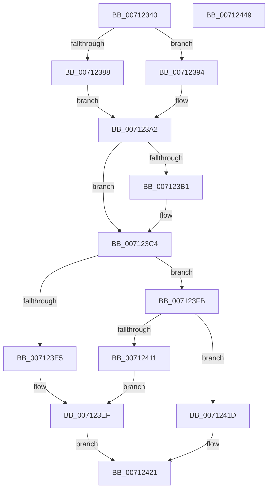

# DbgkpWerDeferredWriteRoutine

- RVA: `0x00712340`–`0x0071244A` (길이 `266` bytes)
- VA: `0x0000000140712340`
- 실행 섹션: `PAGE`
- PDB 이름 있음: `예`; PDB Function 태그: `아니요`
- unwind 정보 RVA: `0x00066400`
- 디코드: `65`개 명령, `266/266` bytes 표시
- 미해석 바이트: `0` (있으면 어셈블리에 `.byte`로 보존)

> 이 문서는 커널 이미지의 기계어와 PDB 기호를 분석해 생성했습니다. 4번과 5번은 함수 원형과 자료형을 바이너리 사용 방식에서 추정한 C 해석이며 원본 소스 복구 결과는 아닙니다.

## 1. Dependencies

- 직접 호출 지점: **8**; 고유 호출 대상: **7**
- 직접 호출자로 확인된 함수: **0**
- RIP 상대 이미지 참조: **6**

### Outgoing calls
- `0x00712369` → [DbgPrintEx](../../text/35/DbgPrintEx_function_00359290.md) (function, `0x00359290`)
- `0x007123BF` → [KiSetTimerEx](../../text/23/KiSetTimerEx_function_00232CB0.md) (function, `0x00232CB0`)
- `0x007123CB` → [IoWriteDeferredLiveDumpData](../../text/59/IoWriteDeferredLiveDumpData_function_00598CD0.md) (function, `0x00598CD0`)
- `0x007123D5` → [KeCancelTimer](../../text/23/KeCancelTimer_function_002327E0.md) (function, `0x002327E0`)
- `0x007123F4` → [DbgPrintEx](../../text/35/DbgPrintEx_function_00359290.md) (function, `0x00359290`)
- `0x00712401` → `ext-ms-win-ntos-werkernel-l1-1-1.dll!WerLiveKernelSubmitReport` (import, 간접 대상; import `ext-ms-win-ntos-werkernel-l1-1-1.dll!WerLiveKernelSubmitReport`)
- `0x00712424` → [DbgkpWerCleanupContext](DbgkpWerCleanupContext_function_00712178.md) (function, `0x00712178`)
- `0x0071242F` → [KeLeaveCriticalRegion](../../text/25/KeLeaveCriticalRegion_function_0025D8B0.md) (function, `0x0025D8B0`)

### Direct callers
- 이 함수 시작 RVA로 연결되는 직접 call은 확인되지 않았습니다. 간접 호출은 완전히 역산할 수 없습니다.

### Static image references
- `0x00712359` → RVA `0x00AFB610` (` ?? ::NNGAKEGL::`string'`; read)
- `0x00712394` → RVA `0x00F8F208` (`.data`; read)
- `0x007123E8` → RVA `0x00AFB650` (` ?? ::NNGAKEGL::`string'`; read)
- `0x00712401` → RVA `0x00151640` (`ext-ms-win-ntos-werkernel-l1-1-1.dll!WerLiveKernelSubmitReport (IAT)`; read)
- `0x00712414` → RVA `0x00AFB580` (` ?? ::NNGAKEGL::`string'`; read)
- `0x00712429` → RVA `0x00F8F20C` (`.data`; read/write)

## 2. Other-region calls and transfers

- 다른 실행 섹션으로 향하는 call: **6**
  - `0x00712369` → [DbgPrintEx](../../text/35/DbgPrintEx_function_00359290.md) (`PAGE` → `.text`)
  - `0x007123BF` → [KiSetTimerEx](../../text/23/KiSetTimerEx_function_00232CB0.md) (`PAGE` → `.text`)
  - `0x007123CB` → [IoWriteDeferredLiveDumpData](../../text/59/IoWriteDeferredLiveDumpData_function_00598CD0.md) (`PAGE` → `.text`)
  - `0x007123D5` → [KeCancelTimer](../../text/23/KeCancelTimer_function_002327E0.md) (`PAGE` → `.text`)
  - `0x007123F4` → [DbgPrintEx](../../text/35/DbgPrintEx_function_00359290.md) (`PAGE` → `.text`)
  - `0x0071242F` → [KeLeaveCriticalRegion](../../text/25/KeLeaveCriticalRegion_function_0025D8B0.md) (`PAGE` → `.text`)
- 별도 외부 분기/꼬리 이동을 확인하지 못했습니다.

## 3. Assembly (complete function range)

```asm
00712340  48 89 5C 24 08                  mov qword ptr [rsp + 8], rbx
00712345  48 89 6C 24 10                  mov qword ptr [rsp + 0x10], rbp
0071234A  48 89 74 24 18                  mov qword ptr [rsp + 0x18], rsi
0071234F  57                              push rdi
00712350  48 83 EC 30                     sub rsp, 0x30
00712354  BA 03 00 00 00                  mov edx, 3
00712359  4C 8D 05 B0 92 3E 00            lea r8, [rip + 0x3e92b0]
00712360  48 8B D9                        mov rbx, rcx
00712363  4C 8B C9                        mov r9, rcx
00712366  8D 4A 02                        lea ecx, [rdx + 2]
00712369  E8 22 6F C4 FF                  call 0x140359290
0071236E  65 48 8B 04 25 88 01 00 00      mov rax, qword ptr gs:[0x188]
00712377  66 FF 88 E4 01 00 00            dec word ptr [rax + 0x1e4]
0071237E  90                              nop
0071237F  81 7B 20 C5 01 00 00            cmp dword ptr [rbx + 0x20], 0x1c5
00712386  75 0C                           jne 0x140712394
00712388  48 BA 00 10 7D 69 FA FF FF FF   movabs rdx, 0xfffffffa697d1000
00712392  EB 0E                           jmp 0x1407123a2
00712394  48 63 05 6D CE 87 00            movsxd rax, dword ptr [rip + 0x87ce6d]
0071239B  48 69 D0 80 69 67 FF            imul rdx, rax, -0x989680
007123A2  48 8B 43 78                     mov rax, qword ptr [rbx + 0x78]
007123A6  33 FF                           xor edi, edi
007123A8  48 8B 70 10                     mov rsi, qword ptr [rax + 0x10]
007123AC  48 85 F6                        test rsi, rsi
007123AF  74 13                           je 0x1407123c4
007123B1  45 33 C9                        xor r9d, r9d
007123B4  48 89 7C 24 20                  mov qword ptr [rsp + 0x20], rdi
007123B9  45 33 C0                        xor r8d, r8d
007123BC  48 8B CE                        mov rcx, rsi
007123BF  E8 EC 08 B2 FF                  call 0x140232cb0
007123C4  48 8B 8B 80 00 00 00            mov rcx, qword ptr [rbx + 0x80]
007123CB  E8 00 69 E8 FF                  call 0x140598cd0
007123D0  48 8B CE                        mov rcx, rsi
007123D3  8B E8                           mov ebp, eax
007123D5  E8 06 04 B2 FF                  call 0x1402327e0
007123DA  48 89 BB 80 00 00 00            mov qword ptr [rbx + 0x80], rdi
007123E1  85 ED                           test ebp, ebp
007123E3  79 16                           jns 0x1407123fb
007123E5  44 8B CD                        mov r9d, ebp
007123E8  4C 8D 05 61 92 3E 00            lea r8, [rip + 0x3e9261]
007123EF  33 D2                           xor edx, edx
007123F1  8D 4A 05                        lea ecx, [rdx + 5]
007123F4  E8 97 6E C4 FF                  call 0x140359290
007123F9  EB 26                           jmp 0x140712421
007123FB  48 8B 4B 60                     mov rcx, qword ptr [rbx + 0x60]
007123FF  33 D2                           xor edx, edx
00712401  48 FF 15 38 F2 A3 FF            call qword ptr [rip - 0x5c0dc8]
00712408  0F 1F 44 00 00                  nop dword ptr [rax + rax]
0071240D  85 C0                           test eax, eax
0071240F  79 0C                           jns 0x14071241d
00712411  44 8B C8                        mov r9d, eax
00712414  4C 8D 05 65 91 3E 00            lea r8, [rip + 0x3e9165]
0071241B  EB D2                           jmp 0x1407123ef
0071241D  83 4B 68 01                     or dword ptr [rbx + 0x68], 1
00712421  48 8B CB                        mov rcx, rbx
00712424  E8 4F FD FF FF                  call 0x140712178
00712429  87 3D DD CD 87 00               xchg dword ptr [rip + 0x87cddd], edi
0071242F  E8 7C B4 B4 FF                  call 0x14025d8b0
00712434  48 8B 5C 24 40                  mov rbx, qword ptr [rsp + 0x40]
00712439  48 8B 6C 24 48                  mov rbp, qword ptr [rsp + 0x48]
0071243E  48 8B 74 24 50                  mov rsi, qword ptr [rsp + 0x50]
00712443  48 83 C4 30                     add rsp, 0x30
00712447  5F                              pop rdi
00712448  C3                              ret
00712449  CC                              int3
```

## 4. C-style interpretation (structured pseudocode)

```c
__int64 __fastcall DbgkpWerDeferredWriteRoutine(__int64 a1)
{
    __int64 result;
    __int64 v_rdi;
    __int64 v_rsp;
    unsigned __int64 v_stack_m18;
    unsigned __int64 v_stack_p10;
    unsigned __int64 v_stack_p18;
    unsigned __int64 v_stack_p8;

    v_stack_p8 = v_rbx;
    v_stack_p10 = v_rbp;
    v_stack_p18 = v_rsi;
    v_rsp = (v_rsp) - (48);
    result = DbgPrintEx(3 + 2, 3, v_rip + 4100784, a1);
    if ((*(unsigned int *)(a1 + 32)) != 453) goto loc_00712394;
    goto loc_007123A2;
loc_00712394:
    a2 = (3) * ((int)(*(unsigned int *)(v_rip + 8900205)));
loc_007123A2:
    v_rdi = 0;
    result = *(unsigned __int64 *)(a1 + 120);
    if (*(unsigned __int64 *)(*(unsigned __int64 *)(a1 + 120) + 16) != 0) {
        a4 = 0;
        v_stack_m18 = 0;
        a3 = 0;
        a1 = *(unsigned __int64 *)(*(unsigned __int64 *)(a1 + 120) + 16);
        result = KiSetTimerEx(a1, a2, a3, a4);
    }
    result = IoWriteDeferredLiveDumpData(*(unsigned __int64 *)(a1 + 128), a2, a3, a4);
    result = KeCancelTimer(*(unsigned __int64 *)(*(unsigned __int64 *)(a1 + 120) + 16), a2, a3, a4);
    *(unsigned __int64 *)(a1 + 128) = 0;
    if (!sign_flag) goto loc_007123FB;
loc_007123EF:
    a2 = 0;
    result = DbgPrintEx(a2 + 5, a2, v_rip + 4100705, (unsigned int)((unsigned int)((unsigned int)((unsigned int)(result)))));
    goto loc_00712421;
loc_007123FB:
    a2 = 0;
    result = ext_ms_win_ntos_werkernel_l1_1_1_dll_WerLiveKernelSubmitReport(*(unsigned __int64 *)(a1 + 96), a2, v_rip + 4100705, (unsigned int)((unsigned int)((unsigned int)((unsigned int)(result)))));
    if (!sign_flag) goto loc_0071241D;
    goto loc_007123EF;
loc_0071241D:
loc_00712421:
    result = DbgkpWerCleanupContext(a1, a2, v_rip + 4100453, (unsigned int)((unsigned int)(result)));
    result = KeLeaveCriticalRegion(a1, a2, v_rip + 4100453, (unsigned int)((unsigned int)(result)));
    v_rsp = (v_rsp) + (48);
    return result;
}
```

## 5. (Beta) C Style

```c
int64_t DbgkpWerDeferredWriteRoutine(void *Arg1)
{
    uint8_t *arg1 = (uint8_t *)Arg1;

    int64_t result;
    int64_t local_rdi;
    int64_t local_rsp;
    uint64_t v_stack_m18;
    uint64_t v_stack_p10;
    uint64_t v_stack_p18;
    uint64_t v_stack_p8;

    v_stack_p8 = local_rbx;
    v_stack_p10 = local_rbp;
    v_stack_p18 = local_rsi;
    local_rsp = (local_rsp) - (48);
    result = DbgPrintEx(3 + 2, 3, v_rip + 4100784, Arg1);
    if ((*(uint32_t *)(arg1 + 0x20)) != 453) goto loc_00712394;
    goto loc_007123A2;
loc_00712394:
    a2 = (3) * ((int32_t)(*(uint32_t *)(v_rip + 0x87CE6D)));
loc_007123A2:
    local_rdi = 0;
    result = *(uint64_t *)(arg1 + 0x78);
    if (*(uint64_t *)(*(uint64_t *)(arg1 + 0x78) + 0x10) != 0) {
        a4 = 0;
        v_stack_m18 = 0;
        a3 = 0;
        Arg1 = *(uint64_t *)(*(uint64_t *)(arg1 + 0x78) + 0x10);
        result = KiSetTimerEx(Arg1, a2, a3, a4);
    }
    result = IoWriteDeferredLiveDumpData(*(uint64_t *)(arg1 + 0x80), a2, a3, a4);
    result = KeCancelTimer(*(uint64_t *)(*(uint64_t *)(arg1 + 0x78) + 0x10), a2, a3, a4);
    *(uint64_t *)(arg1 + 0x80) = 0;
    if (!sign_flag) goto loc_007123FB;
loc_007123EF:
    a2 = 0;
    result = DbgPrintEx(a2 + 5, a2, v_rip + 4100705, (uint32_t)((uint32_t)((uint32_t)((uint32_t)(result)))));
    goto loc_00712421;
loc_007123FB:
    a2 = 0;
    result = kernel_indirect_call(*(uint64_t *)(arg1 + 0x60), a2, v_rip + 4100705, (uint32_t)((uint32_t)((uint32_t)((uint32_t)(result)))));
    if (!sign_flag) goto loc_0071241D;
    goto loc_007123EF;
loc_0071241D:
loc_00712421:
    result = DbgkpWerCleanupContext(Arg1, a2, v_rip + 4100453, (uint32_t)((uint32_t)(result)));
    result = KeLeaveCriticalRegion(Arg1, a2, v_rip + 4100453, (uint32_t)((uint32_t)(result)));
    local_rsp = (local_rsp) + (48);
    return result;
}
```

### 관측된 메모리 오프셋

구조체 형식이 확인되지 않은 접근은 인자 기준의 오프셋으로만 기록했습니다.

| 기준 인자 | 오프셋 표현 | 폭 (bit) | 접근 |
|---|---:|---:|---|
| `Arg1` | `+ 0x20` | `32` | `R` |
| `Arg1` | `+ 0x60` | `64` | `R` |
| `Arg1` | `+ 0x68` | `32` | `R/W` |
| `Arg1` | `+ 0x78` | `64` | `R` |
| `Arg1` | `+ 0x80` | `64` | `R` |
| `Arg1` | `+ 0x80` | `64` | `W` |

## 6. Execution-region graph

[열기: 2D/3D 그래프와 함수 탐색 컨트롤 패널](../../../control-panel.html?section=page&rva=0x00712340&view=graph)

- 2D 그래프는 위에서 아래로 흐르고, 3D 그래프는 빈 공간을 드래그해 회전합니다. Shift+드래그는 이동, 휠은 확대·축소, 함수 노드 선택은 대상 보고서 이동입니다.

### Static fallback


