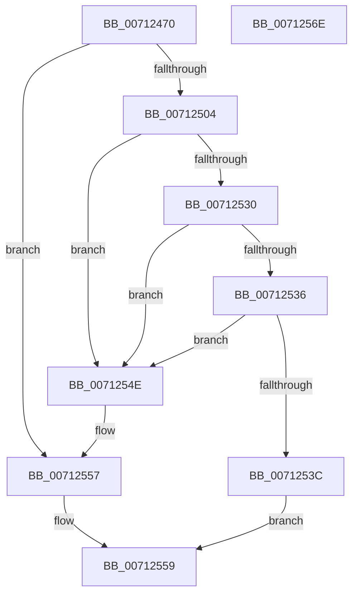

# DbgkpWerIsFullLiveDumpDisabled

- RVA: `0x00712470`–`0x0071256F` (길이 `255` bytes)
- VA: `0x0000000140712470`
- 실행 섹션: `PAGE`
- PDB 이름 있음: `예`; PDB Function 태그: `아니요`
- unwind 정보 RVA: `0x000C5A74`
- 디코드: `61`개 명령, `255/255` bytes 표시
- 미해석 바이트: `0` (있으면 어셈블리에 `.byte`로 보존)

> 이 문서는 커널 이미지의 기계어와 PDB 기호를 분석해 생성했습니다. 4번과 5번은 함수 원형과 자료형을 바이너리 사용 방식에서 추정한 C 해석이며 원본 소스 복구 결과는 아닙니다.

## 1. Dependencies

- 직접 호출 지점: **5**; 고유 호출 대상: **4**
- 직접 호출자로 확인된 함수: **2**
- RIP 상대 이미지 참조: **3**

### Outgoing calls
- `0x007124FB` → [ZwOpenKey](../../text/6A/ZwOpenKey_function_006AD310.md) (function, `0x006AD310`)
- `0x00712527` → [ZwQueryValueKey](../../text/6A/ZwQueryValueKey_function_006AD3B0.md) (function, `0x006AD3B0`)
- `0x00712540` → [ZwClose](../../text/6A/ZwClose_function_006AD2B0.md) (function, `0x006AD2B0`)
- `0x00712552` → [ZwClose](../../text/6A/ZwClose_function_006AD2B0.md) (function, `0x006AD2B0`)
- `0x00712560` → [_security_check_cookie](../../text/6A/_security_check_cookie_function_006AC640.md) (function, `0x006AC640`)

### Direct callers
- [DbgkCaptureLiveKernelDump](../../text/58/DbgkCaptureLiveKernelDump_function_00580288.md) at `0x005802CA`
- [DbgkWerCaptureLiveKernelDump2](../AC/DbgkWerCaptureLiveKernelDump2_function_00AC1F10.md) at `0x00AC1F92`

### Static image references
- `0x0071247E` → RVA `0x00E0A740` (`.data`; read)
- `0x007124BD` → RVA `0x00AFB820` (` ?? ::NNGAKEGL::`string'`; read)
- `0x007124C8` → RVA `0x00AFB770` (` ?? ::NNGAKEGL::`string'`; read)

## 2. Other-region calls and transfers

- 다른 실행 섹션으로 향하는 call: **5**
  - `0x007124FB` → [ZwOpenKey](../../text/6A/ZwOpenKey_function_006AD310.md) (`PAGE` → `.text`)
  - `0x00712527` → [ZwQueryValueKey](../../text/6A/ZwQueryValueKey_function_006AD3B0.md) (`PAGE` → `.text`)
  - `0x00712540` → [ZwClose](../../text/6A/ZwClose_function_006AD2B0.md) (`PAGE` → `.text`)
  - `0x00712552` → [ZwClose](../../text/6A/ZwClose_function_006AD2B0.md) (`PAGE` → `.text`)
  - `0x00712560` → [_security_check_cookie](../../text/6A/_security_check_cookie_function_006AC640.md) (`PAGE` → `.text`)
- 별도 외부 분기/꼬리 이동을 확인하지 못했습니다.

## 3. Assembly (complete function range)

```asm
00712470  40 55                           push rbp
00712472  48 8D 6C 24 A9                  lea rbp, [rsp - 0x57]
00712477  48 81 EC B0 00 00 00            sub rsp, 0xb0
0071247E  48 8B 05 BB 82 6F 00            mov rax, qword ptr [rip + 0x6f82bb]
00712485  48 33 C4                        xor rax, rsp
00712488  48 89 45 4F                     mov qword ptr [rbp + 0x4f], rax
0071248C  48 83 65 D7 00                  and qword ptr [rbp - 0x29], 0
00712491  4C 8D 45 07                     lea r8, [rbp + 7]
00712495  83 65 DF 00                     and dword ptr [rbp - 0x21], 0
00712499  48 8D 4D D7                     lea rcx, [rbp - 0x29]
0071249D  48 83 65 0F 00                  and qword ptr [rbp + 0xf], 0
007124A2  33 C0                           xor eax, eax
007124A4  21 45 23                        and dword ptr [rbp + 0x23], eax
007124A7  0F 57 C0                        xorps xmm0, xmm0
007124AA  89 45 47                        mov dword ptr [rbp + 0x47], eax
007124AD  BA 19 00 02 00                  mov edx, 0x20019
007124B2  48 C7 45 07 30 00 00 00         mov qword ptr [rbp + 7], 0x30
007124BA  21 45 0B                        and dword ptr [rbp + 0xb], eax
007124BD  48 8D 05 5C 93 3E 00            lea rax, [rip + 0x3e935c]
007124C4  48 89 45 EF                     mov qword ptr [rbp - 0x11], rax
007124C8  48 8D 05 A1 92 3E 00            lea rax, [rip + 0x3e92a1]
007124CF  48 89 45 FF                     mov qword ptr [rbp - 1], rax
007124D3  48 8D 45 E7                     lea rax, [rbp - 0x19]
007124D7  48 89 45 17                     mov qword ptr [rbp + 0x17], rax
007124DB  0F 11 45 37                     movups xmmword ptr [rbp + 0x37], xmm0
007124DF  48 C7 45 E7 AA 00 AC 00         mov qword ptr [rbp - 0x19], 0xac00aa
007124E7  48 C7 45 F7 24 00 26 00         mov qword ptr [rbp - 9], 0x260024
007124EF  C7 45 1F 40 02 00 00            mov dword ptr [rbp + 0x1f], 0x240
007124F6  F3 0F 7F 45 27                  movdqu xmmword ptr [rbp + 0x27], xmm0
007124FB  E8 10 AE F9 FF                  call 0x1406ad310
00712500  85 C0                           test eax, eax
00712502  78 53                           js 0x140712557
00712504  48 8B 4D D7                     mov rcx, qword ptr [rbp - 0x29]
00712508  48 8D 45 DF                     lea rax, [rbp - 0x21]
0071250C  48 89 44 24 28                  mov qword ptr [rsp + 0x28], rax
00712511  4C 8D 4D 37                     lea r9, [rbp + 0x37]
00712515  41 B8 02 00 00 00               mov r8d, 2
0071251B  C7 44 24 20 14 00 00 00         mov dword ptr [rsp + 0x20], 0x14
00712523  48 8D 55 F7                     lea rdx, [rbp - 9]
00712527  E8 84 AE F9 FF                  call 0x1406ad3b0
0071252C  85 C0                           test eax, eax
0071252E  78 1E                           js 0x14071254e
00712530  83 7D 3B 04                     cmp dword ptr [rbp + 0x3b], 4
00712534  75 18                           jne 0x14071254e
00712536  83 7D 3F 04                     cmp dword ptr [rbp + 0x3f], 4
0071253A  75 12                           jne 0x14071254e
0071253C  48 8B 4D D7                     mov rcx, qword ptr [rbp - 0x29]
00712540  E8 6B AD F9 FF                  call 0x1406ad2b0
00712545  83 7D 43 00                     cmp dword ptr [rbp + 0x43], 0
00712549  0F 94 C0                        sete al
0071254C  EB 0B                           jmp 0x140712559
0071254E  48 8B 4D D7                     mov rcx, qword ptr [rbp - 0x29]
00712552  E8 59 AD F9 FF                  call 0x1406ad2b0
00712557  32 C0                           xor al, al
00712559  48 8B 4D 4F                     mov rcx, qword ptr [rbp + 0x4f]
0071255D  48 33 CC                        xor rcx, rsp
00712560  E8 DB A0 F9 FF                  call 0x1406ac640
00712565  48 81 C4 B0 00 00 00            add rsp, 0xb0
0071256C  5D                              pop rbp
0071256D  C3                              ret
0071256E  CC                              int3
```

## 4. C-style interpretation (structured pseudocode)

```c
__int64 __fastcall DbgkpWerIsFullLiveDumpDisabled(void)
{
    __int64 result;
    __int64 v_rsp;
    unsigned __int64 v_stack_m10;
    unsigned int v_stack_m18;
    unsigned int v_stack_m1C;
    unsigned int v_stack_m20;
    unsigned int v_stack_m24;
    unsigned __int64 v_stack_m28;
    unsigned __int64 v_stack_m38;
    unsigned int v_stack_m3C;
    unsigned int v_stack_m40;
    unsigned __int64 v_stack_m48;
    unsigned __int64 v_stack_m50;
    unsigned int v_stack_m54;
    unsigned __int64 v_stack_m58;
    unsigned __int64 v_stack_m5F;
    unsigned __int64 v_stack_m60;
    unsigned __int64 v_stack_m68;
    unsigned __int64 v_stack_m70;
    unsigned __int64 v_stack_m78;
    unsigned int v_stack_m80;
    unsigned __int64 v_stack_m88;
    unsigned __int64 v_stack_m90;
    unsigned int v_stack_m98;

    v_rsp = (v_rsp) - (176);
    result = (*(unsigned __int64 *)(v_rip + 7307963)) ^ (v_rsp);
    v_stack_m10 = result;
    result = 0;
    v_stack_m18 = 0;
    v_stack_m58 = 48;
    v_stack_m70 = v_rip + 4100956;
    v_stack_m60 = v_rip + 4100769;
    v_stack_m48 = v_stack_m78;
    v_stack_m28 = v_xmm0;
    v_stack_m78 = 0xAC00AAULL;
    v_stack_m68 = 0x260024ULL;
    v_stack_m40 = 576;
    v_stack_m38 = v_xmm0;
    result = ZwOpenKey(v_stack_m88, (unsigned int)(0x20019ULL), v_stack_m58, a4);
    if (sign_flag) goto loc_00712557;
    v_stack_m90 = v_stack_m80;
    v_stack_m98 = 20;
    result = ZwQueryValueKey(v_stack_m88, v_stack_m68, 2, v_stack_m28);
    if (sign_flag) goto loc_0071254E;
    if (v_stack_m24 != 4) goto loc_0071254E;
    if (v_stack_m20 != 4) goto loc_0071254E;
    result = ZwClose(v_stack_m88, v_stack_m68, 2, v_stack_m28);
    result = (v_stack_m1C == 0) ? 1 : 0;
    goto loc_00712559;
loc_0071254E:
    result = ZwClose(v_stack_m88, v_stack_m68, 2, v_stack_m28);
loc_00712557:
    result = 0;
loc_00712559:
    a1 = (v_stack_m10) ^ (v_rsp);
    result = _security_check_cookie(a1, v_stack_m68, 2, v_stack_m28);
    v_rsp = (v_rsp) + (176);
    return result;
}
```

## 5. (Beta) C Style

```c
void DbgkpWerIsFullLiveDumpDisabled(void)
{
    int64_t result;
    int64_t local_rsp;
    uint64_t v_stack_m10;
    uint32_t v_stack_m18;
    uint32_t v_stack_m1C;
    uint32_t v_stack_m20;
    uint32_t v_stack_m24;
    uint64_t v_stack_m28;
    uint64_t v_stack_m38;
    uint32_t v_stack_m3C;
    uint32_t v_stack_m40;
    uint64_t v_stack_m48;
    uint64_t v_stack_m50;
    uint32_t v_stack_m54;
    uint64_t v_stack_m58;
    uint64_t v_stack_m5F;
    uint64_t v_stack_m60;
    uint64_t v_stack_m68;
    uint64_t v_stack_m70;
    uint64_t v_stack_m78;
    uint32_t v_stack_m80;
    uint64_t v_stack_m88;
    uint64_t v_stack_m90;
    uint32_t v_stack_m98;

    local_rsp = (local_rsp) - (176);
    result = (*(uint64_t *)(v_rip + 0x6F82BB)) ^ (local_rsp);
    v_stack_m10 = result;
    result = 0;
    v_stack_m18 = 0;
    v_stack_m58 = 48;
    v_stack_m70 = v_rip + 4100956;
    v_stack_m60 = v_rip + 4100769;
    v_stack_m48 = v_stack_m78;
    v_stack_m28 = v_xmm0;
    v_stack_m78 = 0xAC00AAULL;
    v_stack_m68 = 0x260024ULL;
    v_stack_m40 = 576;
    v_stack_m38 = v_xmm0;
    result = ZwOpenKey(v_stack_m88, (uint32_t)(0x20019ULL), v_stack_m58, a4);
    if (sign_flag) goto loc_00712557;
    v_stack_m90 = v_stack_m80;
    v_stack_m98 = 20;
    result = ZwQueryValueKey(v_stack_m88, v_stack_m68, 2, v_stack_m28);
    if (sign_flag) goto loc_0071254E;
    if (v_stack_m24 != 4) goto loc_0071254E;
    if (v_stack_m20 != 4) goto loc_0071254E;
    result = ZwClose(v_stack_m88, v_stack_m68, 2, v_stack_m28);
    result = (v_stack_m1C == 0) ? 1 : 0;
    goto loc_00712559;
loc_0071254E:
    result = ZwClose(v_stack_m88, v_stack_m68, 2, v_stack_m28);
loc_00712557:
    result = 0;
loc_00712559:
    a1 = (v_stack_m10) ^ (local_rsp);
    result = _security_check_cookie(a1, v_stack_m68, 2, v_stack_m28);
    local_rsp = (local_rsp) + (176);
    return result;
}
```

## 6. Execution-region graph

[열기: 2D/3D 그래프와 함수 탐색 컨트롤 패널](../../../control-panel.html?section=page&rva=0x00712470&view=graph)

- 2D 그래프는 위에서 아래로 흐르고, 3D 그래프는 빈 공간을 드래그해 회전합니다. Shift+드래그는 이동, 휠은 확대·축소, 함수 노드 선택은 대상 보고서 이동입니다.

### Static fallback


