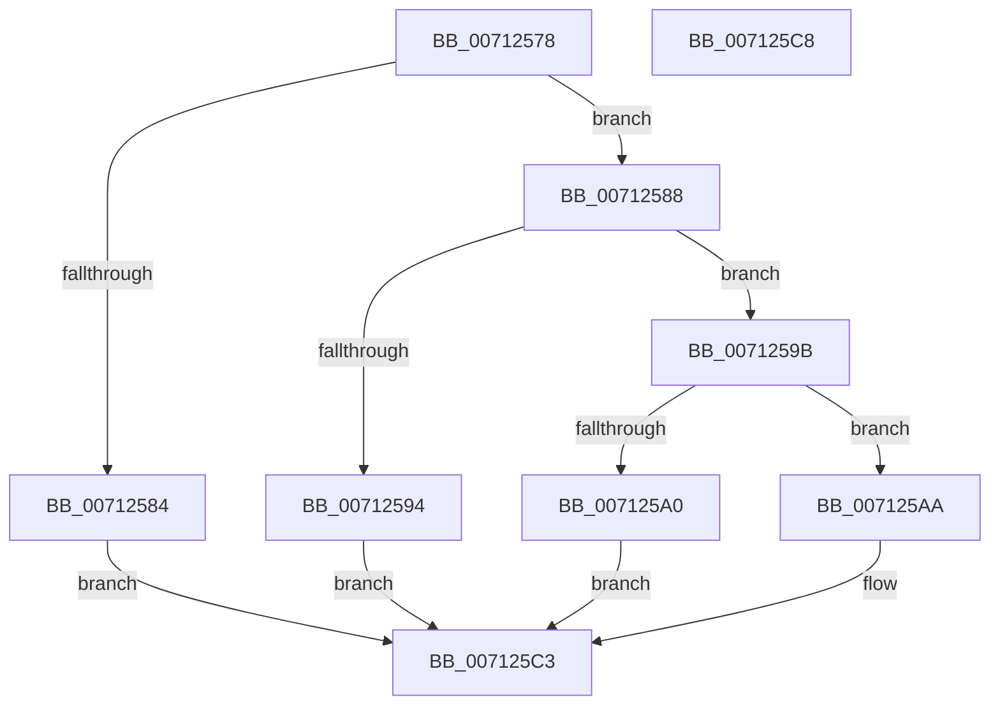

# DbgkpWerProcessPolicyResult

- RVA: `0x00712578`–`0x007125C9` (길이 `81` bytes)
- VA: `0x0000000140712578`
- 실행 섹션: `PAGE`
- PDB 이름 있음: `예`; PDB Function 태그: `아니요`
- unwind 정보 RVA: `0x0005C788`
- 디코드: `26`개 명령, `81/81` bytes 표시
- 미해석 바이트: `0` (있으면 어셈블리에 `.byte`로 보존)

> 이 문서는 커널 이미지의 기계어와 PDB 기호를 분석해 생성했습니다. 4번과 5번은 함수 원형과 자료형을 바이너리 사용 방식에서 추정한 C 해석이며 원본 소스 복구 결과는 아닙니다.

## 1. Dependencies

- 직접 호출 지점: **3**; 고유 호출 대상: **3**
- 직접 호출자로 확인된 함수: **1**
- RIP 상대 이미지 참조: **1**

### Outgoing calls
- `0x00712594` → [DbgkpWerCaptureLiveTriageDump](DbgkpWerCaptureLiveTriageDump_function_00712000.md) (function, `0x00712000`)
- `0x007125A3` → [DbgkpWerCaptureLiveFullDump](../AB/DbgkpWerCaptureLiveFullDump_function_00AB0DAC.md) (function, `0x00AB0DAC`)
- `0x007125B9` → [DbgPrintEx](../../text/35/DbgPrintEx_function_00359290.md) (function, `0x00359290`)

### Direct callers
- [DbgkWerCaptureLiveKernelDump2](../AC/DbgkWerCaptureLiveKernelDump2_function_00AC1F10.md) at `0x00AC20F5`

### Static image references
- `0x007125AD` → RVA `0x00AFB7A0` (` ?? ::NNGAKEGL::`string'`; read)

## 2. Other-region calls and transfers

- 다른 실행 섹션으로 향하는 call: **1**
  - `0x007125B9` → [DbgPrintEx](../../text/35/DbgPrintEx_function_00359290.md) (`PAGE` → `.text`)
- 별도 외부 분기/꼬리 이동을 확인하지 못했습니다.

## 3. Assembly (complete function range)

```asm
00712578  48 83 EC 28                     sub rsp, 0x28
0071257C  41 C6 01 01                     mov byte ptr [r9], 1
00712580  85 D2                           test edx, edx
00712582  75 04                           jne 0x140712588
00712584  33 C0                           xor eax, eax
00712586  EB 3B                           jmp 0x1407125c3
00712588  4C 89 41 60                     mov qword ptr [rcx + 0x60], r8
0071258C  89 51 58                        mov dword ptr [rcx + 0x58], edx
0071258F  83 FA 01                        cmp edx, 1
00712592  75 07                           jne 0x14071259b
00712594  E8 67 FA FF FF                  call 0x140712000
00712599  EB 28                           jmp 0x1407125c3
0071259B  83 FA 02                        cmp edx, 2
0071259E  75 0A                           jne 0x1407125aa
007125A0  49 8B D1                        mov rdx, r9
007125A3  E8 04 E8 39 00                  call 0x140ab0dac
007125A8  EB 19                           jmp 0x1407125c3
007125AA  44 8B CA                        mov r9d, edx
007125AD  4C 8D 05 EC 91 3E 00            lea r8, [rip + 0x3e91ec]
007125B4  33 D2                           xor edx, edx
007125B6  8D 4A 05                        lea ecx, [rdx + 5]
007125B9  E8 D2 6C C4 FF                  call 0x140359290
007125BE  B8 BB 00 00 C0                  mov eax, 0xc00000bb
007125C3  48 83 C4 28                     add rsp, 0x28
007125C7  C3                              ret
007125C8  CC                              int3
```

## 4. C-style interpretation (structured pseudocode)

```c
__int64 __fastcall DbgkpWerProcessPolicyResult(__int64 a1, int a2, __int64 a3, __int64 a4)
{
    __int64 result;
    __int64 v_rsp;

    v_rsp = (v_rsp) - (40);
    *(unsigned __int8 *)(a4) = 1;
    if (a2 != 0) goto loc_00712588;
    result = 0;
    goto loc_007125C3;
loc_00712588:
    *(unsigned __int64 *)(a1 + 96) = a3;
    *(unsigned int *)(a1 + 88) = a2;
    if (a2 != 1) goto loc_0071259B;
    result = DbgkpWerCaptureLiveTriageDump(a1, a2, a3, a4);
    goto loc_007125C3;
loc_0071259B:
    if (a2 != 2) goto loc_007125AA;
    result = DbgkpWerCaptureLiveFullDump(a1, a4, a3, a4);
    goto loc_007125C3;
loc_007125AA:
    a2 = 0;
    result = DbgPrintEx(a2 + 5, a2, v_rip + 4100588, (unsigned int)((unsigned int)(a4)));
loc_007125C3:
    v_rsp = (v_rsp) + (40);
    return (unsigned int)(0xC00000BBULL);
}
```

## 5. (Beta) C Style

```c
int64_t DbgkpWerProcessPolicyResult(void *Arg1, int32_t Arg2, int64_t Arg3, void *Arg4)
{
    uint8_t *arg1 = (uint8_t *)Arg1;
    uint8_t *arg4 = (uint8_t *)Arg4;

    int64_t result;
    int64_t local_rsp;

    local_rsp = (local_rsp) - (40);
    *(uint8_t *)(arg4) = 1;
    if (Arg2 != 0) goto loc_00712588;
    result = 0;
    goto loc_007125C3;
loc_00712588:
    *(uint64_t *)(arg1 + 0x60) = Arg3;
    *(uint32_t *)(arg1 + 0x58) = Arg2;
    if (Arg2 != 1) goto loc_0071259B;
    result = DbgkpWerCaptureLiveTriageDump(Arg1, Arg2, Arg3, Arg4);
    goto loc_007125C3;
loc_0071259B:
    if (Arg2 != 2) goto loc_007125AA;
    result = DbgkpWerCaptureLiveFullDump(Arg1, Arg4, Arg3, Arg4);
    goto loc_007125C3;
loc_007125AA:
    Arg2 = 0;
    result = DbgPrintEx(Arg2 + 5, Arg2, v_rip + 4100588, (uint32_t)((uint32_t)(Arg4)));
loc_007125C3:
    local_rsp = (local_rsp) + (40);
    return (uint32_t)(0xC00000BBULL);
}
```

### 관측된 메모리 오프셋

구조체 형식이 확인되지 않은 접근은 인자 기준의 오프셋으로만 기록했습니다.

| 기준 인자 | 오프셋 표현 | 폭 (bit) | 접근 |
|---|---:|---:|---|
| `Arg1` | `+ 0x58` | `32` | `W` |
| `Arg1` | `+ 0x60` | `64` | `W` |
| `Arg4` | `+ 0x0` | `8` | `W` |

## 6. Execution-region graph

[열기: 2D/3D 그래프와 함수 탐색 컨트롤 패널](../../../control-panel.html?section=page&rva=0x00712578&view=graph)

- 2D 그래프는 위에서 아래로 흐르고, 3D 그래프는 빈 공간을 드래그해 회전합니다. Shift+드래그는 이동, 휠은 확대·축소, 함수 노드 선택은 대상 보고서 이동입니다.

### Static fallback


