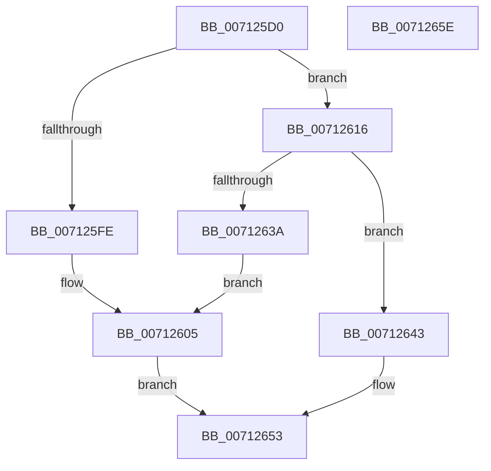

# DbgkpWerStartDeferredLiveDump

- RVA: `0x007125D0`–`0x0071265F` (길이 `143` bytes)
- VA: `0x00000001407125D0`
- 실행 섹션: `PAGE`
- PDB 이름 있음: `예`; PDB Function 태그: `아니요`
- unwind 정보 RVA: `0x00068D5C`
- 디코드: `39`개 명령, `143/143` bytes 표시
- 미해석 바이트: `0` (있으면 어셈블리에 `.byte`로 보존)

> 이 문서는 커널 이미지의 기계어와 PDB 기호를 분석해 생성했습니다. 4번과 5번은 함수 원형과 자료형을 바이너리 사용 방식에서 추정한 C 해석이며 원본 소스 복구 결과는 아닙니다.

## 1. Dependencies

- 직접 호출 지점: **4**; 고유 호출 대상: **4**
- 직접 호출자로 확인된 함수: **1**
- RIP 상대 이미지 참조: **3**

### Outgoing calls
- `0x007125EC` → `ext-ms-win-ntos-werkernel-l1-1-1.dll!WerLiveKernelOpenDumpFile` (import, 간접 대상; import `ext-ms-win-ntos-werkernel-l1-1-1.dll!WerLiveKernelOpenDumpFile`)
- `0x0071260D` → [DbgPrintEx](../../text/35/DbgPrintEx_function_00359290.md) (function, `0x00359290`)
- `0x0071262F` → [IoSetDeferredLiveDumpFileHandle](../../text/59/IoSetDeferredLiveDumpFileHandle_function_00598C30.md) (function, `0x00598C30`)
- `0x0071264C` → [ExQueueWorkItem](../../text/2F/ExQueueWorkItem_function_002F9520.md) (function, `0x002F9520`)

### Direct callers
- [DbgkpWerCaptureLiveFullDump](../AB/DbgkpWerCaptureLiveFullDump_function_00AB0DAC.md) at `0x00AB0F96`

### Static image references
- `0x007125EC` → RVA `0x00151620` (`ext-ms-win-ntos-werkernel-l1-1-1.dll!WerLiveKernelOpenDumpFile (IAT)`; read)
- `0x007125FE` → RVA `0x00AFB940` (` ?? ::NNGAKEGL::`string'`; read)
- `0x0071263A` → RVA `0x00AFB9A0` (` ?? ::NNGAKEGL::`string'`; read)

## 2. Other-region calls and transfers

- 다른 실행 섹션으로 향하는 call: **3**
  - `0x0071260D` → [DbgPrintEx](../../text/35/DbgPrintEx_function_00359290.md) (`PAGE` → `.text`)
  - `0x0071262F` → [IoSetDeferredLiveDumpFileHandle](../../text/59/IoSetDeferredLiveDumpFileHandle_function_00598C30.md) (`PAGE` → `.text`)
  - `0x0071264C` → [ExQueueWorkItem](../../text/2F/ExQueueWorkItem_function_002F9520.md) (`PAGE` → `.text`)
- 별도 외부 분기/꼬리 이동을 확인하지 못했습니다.

## 3. Assembly (complete function range)

```asm
007125D0  48 89 5C 24 10                  mov qword ptr [rsp + 0x10], rbx
007125D5  57                              push rdi
007125D6  48 83 EC 20                     sub rsp, 0x20
007125DA  48 83 64 24 30 00               and qword ptr [rsp + 0x30], 0
007125E0  48 8D 54 24 30                  lea rdx, [rsp + 0x30]
007125E5  48 8B D9                        mov rbx, rcx
007125E8  48 8B 49 60                     mov rcx, qword ptr [rcx + 0x60]
007125EC  48 FF 15 2D F0 A3 FF            call qword ptr [rip - 0x5c0fd3]
007125F3  0F 1F 44 00 00                  nop dword ptr [rax + rax]
007125F8  8B F8                           mov edi, eax
007125FA  85 C0                           test eax, eax
007125FC  79 18                           jns 0x140712616
007125FE  4C 8D 05 3B 93 3E 00            lea r8, [rip + 0x3e933b]
00712605  33 D2                           xor edx, edx
00712607  44 8B CF                        mov r9d, edi
0071260A  8D 4A 05                        lea ecx, [rdx + 5]
0071260D  E8 7E 6C C4 FF                  call 0x140359290
00712612  8B C7                           mov eax, edi
00712614  EB 3D                           jmp 0x140712653
00712616  48 8B 4B 78                     mov rcx, qword ptr [rbx + 0x78]
0071261A  48 8B 44 24 30                  mov rax, qword ptr [rsp + 0x30]
0071261F  48 89 41 08                     mov qword ptr [rcx + 8], rax
00712623  48 8B 54 24 30                  mov rdx, qword ptr [rsp + 0x30]
00712628  48 8B 8B 80 00 00 00            mov rcx, qword ptr [rbx + 0x80]
0071262F  E8 FC 65 E8 FF                  call 0x140598c30
00712634  8B F8                           mov edi, eax
00712636  85 C0                           test eax, eax
00712638  79 09                           jns 0x140712643
0071263A  4C 8D 05 5F 93 3E 00            lea r8, [rip + 0x3e935f]
00712641  EB C2                           jmp 0x140712605
00712643  48 8B 4B 70                     mov rcx, qword ptr [rbx + 0x70]
00712647  BA 01 00 00 00                  mov edx, 1
0071264C  E8 CF 6E BE FF                  call 0x1402f9520
00712651  33 C0                           xor eax, eax
00712653  48 8B 5C 24 38                  mov rbx, qword ptr [rsp + 0x38]
00712658  48 83 C4 20                     add rsp, 0x20
0071265C  5F                              pop rdi
0071265D  C3                              ret
0071265E  CC                              int3
```

## 4. C-style interpretation (structured pseudocode)

```c
__int64 __fastcall DbgkpWerStartDeferredLiveDump(__int64 a1)
{
    __int64 result;
    __int64 v_rsp;
    unsigned __int64 v_stack_p10;
    unsigned __int64 v_stack_p8;

    v_stack_p10 = v_rbx;
    v_rsp = (v_rsp) - (32);
    result = ext_ms_win_ntos_werkernel_l1_1_1_dll_WerLiveKernelOpenDumpFile(*(unsigned __int64 *)(a1 + 96), v_stack_p8, a3, a4);
    if (!sign_flag) goto loc_00712616;
loc_00712605:
    a2 = 0;
    result = DbgPrintEx(a2 + 5, a2, v_rip + 4100923, (unsigned int)((unsigned int)((unsigned int)((unsigned int)(result)))));
    goto loc_00712653;
loc_00712616:
    *(unsigned __int64 *)(*(unsigned __int64 *)(a1 + 120) + 8) = v_stack_p8;
    result = IoSetDeferredLiveDumpFileHandle(*(unsigned __int64 *)(a1 + 128), v_stack_p8, v_rip + 4100923, (unsigned int)((unsigned int)((unsigned int)((unsigned int)(result)))));
    if (!sign_flag) goto loc_00712643;
    goto loc_00712605;
loc_00712643:
    result = ExQueueWorkItem(*(unsigned __int64 *)(a1 + 112), 1, v_rip + 4100959, (unsigned int)((unsigned int)((unsigned int)((unsigned int)(result)))));
    result = 0;
loc_00712653:
    v_rsp = (v_rsp) + (32);
    return result;
}
```

## 5. (Beta) C Style

```c
int64_t DbgkpWerStartDeferredLiveDump(void *Arg1)
{
    uint8_t *arg1 = (uint8_t *)Arg1;

    int64_t result;
    int64_t local_rsp;
    uint64_t v_stack_p10;
    uint64_t v_stack_p8;

    v_stack_p10 = local_rbx;
    local_rsp = (local_rsp) - (32);
    result = kernel_indirect_call(*(uint64_t *)(arg1 + 0x60), v_stack_p8, a3, a4);
    if (!sign_flag) goto loc_00712616;
loc_00712605:
    a2 = 0;
    result = DbgPrintEx(a2 + 5, a2, v_rip + 4100923, (uint32_t)((uint32_t)((uint32_t)((uint32_t)(result)))));
    goto loc_00712653;
loc_00712616:
    *(uint64_t *)(*(uint64_t *)(arg1 + 0x78) + 0x8) = v_stack_p8;
    result = IoSetDeferredLiveDumpFileHandle(*(uint64_t *)(arg1 + 0x80), v_stack_p8, v_rip + 4100923, (uint32_t)((uint32_t)((uint32_t)((uint32_t)(result)))));
    if (!sign_flag) goto loc_00712643;
    goto loc_00712605;
loc_00712643:
    result = ExQueueWorkItem(*(uint64_t *)(arg1 + 0x70), 1, v_rip + 4100959, (uint32_t)((uint32_t)((uint32_t)((uint32_t)(result)))));
    result = 0;
loc_00712653:
    local_rsp = (local_rsp) + (32);
    return result;
}
```

### 관측된 메모리 오프셋

구조체 형식이 확인되지 않은 접근은 인자 기준의 오프셋으로만 기록했습니다.

| 기준 인자 | 오프셋 표현 | 폭 (bit) | 접근 |
|---|---:|---:|---|
| `Arg1` | `+ 0x60` | `64` | `R` |
| `Arg1` | `+ 0x70` | `64` | `R` |
| `Arg1` | `+ 0x78` | `64` | `R` |
| `Arg1` | `+ 0x80` | `64` | `R` |

## 6. Execution-region graph

[열기: 2D/3D 그래프와 함수 탐색 컨트롤 패널](../../../control-panel.html?section=page&rva=0x007125D0&view=graph)

- 2D 그래프는 위에서 아래로 흐르고, 3D 그래프는 빈 공간을 드래그해 회전합니다. Shift+드래그는 이동, 휠은 확대·축소, 함수 노드 선택은 대상 보고서 이동입니다.

### Static fallback


