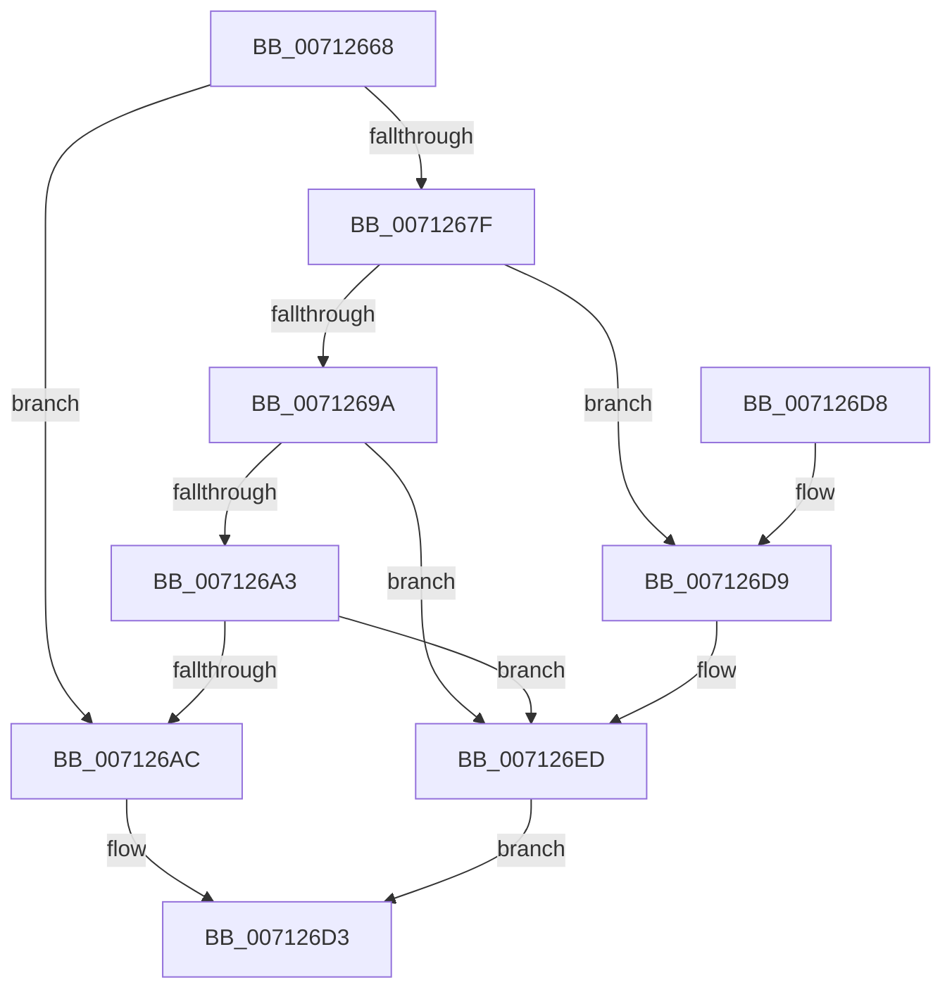

# DbgkpWerUpdateTriageDumpHeader

- RVA: `0x00712668`–`0x007126F4` (길이 `140` bytes)
- VA: `0x0000000140712668`
- 실행 섹션: `PAGE`
- PDB 이름 있음: `예`; PDB Function 태그: `아니요`
- unwind 정보 RVA: `0x00094EEC`
- 디코드: `37`개 명령, `140/140` bytes 표시
- 미해석 바이트: `0` (있으면 어셈블리에 `.byte`로 보존)

> 이 문서는 커널 이미지의 기계어와 PDB 기호를 분석해 생성했습니다. 4번과 5번은 함수 원형과 자료형을 바이너리 사용 방식에서 추정한 C 해석이며 원본 소스 복구 결과는 아닙니다.

## 1. Dependencies

- 직접 호출 지점: **2**; 고유 호출 대상: **1**
- 직접 호출자로 확인된 함수: **1**
- RIP 상대 이미지 참조: **2**

### Outgoing calls
- `0x007126CC` → [DbgPrintEx](../../text/35/DbgPrintEx_function_00359290.md) (function, `0x00359290`)
- `0x007126E8` → [DbgPrintEx](../../text/35/DbgPrintEx_function_00359290.md) (function, `0x00359290`)

### Direct callers
- [DbgkpWerWriteTriageDump](DbgkpWerWriteTriageDump_function_00712860.md) at `0x007128A1`

### Static image references
- `0x007126B3` → RVA `0x00AFB910` (` ?? ::NNGAKEGL::`string'`; read)
- `0x007126DC` → RVA `0x00AFB8D0` (` ?? ::NNGAKEGL::`string'`; read)

## 2. Other-region calls and transfers

- 다른 실행 섹션으로 향하는 call: **2**
  - `0x007126CC` → [DbgPrintEx](../../text/35/DbgPrintEx_function_00359290.md) (`PAGE` → `.text`)
  - `0x007126E8` → [DbgPrintEx](../../text/35/DbgPrintEx_function_00359290.md) (`PAGE` → `.text`)
- 별도 외부 분기/꼬리 이동을 확인하지 못했습니다.

## 3. Assembly (complete function range)

```asm
00712668  48 83 EC 28                     sub rsp, 0x28
0071266C  44 8B 41 54                     mov r8d, dword ptr [rcx + 0x54]
00712670  48 8B C1                        mov rax, rcx
00712673  44 8B 89 90 00 00 00            mov r9d, dword ptr [rcx + 0x90]
0071267A  45 85 C0                        test r8d, r8d
0071267D  74 2D                           je 0x1407126ac
0071267F  8B 91 A8 00 00 00               mov edx, dword ptr [rcx + 0xa8]
00712685  41 83 C1 10                     add r9d, 0x10
00712689  8B CA                           mov ecx, edx
0071268B  41 BA FF FF FF FF               mov r10d, 0xffffffff
00712691  48 C1 E1 05                     shl rcx, 5
00712695  49 3B CA                        cmp rcx, r10
00712698  77 3F                           ja 0x1407126d9
0071269A  42 8D 14 09                     lea edx, [rcx + r9]
0071269E  41 3B D1                        cmp edx, r9d
007126A1  72 4A                           jb 0x1407126ed
007126A3  45 8D 0C 10                     lea r9d, [r8 + rdx]
007126A7  44 3B CA                        cmp r9d, edx
007126AA  72 41                           jb 0x1407126ed
007126AC  48 8B 80 88 00 00 00            mov rax, qword ptr [rax + 0x88]
007126B3  4C 8D 05 56 92 3E 00            lea r8, [rip + 0x3e9256]
007126BA  41 8B C9                        mov ecx, r9d
007126BD  BA 03 00 00 00                  mov edx, 3
007126C2  48 89 88 A0 0F 00 00            mov qword ptr [rax + 0xfa0], rcx
007126C9  8D 4A 02                        lea ecx, [rdx + 2]
007126CC  E8 BF 6B C4 FF                  call 0x140359290
007126D1  33 C0                           xor eax, eax
007126D3  48 83 C4 28                     add rsp, 0x28
007126D7  C3                              ret
007126D8  CC                              int3
007126D9  44 8B CA                        mov r9d, edx
007126DC  4C 8D 05 ED 91 3E 00            lea r8, [rip + 0x3e91ed]
007126E3  33 D2                           xor edx, edx
007126E5  8D 4A 05                        lea ecx, [rdx + 5]
007126E8  E8 A3 6B C4 FF                  call 0x140359290
007126ED  B8 95 00 00 C0                  mov eax, 0xc0000095
007126F2  EB DF                           jmp 0x1407126d3
```

## 4. C-style interpretation (structured pseudocode)

```c
__int64 __fastcall DbgkpWerUpdateTriageDumpHeader(__int64 a1)
{
    __int64 result;
    __int64 v_rsp;

    v_rsp = (v_rsp) - (40);
    if ((unsigned int)((unsigned int)(*(unsigned int *)(a1 + 84))) == 0) goto loc_007126AC;
    a4 = (unsigned int)(((unsigned int)(*(unsigned int *)(a1 + 144))) + (16));
    a1 = ((unsigned int)((unsigned int)((unsigned int)(*(unsigned int *)(a1 + 168))))) << (5);
    if (a1 > ((unsigned int)(0xFFFFFFFFULL))) goto loc_007126D9;
    if (((unsigned int)(a1 + a4 * 1)) < ((unsigned int)(a4))) goto loc_007126ED;
    if (((unsigned int)((unsigned int)(*(unsigned int *)(a1 + 84)) + a1 + a4 * 1 * 1)) < ((unsigned int)(a1 + a4 * 1))) goto loc_007126ED;
loc_007126AC:
    *(unsigned __int64 *)(*(unsigned __int64 *)(a1 + 136) + 4000) = (unsigned int)((unsigned int)((unsigned int)(*(unsigned int *)(a1 + 84)) + a1 + a4 * 1 * 1));
    result = DbgPrintEx(3 + 2, 3, v_rip + 4100694, (unsigned int)(*(unsigned int *)(a1 + 84)) + a1 + a4 * 1 * 1);
    result = 0;
loc_007126D3:
    v_rsp = (v_rsp) + (40);
    return result;
loc_007126D9:
    a2 = 0;
    result = DbgPrintEx(a2 + 5, a2, v_rip + 4100589, 3);
loc_007126ED:
    goto loc_007126D3;
}
```

## 5. (Beta) C Style

```c
int64_t DbgkpWerUpdateTriageDumpHeader(void *Arg1)
{
    uint8_t *arg1 = (uint8_t *)Arg1;

    int64_t result;
    int64_t local_rsp;

    local_rsp = (local_rsp) - (40);
    if ((uint32_t)((uint32_t)(*(uint32_t *)(arg1 + 0x54))) == 0) goto loc_007126AC;
    a4 = (uint32_t)(((uint32_t)(*(uint32_t *)(arg1 + 0x90))) + (16));
    Arg1 = ((uint32_t)((uint32_t)((uint32_t)(*(uint32_t *)(arg1 + 0xA8))))) << (5);
    if (Arg1 > ((uint32_t)(0xFFFFFFFFULL))) goto loc_007126D9;
    if (((uint32_t)(Arg1 + a4 * 1)) < ((uint32_t)(a4))) goto loc_007126ED;
    if (((uint32_t)((uint32_t)(*(uint32_t *)(arg1 + 0x54)) + Arg1 + a4 * 1 * 1)) < ((uint32_t)(Arg1 + a4 * 1))) goto loc_007126ED;
loc_007126AC:
    *(uint64_t *)(*(uint64_t *)(arg1 + 0x88) + 0xFA0) = (uint32_t)((uint32_t)((uint32_t)(*(uint32_t *)(arg1 + 0x54)) + Arg1 + a4 * 1 * 1));
    result = DbgPrintEx(3 + 2, 3, v_rip + 4100694, (uint32_t)(*(uint32_t *)(arg1 + 0x54)) + Arg1 + a4 * 1 * 1);
    result = 0;
loc_007126D3:
    local_rsp = (local_rsp) + (40);
    return result;
loc_007126D9:
    a2 = 0;
    result = DbgPrintEx(a2 + 5, a2, v_rip + 4100589, 3);
loc_007126ED:
    goto loc_007126D3;
}
```

### 관측된 메모리 오프셋

구조체 형식이 확인되지 않은 접근은 인자 기준의 오프셋으로만 기록했습니다.

| 기준 인자 | 오프셋 표현 | 폭 (bit) | 접근 |
|---|---:|---:|---|
| `Arg1` | `+ 0x54` | `32` | `R` |
| `Arg1` | `+ 0x88` | `64` | `R` |
| `Arg1` | `+ 0x90` | `32` | `R` |
| `Arg1` | `+ 0xA8` | `32` | `R` |

## 6. Execution-region graph

[열기: 2D/3D 그래프와 함수 탐색 컨트롤 패널](../../../control-panel.html?section=page&rva=0x00712668&view=graph)

- 2D 그래프는 위에서 아래로 흐르고, 3D 그래프는 빈 공간을 드래그해 회전합니다. Shift+드래그는 이동, 휠은 확대·축소, 함수 노드 선택은 대상 보고서 이동입니다.

### Static fallback


