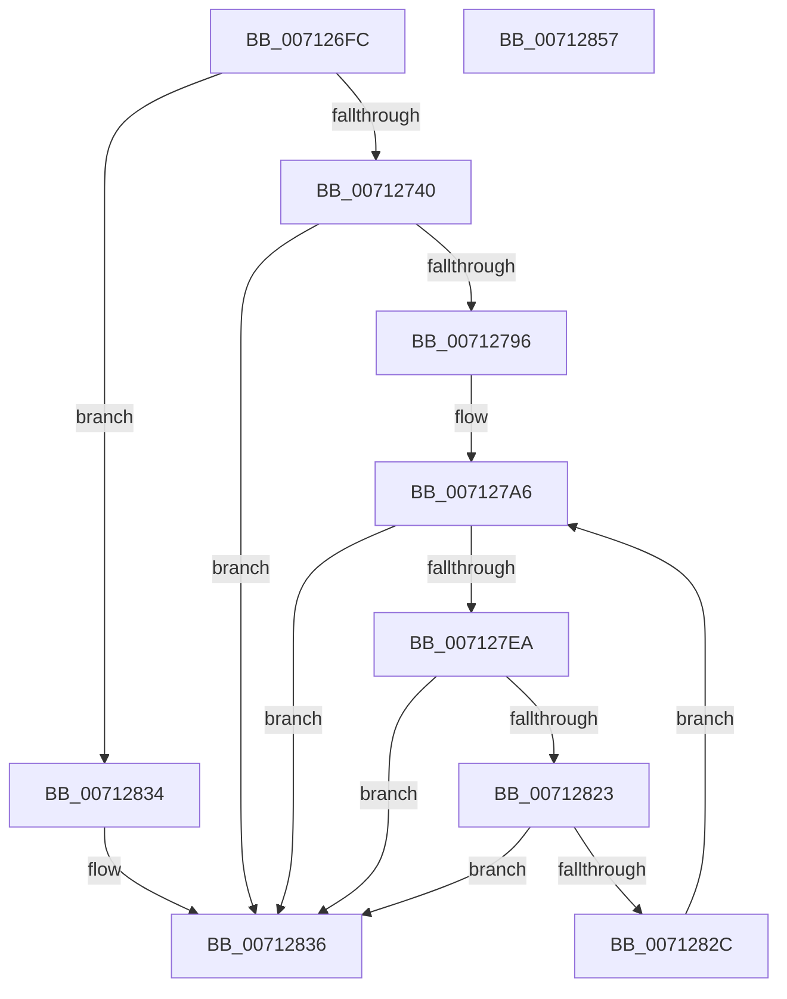

# DbgkpWerWriteSecondaryData

- RVA: `0x007126FC`–`0x00712858` (길이 `348` bytes)
- VA: `0x00000001407126FC`
- 실행 섹션: `PAGE`
- PDB 이름 있음: `예`; PDB Function 태그: `아니요`
- unwind 정보 RVA: `0x000C5A54`
- 디코드: `89`개 명령, `348/348` bytes 표시
- 미해석 바이트: `0` (있으면 어셈블리에 `.byte`로 보존)

> 이 문서는 커널 이미지의 기계어와 PDB 기호를 분석해 생성했습니다. 4번과 5번은 함수 원형과 자료형을 바이너리 사용 방식에서 추정한 C 해석이며 원본 소스 복구 결과는 아닙니다.

## 1. Dependencies

- 직접 호출 지점: **4**; 고유 호출 대상: **2**
- 직접 호출자로 확인된 함수: **1**
- RIP 상대 이미지 참조: **2**

### Outgoing calls
- `0x00712789` → [ZwWriteFile](../../text/6A/ZwWriteFile_function_006AD1D0.md) (function, `0x006AD1D0`)
- `0x007127E1` → [ZwWriteFile](../../text/6A/ZwWriteFile_function_006AD1D0.md) (function, `0x006AD1D0`)
- `0x0071281A` → [ZwWriteFile](../../text/6A/ZwWriteFile_function_006AD1D0.md) (function, `0x006AD1D0`)
- `0x0071283D` → [_security_check_cookie](../../text/6A/_security_check_cookie_function_006AC640.md) (function, `0x006AC640`)

### Direct callers
- [DbgkpWerWriteTriageDump](DbgkpWerWriteTriageDump_function_00712860.md) at `0x00712901`

### Static image references
- `0x00712713` → RVA `0x00E0A740` (`.data`; read)
- `0x00712752` → RVA `0x00E0A74C` (`.data`; read)

## 2. Other-region calls and transfers

- 다른 실행 섹션으로 향하는 call: **4**
  - `0x00712789` → [ZwWriteFile](../../text/6A/ZwWriteFile_function_006AD1D0.md) (`PAGE` → `.text`)
  - `0x007127E1` → [ZwWriteFile](../../text/6A/ZwWriteFile_function_006AD1D0.md) (`PAGE` → `.text`)
  - `0x0071281A` → [ZwWriteFile](../../text/6A/ZwWriteFile_function_006AD1D0.md) (`PAGE` → `.text`)
  - `0x0071283D` → [_security_check_cookie](../../text/6A/_security_check_cookie_function_006AC640.md) (`PAGE` → `.text`)
- 별도 외부 분기/꼬리 이동을 확인하지 못했습니다.

## 3. Assembly (complete function range)

```asm
007126FC  4C 8B DC                        mov r11, rsp
007126FF  49 89 5B 18                     mov qword ptr [r11 + 0x18], rbx
00712703  49 89 7B 20                     mov qword ptr [r11 + 0x20], rdi
00712707  55                              push rbp
00712708  49 8D 6B A1                     lea rbp, [r11 - 0x5f]
0071270C  48 81 EC A0 00 00 00            sub rsp, 0xa0
00712713  48 8B 05 26 80 6F 00            mov rax, qword ptr [rip + 0x6f8026]
0071271A  48 33 C4                        xor rax, rsp
0071271D  48 89 45 47                     mov qword ptr [rbp + 0x47], rax
00712721  48 8B 99 A0 00 00 00            mov rbx, qword ptr [rcx + 0xa0]
00712728  0F 57 C0                        xorps xmm0, xmm0
0071272B  48 8B FA                        mov rdi, rdx
0071272E  F3 0F 7F 45 2B                  movdqu xmmword ptr [rbp + 0x2b], xmm0
00712733  0F 11 45 07                     movups xmmword ptr [rbp + 7], xmm0
00712737  48 85 DB                        test rbx, rbx
0071273A  0F 84 F4 00 00 00               je 0x140712834
00712740  49 83 63 98 00                  and qword ptr [r11 - 0x68], 0
00712745  B9 10 00 00 00                  mov ecx, 0x10
0071274A  49 83 63 90 00                  and qword ptr [r11 - 0x70], 0
0071274F  45 33 C9                        xor r9d, r9d
00712752  8B 05 F4 7F 6F 00               mov eax, dword ptr [rip + 0x6f7ff4]
00712758  45 33 C0                        xor r8d, r8d
0071275B  89 4C 24 30                     mov dword ptr [rsp + 0x30], ecx
0071275F  33 D2                           xor edx, edx
00712761  89 45 23                        mov dword ptr [rbp + 0x23], eax
00712764  48 8D 45 17                     lea rax, [rbp + 0x17]
00712768  49 89 43 80                     mov qword ptr [r11 - 0x80], rax
0071276C  48 8D 45 07                     lea rax, [rbp + 7]
00712770  89 4D 1F                        mov dword ptr [rbp + 0x1f], ecx
00712773  48 8B CF                        mov rcx, rdi
00712776  48 89 44 24 20                  mov qword ptr [rsp + 0x20], rax
0071277B  C7 45 17 44 75 6D 70            mov dword ptr [rbp + 0x17], 0x706d7544
00712782  C7 45 1B 42 6C 6F 62            mov dword ptr [rbp + 0x1b], 0x626f6c42
00712789  E8 42 AA F9 FF                  call 0x1406ad1d0
0071278E  85 C0                           test eax, eax
00712790  0F 88 A0 00 00 00               js 0x140712836
00712796  83 65 3F 00                     and dword ptr [rbp + 0x3f], 0
0071279A  B9 20 00 00 00                  mov ecx, 0x20
0071279F  83 65 43 00                     and dword ptr [rbp + 0x43], 0
007127A3  89 4D 27                        mov dword ptr [rbp + 0x27], ecx
007127A6  48 83 64 24 40 00               and qword ptr [rsp + 0x40], 0
007127AC  45 33 C9                        xor r9d, r9d
007127AF  0F 10 03                        movups xmm0, xmmword ptr [rbx]
007127B2  48 83 64 24 38 00               and qword ptr [rsp + 0x38], 0
007127B8  45 33 C0                        xor r8d, r8d
007127BB  89 4C 24 30                     mov dword ptr [rsp + 0x30], ecx
007127BF  33 D2                           xor edx, edx
007127C1  F3 0F 7F 45 2B                  movdqu xmmword ptr [rbp + 0x2b], xmm0
007127C6  8B 43 18                        mov eax, dword ptr [rbx + 0x18]
007127C9  48 8B CF                        mov rcx, rdi
007127CC  89 45 3B                        mov dword ptr [rbp + 0x3b], eax
007127CF  48 8D 45 27                     lea rax, [rbp + 0x27]
007127D3  48 89 44 24 28                  mov qword ptr [rsp + 0x28], rax
007127D8  48 8D 45 07                     lea rax, [rbp + 7]
007127DC  48 89 44 24 20                  mov qword ptr [rsp + 0x20], rax
007127E1  E8 EA A9 F9 FF                  call 0x1406ad1d0
007127E6  85 C0                           test eax, eax
007127E8  78 4C                           js 0x140712836
007127EA  48 83 64 24 40 00               and qword ptr [rsp + 0x40], 0
007127F0  45 33 C9                        xor r9d, r9d
007127F3  48 83 64 24 38 00               and qword ptr [rsp + 0x38], 0
007127F9  45 33 C0                        xor r8d, r8d
007127FC  8B 43 18                        mov eax, dword ptr [rbx + 0x18]
007127FF  33 D2                           xor edx, edx
00712801  89 44 24 30                     mov dword ptr [rsp + 0x30], eax
00712805  48 8B CF                        mov rcx, rdi
00712808  48 8B 43 10                     mov rax, qword ptr [rbx + 0x10]
0071280C  48 89 44 24 28                  mov qword ptr [rsp + 0x28], rax
00712811  48 8D 45 07                     lea rax, [rbp + 7]
00712815  48 89 44 24 20                  mov qword ptr [rsp + 0x20], rax
0071281A  E8 B1 A9 F9 FF                  call 0x1406ad1d0
0071281F  85 C0                           test eax, eax
00712821  78 13                           js 0x140712836
00712823  48 8B 5B 20                     mov rbx, qword ptr [rbx + 0x20]
00712827  48 85 DB                        test rbx, rbx
0071282A  74 0A                           je 0x140712836
0071282C  8B 4D 27                        mov ecx, dword ptr [rbp + 0x27]
0071282F  E9 72 FF FF FF                  jmp 0x1407127a6
00712834  33 C0                           xor eax, eax
00712836  48 8B 4D 47                     mov rcx, qword ptr [rbp + 0x47]
0071283A  48 33 CC                        xor rcx, rsp
0071283D  E8 FE 9D F9 FF                  call 0x1406ac640
00712842  4C 8D 9C 24 A0 00 00 00         lea r11, [rsp + 0xa0]
0071284A  49 8B 5B 20                     mov rbx, qword ptr [r11 + 0x20]
0071284E  49 8B 7B 28                     mov rdi, qword ptr [r11 + 0x28]
00712852  49 8B E3                        mov rsp, r11
00712855  5D                              pop rbp
00712856  C3                              ret
00712857  CC                              int3
```

## 4. C-style interpretation (structured pseudocode)

```c
__int64 __fastcall DbgkpWerWriteSecondaryData(__int64 a1, __int64 a2, int a3, int a4)
{
    __int64 result;
    __int64 v_rsp;
    unsigned __int64 v_stack_m68;
    unsigned __int64 v_stack_m70;
    unsigned int v_stack_m78;
    unsigned __int64 v_stack_m8;
    unsigned __int64 v_stack_m80;
    unsigned __int64 v_stack_m88;

    *(unsigned __int64 *)(v_rsp + 24) = v_rbx;
    *(unsigned __int64 *)(v_rsp + 32) = v_rdi;
    v_rsp = (v_rsp) - (160);
    result = (*(unsigned __int64 *)(v_rip + 7307302)) ^ (v_rsp);
    *(unsigned __int64 *)(v_rsp - 95 + 71) = result;
    *(unsigned __int64 *)(v_rsp - 95 + 43) = v_xmm0;
    *(unsigned __int64 *)(v_rsp - 95 + 7) = v_xmm0;
    if (*(unsigned __int64 *)(a1 + 160) == 0) goto loc_00712834;
    a4 = 0;
    a3 = 0;
    v_stack_m78 = 16;
    a2 = 0;
    *(unsigned int *)(v_rsp - 95 + 35) = (unsigned int)((unsigned int)(*(unsigned int *)(v_rip + 7307252)));
    *(unsigned __int64 *)(v_rsp - 128) = v_rsp - 95 + 23;
    *(unsigned int *)(v_rsp - 95 + 31) = 16;
    v_stack_m88 = v_rsp - 95 + 7;
    *(unsigned int *)(v_rsp - 95 + 23) = 0x706D7544ULL;
    *(unsigned int *)(v_rsp - 95 + 27) = 0x626F6C42ULL;
    result = ZwWriteFile(0, a2, a3, a4);
    if (sign_flag) goto loc_00712836;
    *(unsigned int *)(v_rsp - 95 + 39) = 32;
loc_007127A6:
    a4 = 0;
    a3 = 0;
    v_stack_m78 = 32;
    a2 = 0;
    *(unsigned __int64 *)(v_rsp - 95 + 43) = v_xmm0;
    *(unsigned int *)(v_rsp - 95 + 59) = (unsigned int)((unsigned int)(*(unsigned int *)(*(unsigned __int64 *)(a1 + 160) + 24)));
    v_stack_m80 = v_rsp - 95 + 39;
    v_stack_m88 = v_rsp - 95 + 7;
    result = ZwWriteFile(0, a2, a3, a4);
    if (sign_flag) goto loc_00712836;
    a4 = 0;
    a3 = 0;
    a2 = 0;
    v_stack_m78 = (unsigned int)((unsigned int)(*(unsigned int *)(*(unsigned __int64 *)(a1 + 160) + 24)));
    v_stack_m80 = *(unsigned __int64 *)(*(unsigned __int64 *)(a1 + 160) + 16);
    v_stack_m88 = v_rsp - 95 + 7;
    result = ZwWriteFile(0, a2, a3, a4);
    if (sign_flag) goto loc_00712836;
    if (*(unsigned __int64 *)(*(unsigned __int64 *)(a1 + 160) + 32) == 0) goto loc_00712836;
    goto loc_007127A6;
loc_00712834:
    result = 0;
loc_00712836:
    a1 = (*(unsigned __int64 *)(v_rsp - 95 + 71)) ^ (v_rsp);
    result = _security_check_cookie(a1, a2, a3, a4);
    return result;
}
```

## 5. (Beta) C Style

```c
int64_t DbgkpWerWriteSecondaryData(void *Arg1, int64_t Arg2, int32_t Arg3, int32_t Arg4)
{
    uint8_t *arg1 = (uint8_t *)Arg1;

    int64_t result;
    int64_t local_rsp;
    uint64_t v_stack_m68;
    uint64_t v_stack_m70;
    uint32_t v_stack_m78;
    uint64_t v_stack_m8;
    uint64_t v_stack_m80;
    uint64_t v_stack_m88;

    *(uint64_t *)(local_rsp + 0x18) = local_rbx;
    *(uint64_t *)(local_rsp + 0x20) = local_rdi;
    local_rsp = (local_rsp) - (160);
    result = (*(uint64_t *)(v_rip + 0x6F8026)) ^ (local_rsp);
    *(uint64_t *)(local_rsp - 0x5F + 0x47) = result;
    *(uint64_t *)(local_rsp - 0x5F + 0x2B) = v_xmm0;
    *(uint64_t *)(local_rsp - 0x5F + 0x7) = v_xmm0;
    if (*(uint64_t *)(arg1 + 0xA0) == 0) goto loc_00712834;
    Arg4 = 0;
    Arg3 = 0;
    v_stack_m78 = 16;
    Arg2 = 0;
    *(uint32_t *)(local_rsp - 0x5F + 0x23) = (uint32_t)((uint32_t)(*(uint32_t *)(v_rip + 0x6F7FF4)));
    *(uint64_t *)(local_rsp - 0x80) = local_rsp - 95 + 23;
    *(uint32_t *)(local_rsp - 0x5F + 0x1F) = 16;
    v_stack_m88 = local_rsp - 95 + 7;
    *(uint32_t *)(local_rsp - 0x5F + 0x17) = 0x706D7544ULL;
    *(uint32_t *)(local_rsp - 0x5F + 0x1B) = 0x626F6C42ULL;
    result = ZwWriteFile(0, Arg2, Arg3, Arg4);
    if (sign_flag) goto loc_00712836;
    *(uint32_t *)(local_rsp - 0x5F + 0x27) = 32;
loc_007127A6:
    Arg4 = 0;
    Arg3 = 0;
    v_stack_m78 = 32;
    Arg2 = 0;
    *(uint64_t *)(local_rsp - 0x5F + 0x2B) = v_xmm0;
    *(uint32_t *)(local_rsp - 0x5F + 0x3B) = (uint32_t)((uint32_t)(*(uint32_t *)(*(uint64_t *)(arg1 + 0xA0) + 0x18)));
    v_stack_m80 = local_rsp - 95 + 39;
    v_stack_m88 = local_rsp - 95 + 7;
    result = ZwWriteFile(0, Arg2, Arg3, Arg4);
    if (sign_flag) goto loc_00712836;
    Arg4 = 0;
    Arg3 = 0;
    Arg2 = 0;
    v_stack_m78 = (uint32_t)((uint32_t)(*(uint32_t *)(*(uint64_t *)(arg1 + 0xA0) + 0x18)));
    v_stack_m80 = *(uint64_t *)(*(uint64_t *)(arg1 + 0xA0) + 0x10);
    v_stack_m88 = local_rsp - 95 + 7;
    result = ZwWriteFile(0, Arg2, Arg3, Arg4);
    if (sign_flag) goto loc_00712836;
    if (*(uint64_t *)(*(uint64_t *)(arg1 + 0xA0) + 0x20) == 0) goto loc_00712836;
    goto loc_007127A6;
loc_00712834:
    result = 0;
loc_00712836:
    Arg1 = (*(uint64_t *)(local_rsp - 0x5F + 0x47)) ^ (local_rsp);
    result = _security_check_cookie(Arg1, Arg2, Arg3, Arg4);
    return result;
}
```

### 관측된 메모리 오프셋

구조체 형식이 확인되지 않은 접근은 인자 기준의 오프셋으로만 기록했습니다.

| 기준 인자 | 오프셋 표현 | 폭 (bit) | 접근 |
|---|---:|---:|---|
| `Arg1` | `+ 0xA0` | `64` | `R` |

## 6. Execution-region graph

[열기: 2D/3D 그래프와 함수 탐색 컨트롤 패널](../../../control-panel.html?section=page&rva=0x007126FC&view=graph)

- 2D 그래프는 위에서 아래로 흐르고, 3D 그래프는 빈 공간을 드래그해 회전합니다. Shift+드래그는 이동, 휠은 확대·축소, 함수 노드 선택은 대상 보고서 이동입니다.

### Static fallback


