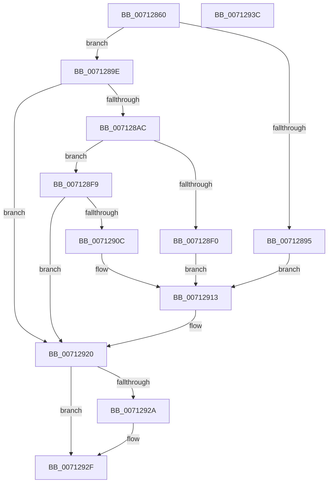

# DbgkpWerWriteTriageDump

- RVA: `0x00712860`–`0x0071293D` (길이 `221` bytes)
- VA: `0x0000000140712860`
- 실행 섹션: `PAGE`
- PDB 이름 있음: `예`; PDB Function 태그: `아니요`
- unwind 정보 RVA: `0x000956E8`
- 디코드: `61`개 명령, `221/221` bytes 표시
- 미해석 바이트: `0` (있으면 어셈블리에 `.byte`로 보존)

> 이 문서는 커널 이미지의 기계어와 PDB 기호를 분석해 생성했습니다. 4번과 5번은 함수 원형과 자료형을 바이너리 사용 방식에서 추정한 C 해석이며 원본 소스 복구 결과는 아닙니다.

## 1. Dependencies

- 직접 호출 지점: **6**; 고유 호출 대상: **6**
- 직접 호출자로 확인된 함수: **1**
- RIP 상대 이미지 참조: **4**

### Outgoing calls
- `0x00712883` → `ext-ms-win-ntos-werkernel-l1-1-1.dll!WerLiveKernelOpenDumpFile` (import, 간접 대상; import `ext-ms-win-ntos-werkernel-l1-1-1.dll!WerLiveKernelOpenDumpFile`)
- `0x007128A1` → [DbgkpWerUpdateTriageDumpHeader](DbgkpWerUpdateTriageDumpHeader_function_00712668.md) (function, `0x00712668`)
- `0x007128E5` → [ZwWriteFile](../../text/6A/ZwWriteFile_function_006AD1D0.md) (function, `0x006AD1D0`)
- `0x00712901` → [DbgkpWerWriteSecondaryData](DbgkpWerWriteSecondaryData_function_007126FC.md) (function, `0x007126FC`)
- `0x0071291B` → [DbgPrintEx](../../text/35/DbgPrintEx_function_00359290.md) (function, `0x00359290`)
- `0x0071292A` → [ZwClose](../../text/6A/ZwClose_function_006AD2B0.md) (function, `0x006AD2B0`)

### Direct callers
- [DbgkpWerCaptureLiveTriageDump](DbgkpWerCaptureLiveTriageDump_function_00712000.md) at `0x00712110`

### Static image references
- `0x00712883` → RVA `0x00151620` (`ext-ms-win-ntos-werkernel-l1-1-1.dll!WerLiveKernelOpenDumpFile (IAT)`; read)
- `0x00712895` → RVA `0x00AFBA40` (` ?? ::NNGAKEGL::`string'`; read)
- `0x007128F0` → RVA `0x00AFBA90` (` ?? ::NNGAKEGL::`string'`; read)
- `0x0071290C` → RVA `0x00AFBA00` (` ?? ::NNGAKEGL::`string'`; read)

## 2. Other-region calls and transfers

- 다른 실행 섹션으로 향하는 call: **3**
  - `0x007128E5` → [ZwWriteFile](../../text/6A/ZwWriteFile_function_006AD1D0.md) (`PAGE` → `.text`)
  - `0x0071291B` → [DbgPrintEx](../../text/35/DbgPrintEx_function_00359290.md) (`PAGE` → `.text`)
  - `0x0071292A` → [ZwClose](../../text/6A/ZwClose_function_006AD2B0.md) (`PAGE` → `.text`)
- 별도 외부 분기/꼬리 이동을 확인하지 못했습니다.

## 3. Assembly (complete function range)

```asm
00712860  48 8B C4                        mov rax, rsp
00712863  48 89 58 10                     mov qword ptr [rax + 0x10], rbx
00712867  57                              push rdi
00712868  48 83 EC 60                     sub rsp, 0x60
0071286C  48 83 60 08 00                  and qword ptr [rax + 8], 0
00712871  48 8D 50 08                     lea rdx, [rax + 8]
00712875  48 8B F9                        mov rdi, rcx
00712878  0F 57 C0                        xorps xmm0, xmm0
0071287B  48 8B 49 60                     mov rcx, qword ptr [rcx + 0x60]
0071287F  0F 11 40 E8                     movups xmmword ptr [rax - 0x18], xmm0
00712883  48 FF 15 96 ED A3 FF            call qword ptr [rip - 0x5c126a]
0071288A  0F 1F 44 00 00                  nop dword ptr [rax + rax]
0071288F  8B D8                           mov ebx, eax
00712891  85 C0                           test eax, eax
00712893  79 09                           jns 0x14071289e
00712895  4C 8D 05 A4 91 3E 00            lea r8, [rip + 0x3e91a4]
0071289C  EB 75                           jmp 0x140712913
0071289E  48 8B CF                        mov rcx, rdi
007128A1  E8 C2 FD FF FF                  call 0x140712668
007128A6  8B D8                           mov ebx, eax
007128A8  85 C0                           test eax, eax
007128AA  78 74                           js 0x140712920
007128AC  48 83 64 24 40 00               and qword ptr [rsp + 0x40], 0
007128B2  45 33 C9                        xor r9d, r9d
007128B5  48 83 64 24 38 00               and qword ptr [rsp + 0x38], 0
007128BB  45 33 C0                        xor r8d, r8d
007128BE  8B 87 90 00 00 00               mov eax, dword ptr [rdi + 0x90]
007128C4  33 D2                           xor edx, edx
007128C6  48 8B 4C 24 70                  mov rcx, qword ptr [rsp + 0x70]
007128CB  89 44 24 30                     mov dword ptr [rsp + 0x30], eax
007128CF  48 8B 87 88 00 00 00            mov rax, qword ptr [rdi + 0x88]
007128D6  48 89 44 24 28                  mov qword ptr [rsp + 0x28], rax
007128DB  48 8D 44 24 50                  lea rax, [rsp + 0x50]
007128E0  48 89 44 24 20                  mov qword ptr [rsp + 0x20], rax
007128E5  E8 E6 A8 F9 FF                  call 0x1406ad1d0
007128EA  8B D8                           mov ebx, eax
007128EC  85 C0                           test eax, eax
007128EE  79 09                           jns 0x1407128f9
007128F0  4C 8D 05 99 91 3E 00            lea r8, [rip + 0x3e9199]
007128F7  EB 1A                           jmp 0x140712913
007128F9  48 8B 54 24 70                  mov rdx, qword ptr [rsp + 0x70]
007128FE  48 8B CF                        mov rcx, rdi
00712901  E8 F6 FD FF FF                  call 0x1407126fc
00712906  8B D8                           mov ebx, eax
00712908  85 C0                           test eax, eax
0071290A  79 14                           jns 0x140712920
0071290C  4C 8D 05 ED 90 3E 00            lea r8, [rip + 0x3e90ed]
00712913  33 D2                           xor edx, edx
00712915  44 8B C8                        mov r9d, eax
00712918  8D 4A 05                        lea ecx, [rdx + 5]
0071291B  E8 70 69 C4 FF                  call 0x140359290
00712920  48 8B 4C 24 70                  mov rcx, qword ptr [rsp + 0x70]
00712925  48 85 C9                        test rcx, rcx
00712928  74 05                           je 0x14071292f
0071292A  E8 81 A9 F9 FF                  call 0x1406ad2b0
0071292F  8B C3                           mov eax, ebx
00712931  48 8B 5C 24 78                  mov rbx, qword ptr [rsp + 0x78]
00712936  48 83 C4 60                     add rsp, 0x60
0071293A  5F                              pop rdi
0071293B  C3                              ret
0071293C  CC                              int3
```

## 4. C-style interpretation (structured pseudocode)

```c
__int64 __fastcall DbgkpWerWriteTriageDump(__int64 a1, __int64 a2, __int64 a3, int a4)
{
    __int64 result;
    __int64 v_rsp;
    unsigned __int64 v_stack_m18;
    unsigned __int64 v_stack_m28;
    unsigned __int64 v_stack_m30;
    unsigned int v_stack_m38;
    unsigned __int64 v_stack_m40;
    unsigned __int64 v_stack_m48;
    unsigned __int64 v_stack_p10;
    unsigned __int64 v_stack_p8;

    *(unsigned __int64 *)(v_rsp + 16) = v_rbx;
    v_rsp = (v_rsp) - (96);
    *(unsigned __int64 *)(v_rsp - 24) = v_xmm0;
    result = ext_ms_win_ntos_werkernel_l1_1_1_dll_WerLiveKernelOpenDumpFile(*(unsigned __int64 *)(a1 + 96), v_rsp + 8, a3, a4);
    if (!sign_flag) goto loc_0071289E;
    goto loc_00712913;
loc_0071289E:
    result = DbgkpWerUpdateTriageDumpHeader(a1, v_rsp + 8, v_rip + 4100516, a4);
    if (sign_flag) goto loc_00712920;
    a4 = 0;
    a3 = 0;
    a2 = 0;
    v_stack_m38 = (unsigned int)((unsigned int)(*(unsigned int *)(a1 + 144)));
    v_stack_m40 = *(unsigned __int64 *)(a1 + 136);
    v_stack_m48 = v_stack_m18;
    result = ZwWriteFile(v_stack_p8, a2, a3, a4);
    if (!sign_flag) goto loc_007128F9;
    goto loc_00712913;
loc_007128F9:
    result = DbgkpWerWriteSecondaryData(a1, v_stack_p8, v_rip + 4100505, a4);
    if (!sign_flag) goto loc_00712920;
loc_00712913:
    a2 = 0;
    result = DbgPrintEx(a2 + 5, a2, v_rip + 4100333, (unsigned int)((unsigned int)(result)));
loc_00712920:
    if (v_stack_p8 != 0) {
        result = ZwClose(v_stack_p8, a2, v_rip + 4100333, (unsigned int)((unsigned int)(result)));
    }
    v_rsp = (v_rsp) + (96);
    return (unsigned int)((unsigned int)((unsigned int)((unsigned int)(result))));
}
```

## 5. (Beta) C Style

```c
int64_t DbgkpWerWriteTriageDump(void *Arg1, int64_t Arg2, int64_t Arg3, int32_t Arg4)
{
    uint8_t *arg1 = (uint8_t *)Arg1;

    int64_t result;
    int64_t local_rsp;
    uint64_t v_stack_m18;
    uint64_t v_stack_m28;
    uint64_t v_stack_m30;
    uint32_t v_stack_m38;
    uint64_t v_stack_m40;
    uint64_t v_stack_m48;
    uint64_t v_stack_p10;
    uint64_t v_stack_p8;

    *(uint64_t *)(local_rsp + 0x10) = local_rbx;
    local_rsp = (local_rsp) - (96);
    *(uint64_t *)(local_rsp - 0x18) = v_xmm0;
    result = kernel_indirect_call(*(uint64_t *)(arg1 + 0x60), local_rsp + 8, Arg3, Arg4);
    if (!sign_flag) goto loc_0071289E;
    goto loc_00712913;
loc_0071289E:
    result = DbgkpWerUpdateTriageDumpHeader(Arg1, local_rsp + 8, v_rip + 4100516, Arg4);
    if (sign_flag) goto loc_00712920;
    Arg4 = 0;
    Arg3 = 0;
    Arg2 = 0;
    v_stack_m38 = (uint32_t)((uint32_t)(*(uint32_t *)(arg1 + 0x90)));
    v_stack_m40 = *(uint64_t *)(arg1 + 0x88);
    v_stack_m48 = v_stack_m18;
    result = ZwWriteFile(v_stack_p8, Arg2, Arg3, Arg4);
    if (!sign_flag) goto loc_007128F9;
    goto loc_00712913;
loc_007128F9:
    result = DbgkpWerWriteSecondaryData(Arg1, v_stack_p8, v_rip + 4100505, Arg4);
    if (!sign_flag) goto loc_00712920;
loc_00712913:
    Arg2 = 0;
    result = DbgPrintEx(Arg2 + 5, Arg2, v_rip + 4100333, (uint32_t)((uint32_t)(result)));
loc_00712920:
    if (v_stack_p8 != 0) {
        result = ZwClose(v_stack_p8, Arg2, v_rip + 4100333, (uint32_t)((uint32_t)(result)));
    }
    local_rsp = (local_rsp) + (96);
    return (uint32_t)((uint32_t)((uint32_t)((uint32_t)(result))));
}
```

### 관측된 메모리 오프셋

구조체 형식이 확인되지 않은 접근은 인자 기준의 오프셋으로만 기록했습니다.

| 기준 인자 | 오프셋 표현 | 폭 (bit) | 접근 |
|---|---:|---:|---|
| `Arg1` | `+ 0x60` | `64` | `R` |
| `Arg1` | `+ 0x88` | `64` | `R` |
| `Arg1` | `+ 0x90` | `32` | `R` |

## 6. Execution-region graph

[열기: 2D/3D 그래프와 함수 탐색 컨트롤 패널](../../../control-panel.html?section=page&rva=0x00712860&view=graph)

- 2D 그래프는 위에서 아래로 흐르고, 3D 그래프는 빈 공간을 드래그해 회전합니다. Shift+드래그는 이동, 휠은 확대·축소, 함수 노드 선택은 대상 보고서 이동입니다.

### Static fallback


