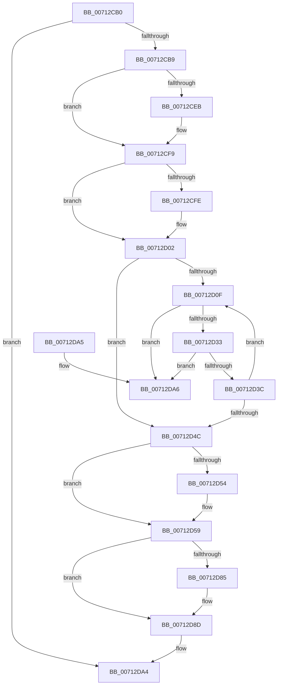

# EmClientRuleDeregisterNotification

- RVA: `0x00712CB0`–`0x00712DAD` (길이 `253` bytes)
- VA: `0x0000000140712CB0`
- 실행 섹션: `PAGE`
- PDB 이름 있음: `예`; PDB Function 태그: `아니요`
- unwind 정보 RVA: `0x000C5AC0`
- 디코드: `70`개 명령, `253/253` bytes 표시
- 미해석 바이트: `0` (있으면 어셈블리에 `.byte`로 보존)

> 이 문서는 커널 이미지의 기계어와 PDB 기호를 분석해 생성했습니다. 4번과 5번은 함수 원형과 자료형을 바이너리 사용 방식에서 추정한 C 해석이며 원본 소스 복구 결과는 아닙니다.

## 1. Dependencies

- 직접 호출 지점: **7**; 고유 호출 대상: **6**
- 직접 호출자로 확인된 함수: **0**
- RIP 상대 이미지 참조: **2**

### Outgoing calls
- `0x00712CDA` → [KeAbPreAcquire](../../text/21/KeAbPreAcquire_function_00210230.md) (function, `0x00210230`)
- `0x00712CF4` → [ExfAcquirePushLockExclusiveEx](../../text/20/ExfAcquirePushLockExclusiveEx_function_0020FC90.md) (function, `0x0020FC90`)
- `0x00712D54` → [ObfDereferenceObject](../../text/2F/ObfDereferenceObject_function_002F9350.md) (function, `0x002F9350`)
- `0x00712D62` → [ExFreePoolWithTag](../../poolcode/B8/ExFreePoolWithTag_function_00B82870.md) (function, `0x00B82870`)
- `0x00712D6F` → [ExFreePoolWithTag](../../poolcode/B8/ExFreePoolWithTag_function_00B82870.md) (function, `0x00B82870`)
- `0x00712D88` → [ExfTryToWakePushLock](../../text/26/ExfTryToWakePushLock_function_00265DD0.md) (function, `0x00265DD0`)
- `0x00712D90` → [KeAbPostRelease](../../text/2E/KeAbPostRelease_function_002E1600.md) (function, `0x002E1600`)

### Direct callers
- 이 함수 시작 RVA로 연결되는 직접 call은 확인되지 않았습니다. 간접 호출은 완전히 역산할 수 없습니다.

### Static image references
- `0x00712CCB` → RVA `0x00F8F1E0` (`.data`; read)
- `0x00712D74` → RVA `0x00F8F1E0` (`.data`; read/write)

## 2. Other-region calls and transfers

- 다른 실행 섹션으로 향하는 call: **7**
  - `0x00712CDA` → [KeAbPreAcquire](../../text/21/KeAbPreAcquire_function_00210230.md) (`PAGE` → `.text`)
  - `0x00712CF4` → [ExfAcquirePushLockExclusiveEx](../../text/20/ExfAcquirePushLockExclusiveEx_function_0020FC90.md) (`PAGE` → `.text`)
  - `0x00712D54` → [ObfDereferenceObject](../../text/2F/ObfDereferenceObject_function_002F9350.md) (`PAGE` → `.text`)
  - `0x00712D62` → [ExFreePoolWithTag](../../poolcode/B8/ExFreePoolWithTag_function_00B82870.md) (`PAGE` → `POOLCODE`)
  - `0x00712D6F` → [ExFreePoolWithTag](../../poolcode/B8/ExFreePoolWithTag_function_00B82870.md) (`PAGE` → `POOLCODE`)
  - `0x00712D88` → [ExfTryToWakePushLock](../../text/26/ExfTryToWakePushLock_function_00265DD0.md) (`PAGE` → `.text`)
  - `0x00712D90` → [KeAbPostRelease](../../text/2E/KeAbPostRelease_function_002E1600.md) (`PAGE` → `.text`)
- 별도 외부 분기/꼬리 이동을 확인하지 못했습니다.

## 3. Assembly (complete function range)

```asm
00712CB0  48 85 C9                        test rcx, rcx
00712CB3  0F 84 EB 00 00 00               je 0x140712da4
00712CB9  48 89 5C 24 08                  mov qword ptr [rsp + 8], rbx
00712CBE  48 89 6C 24 10                  mov qword ptr [rsp + 0x10], rbp
00712CC3  57                              push rdi
00712CC4  48 83 EC 20                     sub rsp, 0x20
00712CC8  48 8B F9                        mov rdi, rcx
00712CCB  48 8D 2D 0E C5 87 00            lea rbp, [rip + 0x87c50e]
00712CD2  48 8B CD                        mov rcx, rbp
00712CD5  45 33 C0                        xor r8d, r8d
00712CD8  33 D2                           xor edx, edx
00712CDA  E8 51 D5 AF FF                  call 0x140210230
00712CDF  F0 48 0F BA 6D 00 00            lock bts qword ptr [rbp], 0
00712CE6  48 8B D8                        mov rbx, rax
00712CE9  73 0E                           jae 0x140712cf9
00712CEB  4C 8B C5                        mov r8, rbp
00712CEE  48 8B D0                        mov rdx, rax
00712CF1  48 8B CD                        mov rcx, rbp
00712CF4  E8 97 CF AF FF                  call 0x14020fc90
00712CF9  48 85 DB                        test rbx, rbx
00712CFC  74 04                           je 0x140712d02
00712CFE  C6 43 0A 01                     mov byte ptr [rbx + 0xa], 1
00712D02  45 33 C0                        xor r8d, r8d
00712D05  48 83 CB FF                     or rbx, 0xffffffffffffffff
00712D09  44 39 47 10                     cmp dword ptr [rdi + 0x10], r8d
00712D0D  76 3D                           jbe 0x140712d4c
00712D0F  48 8B 47 08                     mov rax, qword ptr [rdi + 8]
00712D13  4B 8D 14 80                     lea rdx, [r8 + r8*4]
00712D17  48 8B 0C D0                     mov rcx, qword ptr [rax + rdx*8]
00712D1B  F0 01 19                        lock add dword ptr [rcx], ebx
00712D1E  48 8B 47 08                     mov rax, qword ptr [rdi + 8]
00712D22  48 8D 52 03                     lea rdx, [rdx + 3]
00712D26  48 8D 0C D0                     lea rcx, [rax + rdx*8]
00712D2A  48 8B 11                        mov rdx, qword ptr [rcx]
00712D2D  48 39 4A 08                     cmp qword ptr [rdx + 8], rcx
00712D31  75 73                           jne 0x140712da6
00712D33  48 8B 41 08                     mov rax, qword ptr [rcx + 8]
00712D37  48 39 08                        cmp qword ptr [rax], rcx
00712D3A  75 6A                           jne 0x140712da6
00712D3C  48 89 10                        mov qword ptr [rax], rdx
00712D3F  41 FF C0                        inc r8d
00712D42  48 89 42 08                     mov qword ptr [rdx + 8], rax
00712D46  44 3B 47 10                     cmp r8d, dword ptr [rdi + 0x10]
00712D4A  72 C3                           jb 0x140712d0f
00712D4C  48 8B 0F                        mov rcx, qword ptr [rdi]
00712D4F  48 85 C9                        test rcx, rcx
00712D52  74 05                           je 0x140712d59
00712D54  E8 F7 65 BE FF                  call 0x1402f9350
00712D59  48 8B 4F 08                     mov rcx, qword ptr [rdi + 8]
00712D5D  BA 45 4D 63 6C                  mov edx, 0x6c634d45
00712D62  E8 09 FB 46 00                  call 0x140b82870
00712D67  BA 45 4D 63 6C                  mov edx, 0x6c634d45
00712D6C  48 8B CF                        mov rcx, rdi
00712D6F  E8 FC FA 46 00                  call 0x140b82870
00712D74  F0 48 0F C1 1D 63 C4 87 00      lock xadd qword ptr [rip + 0x87c463], rbx
00712D7D  80 E3 06                        and bl, 6
00712D80  80 FB 02                        cmp bl, 2
00712D83  75 08                           jne 0x140712d8d
00712D85  48 8B CD                        mov rcx, rbp
00712D88  E8 43 30 B5 FF                  call 0x140265dd0
00712D8D  48 8B CD                        mov rcx, rbp
00712D90  E8 6B E8 BC FF                  call 0x1402e1600
00712D95  48 8B 5C 24 30                  mov rbx, qword ptr [rsp + 0x30]
00712D9A  48 8B 6C 24 38                  mov rbp, qword ptr [rsp + 0x38]
00712D9F  48 83 C4 20                     add rsp, 0x20
00712DA3  5F                              pop rdi
00712DA4  C3                              ret
00712DA5  CC                              int3
00712DA6  B9 03 00 00 00                  mov ecx, 3
00712DAB  CD 29                           int 0x29
```

## 4. C-style interpretation (structured pseudocode)

```c
__int64 __fastcall EmClientRuleDeregisterNotification(__int64 a1, int a2, int a3)
{
    __int64 result;
    __int64 v_rbx;
    __int64 v_rsp;
    unsigned __int64 v_stack_p10;
    unsigned __int64 v_stack_p8;

    if (a1 == 0) goto loc_00712DA4;
    v_stack_p8 = v_rbx;
    v_stack_p10 = v_rbp;
    v_rsp = (v_rsp) - (32);
    a3 = 0;
    a2 = 0;
    result = KeAbPreAcquire(v_rip + 8897806, a2, a3, a4);
    if (!(condition_is_above_or_equal)) {
        a3 = v_rip + 8897806;
        a2 = result;
        a1 = v_rip + 8897806;
        result = ExfAcquirePushLockExclusiveEx(a1, a2, a3, a4);
    }
    if (result != 0) {
        *(unsigned __int8 *)(result + 10) = 1;
    }
    a3 = 0;
    v_rbx = (result) | (-1);
    if ((*(unsigned int *)(a1 + 16)) <= 0) goto loc_00712D4C;
loc_00712D0F:
    if ((*(unsigned __int64 *)(*(unsigned __int64 *)(*(unsigned __int64 *)(a1 + 8) + a3 + a3 * 4 + 3 * 8) + 8)) != (*(unsigned __int64 *)(a1 + 8) + a3 + a3 * 4 + 3 * 8)) goto loc_00712DA6;
    if ((*(unsigned __int64 *)(*(unsigned __int64 *)(*(unsigned __int64 *)(a1 + 8) + a3 + a3 * 4 + 3 * 8 + 8))) != (*(unsigned __int64 *)(a1 + 8) + a3 + a3 * 4 + 3 * 8)) goto loc_00712DA6;
    *(unsigned __int64 *)(*(unsigned __int64 *)(*(unsigned __int64 *)(a1 + 8) + a3 + a3 * 4 + 3 * 8 + 8)) = *(unsigned __int64 *)(*(unsigned __int64 *)(a1 + 8) + a3 + a3 * 4 + 3 * 8);
    a3 = (unsigned int)((a3) + 1);
    *(unsigned __int64 *)(*(unsigned __int64 *)(*(unsigned __int64 *)(a1 + 8) + a3 + a3 * 4 + 3 * 8) + 8) = *(unsigned __int64 *)(*(unsigned __int64 *)(a1 + 8) + a3 + a3 * 4 + 3 * 8 + 8);
    if (a3 < (*(unsigned int *)(a1 + 16))) goto loc_00712D0F;
loc_00712D4C:
    result = *(unsigned __int64 *)(*(unsigned __int64 *)(a1 + 8) + a3 + a3 * 4 + 3 * 8 + 8);
    if (*(unsigned __int64 *)(a1) != 0) {
        result = ObfDereferenceObject(*(unsigned __int64 *)(a1), *(unsigned __int64 *)(*(unsigned __int64 *)(a1 + 8) + a3 + a3 * 4 + 3 * 8), a3, a4);
    }
    result = ExFreePoolWithTag(*(unsigned __int64 *)(a1 + 8), (unsigned int)(0x6C634D45ULL), a3, a4);
    result = ExFreePoolWithTag(a1, (unsigned int)(0x6C634D45ULL), a3, a4);
    v_rbx = (unsigned __int8)((v_rbx) & (6));
    if (((unsigned __int8)(v_rbx)) == 2) {
        a1 = v_rip + 8897806;
        result = ExfTryToWakePushLock(a1, (unsigned int)(0x6C634D45ULL), a3, a4);
    }
    result = KeAbPostRelease(v_rip + 8897806, (unsigned int)(0x6C634D45ULL), a3, a4);
    v_rsp = (v_rsp) + (32);
loc_00712DA4:
    return result;
loc_00712DA6:
    return result;
}
```

## 5. (Beta) C Style

```c
int64_t EmClientRuleDeregisterNotification(int64_t Arg1, int32_t Arg2, int32_t Arg3)
{
    int64_t result;
    int64_t local_rbx;
    int64_t local_rsp;
    uint64_t v_stack_p10;
    uint64_t v_stack_p8;

    if (Arg1 == 0) goto loc_00712DA4;
    v_stack_p8 = local_rbx;
    v_stack_p10 = local_rbp;
    local_rsp = (local_rsp) - (32);
    Arg3 = 0;
    Arg2 = 0;
    result = KeAbPreAcquire(v_rip + 8897806, Arg2, Arg3, a4);
    if (!(condition_is_above_or_equal)) {
        Arg3 = v_rip + 8897806;
        Arg2 = result;
        Arg1 = v_rip + 8897806;
        result = ExfAcquirePushLockExclusiveEx(Arg1, Arg2, Arg3, a4);
    }
    if (result != 0) {
        *(uint8_t *)(result + 0xA) = 1;
    }
    Arg3 = 0;
    local_rbx = (result) | (-1);
    if ((*(uint32_t *)(Arg1 + 0x10)) <= 0) goto loc_00712D4C;
loc_00712D0F:
    if ((*(uint64_t *)(*(uint64_t *)(*(uint64_t *)(Arg1 + 0x8) + Arg3 + Arg3 * 4 + 0x3 * 8) + 0x8)) != (*(uint64_t *)(Arg1 + 0x8) + Arg3 + Arg3 * 4 + 3 * 8)) goto loc_00712DA6;
    if ((*(uint64_t *)(*(uint64_t *)(*(uint64_t *)(Arg1 + 0x8) + Arg3 + Arg3 * 4 + 0x3 * 8 + 0x8))) != (*(uint64_t *)(Arg1 + 0x8) + Arg3 + Arg3 * 4 + 3 * 8)) goto loc_00712DA6;
    *(uint64_t *)(*(uint64_t *)(*(uint64_t *)(Arg1 + 0x8) + Arg3 + Arg3 * 4 + 0x3 * 8 + 0x8)) = *(uint64_t *)(*(uint64_t *)(Arg1 + 0x8) + Arg3 + Arg3 * 4 + 0x3 * 8);
    Arg3 = (uint32_t)((Arg3) + 1);
    *(uint64_t *)(*(uint64_t *)(*(uint64_t *)(Arg1 + 0x8) + Arg3 + Arg3 * 4 + 0x3 * 8) + 0x8) = *(uint64_t *)(*(uint64_t *)(Arg1 + 0x8) + Arg3 + Arg3 * 4 + 0x3 * 8 + 0x8);
    if (Arg3 < (*(uint32_t *)(Arg1 + 0x10))) goto loc_00712D0F;
loc_00712D4C:
    result = *(uint64_t *)(*(uint64_t *)(Arg1 + 0x8) + Arg3 + Arg3 * 4 + 0x3 * 8 + 0x8);
    if (*(uint64_t *)(Arg1) != 0) {
        result = ObfDereferenceObject(*(uint64_t *)(Arg1), *(uint64_t *)(*(uint64_t *)(Arg1 + 0x8) + Arg3 + Arg3 * 4 + 0x3 * 8), Arg3, a4);
    }
    result = ExFreePoolWithTag(*(uint64_t *)(Arg1 + 0x8), (uint32_t)(0x6C634D45ULL), Arg3, a4);
    result = ExFreePoolWithTag(Arg1, (uint32_t)(0x6C634D45ULL), Arg3, a4);
    local_rbx = (uint8_t)((local_rbx) & (6));
    if (((uint8_t)(local_rbx)) == 2) {
        Arg1 = v_rip + 8897806;
        result = ExfTryToWakePushLock(Arg1, (uint32_t)(0x6C634D45ULL), Arg3, a4);
    }
    result = KeAbPostRelease(v_rip + 8897806, (uint32_t)(0x6C634D45ULL), Arg3, a4);
    local_rsp = (local_rsp) + (32);
loc_00712DA4:
    return result;
loc_00712DA6:
    return result;
}
```

## 6. Execution-region graph

[열기: 2D/3D 그래프와 함수 탐색 컨트롤 패널](../../../control-panel.html?section=page&rva=0x00712CB0&view=graph)

- 2D 그래프는 위에서 아래로 흐르고, 3D 그래프는 빈 공간을 드래그해 회전합니다. Shift+드래그는 이동, 휠은 확대·축소, 함수 노드 선택은 대상 보고서 이동입니다.

### Static fallback


