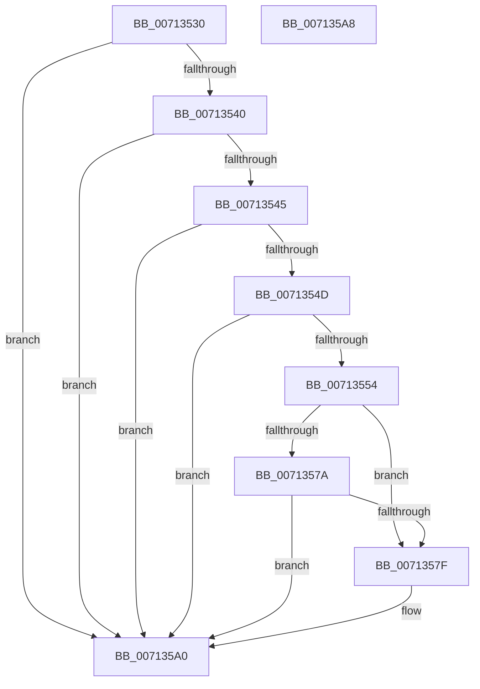

# EmMatchDate

- RVA: `0x00713530`–`0x007135A9` (길이 `121` bytes)
- VA: `0x0000000140713530`
- 실행 섹션: `PAGE`
- PDB 이름 있음: `예`; PDB Function 태그: `아니요`
- unwind 정보 RVA: `0x0005CF00`
- 디코드: `37`개 명령, `121/121` bytes 표시
- 미해석 바이트: `0` (있으면 어셈블리에 `.byte`로 보존)

> 이 문서는 커널 이미지의 기계어와 PDB 기호를 분석해 생성했습니다. 4번과 5번은 함수 원형과 자료형을 바이너리 사용 방식에서 추정한 C 해석이며 원본 소스 복구 결과는 아닙니다.

## 1. Dependencies

- 직접 호출 지점: **1**; 고유 호출 대상: **1**
- 직접 호출자로 확인된 함수: **0**
- RIP 상대 이미지 참조: **1**

### Outgoing calls
- `0x00713591` → [EmpCheckOperator](EmpCheckOperator_function_00713670.md) (function, `0x00713670`)

### Direct callers
- 이 함수 시작 RVA로 연결되는 직접 call은 확인되지 않았습니다. 간접 호출은 완전히 역산할 수 없습니다.

### Static image references
- `0x00713559` → RVA `0x00F8F160` (`.data`; read)

## 2. Other-region calls and transfers

- 다른 실행 섹션으로 향하는 call: **0**
- 별도 외부 분기/꼬리 이동을 확인하지 못했습니다.

## 3. Assembly (complete function range)

```asm
00713530  40 53                           push rbx
00713532  48 83 EC 20                     sub rsp, 0x20
00713536  BB 01 00 00 00                  mov ebx, 1
0071353B  4D 85 C0                        test r8, r8
0071353E  74 60                           je 0x1407135a0
00713540  44 3B CB                        cmp r9d, ebx
00713543  75 5B                           jne 0x1407135a0
00713545  49 8B 08                        mov rcx, qword ptr [r8]
00713548  48 85 C9                        test rcx, rcx
0071354B  74 53                           je 0x1407135a0
0071354D  83 7C 24 58 03                  cmp dword ptr [rsp + 0x58], 3
00713552  75 4C                           jne 0x1407135a0
00713554  4C 8B 4C 24 50                  mov r9, qword ptr [rsp + 0x50]
00713559  8B 15 01 BC 87 00               mov edx, dword ptr [rip + 0x87bc01]
0071355F  45 8B 41 08                     mov r8d, dword ptr [r9 + 8]
00713563  41 81 F8 80 00 00 00            cmp r8d, 0x80
0071356A  1B C0                           sbb eax, eax
0071356C  25 00 00 00 07                  and eax, 0x7000000
00713571  05 00 00 00 19                  add eax, 0x19000000
00713576  85 D2                           test edx, edx
00713578  75 05                           jne 0x14071357f
0071357A  80 39 2A                        cmp byte ptr [rcx], 0x2a
0071357D  75 21                           jne 0x1407135a0
0071357F  41 C1 E0 08                     shl r8d, 8
00713583  45 03 01                        add r8d, dword ptr [r9]
00713586  41 C1 E0 08                     shl r8d, 8
0071358A  45 03 41 04                     add r8d, dword ptr [r9 + 4]
0071358E  44 03 C0                        add r8d, eax
00713591  E8 DA 00 00 00                  call 0x140713670
00713596  85 C0                           test eax, eax
00713598  B9 02 00 00 00                  mov ecx, 2
0071359D  0F 45 D9                        cmovne ebx, ecx
007135A0  8B C3                           mov eax, ebx
007135A2  48 83 C4 20                     add rsp, 0x20
007135A6  5B                              pop rbx
007135A7  C3                              ret
007135A8  CC                              int3
```

## 4. C-style interpretation (structured pseudocode)

```c
__int64 __fastcall EmMatchDate(__int64 a1, __int64 a2, __int64 a3, int a4, __int64 a5, unsigned int a6)
{
    __int64 result;
    __int64 v_rbx;
    __int64 v_rsp;

    v_rsp = (v_rsp) - (32);
    if (a3 == 0) goto loc_007135A0;
    if (a4 != 1) goto loc_007135A0;
    if (*(unsigned __int64 *)(a3) == 0) goto loc_007135A0;
    if (a6 != 3) goto loc_007135A0;
    result = (unsigned int)((result) & (0x7000000ULL));
    result = (unsigned int)((result) + (0x19000000ULL));
    if ((unsigned int)((unsigned int)(*(unsigned int *)(v_rip + 8895489))) != 0) goto loc_0071357F;
    v_rbx = 1;
    if ((*(unsigned __int8 *)(*(unsigned __int64 *)(a3))) == 42) {
        a3 = (unsigned int)(((unsigned int)(*(unsigned int *)(a5 + 8))) << (8));
        a3 = (unsigned int)((a3) + (*(unsigned int *)(a5)));
        a3 = (unsigned int)((a3) << (8));
        a3 = (unsigned int)((a3) + (*(unsigned int *)(a5 + 4)));
        a3 = (unsigned int)((a3) + ((unsigned int)(result)));
        result = EmpCheckOperator(*(unsigned __int64 *)(a3), (unsigned int)(*(unsigned int *)(v_rip + 8895489)), a3, a5);
        a1 = 2;
        v_rbx = 1;
        if ((unsigned int)(result) != 0) { v_rbx = (unsigned int)(a1); }
    }
    v_rsp = (v_rsp) + (32);
    return (unsigned int)((unsigned int)(v_rbx));
}
```

## 5. (Beta) C Style

```c
int64_t EmMatchDate(int64_t Arg1, int64_t Arg2, int64_t Arg3, int32_t Arg4, void *Arg5, uint32_t Arg6)
{
    uint8_t *arg5 = (uint8_t *)Arg5;

    int64_t result;
    int64_t local_rbx;
    int64_t local_rsp;

    local_rsp = (local_rsp) - (32);
    if (Arg3 == 0) goto loc_007135A0;
    if (Arg4 != 1) goto loc_007135A0;
    if (*(uint64_t *)(Arg3) == 0) goto loc_007135A0;
    if (Arg6 != 3) goto loc_007135A0;
    result = (uint32_t)((result) & (0x7000000ULL));
    result = (uint32_t)((result) + (0x19000000ULL));
    if ((uint32_t)((uint32_t)(*(uint32_t *)(v_rip + 0x87BC01))) != 0) goto loc_0071357F;
    local_rbx = 1;
    if ((*(uint8_t *)(*(uint64_t *)(Arg3))) == 42) {
        Arg3 = (uint32_t)(((uint32_t)(*(uint32_t *)(arg5 + 0x8))) << (8));
        Arg3 = (uint32_t)((Arg3) + (*(uint32_t *)(arg5)));
        Arg3 = (uint32_t)((Arg3) << (8));
        Arg3 = (uint32_t)((Arg3) + (*(uint32_t *)(arg5 + 0x4)));
        Arg3 = (uint32_t)((Arg3) + ((uint32_t)(result)));
        result = EmpCheckOperator(*(uint64_t *)(Arg3), (uint32_t)(*(uint32_t *)(v_rip + 0x87BC01)), Arg3, Arg5);
        Arg1 = 2;
        local_rbx = 1;
        if ((uint32_t)(result) != 0) { local_rbx = (uint32_t)(Arg1); }
    }
    local_rsp = (local_rsp) + (32);
    return (uint32_t)((uint32_t)(local_rbx));
}
```

### 관측된 메모리 오프셋

구조체 형식이 확인되지 않은 접근은 인자 기준의 오프셋으로만 기록했습니다.

| 기준 인자 | 오프셋 표현 | 폭 (bit) | 접근 |
|---|---:|---:|---|
| `Arg5` | `+ 0x0` | `32` | `R` |
| `Arg5` | `+ 0x4` | `32` | `R` |
| `Arg5` | `+ 0x8` | `32` | `R` |

## 6. Execution-region graph

[열기: 2D/3D 그래프와 함수 탐색 컨트롤 패널](../../../control-panel.html?section=page&rva=0x00713530&view=graph)

- 2D 그래프는 위에서 아래로 흐르고, 3D 그래프는 빈 공간을 드래그해 회전합니다. Shift+드래그는 이동, 휠은 확대·축소, 함수 노드 선택은 대상 보고서 이동입니다.

### Static fallback


