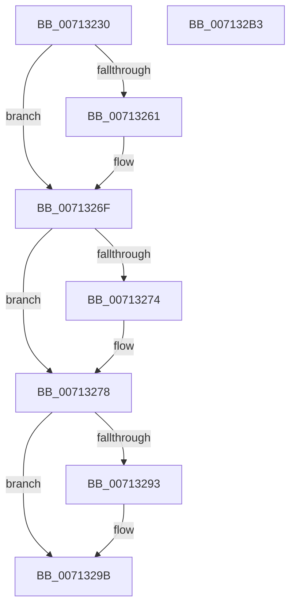

# EmProviderDeregisterEntry

- RVA: `0x00713230`–`0x007132B4` (길이 `132` bytes)
- VA: `0x0000000140713230`
- 실행 섹션: `PAGE`
- PDB 이름 있음: `예`; PDB Function 태그: `아니요`
- unwind 정보 RVA: `0x00060BC4`
- 디코드: `37`개 명령, `132/132` bytes 표시
- 미해석 바이트: `0` (있으면 어셈블리에 `.byte`로 보존)

> 이 문서는 커널 이미지의 기계어와 PDB 기호를 분석해 생성했습니다. 4번과 5번은 함수 원형과 자료형을 바이너리 사용 방식에서 추정한 C 해석이며 원본 소스 복구 결과는 아닙니다.

## 1. Dependencies

- 직접 호출 지점: **5**; 고유 호출 대상: **5**
- 직접 호출자로 확인된 함수: **0**
- RIP 상대 이미지 참조: **2**

### Outgoing calls
- `0x00713251` → [KeAbPreAcquire](../../text/21/KeAbPreAcquire_function_00210230.md) (function, `0x00210230`)
- `0x0071326A` → [ExfAcquirePushLockExclusiveEx](../../text/20/ExfAcquirePushLockExclusiveEx_function_0020FC90.md) (function, `0x0020FC90`)
- `0x0071327B` → [EmpProviderDeregisterEntry](../../text/58/EmpProviderDeregisterEntry_function_00580920.md) (function, `0x00580920`)
- `0x00713296` → [ExfTryToWakePushLock](../../text/26/ExfTryToWakePushLock_function_00265DD0.md) (function, `0x00265DD0`)
- `0x0071329E` → [KeAbPostRelease](../../text/2E/KeAbPostRelease_function_002E1600.md) (function, `0x002E1600`)

### Direct callers
- 이 함수 시작 RVA로 연결되는 직접 call은 확인되지 않았습니다. 간접 호출은 완전히 역산할 수 없습니다.

### Static image references
- `0x00713242` → RVA `0x00F8F1E0` (`.data`; read)
- `0x00713284` → RVA `0x00F8F1E0` (`.data`; read/write)

## 2. Other-region calls and transfers

- 다른 실행 섹션으로 향하는 call: **5**
  - `0x00713251` → [KeAbPreAcquire](../../text/21/KeAbPreAcquire_function_00210230.md) (`PAGE` → `.text`)
  - `0x0071326A` → [ExfAcquirePushLockExclusiveEx](../../text/20/ExfAcquirePushLockExclusiveEx_function_0020FC90.md) (`PAGE` → `.text`)
  - `0x0071327B` → [EmpProviderDeregisterEntry](../../text/58/EmpProviderDeregisterEntry_function_00580920.md) (`PAGE` → `.text`)
  - `0x00713296` → [ExfTryToWakePushLock](../../text/26/ExfTryToWakePushLock_function_00265DD0.md) (`PAGE` → `.text`)
  - `0x0071329E` → [KeAbPostRelease](../../text/2E/KeAbPostRelease_function_002E1600.md) (`PAGE` → `.text`)
- 별도 외부 분기/꼬리 이동을 확인하지 못했습니다.

## 3. Assembly (complete function range)

```asm
00713230  48 89 5C 24 08                  mov qword ptr [rsp + 8], rbx
00713235  48 89 74 24 10                  mov qword ptr [rsp + 0x10], rsi
0071323A  57                              push rdi
0071323B  48 83 EC 20                     sub rsp, 0x20
0071323F  48 8B F9                        mov rdi, rcx
00713242  48 8D 35 97 BF 87 00            lea rsi, [rip + 0x87bf97]
00713249  48 8B CE                        mov rcx, rsi
0071324C  45 33 C0                        xor r8d, r8d
0071324F  33 D2                           xor edx, edx
00713251  E8 DA CF AF FF                  call 0x140210230
00713256  F0 48 0F BA 2E 00               lock bts qword ptr [rsi], 0
0071325C  48 8B D8                        mov rbx, rax
0071325F  73 0E                           jae 0x14071326f
00713261  4C 8B C6                        mov r8, rsi
00713264  48 8B D0                        mov rdx, rax
00713267  48 8B CE                        mov rcx, rsi
0071326A  E8 21 CA AF FF                  call 0x14020fc90
0071326F  48 85 DB                        test rbx, rbx
00713272  74 04                           je 0x140713278
00713274  C6 43 0A 01                     mov byte ptr [rbx + 0xa], 1
00713278  48 8B CF                        mov rcx, rdi
0071327B  E8 A0 D6 E6 FF                  call 0x140580920
00713280  48 83 C8 FF                     or rax, 0xffffffffffffffff
00713284  F0 48 0F C1 05 53 BF 87 00      lock xadd qword ptr [rip + 0x87bf53], rax
0071328D  24 06                           and al, 6
0071328F  3C 02                           cmp al, 2
00713291  75 08                           jne 0x14071329b
00713293  48 8B CE                        mov rcx, rsi
00713296  E8 35 2B B5 FF                  call 0x140265dd0
0071329B  48 8B CE                        mov rcx, rsi
0071329E  E8 5D E3 BC FF                  call 0x1402e1600
007132A3  48 8B 5C 24 30                  mov rbx, qword ptr [rsp + 0x30]
007132A8  48 8B 74 24 38                  mov rsi, qword ptr [rsp + 0x38]
007132AD  48 83 C4 20                     add rsp, 0x20
007132B1  5F                              pop rdi
007132B2  C3                              ret
007132B3  CC                              int3
```

## 4. C-style interpretation (structured pseudocode)

```c
__int64 __fastcall EmProviderDeregisterEntry(__int64 a1, int a2, int a3)
{
    __int64 result;
    __int64 v_rsp;
    unsigned __int64 v_stack_p10;
    unsigned __int64 v_stack_p8;

    v_stack_p8 = v_rbx;
    v_stack_p10 = v_rsi;
    v_rsp = (v_rsp) - (32);
    a3 = 0;
    a2 = 0;
    result = KeAbPreAcquire(v_rip + 8896407, a2, a3, a4);
    if (!(condition_is_above_or_equal)) {
        a3 = v_rip + 8896407;
        a2 = result;
        a1 = v_rip + 8896407;
        result = ExfAcquirePushLockExclusiveEx(a1, a2, a3, a4);
    }
    if (result != 0) {
        *(unsigned __int8 *)(result + 10) = 1;
    }
    result = EmpProviderDeregisterEntry(a1, a2, a3, a4);
    result = (result) | (-1);
    result = (unsigned __int8)((result) & (6));
    if (((unsigned __int8)(result)) == 2) {
        a1 = v_rip + 8896407;
        result = ExfTryToWakePushLock(a1, a2, a3, a4);
    }
    result = KeAbPostRelease(v_rip + 8896407, a2, a3, a4);
    v_rsp = (v_rsp) + (32);
    return result;
}
```

## 5. (Beta) C Style

```c
int64_t EmProviderDeregisterEntry(int64_t Arg1, int32_t Arg2, int32_t Arg3)
{
    int64_t result;
    int64_t local_rsp;
    uint64_t v_stack_p10;
    uint64_t v_stack_p8;

    v_stack_p8 = local_rbx;
    v_stack_p10 = local_rsi;
    local_rsp = (local_rsp) - (32);
    Arg3 = 0;
    Arg2 = 0;
    result = KeAbPreAcquire(v_rip + 8896407, Arg2, Arg3, a4);
    if (!(condition_is_above_or_equal)) {
        Arg3 = v_rip + 8896407;
        Arg2 = result;
        Arg1 = v_rip + 8896407;
        result = ExfAcquirePushLockExclusiveEx(Arg1, Arg2, Arg3, a4);
    }
    if (result != 0) {
        *(uint8_t *)(result + 0xA) = 1;
    }
    result = EmpProviderDeregisterEntry(Arg1, Arg2, Arg3, a4);
    result = (result) | (-1);
    result = (uint8_t)((result) & (6));
    if (((uint8_t)(result)) == 2) {
        Arg1 = v_rip + 8896407;
        result = ExfTryToWakePushLock(Arg1, Arg2, Arg3, a4);
    }
    result = KeAbPostRelease(v_rip + 8896407, Arg2, Arg3, a4);
    local_rsp = (local_rsp) + (32);
    return result;
}
```

## 6. Execution-region graph

[열기: 2D/3D 그래프와 함수 탐색 컨트롤 패널](../../../control-panel.html?section=page&rva=0x00713230&view=graph)

- 2D 그래프는 위에서 아래로 흐르고, 3D 그래프는 빈 공간을 드래그해 회전합니다. Shift+드래그는 이동, 휠은 확대·축소, 함수 노드 선택은 대상 보고서 이동입니다.

### Static fallback


