# EmProviderDeregister

- RVA: `0x00713060`–`0x00713226` (길이 `454` bytes)
- VA: `0x0000000140713060`
- 실행 섹션: `PAGE`
- PDB 이름 있음: `예`; PDB Function 태그: `아니요`
- unwind 정보 RVA: `0x000C5AE4`
- 디코드: `136`개 명령, `454/454` bytes 표시
- 미해석 바이트: `0` (있으면 어셈블리에 `.byte`로 보존)

> 이 문서는 커널 이미지의 기계어와 PDB 기호를 분석해 생성했습니다. 4번과 5번은 함수 원형과 자료형을 바이너리 사용 방식에서 추정한 C 해석이며 원본 소스 복구 결과는 아닙니다.

## 1. Dependencies

- 직접 호출 지점: **11**; 고유 호출 대상: **8**
- 직접 호출자로 확인된 함수: **0**
- RIP 상대 이미지 참조: **2**

### Outgoing calls
- `0x00713093` → [KeAbPreAcquire](../../text/21/KeAbPreAcquire_function_00210230.md) (function, `0x00210230`)
- `0x007130AD` → [ExfAcquirePushLockExclusiveEx](../../text/20/ExfAcquirePushLockExclusiveEx_function_0020FC90.md) (function, `0x0020FC90`)
- `0x00713103` → [ExFreePoolWithTag](../../poolcode/B8/ExFreePoolWithTag_function_00B82870.md) (function, `0x00B82870`)
- `0x00713141` → [EmpQueueRuleUpdateState](../../text/58/EmpQueueRuleUpdateState_function_005809B0.md) (function, `0x005809B0`)
- `0x00713165` → [EmpProviderDeregisterEntry](../../text/58/EmpProviderDeregisterEntry_function_00580920.md) (function, `0x00580920`)
- `0x007131AA` → [EmpQueueRuleUpdateState](../../text/58/EmpQueueRuleUpdateState_function_005809B0.md) (function, `0x005809B0`)
- `0x007131C6` → [ObfDereferenceObject](../../text/2F/ObfDereferenceObject_function_002F9350.md) (function, `0x002F9350`)
- `0x007131D9` → [ExFreePoolWithTag](../../poolcode/B8/ExFreePoolWithTag_function_00B82870.md) (function, `0x00B82870`)
- `0x007131E6` → [ExFreePoolWithTag](../../poolcode/B8/ExFreePoolWithTag_function_00B82870.md) (function, `0x00B82870`)
- `0x007131FF` → [ExfTryToWakePushLock](../../text/26/ExfTryToWakePushLock_function_00265DD0.md) (function, `0x00265DD0`)
- `0x00713207` → [KeAbPostRelease](../../text/2E/KeAbPostRelease_function_002E1600.md) (function, `0x002E1600`)

### Direct callers
- 이 함수 시작 RVA로 연결되는 직접 call은 확인되지 않았습니다. 간접 호출은 완전히 역산할 수 없습니다.

### Static image references
- `0x00713084` → RVA `0x00F8F1E0` (`.data`; read)
- `0x007131EB` → RVA `0x00F8F1E0` (`.data`; read/write)

## 2. Other-region calls and transfers

- 다른 실행 섹션으로 향하는 call: **11**
  - `0x00713093` → [KeAbPreAcquire](../../text/21/KeAbPreAcquire_function_00210230.md) (`PAGE` → `.text`)
  - `0x007130AD` → [ExfAcquirePushLockExclusiveEx](../../text/20/ExfAcquirePushLockExclusiveEx_function_0020FC90.md) (`PAGE` → `.text`)
  - `0x00713103` → [ExFreePoolWithTag](../../poolcode/B8/ExFreePoolWithTag_function_00B82870.md) (`PAGE` → `POOLCODE`)
  - `0x00713141` → [EmpQueueRuleUpdateState](../../text/58/EmpQueueRuleUpdateState_function_005809B0.md) (`PAGE` → `.text`)
  - `0x00713165` → [EmpProviderDeregisterEntry](../../text/58/EmpProviderDeregisterEntry_function_00580920.md) (`PAGE` → `.text`)
  - `0x007131AA` → [EmpQueueRuleUpdateState](../../text/58/EmpQueueRuleUpdateState_function_005809B0.md) (`PAGE` → `.text`)
  - `0x007131C6` → [ObfDereferenceObject](../../text/2F/ObfDereferenceObject_function_002F9350.md) (`PAGE` → `.text`)
  - `0x007131D9` → [ExFreePoolWithTag](../../poolcode/B8/ExFreePoolWithTag_function_00B82870.md) (`PAGE` → `POOLCODE`)
  - `0x007131E6` → [ExFreePoolWithTag](../../poolcode/B8/ExFreePoolWithTag_function_00B82870.md) (`PAGE` → `POOLCODE`)
  - `0x007131FF` → [ExfTryToWakePushLock](../../text/26/ExfTryToWakePushLock_function_00265DD0.md) (`PAGE` → `.text`)
  - `0x00713207` → [KeAbPostRelease](../../text/2E/KeAbPostRelease_function_002E1600.md) (`PAGE` → `.text`)
- 별도 외부 분기/꼬리 이동을 확인하지 못했습니다.

## 3. Assembly (complete function range)

```asm
00713060  48 85 C9                        test rcx, rcx
00713063  0F 84 BB 01 00 00               je 0x140713224
00713069  48 89 5C 24 08                  mov qword ptr [rsp + 8], rbx
0071306E  48 89 6C 24 10                  mov qword ptr [rsp + 0x10], rbp
00713073  48 89 74 24 18                  mov qword ptr [rsp + 0x18], rsi
00713078  57                              push rdi
00713079  41 54                           push r12
0071307B  41 56                           push r14
0071307D  48 83 EC 20                     sub rsp, 0x20
00713081  48 8B F9                        mov rdi, rcx
00713084  4C 8D 25 55 C1 87 00            lea r12, [rip + 0x87c155]
0071308B  49 8B CC                        mov rcx, r12
0071308E  45 33 C0                        xor r8d, r8d
00713091  33 D2                           xor edx, edx
00713093  E8 98 D1 AF FF                  call 0x140210230
00713098  F0 49 0F BA 2C 24 00            lock bts qword ptr [r12], 0
0071309F  48 8B D8                        mov rbx, rax
007130A2  73 0E                           jae 0x1407130b2
007130A4  4D 8B C4                        mov r8, r12
007130A7  48 8B D0                        mov rdx, rax
007130AA  49 8B CC                        mov rcx, r12
007130AD  E8 DE CB AF FF                  call 0x14020fc90
007130B2  48 85 DB                        test rbx, rbx
007130B5  74 04                           je 0x1407130bb
007130B7  C6 43 0A 01                     mov byte ptr [rbx + 0xa], 1
007130BB  48 83 7F 18 00                  cmp qword ptr [rdi + 0x18], 0
007130C0  74 46                           je 0x140713108
007130C2  33 D2                           xor edx, edx
007130C4  39 57 20                        cmp dword ptr [rdi + 0x20], edx
007130C7  76 31                           jbe 0x1407130fa
007130C9  4C 8B 47 18                     mov r8, qword ptr [rdi + 0x18]
007130CD  49 83 C0 10                     add r8, 0x10
007130D1  8B CA                           mov ecx, edx
007130D3  48 C1 E1 05                     shl rcx, 5
007130D7  4C 03 C1                        add r8, rcx
007130DA  49 8B 08                        mov rcx, qword ptr [r8]
007130DD  4C 39 41 08                     cmp qword ptr [rcx + 8], r8
007130E1  75 51                           jne 0x140713134
007130E3  49 8B 40 08                     mov rax, qword ptr [r8 + 8]
007130E7  4C 39 00                        cmp qword ptr [rax], r8
007130EA  75 48                           jne 0x140713134
007130EC  48 89 08                        mov qword ptr [rax], rcx
007130EF  FF C2                           inc edx
007130F1  48 89 41 08                     mov qword ptr [rcx + 8], rax
007130F5  3B 57 20                        cmp edx, dword ptr [rdi + 0x20]
007130F8  72 CF                           jb 0x1407130c9
007130FA  48 8B 4F 18                     mov rcx, qword ptr [rdi + 0x18]
007130FE  BA 45 4D 70 72                  mov edx, 0x72704d45
00713103  E8 68 F7 46 00                  call 0x140b82870
00713108  33 ED                           xor ebp, ebp
0071310A  48 83 CB FF                     or rbx, 0xffffffffffffffff
0071310E  39 6F 10                        cmp dword ptr [rdi + 0x10], ebp
00713111  76 42                           jbe 0x140713155
00713113  48 8B 47 08                     mov rax, qword ptr [rdi + 8]
00713117  48 8B 0C E8                     mov rcx, qword ptr [rax + rbp*8]
0071311B  8B C3                           mov eax, ebx
0071311D  F0 0F C1 41 10                  lock xadd dword ptr [rcx + 0x10], eax
00713122  03 C3                           add eax, ebx
00713124  75 28                           jne 0x14071314e
00713126  48 8B 47 08                     mov rax, qword ptr [rdi + 8]
0071312A  48 8B 0C E8                     mov rcx, qword ptr [rax + rbp*8]
0071312E  48 8B 71 48                     mov rsi, qword ptr [rcx + 0x48]
00713132  EB 15                           jmp 0x140713149
00713134  B9 03 00 00 00                  mov ecx, 3
00713139  CD 29                           int 0x29
0071313B  48 8B 4E F8                     mov rcx, qword ptr [rsi - 8]
0071313F  33 D2                           xor edx, edx
00713141  E8 6A D8 E6 FF                  call 0x1405809b0
00713146  48 8B 36                        mov rsi, qword ptr [rsi]
00713149  48 85 F6                        test rsi, rsi
0071314C  75 ED                           jne 0x14071313b
0071314E  FF C5                           inc ebp
00713150  3B 6F 10                        cmp ebp, dword ptr [rdi + 0x10]
00713153  72 BE                           jb 0x140713113
00713155  4C 8D 77 38                     lea r14, [rdi + 0x38]
00713159  49 8B 36                        mov rsi, qword ptr [r14]
0071315C  EB 0C                           jmp 0x14071316a
0071315E  48 8D 4E D8                     lea rcx, [rsi - 0x28]
00713162  48 8B 36                        mov rsi, qword ptr [rsi]
00713165  E8 B6 D7 E6 FF                  call 0x140580920
0071316A  49 3B F6                        cmp rsi, r14
0071316D  75 EF                           jne 0x14071315e
0071316F  33 F6                           xor esi, esi
00713171  39 77 30                        cmp dword ptr [rdi + 0x30], esi
00713174  76 48                           jbe 0x1407131be
00713176  48 8B 47 28                     mov rax, qword ptr [rdi + 0x28]
0071317A  48 8B 0C F0                     mov rcx, qword ptr [rax + rsi*8]
0071317E  8B C3                           mov eax, ebx
00713180  F0 0F C1 41 18                  lock xadd dword ptr [rcx + 0x18], eax
00713185  03 C3                           add eax, ebx
00713187  75 2E                           jne 0x1407131b7
00713189  48 8B 47 28                     mov rax, qword ptr [rdi + 0x28]
0071318D  48 8B 0C F0                     mov rcx, qword ptr [rax + rsi*8]
00713191  48 83 61 10 00                  and qword ptr [rcx + 0x10], 0
00713196  48 8B 47 28                     mov rax, qword ptr [rdi + 0x28]
0071319A  48 8B 0C F0                     mov rcx, qword ptr [rax + rsi*8]
0071319E  4C 8B 71 30                     mov r14, qword ptr [rcx + 0x30]
007131A2  EB 0E                           jmp 0x1407131b2
007131A4  49 8B 4E F8                     mov rcx, qword ptr [r14 - 8]
007131A8  33 D2                           xor edx, edx
007131AA  E8 01 D8 E6 FF                  call 0x1405809b0
007131AF  4D 8B 36                        mov r14, qword ptr [r14]
007131B2  4D 85 F6                        test r14, r14
007131B5  75 ED                           jne 0x1407131a4
007131B7  FF C6                           inc esi
007131B9  3B 77 30                        cmp esi, dword ptr [rdi + 0x30]
007131BC  72 B8                           jb 0x140713176
007131BE  48 8B 0F                        mov rcx, qword ptr [rdi]
007131C1  48 85 C9                        test rcx, rcx
007131C4  74 05                           je 0x1407131cb
007131C6  E8 85 61 BE FF                  call 0x1402f9350
007131CB  48 8B 4F 28                     mov rcx, qword ptr [rdi + 0x28]
007131CF  48 85 C9                        test rcx, rcx
007131D2  74 0A                           je 0x1407131de
007131D4  BA 45 4D 70 72                  mov edx, 0x72704d45
007131D9  E8 92 F6 46 00                  call 0x140b82870
007131DE  BA 45 4D 70 72                  mov edx, 0x72704d45
007131E3  48 8B CF                        mov rcx, rdi
007131E6  E8 85 F6 46 00                  call 0x140b82870
007131EB  F0 48 0F C1 1D EC BF 87 00      lock xadd qword ptr [rip + 0x87bfec], rbx
007131F4  80 E3 06                        and bl, 6
007131F7  80 FB 02                        cmp bl, 2
007131FA  75 08                           jne 0x140713204
007131FC  49 8B CC                        mov rcx, r12
007131FF  E8 CC 2B B5 FF                  call 0x140265dd0
00713204  49 8B CC                        mov rcx, r12
00713207  E8 F4 E3 BC FF                  call 0x1402e1600
0071320C  48 8B 5C 24 40                  mov rbx, qword ptr [rsp + 0x40]
00713211  48 8B 6C 24 48                  mov rbp, qword ptr [rsp + 0x48]
00713216  48 8B 74 24 50                  mov rsi, qword ptr [rsp + 0x50]
0071321B  48 83 C4 20                     add rsp, 0x20
0071321F  41 5E                           pop r14
00713221  41 5C                           pop r12
00713223  5F                              pop rdi
00713224  C3                              ret
00713225  CC                              int3
```

## 4. C-style interpretation (structured pseudocode)

```c
__int64 __fastcall EmProviderDeregister(__int64 a1, int a2, int a3)
{
    __int64 result;
    __int64 v_rbp;
    __int64 v_rbx;
    __int64 v_rsi;
    __int64 v_rsp;
    unsigned __int64 v_stack_p10;
    unsigned __int64 v_stack_p18;
    unsigned __int64 v_stack_p8;

    if (a1 == 0) goto loc_00713224;
    v_stack_p8 = v_rbx;
    v_stack_p10 = v_rbp;
    v_stack_p18 = v_rsi;
    v_rsp = (v_rsp) - (32);
    a3 = 0;
    a2 = 0;
    result = KeAbPreAcquire(v_rip + 8896853, a2, a3, a4);
    if (!(condition_is_above_or_equal)) {
        a3 = v_rip + 8896853;
        a2 = result;
        a1 = v_rip + 8896853;
        result = ExfAcquirePushLockExclusiveEx(a1, a2, a3, a4);
    }
    if (result != 0) {
        *(unsigned __int8 *)(result + 10) = 1;
    }
    if ((*(unsigned __int64 *)(a1 + 24)) == 0) goto loc_00713108;
    a2 = 0;
    if ((*(unsigned int *)(a1 + 32)) <= 0) goto loc_007130FA;
loc_007130C9:
    a3 = (*(unsigned __int64 *)(a1 + 24)) + (16);
    a1 = (0) << (5);
    a3 = (a3) + (a1);
    if ((*(unsigned __int64 *)(*(unsigned __int64 *)(a3) + 8)) != a3) goto loc_00713134;
    if ((*(unsigned __int64 *)(*(unsigned __int64 *)(a3 + 8))) != a3) goto loc_00713134;
    *(unsigned __int64 *)(*(unsigned __int64 *)(a3 + 8)) = *(unsigned __int64 *)(a3);
    a2 = (unsigned int)((a2) + 1);
    *(unsigned __int64 *)(*(unsigned __int64 *)(a3) + 8) = *(unsigned __int64 *)(a3 + 8);
    if (a2 < (*(unsigned int *)(a1 + 32))) goto loc_007130C9;
loc_007130FA:
    result = ExFreePoolWithTag(*(unsigned __int64 *)(a1 + 24), (unsigned int)(0x72704D45ULL), a3, a4);
loc_00713108:
    v_rbp = 0;
    v_rbx = (result) | (-1);
    if ((*(unsigned int *)(a1 + 16)) <= 0) goto loc_00713155;
loc_00713113:
    result = (unsigned int)(((unsigned int)((unsigned int)(v_rbx))) + ((unsigned int)(v_rbx)));
    if (condition_is_not_equal) goto loc_0071314E;
    goto loc_00713149;
loc_00713134:
loc_0071313B:
    a2 = 0;
    result = EmpQueueRuleUpdateState(*(unsigned __int64 *)(*(unsigned __int64 *)(*(unsigned __int64 *)(*(unsigned __int64 *)(a1 + 8) + v_rbp * 8) + 72) - 8), a2, a3, a4);
loc_00713149:
    if (*(unsigned __int64 *)(*(unsigned __int64 *)(*(unsigned __int64 *)(*(unsigned __int64 *)(a1 + 8) + v_rbp * 8) + 72)) != 0) goto loc_0071313B;
loc_0071314E:
    v_rbp = (unsigned int)((v_rbp) + 1);
    if (((unsigned int)(v_rbp)) < (*(unsigned int *)(a1 + 16))) goto loc_00713113;
loc_00713155:
    goto loc_0071316A;
loc_0071315E:
    result = EmpProviderDeregisterEntry(*(unsigned __int64 *)(a1 + 56) - 40, a2, a3, a4);
loc_0071316A:
    if ((*(unsigned __int64 *)(*(unsigned __int64 *)(a1 + 56))) != (a1 + 56)) goto loc_0071315E;
    v_rsi = 0;
    if ((*(unsigned int *)(a1 + 48)) <= 0) goto loc_007131BE;
loc_00713176:
    result = (unsigned int)(((unsigned int)((unsigned int)(v_rbx))) + ((unsigned int)(v_rbx)));
    if (condition_is_not_equal) goto loc_007131B7;
    goto loc_007131B2;
loc_007131A4:
    a2 = 0;
    result = EmpQueueRuleUpdateState(*(unsigned __int64 *)(*(unsigned __int64 *)(*(unsigned __int64 *)(*(unsigned __int64 *)(a1 + 40) + v_rsi * 8) + 48) - 8), a2, a3, a4);
loc_007131B2:
    if (*(unsigned __int64 *)(*(unsigned __int64 *)(*(unsigned __int64 *)(*(unsigned __int64 *)(a1 + 40) + v_rsi * 8) + 48)) != 0) goto loc_007131A4;
loc_007131B7:
    v_rsi = (unsigned int)((v_rsi) + 1);
    if (((unsigned int)(v_rsi)) < (*(unsigned int *)(a1 + 48))) goto loc_00713176;
loc_007131BE:
    if (*(unsigned __int64 *)(a1) != 0) {
        result = ObfDereferenceObject(*(unsigned __int64 *)(a1), a2, a3, a4);
    }
    if (*(unsigned __int64 *)(a1 + 40) != 0) {
        a2 = 0x72704D45ULL;
        result = ExFreePoolWithTag(*(unsigned __int64 *)(a1 + 40), a2, a3, a4);
    }
    result = ExFreePoolWithTag(a1, (unsigned int)(0x72704D45ULL), a3, a4);
    v_rbx = (unsigned __int8)((v_rbx) & (6));
    if (((unsigned __int8)(v_rbx)) == 2) {
        a1 = v_rip + 8896853;
        result = ExfTryToWakePushLock(a1, (unsigned int)(0x72704D45ULL), a3, a4);
    }
    result = KeAbPostRelease(v_rip + 8896853, (unsigned int)(0x72704D45ULL), a3, a4);
    v_rsp = (v_rsp) + (32);
loc_00713224:
    return result;
}
```

## 5. (Beta) C Style

```c
int64_t EmProviderDeregister(int64_t Arg1, int32_t Arg2, int32_t Arg3)
{
    int64_t result;
    int64_t local_rbp;
    int64_t local_rbx;
    int64_t local_rsi;
    int64_t local_rsp;
    uint64_t v_stack_p10;
    uint64_t v_stack_p18;
    uint64_t v_stack_p8;

    if (Arg1 == 0) goto loc_00713224;
    v_stack_p8 = local_rbx;
    v_stack_p10 = local_rbp;
    v_stack_p18 = local_rsi;
    local_rsp = (local_rsp) - (32);
    Arg3 = 0;
    Arg2 = 0;
    result = KeAbPreAcquire(v_rip + 8896853, Arg2, Arg3, a4);
    if (!(condition_is_above_or_equal)) {
        Arg3 = v_rip + 8896853;
        Arg2 = result;
        Arg1 = v_rip + 8896853;
        result = ExfAcquirePushLockExclusiveEx(Arg1, Arg2, Arg3, a4);
    }
    if (result != 0) {
        *(uint8_t *)(result + 0xA) = 1;
    }
    if ((*(uint64_t *)(Arg1 + 0x18)) == 0) goto loc_00713108;
    Arg2 = 0;
    if ((*(uint32_t *)(Arg1 + 0x20)) <= 0) goto loc_007130FA;
loc_007130C9:
    Arg3 = (*(uint64_t *)(Arg1 + 0x18)) + (16);
    Arg1 = (0) << (5);
    Arg3 = (Arg3) + (Arg1);
    if ((*(uint64_t *)(*(uint64_t *)(Arg3) + 0x8)) != Arg3) goto loc_00713134;
    if ((*(uint64_t *)(*(uint64_t *)(Arg3 + 0x8))) != Arg3) goto loc_00713134;
    *(uint64_t *)(*(uint64_t *)(Arg3 + 0x8)) = *(uint64_t *)(Arg3);
    Arg2 = (uint32_t)((Arg2) + 1);
    *(uint64_t *)(*(uint64_t *)(Arg3) + 0x8) = *(uint64_t *)(Arg3 + 0x8);
    if (Arg2 < (*(uint32_t *)(Arg1 + 0x20))) goto loc_007130C9;
loc_007130FA:
    result = ExFreePoolWithTag(*(uint64_t *)(Arg1 + 0x18), (uint32_t)(0x72704D45ULL), Arg3, a4);
loc_00713108:
    local_rbp = 0;
    local_rbx = (result) | (-1);
    if ((*(uint32_t *)(Arg1 + 0x10)) <= 0) goto loc_00713155;
loc_00713113:
    result = (uint32_t)(((uint32_t)((uint32_t)(local_rbx))) + ((uint32_t)(local_rbx)));
    if (condition_is_not_equal) goto loc_0071314E;
    goto loc_00713149;
loc_00713134:
loc_0071313B:
    Arg2 = 0;
    result = EmpQueueRuleUpdateState(*(uint64_t *)(*(uint64_t *)(*(uint64_t *)(*(uint64_t *)(Arg1 + 0x8) + local_rbp * 8) + 0x48) - 0x8), Arg2, Arg3, a4);
loc_00713149:
    if (*(uint64_t *)(*(uint64_t *)(*(uint64_t *)(*(uint64_t *)(Arg1 + 0x8) + local_rbp * 8) + 0x48)) != 0) goto loc_0071313B;
loc_0071314E:
    local_rbp = (uint32_t)((local_rbp) + 1);
    if (((uint32_t)(local_rbp)) < (*(uint32_t *)(Arg1 + 0x10))) goto loc_00713113;
loc_00713155:
    goto loc_0071316A;
loc_0071315E:
    result = EmpProviderDeregisterEntry(*(uint64_t *)(Arg1 + 0x38) - 40, Arg2, Arg3, a4);
loc_0071316A:
    if ((*(uint64_t *)(*(uint64_t *)(Arg1 + 0x38))) != (Arg1 + 56)) goto loc_0071315E;
    local_rsi = 0;
    if ((*(uint32_t *)(Arg1 + 0x30)) <= 0) goto loc_007131BE;
loc_00713176:
    result = (uint32_t)(((uint32_t)((uint32_t)(local_rbx))) + ((uint32_t)(local_rbx)));
    if (condition_is_not_equal) goto loc_007131B7;
    goto loc_007131B2;
loc_007131A4:
    Arg2 = 0;
    result = EmpQueueRuleUpdateState(*(uint64_t *)(*(uint64_t *)(*(uint64_t *)(*(uint64_t *)(Arg1 + 0x28) + local_rsi * 8) + 0x30) - 0x8), Arg2, Arg3, a4);
loc_007131B2:
    if (*(uint64_t *)(*(uint64_t *)(*(uint64_t *)(*(uint64_t *)(Arg1 + 0x28) + local_rsi * 8) + 0x30)) != 0) goto loc_007131A4;
loc_007131B7:
    local_rsi = (uint32_t)((local_rsi) + 1);
    if (((uint32_t)(local_rsi)) < (*(uint32_t *)(Arg1 + 0x30))) goto loc_00713176;
loc_007131BE:
    if (*(uint64_t *)(Arg1) != 0) {
        result = ObfDereferenceObject(*(uint64_t *)(Arg1), Arg2, Arg3, a4);
    }
    if (*(uint64_t *)(Arg1 + 0x28) != 0) {
        Arg2 = 0x72704D45ULL;
        result = ExFreePoolWithTag(*(uint64_t *)(Arg1 + 0x28), Arg2, Arg3, a4);
    }
    result = ExFreePoolWithTag(Arg1, (uint32_t)(0x72704D45ULL), Arg3, a4);
    local_rbx = (uint8_t)((local_rbx) & (6));
    if (((uint8_t)(local_rbx)) == 2) {
        Arg1 = v_rip + 8896853;
        result = ExfTryToWakePushLock(Arg1, (uint32_t)(0x72704D45ULL), Arg3, a4);
    }
    result = KeAbPostRelease(v_rip + 8896853, (uint32_t)(0x72704D45ULL), Arg3, a4);
    local_rsp = (local_rsp) + (32);
loc_00713224:
    return result;
}
```

## 6. Execution-region graph

[열기: 2D/3D 그래프와 함수 탐색 컨트롤 패널](../../../control-panel.html?section=page&rva=0x00713060&view=graph)

- 2D 그래프는 위에서 아래로 흐르고, 3D 그래프는 빈 공간을 드래그해 회전합니다. Shift+드래그는 이동, 휠은 확대·축소, 함수 노드 선택은 대상 보고서 이동입니다.

### Static fallback

```mermaid
flowchart TD
  bb_00713060[BB_00713060]
  bb_00713069[BB_00713069]
  bb_007130A4[BB_007130A4]
  bb_007130B2[BB_007130B2]
  bb_007130B7[BB_007130B7]
  bb_007130BB[BB_007130BB]
  bb_007130C2[BB_007130C2]
  bb_007130C9[BB_007130C9]
  bb_007130E3[BB_007130E3]
  bb_007130EC[BB_007130EC]
  bb_007130FA[BB_007130FA]
  bb_00713108[BB_00713108]
  bb_00713113[BB_00713113]
  bb_00713126[BB_00713126]
  bb_00713134[BB_00713134]
  bb_0071313B[BB_0071313B]
  bb_00713149[BB_00713149]
  bb_0071314E[BB_0071314E]
  bb_00713155[BB_00713155]
  bb_0071315E[BB_0071315E]
  bb_0071316A[BB_0071316A]
  bb_0071316F[BB_0071316F]
  bb_00713176[BB_00713176]
  bb_00713189[BB_00713189]
  bb_007131A4[BB_007131A4]
  bb_007131B2[BB_007131B2]
  bb_007131B7[BB_007131B7]
  bb_007131BE[BB_007131BE]
  bb_007131C6[BB_007131C6]
  bb_007131CB[BB_007131CB]
  bb_007131D4[BB_007131D4]
  bb_007131DE[BB_007131DE]
  bb_007131FC[BB_007131FC]
  bb_00713204[BB_00713204]
  bb_00713224[BB_00713224]
  bb_00713225[BB_00713225]
  bb_00713060 -->|branch| bb_00713224
  bb_00713060 -->|fallthrough| bb_00713069
  bb_00713069 -->|branch| bb_007130B2
  bb_00713069 -->|fallthrough| bb_007130A4
  bb_007130A4 -->|flow| bb_007130B2
  bb_007130B2 -->|branch| bb_007130BB
  bb_007130B2 -->|fallthrough| bb_007130B7
  bb_007130B7 -->|flow| bb_007130BB
  bb_007130BB -->|branch| bb_00713108
  bb_007130BB -->|fallthrough| bb_007130C2
  bb_007130C2 -->|branch| bb_007130FA
  bb_007130C2 -->|fallthrough| bb_007130C9
  bb_007130C9 -->|branch| bb_00713134
  bb_007130C9 -->|fallthrough| bb_007130E3
  bb_007130E3 -->|branch| bb_00713134
  bb_007130E3 -->|fallthrough| bb_007130EC
  bb_007130EC -->|branch| bb_007130C9
  bb_007130EC -->|fallthrough| bb_007130FA
  bb_007130FA -->|flow| bb_00713108
  bb_00713108 -->|branch| bb_00713155
  bb_00713108 -->|fallthrough| bb_00713113
  bb_00713113 -->|branch| bb_0071314E
  bb_00713113 -->|fallthrough| bb_00713126
  bb_00713126 -->|branch| bb_00713149
  bb_00713134 -->|flow| bb_0071313B
  bb_0071313B -->|flow| bb_00713149
  bb_00713149 -->|branch| bb_0071313B
  bb_00713149 -->|fallthrough| bb_0071314E
  bb_0071314E -->|branch| bb_00713113
  bb_0071314E -->|fallthrough| bb_00713155
  bb_00713155 -->|branch| bb_0071316A
  bb_0071315E -->|flow| bb_0071316A
  bb_0071316A -->|branch| bb_0071315E
  bb_0071316A -->|fallthrough| bb_0071316F
  bb_0071316F -->|branch| bb_007131BE
  bb_0071316F -->|fallthrough| bb_00713176
  bb_00713176 -->|branch| bb_007131B7
  bb_00713176 -->|fallthrough| bb_00713189
  bb_00713189 -->|branch| bb_007131B2
  bb_007131A4 -->|flow| bb_007131B2
  bb_007131B2 -->|branch| bb_007131A4
  bb_007131B2 -->|fallthrough| bb_007131B7
  bb_007131B7 -->|branch| bb_00713176
  bb_007131B7 -->|fallthrough| bb_007131BE
  bb_007131BE -->|branch| bb_007131CB
  bb_007131BE -->|fallthrough| bb_007131C6
  bb_007131C6 -->|flow| bb_007131CB
  bb_007131CB -->|branch| bb_007131DE
  bb_007131CB -->|fallthrough| bb_007131D4
  bb_007131D4 -->|flow| bb_007131DE
  bb_007131DE -->|branch| bb_00713204
  bb_007131DE -->|fallthrough| bb_007131FC
  bb_007131FC -->|flow| bb_00713204
  bb_00713204 -->|flow| bb_00713224
```


