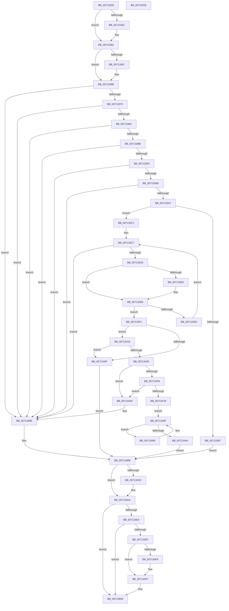

# EmProviderRegisterEntry

- RVA: `0x00713300`–`0x00713529` (길이 `553` bytes)
- VA: `0x0000000140713300`
- 실행 섹션: `PAGE`
- PDB 이름 있음: `예`; PDB Function 태그: `아니요`
- unwind 정보 RVA: `0x00075C18`
- 디코드: `154`개 명령, `553/553` bytes 표시
- 미해석 바이트: `0` (있으면 어셈블리에 `.byte`로 보존)

> 이 문서는 커널 이미지의 기계어와 PDB 기호를 분석해 생성했습니다. 4번과 5번은 함수 원형과 자료형을 바이너리 사용 방식에서 추정한 C 해석이며 원본 소스 복구 결과는 아닙니다.

## 1. Dependencies

- 직접 호출 지점: **11**; 고유 호출 대상: **9**
- 직접 호출자로 확인된 함수: **0**
- RIP 상대 이미지 참조: **2**

### Outgoing calls
- `0x00713338` → [KeAbPreAcquire](../../text/21/KeAbPreAcquire_function_00210230.md) (function, `0x00210230`)
- `0x0071335D` → [ExfAcquirePushLockExclusiveEx](../../text/20/ExfAcquirePushLockExclusiveEx_function_0020FC90.md) (function, `0x0020FC90`)
- `0x007133AA` → [EmpSearchEntryDatabase](../../text/58/EmpSearchEntryDatabase_function_00580CE8.md) (function, `0x00580CE8`)
- `0x00713402` → [ExAllocatePool2](../../poolcode/B8/ExAllocatePool2_function_00B820F0.md) (function, `0x00B820F0`)
- `0x0071342B` → [ExAllocatePool2](../../poolcode/B8/ExAllocatePool2_function_00B820F0.md) (function, `0x00B820F0`)
- `0x00713443` → [memcpy](../../text/6C/memcpy_function_006C6840.md) (function, `0x006C6840`)
- `0x00713497` → [EmpQueueRuleUpdateState](../../text/58/EmpQueueRuleUpdateState_function_005809B0.md) (function, `0x005809B0`)
- `0x007134D5` → [ExfTryToWakePushLock](../../text/26/ExfTryToWakePushLock_function_00265DD0.md) (function, `0x00265DD0`)
- `0x007134E1` → [KeAbPostRelease](../../text/2E/KeAbPostRelease_function_002E1600.md) (function, `0x002E1600`)
- `0x007134FA` → [ExFreePoolWithTag](../../poolcode/B8/ExFreePoolWithTag_function_00B82870.md) (function, `0x00B82870`)
- `0x00713504` → [ExFreePoolWithTag](../../poolcode/B8/ExFreePoolWithTag_function_00B82870.md) (function, `0x00B82870`)

### Direct callers
- 이 함수 시작 RVA로 연결되는 직접 call은 확인되지 않았습니다. 간접 호출은 완전히 역산할 수 없습니다.

### Static image references
- `0x0071332A` → RVA `0x00F8F1E0` (`.data`; read)
- `0x0071333D` → RVA `0x00F8F1E0` (`.data`; read/write)

## 2. Other-region calls and transfers

- 다른 실행 섹션으로 향하는 call: **11**
  - `0x00713338` → [KeAbPreAcquire](../../text/21/KeAbPreAcquire_function_00210230.md) (`PAGE` → `.text`)
  - `0x0071335D` → [ExfAcquirePushLockExclusiveEx](../../text/20/ExfAcquirePushLockExclusiveEx_function_0020FC90.md) (`PAGE` → `.text`)
  - `0x007133AA` → [EmpSearchEntryDatabase](../../text/58/EmpSearchEntryDatabase_function_00580CE8.md) (`PAGE` → `.text`)
  - `0x00713402` → [ExAllocatePool2](../../poolcode/B8/ExAllocatePool2_function_00B820F0.md) (`PAGE` → `POOLCODE`)
  - `0x0071342B` → [ExAllocatePool2](../../poolcode/B8/ExAllocatePool2_function_00B820F0.md) (`PAGE` → `POOLCODE`)
  - `0x00713443` → [memcpy](../../text/6C/memcpy_function_006C6840.md) (`PAGE` → `.text`)
  - `0x00713497` → [EmpQueueRuleUpdateState](../../text/58/EmpQueueRuleUpdateState_function_005809B0.md) (`PAGE` → `.text`)
  - `0x007134D5` → [ExfTryToWakePushLock](../../text/26/ExfTryToWakePushLock_function_00265DD0.md) (`PAGE` → `.text`)
  - `0x007134E1` → [KeAbPostRelease](../../text/2E/KeAbPostRelease_function_002E1600.md) (`PAGE` → `.text`)
  - `0x007134FA` → [ExFreePoolWithTag](../../poolcode/B8/ExFreePoolWithTag_function_00B82870.md) (`PAGE` → `POOLCODE`)
  - `0x00713504` → [ExFreePoolWithTag](../../poolcode/B8/ExFreePoolWithTag_function_00B82870.md) (`PAGE` → `POOLCODE`)
- 별도 외부 분기/꼬리 이동을 확인하지 못했습니다.

## 3. Assembly (complete function range)

```asm
00713300  48 89 5C 24 08                  mov qword ptr [rsp + 8], rbx
00713305  48 89 6C 24 10                  mov qword ptr [rsp + 0x10], rbp
0071330A  48 89 74 24 18                  mov qword ptr [rsp + 0x18], rsi
0071330F  57                              push rdi
00713310  41 54                           push r12
00713312  41 55                           push r13
00713314  41 56                           push r14
00713316  41 57                           push r15
00713318  48 83 EC 20                     sub rsp, 0x20
0071331C  4D 8B F0                        mov r14, r8
0071331F  4C 8B FA                        mov r15, rdx
00713322  4C 8B E9                        mov r13, rcx
00713325  45 33 C0                        xor r8d, r8d
00713328  33 D2                           xor edx, edx
0071332A  48 8D 0D AF BE 87 00            lea rcx, [rip + 0x87beaf]
00713331  4D 8B E1                        mov r12, r9
00713334  33 FF                           xor edi, edi
00713336  33 DB                           xor ebx, ebx
00713338  E8 F3 CE AF FF                  call 0x140210230
0071333D  F0 48 0F BA 2D 99 BE 87 00 00   lock bts qword ptr [rip + 0x87be99], 0
00713347  48 8B F0                        mov rsi, rax
0071334A  73 16                           jae 0x140713362
0071334C  4C 8D 05 8D BE 87 00            lea r8, [rip + 0x87be8d]
00713353  48 8B D0                        mov rdx, rax
00713356  48 8D 0D 83 BE 87 00            lea rcx, [rip + 0x87be83]
0071335D  E8 2E C9 AF FF                  call 0x14020fc90
00713362  48 85 F6                        test rsi, rsi
00713365  74 04                           je 0x14071336b
00713367  C6 46 0A 01                     mov byte ptr [rsi + 0xa], 1
0071336B  BE 45 4D 70 72                  mov esi, 0x72704d45
00713370  4D 85 FF                        test r15, r15
00713373  0F 84 3D 01 00 00               je 0x1407134b6
00713379  4D 85 ED                        test r13, r13
0071337C  0F 84 34 01 00 00               je 0x1407134b6
00713382  4D 85 F6                        test r14, r14
00713385  0F 84 2B 01 00 00               je 0x1407134b6
0071338B  4D 85 E4                        test r12, r12
0071338E  0F 84 22 01 00 00               je 0x1407134b6
00713394  49 39 1E                        cmp qword ptr [r14], rbx
00713397  0F 84 19 01 00 00               je 0x1407134b6
0071339D  41 39 5E 08                     cmp dword ptr [r14 + 8], ebx
007133A1  0F 84 0F 01 00 00               je 0x1407134b6
007133A7  49 8B CF                        mov rcx, r15
007133AA  E8 39 D9 E6 FF                  call 0x140580ce8
007133AF  48 8B E8                        mov rbp, rax
007133B2  48 85 C0                        test rax, rax
007133B5  75 0A                           jne 0x1407133c1
007133B7  BB 25 02 00 C0                  mov ebx, 0xc0000225
007133BC  E9 FA 00 00 00                  jmp 0x1407134bb
007133C1  45 8B 4D 10                     mov r9d, dword ptr [r13 + 0x10]
007133C5  33 D2                           xor edx, edx
007133C7  41 3B D1                        cmp edx, r9d
007133CA  0F 83 E6 00 00 00               jae 0x1407134b6
007133D0  49 8B 45 08                     mov rax, qword ptr [r13 + 8]
007133D4  4C 8B 04 D0                     mov r8, qword ptr [rax + rdx*8]
007133D8  49 8B 08                        mov rcx, qword ptr [r8]
007133DB  49 2B 0F                        sub rcx, qword ptr [r15]
007133DE  75 08                           jne 0x1407133e8
007133E0  49 8B 48 08                     mov rcx, qword ptr [r8 + 8]
007133E4  49 2B 4F 08                     sub rcx, qword ptr [r15 + 8]
007133E8  48 85 C9                        test rcx, rcx
007133EB  74 04                           je 0x1407133f1
007133ED  FF C2                           inc edx
007133EF  EB D6                           jmp 0x1407133c7
007133F1  41 BF 00 01 00 00               mov r15d, 0x100
007133F7  44 8B C6                        mov r8d, esi
007133FA  41 8B CF                        mov ecx, r15d
007133FD  BA 38 00 00 00                  mov edx, 0x38
00713402  E8 E9 EC 46 00                  call 0x140b820f0
00713407  48 8B F8                        mov rdi, rax
0071340A  48 85 C0                        test rax, rax
0071340D  75 0A                           jne 0x140713419
0071340F  BB 9A 00 00 C0                  mov ebx, 0xc000009a
00713414  E9 A2 00 00 00                  jmp 0x1407134bb
00713419  48 89 28                        mov qword ptr [rax], rbp
0071341C  44 8B C6                        mov r8d, esi
0071341F  41 8B 46 08                     mov eax, dword ptr [r14 + 8]
00713423  49 8B CF                        mov rcx, r15
00713426  8B D0                           mov edx, eax
00713428  89 47 10                        mov dword ptr [rdi + 0x10], eax
0071342B  E8 C0 EC 46 00                  call 0x140b820f0
00713430  48 89 47 08                     mov qword ptr [rdi + 8], rax
00713434  48 85 C0                        test rax, rax
00713437  74 D6                           je 0x14071340f
00713439  44 8B 47 10                     mov r8d, dword ptr [rdi + 0x10]
0071343D  48 8B C8                        mov rcx, rax
00713440  49 8B 16                        mov rdx, qword ptr [r14]
00713443  E8 F8 33 FB FF                  call 0x1406c6840
00713448  49 8D 4D 38                     lea rcx, [r13 + 0x38]
0071344C  48 8B 51 08                     mov rdx, qword ptr [rcx + 8]
00713450  48 8D 47 28                     lea rax, [rdi + 0x28]
00713454  48 39 0A                        cmp qword ptr [rdx], rcx
00713457  75 56                           jne 0x1407134af
00713459  48 89 08                        mov qword ptr [rax], rcx
0071345C  48 89 50 08                     mov qword ptr [rax + 8], rdx
00713460  48 89 02                        mov qword ptr [rdx], rax
00713463  48 89 41 08                     mov qword ptr [rcx + 8], rax
00713467  48 8D 4D 28                     lea rcx, [rbp + 0x28]
0071346B  48 8B 51 08                     mov rdx, qword ptr [rcx + 8]
0071346F  48 8D 47 18                     lea rax, [rdi + 0x18]
00713473  48 39 0A                        cmp qword ptr [rdx], rcx
00713476  75 37                           jne 0x1407134af
00713478  48 89 08                        mov qword ptr [rax], rcx
0071347B  48 89 50 08                     mov qword ptr [rax + 8], rdx
0071347F  48 89 02                        mov qword ptr [rdx], rax
00713482  48 89 41 08                     mov qword ptr [rcx + 8], rax
00713486  48 8B 75 48                     mov rsi, qword ptr [rbp + 0x48]
0071348A  48 89 45 20                     mov qword ptr [rbp + 0x20], rax
0071348E  EB 0F                           jmp 0x14071349f
00713490  48 8B 4E F8                     mov rcx, qword ptr [rsi - 8]
00713494  48 8B D5                        mov rdx, rbp
00713497  E8 14 D5 E6 FF                  call 0x1405809b0
0071349C  48 8B 36                        mov rsi, qword ptr [rsi]
0071349F  48 85 F6                        test rsi, rsi
007134A2  75 EC                           jne 0x140713490
007134A4  49 89 3C 24                     mov qword ptr [r12], rdi
007134A8  BE 45 4D 70 72                  mov esi, 0x72704d45
007134AD  EB 0C                           jmp 0x1407134bb
007134AF  B9 03 00 00 00                  mov ecx, 3
007134B4  CD 29                           int 0x29
007134B6  BB 0D 00 00 C0                  mov ebx, 0xc000000d
007134BB  48 83 C8 FF                     or rax, 0xffffffffffffffff
007134BF  F0 48 0F C1 05 18 BD 87 00      lock xadd qword ptr [rip + 0x87bd18], rax
007134C8  24 06                           and al, 6
007134CA  3C 02                           cmp al, 2
007134CC  75 0C                           jne 0x1407134da
007134CE  48 8D 0D 0B BD 87 00            lea rcx, [rip + 0x87bd0b]
007134D5  E8 F6 28 B5 FF                  call 0x140265dd0
007134DA  48 8D 0D FF BC 87 00            lea rcx, [rip + 0x87bcff]
007134E1  E8 1A E1 BC FF                  call 0x1402e1600
007134E6  85 DB                           test ebx, ebx
007134E8  79 1F                           jns 0x140713509
007134EA  48 85 FF                        test rdi, rdi
007134ED  74 1A                           je 0x140713509
007134EF  48 8B 4F 08                     mov rcx, qword ptr [rdi + 8]
007134F3  48 85 C9                        test rcx, rcx
007134F6  74 07                           je 0x1407134ff
007134F8  8B D6                           mov edx, esi
007134FA  E8 71 F3 46 00                  call 0x140b82870
007134FF  8B D6                           mov edx, esi
00713501  48 8B CF                        mov rcx, rdi
00713504  E8 67 F3 46 00                  call 0x140b82870
00713509  48 8B 6C 24 58                  mov rbp, qword ptr [rsp + 0x58]
0071350E  8B C3                           mov eax, ebx
00713510  48 8B 5C 24 50                  mov rbx, qword ptr [rsp + 0x50]
00713515  48 8B 74 24 60                  mov rsi, qword ptr [rsp + 0x60]
0071351A  48 83 C4 20                     add rsp, 0x20
0071351E  41 5F                           pop r15
00713520  41 5E                           pop r14
00713522  41 5D                           pop r13
00713524  41 5C                           pop r12
00713526  5F                              pop rdi
00713527  C3                              ret
00713528  CC                              int3
```

## 4. C-style interpretation (structured pseudocode)

```c
__int64 __fastcall EmProviderRegisterEntry(__int64 a1, __int64 a2, __int64 a3, __int64 a4)
{
    __int64 result;
    __int64 v_rbx;
    __int64 v_rdi;
    __int64 v_rsp;
    unsigned __int64 v_stack_p10;
    unsigned __int64 v_stack_p18;
    unsigned __int64 v_stack_p8;

    v_stack_p8 = v_rbx;
    v_stack_p10 = v_rbp;
    v_stack_p18 = v_rsi;
    v_rsp = (v_rsp) - (32);
    a3 = 0;
    a2 = 0;
    v_rdi = 0;
    v_rbx = 0;
    result = KeAbPreAcquire(v_rip + 8896175, a2, a3, a4);
    if (!(condition_is_above_or_equal)) {
        a3 = v_rip + 8896141;
        a2 = result;
        a1 = v_rip + 8896131;
        result = ExfAcquirePushLockExclusiveEx(a1, a2, a3, a4);
    }
    if (result != 0) {
        *(unsigned __int8 *)(result + 10) = 1;
    }
    if (a2 == 0) goto loc_007134B6;
    if (a1 == 0) goto loc_007134B6;
    if (a3 == 0) goto loc_007134B6;
    if (a4 == 0) goto loc_007134B6;
    if ((*(unsigned __int64 *)(a3)) == 0) goto loc_007134B6;
    if ((*(unsigned int *)(a3 + 8)) == 0) goto loc_007134B6;
    result = EmpSearchEntryDatabase(a2, a2, a3, a4);
    if (result != 0) goto loc_007133C1;
    goto loc_007134BB;
loc_007133C1:
    a2 = 0;
loc_007133C7:
    if (0 >= ((unsigned int)((unsigned int)(*(unsigned int *)(a1 + 16))))) goto loc_007134B6;
    a1 = (*(unsigned __int64 *)(*(unsigned __int64 *)(*(unsigned __int64 *)(a1 + 8) + a2 * 8))) - (*(unsigned __int64 *)(a2));
    if (!(condition_is_not_equal)) {
        a1 = *(unsigned __int64 *)(*(unsigned __int64 *)(*(unsigned __int64 *)(a1 + 8) + a2 * 8) + 8);
        a1 = (a1) - (*(unsigned __int64 *)(a2 + 8));
    }
    if (a1 == 0) goto loc_007133F1;
    a2 = (unsigned int)((a2) + 1);
    goto loc_007133C7;
loc_007133F1:
    result = ExAllocatePool2(256, 56, (unsigned int)((unsigned int)((unsigned int)(0x72704D45ULL))), (unsigned int)(*(unsigned int *)(a1 + 16)));
    if (result != 0) goto loc_00713419;
loc_0071340F:
    goto loc_007134BB;
loc_00713419:
    *(unsigned __int64 *)(result) = result;
    *(unsigned int *)(result + 16) = (unsigned int)((unsigned int)(*(unsigned int *)(a3 + 8)));
    result = ExAllocatePool2(256, (unsigned int)((unsigned int)((unsigned int)(*(unsigned int *)(a3 + 8)))), (unsigned int)((unsigned int)((unsigned int)(0x72704D45ULL))), (unsigned int)(*(unsigned int *)(a1 + 16)));
    *(unsigned __int64 *)(result + 8) = result;
    if (result == 0) goto loc_0071340F;
    result = memcpy(result, *(unsigned __int64 *)(a3), (unsigned int)(*(unsigned int *)(result + 16)), (unsigned int)(*(unsigned int *)(a1 + 16)));
    if ((*(unsigned __int64 *)(*(unsigned __int64 *)(a1 + 56 + 8))) != (a1 + 56)) goto loc_007134AF;
    *(unsigned __int64 *)(result + 40) = a1 + 56;
    *(unsigned __int64 *)(result + 40 + 8) = *(unsigned __int64 *)(a1 + 56 + 8);
    *(unsigned __int64 *)(*(unsigned __int64 *)(a1 + 56 + 8)) = result + 40;
    *(unsigned __int64 *)(a1 + 56 + 8) = result + 40;
    if ((*(unsigned __int64 *)(*(unsigned __int64 *)(result + 40 + 8))) != (result + 40)) goto loc_007134AF;
    *(unsigned __int64 *)(result + 24) = result + 40;
    *(unsigned __int64 *)(result + 24 + 8) = *(unsigned __int64 *)(result + 40 + 8);
    *(unsigned __int64 *)(*(unsigned __int64 *)(result + 40 + 8)) = result + 24;
    *(unsigned __int64 *)(result + 40 + 8) = result + 24;
    *(unsigned __int64 *)(result + 32) = result + 24;
    goto loc_0071349F;
loc_00713490:
    result = EmpQueueRuleUpdateState(*(unsigned __int64 *)(*(unsigned __int64 *)(result + 72) - 8), result, (unsigned int)(*(unsigned int *)(result + 16)), (unsigned int)(*(unsigned int *)(a1 + 16)));
loc_0071349F:
    if (*(unsigned __int64 *)(*(unsigned __int64 *)(result + 72)) != 0) goto loc_00713490;
    *(unsigned __int64 *)(a4) = result;
    goto loc_007134BB;
loc_007134AF:
loc_007134B6:
loc_007134BB:
    result = (result) | (-1);
    result = (unsigned __int8)((result) & (6));
    if (((unsigned __int8)(result)) == 2) {
        a1 = v_rip + 8895755;
        result = ExfTryToWakePushLock(a1, result, (unsigned int)(*(unsigned int *)(result + 16)), (unsigned int)(*(unsigned int *)(a1 + 16)));
    }
    result = KeAbPostRelease(v_rip + 8895743, result, (unsigned int)(*(unsigned int *)(result + 16)), (unsigned int)(*(unsigned int *)(a1 + 16)));
    if (!sign_flag) goto loc_00713509;
    if (result == 0) goto loc_00713509;
    if (*(unsigned __int64 *)(result + 8) != 0) {
        a2 = (unsigned int)((unsigned int)(0x72704D45ULL));
        result = ExFreePoolWithTag(*(unsigned __int64 *)(result + 8), a2, (unsigned int)(*(unsigned int *)(result + 16)), (unsigned int)(*(unsigned int *)(a1 + 16)));
    }
    result = ExFreePoolWithTag(result, (unsigned int)((unsigned int)((unsigned int)(0x72704D45ULL))), (unsigned int)(*(unsigned int *)(result + 16)), (unsigned int)(*(unsigned int *)(a1 + 16)));
loc_00713509:
    v_rsp = (v_rsp) + (32);
    return (unsigned int)((unsigned int)((unsigned int)(0xC000000DULL)));
}
```

## 5. (Beta) C Style

```c
int64_t EmProviderRegisterEntry(int64_t Arg1, int64_t Arg2, int64_t Arg3, int64_t Arg4)
{
    int64_t result;
    int64_t local_rbx;
    int64_t local_rdi;
    int64_t local_rsp;
    uint64_t v_stack_p10;
    uint64_t v_stack_p18;
    uint64_t v_stack_p8;

    v_stack_p8 = local_rbx;
    v_stack_p10 = local_rbp;
    v_stack_p18 = local_rsi;
    local_rsp = (local_rsp) - (32);
    Arg3 = 0;
    Arg2 = 0;
    local_rdi = 0;
    local_rbx = 0;
    result = KeAbPreAcquire(v_rip + 8896175, Arg2, Arg3, Arg4);
    if (!(condition_is_above_or_equal)) {
        Arg3 = v_rip + 8896141;
        Arg2 = result;
        Arg1 = v_rip + 8896131;
        result = ExfAcquirePushLockExclusiveEx(Arg1, Arg2, Arg3, Arg4);
    }
    if (result != 0) {
        *(uint8_t *)(result + 0xA) = 1;
    }
    if (Arg2 == 0) goto loc_007134B6;
    if (Arg1 == 0) goto loc_007134B6;
    if (Arg3 == 0) goto loc_007134B6;
    if (Arg4 == 0) goto loc_007134B6;
    if ((*(uint64_t *)(Arg3)) == 0) goto loc_007134B6;
    if ((*(uint32_t *)(Arg3 + 0x8)) == 0) goto loc_007134B6;
    result = EmpSearchEntryDatabase(Arg2, Arg2, Arg3, Arg4);
    if (result != 0) goto loc_007133C1;
    goto loc_007134BB;
loc_007133C1:
    Arg2 = 0;
loc_007133C7:
    if (0 >= ((uint32_t)((uint32_t)(*(uint32_t *)(Arg1 + 0x10))))) goto loc_007134B6;
    Arg1 = (*(uint64_t *)(*(uint64_t *)(*(uint64_t *)(Arg1 + 0x8) + Arg2 * 8))) - (*(uint64_t *)(Arg2));
    if (!(condition_is_not_equal)) {
        Arg1 = *(uint64_t *)(*(uint64_t *)(*(uint64_t *)(Arg1 + 0x8) + Arg2 * 8) + 0x8);
        Arg1 = (Arg1) - (*(uint64_t *)(Arg2 + 0x8));
    }
    if (Arg1 == 0) goto loc_007133F1;
    Arg2 = (uint32_t)((Arg2) + 1);
    goto loc_007133C7;
loc_007133F1:
    result = ExAllocatePool2(256, 56, (uint32_t)((uint32_t)((uint32_t)(0x72704D45ULL))), (uint32_t)(*(uint32_t *)(Arg1 + 0x10)));
    if (result != 0) goto loc_00713419;
loc_0071340F:
    goto loc_007134BB;
loc_00713419:
    *(uint64_t *)(result) = result;
    *(uint32_t *)(result + 0x10) = (uint32_t)((uint32_t)(*(uint32_t *)(Arg3 + 0x8)));
    result = ExAllocatePool2(256, (uint32_t)((uint32_t)((uint32_t)(*(uint32_t *)(Arg3 + 0x8)))), (uint32_t)((uint32_t)((uint32_t)(0x72704D45ULL))), (uint32_t)(*(uint32_t *)(Arg1 + 0x10)));
    *(uint64_t *)(result + 0x8) = result;
    if (result == 0) goto loc_0071340F;
    result = memcpy(result, *(uint64_t *)(Arg3), (uint32_t)(*(uint32_t *)(result + 0x10)), (uint32_t)(*(uint32_t *)(Arg1 + 0x10)));
    if ((*(uint64_t *)(*(uint64_t *)(Arg1 + 0x38 + 0x8))) != (Arg1 + 56)) goto loc_007134AF;
    *(uint64_t *)(result + 0x28) = Arg1 + 56;
    *(uint64_t *)(result + 0x28 + 0x8) = *(uint64_t *)(Arg1 + 0x38 + 0x8);
    *(uint64_t *)(*(uint64_t *)(Arg1 + 0x38 + 0x8)) = result + 40;
    *(uint64_t *)(Arg1 + 0x38 + 0x8) = result + 40;
    if ((*(uint64_t *)(*(uint64_t *)(result + 0x28 + 0x8))) != (result + 40)) goto loc_007134AF;
    *(uint64_t *)(result + 0x18) = result + 40;
    *(uint64_t *)(result + 0x18 + 0x8) = *(uint64_t *)(result + 0x28 + 0x8);
    *(uint64_t *)(*(uint64_t *)(result + 0x28 + 0x8)) = result + 24;
    *(uint64_t *)(result + 0x28 + 0x8) = result + 24;
    *(uint64_t *)(result + 0x20) = result + 24;
    goto loc_0071349F;
loc_00713490:
    result = EmpQueueRuleUpdateState(*(uint64_t *)(*(uint64_t *)(result + 0x48) - 0x8), result, (uint32_t)(*(uint32_t *)(result + 0x10)), (uint32_t)(*(uint32_t *)(Arg1 + 0x10)));
loc_0071349F:
    if (*(uint64_t *)(*(uint64_t *)(result + 0x48)) != 0) goto loc_00713490;
    *(uint64_t *)(Arg4) = result;
    goto loc_007134BB;
loc_007134AF:
loc_007134B6:
loc_007134BB:
    result = (result) | (-1);
    result = (uint8_t)((result) & (6));
    if (((uint8_t)(result)) == 2) {
        Arg1 = v_rip + 8895755;
        result = ExfTryToWakePushLock(Arg1, result, (uint32_t)(*(uint32_t *)(result + 0x10)), (uint32_t)(*(uint32_t *)(Arg1 + 0x10)));
    }
    result = KeAbPostRelease(v_rip + 8895743, result, (uint32_t)(*(uint32_t *)(result + 0x10)), (uint32_t)(*(uint32_t *)(Arg1 + 0x10)));
    if (!sign_flag) goto loc_00713509;
    if (result == 0) goto loc_00713509;
    if (*(uint64_t *)(result + 0x8) != 0) {
        Arg2 = (uint32_t)((uint32_t)(0x72704D45ULL));
        result = ExFreePoolWithTag(*(uint64_t *)(result + 0x8), Arg2, (uint32_t)(*(uint32_t *)(result + 0x10)), (uint32_t)(*(uint32_t *)(Arg1 + 0x10)));
    }
    result = ExFreePoolWithTag(result, (uint32_t)((uint32_t)((uint32_t)(0x72704D45ULL))), (uint32_t)(*(uint32_t *)(result + 0x10)), (uint32_t)(*(uint32_t *)(Arg1 + 0x10)));
loc_00713509:
    local_rsp = (local_rsp) + (32);
    return (uint32_t)((uint32_t)((uint32_t)(0xC000000DULL)));
}
```

## 6. Execution-region graph

[열기: 2D/3D 그래프와 함수 탐색 컨트롤 패널](../../../control-panel.html?section=page&rva=0x00713300&view=graph)

- 2D 그래프는 위에서 아래로 흐르고, 3D 그래프는 빈 공간을 드래그해 회전합니다. Shift+드래그는 이동, 휠은 확대·축소, 함수 노드 선택은 대상 보고서 이동입니다.

### Static fallback


