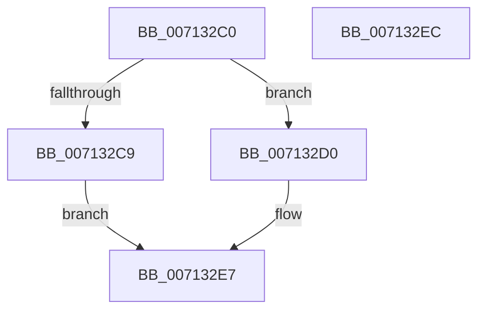

# EmProviderRegister

- RVA: `0x007132C0`–`0x007132ED` (길이 `45` bytes)
- VA: `0x00000001407132C0`
- 실행 섹션: `PAGE`
- PDB 이름 있음: `예`; PDB Function 태그: `아니요`
- unwind 정보 RVA: `0x0005D2F4`
- 디코드: `13`개 명령, `45/45` bytes 표시
- 미해석 바이트: `0` (있으면 어셈블리에 `.byte`로 보존)

> 이 문서는 커널 이미지의 기계어와 PDB 기호를 분석해 생성했습니다. 4번과 5번은 함수 원형과 자료형을 바이너리 사용 방식에서 추정한 C 해석이며 원본 소스 복구 결과는 아닙니다.

## 1. Dependencies

- 직접 호출 지점: **1**; 고유 호출 대상: **1**
- 직접 호출자로 확인된 함수: **0**
- RIP 상대 이미지 참조: **0**

### Outgoing calls
- `0x007132E2` → [EmpProviderRegister](../AC/EmpProviderRegister_function_00ACC5D0.md) (function, `0x00ACC5D0`)

### Direct callers
- 이 함수 시작 RVA로 연결되는 직접 call은 확인되지 않았습니다. 간접 호출은 완전히 역산할 수 없습니다.

### Static image references
- 디코드된 RIP-relative 메모리 참조가 없습니다.

## 2. Other-region calls and transfers

- 다른 실행 섹션으로 향하는 call: **0**
- 별도 외부 분기/꼬리 이동을 확인하지 못했습니다.

## 3. Assembly (complete function range)

```asm
007132C0  48 83 EC 38                     sub rsp, 0x38
007132C4  48 85 C9                        test rcx, rcx
007132C7  75 07                           jne 0x1407132d0
007132C9  B8 0D 00 00 C0                  mov eax, 0xc000000d
007132CE  EB 17                           jmp 0x1407132e7
007132D0  48 8B 44 24 68                  mov rax, qword ptr [rsp + 0x68]
007132D5  48 89 44 24 28                  mov qword ptr [rsp + 0x28], rax
007132DA  8B 44 24 60                     mov eax, dword ptr [rsp + 0x60]
007132DE  89 44 24 20                     mov dword ptr [rsp + 0x20], eax
007132E2  E8 E9 92 3B 00                  call 0x140acc5d0
007132E7  48 83 C4 38                     add rsp, 0x38
007132EB  C3                              ret
007132EC  CC                              int3
```

## 4. C-style interpretation (structured pseudocode)

```c
__int64 __fastcall EmProviderRegister(__int64 a1, __int64 a2, __int64 a3, __int64 a4, unsigned int a5, __int64 a6)
{
    __int64 result;
    __int64 v_rsp;
    unsigned __int64 v_stack_m10;
    unsigned int v_stack_m18;

    v_rsp = (v_rsp) - (56);
    if (a1 != 0) goto loc_007132D0;
    goto loc_007132E7;
loc_007132D0:
    v_stack_m10 = a6;
    v_stack_m18 = (unsigned int)((unsigned int)(a5));
    result = EmpProviderRegister(a1, a2, a3, a4);
loc_007132E7:
    v_rsp = (v_rsp) + (56);
    return result;
}
```

## 5. (Beta) C Style

```c
int64_t EmProviderRegister(int64_t Arg1, int64_t Arg2, int64_t Arg3, int64_t Arg4, uint32_t Arg5, int64_t Arg6)
{
    int64_t result;
    int64_t local_rsp;
    uint64_t v_stack_m10;
    uint32_t v_stack_m18;

    local_rsp = (local_rsp) - (56);
    if (Arg1 != 0) goto loc_007132D0;
    goto loc_007132E7;
loc_007132D0:
    v_stack_m10 = Arg6;
    v_stack_m18 = (uint32_t)((uint32_t)(Arg5));
    result = EmpProviderRegister(Arg1, Arg2, Arg3, Arg4);
loc_007132E7:
    local_rsp = (local_rsp) + (56);
    return result;
}
```

## 6. Execution-region graph

[열기: 2D/3D 그래프와 함수 탐색 컨트롤 패널](../../../control-panel.html?section=page&rva=0x007132C0&view=graph)

- 2D 그래프는 위에서 아래로 흐르고, 3D 그래프는 빈 공간을 드래그해 회전합니다. Shift+드래그는 이동, 휠은 확대·축소, 함수 노드 선택은 대상 보고서 이동입니다.

### Static fallback


