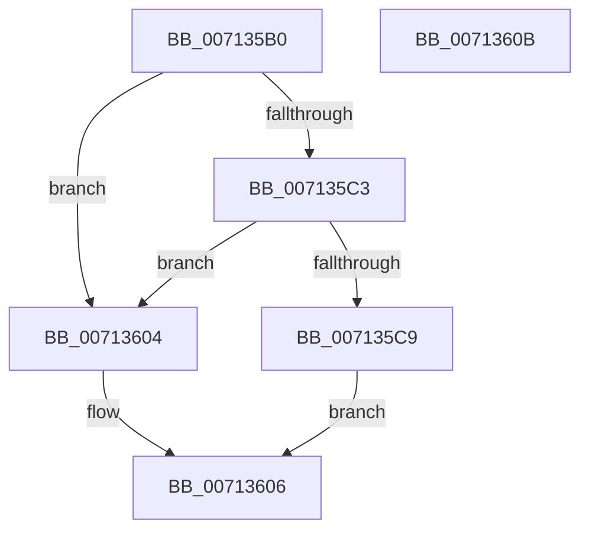

# EmRemoveBadS3PagesCallback

- RVA: `0x007135B0`–`0x0071360C` (길이 `92` bytes)
- VA: `0x00000001407135B0`
- 실행 섹션: `PAGE`
- PDB 이름 있음: `예`; PDB Function 태그: `아니요`
- unwind 정보 RVA: `0x0005C788`
- 디코드: `22`개 명령, `92/92` bytes 표시
- 미해석 바이트: `0` (있으면 어셈블리에 `.byte`로 보존)

> 이 문서는 커널 이미지의 기계어와 PDB 기호를 분석해 생성했습니다. 4번과 5번은 함수 원형과 자료형을 바이너리 사용 방식에서 추정한 C 해석이며 원본 소스 복구 결과는 아닙니다.

## 1. Dependencies

- 직접 호출 지점: **1**; 고유 호출 대상: **1**
- 직접 호출자로 확인된 함수: **0**
- RIP 상대 이미지 참조: **6**

### Outgoing calls
- `0x007135F8` → [ExQueueWorkItem](../../text/2F/ExQueueWorkItem_function_002F9520.md) (function, `0x002F9520`)

### Direct callers
- 이 함수 시작 RVA로 연결되는 직접 call은 확인되지 않았습니다. 간접 호출은 완전히 역산할 수 없습니다.

### Static image references
- `0x007135CD` → RVA `0x00F8F158` (`.data`; read/write)
- `0x007135D5` → RVA `0x00F8F140` (`.data`; read)
- `0x007135DC` → RVA `0x00F8F140` (`.data`; read/write)
- `0x007135E4` → RVA `0x00F8F164` (`.data`; write)
- `0x007135EA` → RVA `0x00713850` (`EmpRemoveBadS3PageWorker`; read)
- `0x007135F1` → RVA `0x00F8F150` (`.data`; write)

## 2. Other-region calls and transfers

- 다른 실행 섹션으로 향하는 call: **1**
  - `0x007135F8` → [ExQueueWorkItem](../../text/2F/ExQueueWorkItem_function_002F9520.md) (`PAGE` → `.text`)
- 별도 외부 분기/꼬리 이동을 확인하지 못했습니다.

## 3. Assembly (complete function range)

```asm
007135B0  48 83 EC 28                     sub rsp, 0x28
007135B4  48 8B 44 24 50                  mov rax, qword ptr [rsp + 0x50]
007135B9  B9 01 00 00 00                  mov ecx, 1
007135BE  48 85 C0                        test rax, rax
007135C1  74 41                           je 0x140713604
007135C3  39 4C 24 58                     cmp dword ptr [rsp + 0x58], ecx
007135C7  75 3B                           jne 0x140713604
007135C9  8B 00                           mov eax, dword ptr [rax]
007135CB  8B D1                           mov edx, ecx
007135CD  48 83 25 83 BB 87 00 00         and qword ptr [rip + 0x87bb83], 0
007135D5  48 8D 0D 64 BB 87 00            lea rcx, [rip + 0x87bb64]
007135DC  48 83 25 5C BB 87 00 00         and qword ptr [rip + 0x87bb5c], 0
007135E4  89 05 7A BB 87 00               mov dword ptr [rip + 0x87bb7a], eax
007135EA  48 8D 05 5F 02 00 00            lea rax, [rip + 0x25f]
007135F1  48 89 05 58 BB 87 00            mov qword ptr [rip + 0x87bb58], rax
007135F8  E8 23 5F BE FF                  call 0x1402f9520
007135FD  B8 02 00 00 00                  mov eax, 2
00713602  EB 02                           jmp 0x140713606
00713604  8B C1                           mov eax, ecx
00713606  48 83 C4 28                     add rsp, 0x28
0071360A  C3                              ret
0071360B  CC                              int3
```

## 4. C-style interpretation (structured pseudocode)

```c
__int64 __fastcall EmRemoveBadS3PagesCallback(__int64 a1, __int64 a2, __int64 a3, __int64 a4, __int64 a5, unsigned int a6)
{
    __int64 result;
    __int64 v_rsp;

    v_rsp = (v_rsp) - (40);
    if (a5 == 0) goto loc_00713604;
    if (a6 != 1) goto loc_00713604;
    *(unsigned int *)(v_rip + 8895354) = (unsigned int)((unsigned int)(*(unsigned int *)(a5)));
    *(unsigned __int64 *)(v_rip + 8895320) = v_rip + 607;
    result = ExQueueWorkItem(v_rip + 8895332, 1, a3, a4);
    goto loc_00713606;
loc_00713604:
loc_00713606:
    v_rsp = (v_rsp) + (40);
    return (unsigned int)((unsigned int)(v_rip + 8895332));
}
```

## 5. (Beta) C Style

```c
int64_t EmRemoveBadS3PagesCallback(int64_t Arg1, int64_t Arg2, int64_t Arg3, int64_t Arg4, int64_t Arg5, uint32_t Arg6)
{
    int64_t result;
    int64_t local_rsp;

    local_rsp = (local_rsp) - (40);
    if (Arg5 == 0) goto loc_00713604;
    if (Arg6 != 1) goto loc_00713604;
    *(uint32_t *)(v_rip + 0x87BB7A) = (uint32_t)((uint32_t)(*(uint32_t *)(Arg5)));
    *(uint64_t *)(v_rip + 0x87BB58) = v_rip + 607;
    result = ExQueueWorkItem(v_rip + 8895332, 1, Arg3, Arg4);
    goto loc_00713606;
loc_00713604:
loc_00713606:
    local_rsp = (local_rsp) + (40);
    return (uint32_t)((uint32_t)(v_rip + 8895332));
}
```

## 6. Execution-region graph

[열기: 2D/3D 그래프와 함수 탐색 컨트롤 패널](../../../control-panel.html?section=page&rva=0x007135B0&view=graph)

- 2D 그래프는 위에서 아래로 흐르고, 3D 그래프는 빈 공간을 드래그해 회전합니다. Shift+드래그는 이동, 휠은 확대·축소, 함수 노드 선택은 대상 보고서 이동입니다.

### Static fallback


