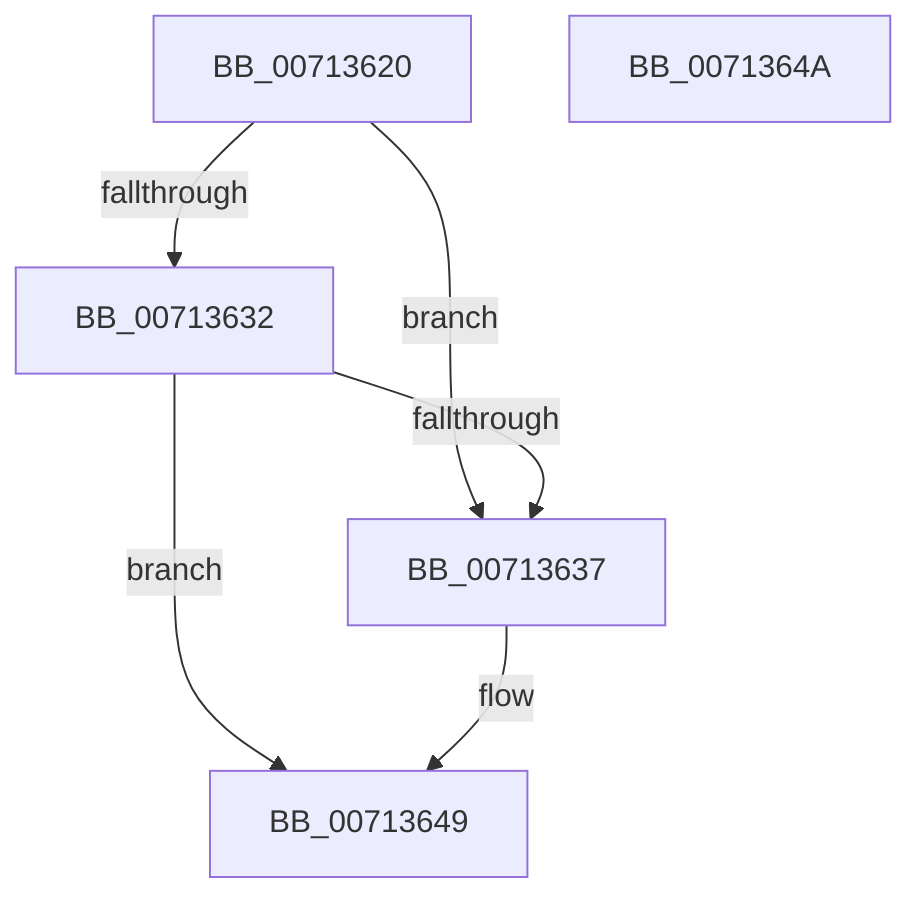

# EmSystemArchitectureCallback

- RVA: `0x00713620`–`0x0071364B` (길이 `43` bytes)
- VA: `0x0000000140713620`
- 실행 섹션: `PAGE`
- PDB 이름 있음: `예`; PDB Function 태그: `아니요`
- unwind 정보 RVA: `0x000DB714`
- 디코드: `13`개 명령, `43/43` bytes 표시
- 미해석 바이트: `0` (있으면 어셈블리에 `.byte`로 보존)

> 이 문서는 커널 이미지의 기계어와 PDB 기호를 분석해 생성했습니다. 4번과 5번은 함수 원형과 자료형을 바이너리 사용 방식에서 추정한 C 해석이며 원본 소스 복구 결과는 아닙니다.

## 1. Dependencies

- 직접 호출 지점: **0**; 고유 호출 대상: **0**
- 직접 호출자로 확인된 함수: **0**
- RIP 상대 이미지 참조: **1**

### Outgoing calls
- 직접 디코드된 call 명령이 없습니다.

### Direct callers
- 이 함수 시작 RVA로 연결되는 직접 call은 확인되지 않았습니다. 간접 호출은 완전히 역산할 수 없습니다.

### Static image references
- `0x00713637` → RVA `0x00FC5078` (`ALMOSTRO`; read)

## 2. Other-region calls and transfers

- 다른 실행 섹션으로 향하는 call: **0**
- 별도 외부 분기/꼬리 이동을 확인하지 못했습니다.

## 3. Assembly (complete function range)

```asm
00713620  48 8B 54 24 28                  mov rdx, qword ptr [rsp + 0x28]
00713625  45 33 C0                        xor r8d, r8d
00713628  41 8D 40 01                     lea eax, [r8 + 1]
0071362C  39 44 24 30                     cmp dword ptr [rsp + 0x30], eax
00713630  74 05                           je 0x140713637
00713632  48 85 D2                        test rdx, rdx
00713635  74 12                           je 0x140713649
00713637  0F B7 0D 3A 1A 8B 00            movzx ecx, word ptr [rip + 0x8b1a3a]
0071363E  B8 02 00 00 00                  mov eax, 2
00713643  39 0A                           cmp dword ptr [rdx], ecx
00713645  41 0F 45 C0                     cmovne eax, r8d
00713649  C3                              ret
0071364A  CC                              int3
```

## 4. C-style interpretation (structured pseudocode)

```c
__int64 __fastcall EmSystemArchitectureCallback(__int64 a1, __int64 a2, int a3, __int64 a4, __int64 a5, unsigned int a6)
{
    __int64 result;

    a3 = 0;
    if (a6 == ((unsigned int)(a3 + 1))) goto loc_00713637;
    result = a3 + 1;
    if (a5 != 0) {
        a1 = *(unsigned __int16 *)(v_rip + 9116218);
        result = 2;
        if ((*(unsigned int *)(a5)) != ((unsigned int)(a1))) { result = 0; }
    }
    return result;
}
```

## 5. (Beta) C Style

```c
int64_t EmSystemArchitectureCallback(int64_t Arg1, int64_t Arg2, int32_t Arg3, int64_t Arg4, int64_t Arg5, uint32_t Arg6)
{
    int64_t result;

    Arg3 = 0;
    if (Arg6 == ((uint32_t)(Arg3 + 1))) goto loc_00713637;
    result = Arg3 + 1;
    if (Arg5 != 0) {
        Arg1 = *(uint16_t *)(v_rip + 0x8B1A3A);
        result = 2;
        if ((*(uint32_t *)(Arg5)) != ((uint32_t)(Arg1))) { result = 0; }
    }
    return result;
}
```

## 6. Execution-region graph

[열기: 2D/3D 그래프와 함수 탐색 컨트롤 패널](../../../control-panel.html?section=page&rva=0x00713620&view=graph)

- 2D 그래프는 위에서 아래로 흐르고, 3D 그래프는 빈 공간을 드래그해 회전합니다. Shift+드래그는 이동, 휠은 확대·축소, 함수 노드 선택은 대상 보고서 이동입니다.

### Static fallback


