# EmpCheckOperator

- RVA: `0x00713670`–`0x00713844` (길이 `468` bytes)
- VA: `0x0000000140713670`
- 실행 섹션: `PAGE`
- PDB 이름 있음: `예`; PDB Function 태그: `아니요`
- unwind 정보 RVA: `0x00069588`
- 디코드: `154`개 명령, `468/468` bytes 표시
- 미해석 바이트: `0` (있으면 어셈블리에 `.byte`로 보존)

> 이 문서는 커널 이미지의 기계어와 PDB 기호를 분석해 생성했습니다. 4번과 5번은 함수 원형과 자료형을 바이너리 사용 방식에서 추정한 C 해석이며 원본 소스 복구 결과는 아닙니다.

## 1. Dependencies

- 직접 호출 지점: **0**; 고유 호출 대상: **0**
- 직접 호출자로 확인된 함수: **2**
- RIP 상대 이미지 참조: **0**

### Outgoing calls
- 직접 디코드된 call 명령이 없습니다.

### Direct callers
- [EmMatchDate](EmMatchDate_function_00713530.md) at `0x00713591`
- [EmCpuMatchCallback](../AC/EmCpuMatchCallback_function_00AC2620.md) at `0x00AC26A1`
- [EmCpuMatchCallback](../AC/EmCpuMatchCallback_function_00AC2620.md) at `0x00AC26B6`
- [EmCpuMatchCallback](../AC/EmCpuMatchCallback_function_00AC2620.md) at `0x00AC26CB`

### Static image references
- 디코드된 RIP-relative 메모리 참조가 없습니다.

## 2. Other-region calls and transfers

- 다른 실행 섹션으로 향하는 call: **0**
- 별도 외부 분기/꼬리 이동을 확인하지 못했습니다.

## 3. Assembly (complete function range)

```asm
00713670  48 89 5C 24 08                  mov qword ptr [rsp + 8], rbx
00713675  48 89 74 24 10                  mov qword ptr [rsp + 0x10], rsi
0071367A  48 89 7C 24 18                  mov qword ptr [rsp + 0x18], rdi
0071367F  44 0F B6 11                     movzx r10d, byte ptr [rcx]
00713683  45 33 C9                        xor r9d, r9d
00713686  44 8B DA                        mov r11d, edx
00713689  41 8D 59 3D                     lea ebx, [r9 + 0x3d]
0071368D  44 2B D3                        sub r10d, ebx
00713690  75 0C                           jne 0x14071369e
00713692  44 0F B6 51 01                  movzx r10d, byte ptr [rcx + 1]
00713697  41 0F B6 C1                     movzx eax, r9b
0071369B  44 2B D0                        sub r10d, eax
0071369E  45 85 D2                        test r10d, r10d
007136A1  0F 84 82 01 00 00               je 0x140713829
007136A7  0F B6 11                        movzx edx, byte ptr [rcx]
007136AA  2B D3                           sub edx, ebx
007136AC  75 12                           jne 0x1407136c0
007136AE  0F B6 51 01                     movzx edx, byte ptr [rcx + 1]
007136B2  2B D3                           sub edx, ebx
007136B4  75 0A                           jne 0x1407136c0
007136B6  0F B6 51 02                     movzx edx, byte ptr [rcx + 2]
007136BA  41 0F B6 C1                     movzx eax, r9b
007136BE  2B D0                           sub edx, eax
007136C0  85 D2                           test edx, edx
007136C2  0F 84 61 01 00 00               je 0x140713829
007136C8  0F B6 11                        movzx edx, byte ptr [rcx]
007136CB  41 BA 21 00 00 00               mov r10d, 0x21
007136D1  41 2B D2                        sub edx, r10d
007136D4  75 12                           jne 0x1407136e8
007136D6  0F B6 51 01                     movzx edx, byte ptr [rcx + 1]
007136DA  2B D3                           sub edx, ebx
007136DC  75 0A                           jne 0x1407136e8
007136DE  0F B6 51 02                     movzx edx, byte ptr [rcx + 2]
007136E2  41 0F B6 C1                     movzx eax, r9b
007136E6  2B D0                           sub edx, eax
007136E8  85 D2                           test edx, edx
007136EA  0F 84 30 01 00 00               je 0x140713820
007136F0  0F B6 11                        movzx edx, byte ptr [rcx]
007136F3  BF 3C 00 00 00                  mov edi, 0x3c
007136F8  8D 77 02                        lea esi, [rdi + 2]
007136FB  2B D7                           sub edx, edi
007136FD  75 12                           jne 0x140713711
007136FF  0F B6 51 01                     movzx edx, byte ptr [rcx + 1]
00713703  2B D6                           sub edx, esi
00713705  75 0A                           jne 0x140713711
00713707  0F B6 51 02                     movzx edx, byte ptr [rcx + 2]
0071370B  41 0F B6 C1                     movzx eax, r9b
0071370F  2B D0                           sub edx, eax
00713711  85 D2                           test edx, edx
00713713  0F 84 07 01 00 00               je 0x140713820
00713719  0F B6 11                        movzx edx, byte ptr [rcx]
0071371C  2B D3                           sub edx, ebx
0071371E  75 13                           jne 0x140713733
00713720  0F B6 51 01                     movzx edx, byte ptr [rcx + 1]
00713724  41 2B D2                        sub edx, r10d
00713727  75 0A                           jne 0x140713733
00713729  0F B6 51 02                     movzx edx, byte ptr [rcx + 2]
0071372D  41 0F B6 C1                     movzx eax, r9b
00713731  2B D0                           sub edx, eax
00713733  85 D2                           test edx, edx
00713735  0F 84 E5 00 00 00               je 0x140713820
0071373B  0F B6 11                        movzx edx, byte ptr [rcx]
0071373E  2B D7                           sub edx, edi
00713740  75 0A                           jne 0x14071374c
00713742  0F B6 51 01                     movzx edx, byte ptr [rcx + 1]
00713746  41 0F B6 C1                     movzx eax, r9b
0071374A  2B D0                           sub edx, eax
0071374C  85 D2                           test edx, edx
0071374E  75 0C                           jne 0x14071375c
00713750  45 3B D8                        cmp r11d, r8d
00713753  41 0F 92 C1                     setb r9b
00713757  E9 D4 00 00 00                  jmp 0x140713830
0071375C  0F B6 11                        movzx edx, byte ptr [rcx]
0071375F  2B D7                           sub edx, edi
00713761  75 12                           jne 0x140713775
00713763  0F B6 51 01                     movzx edx, byte ptr [rcx + 1]
00713767  2B D3                           sub edx, ebx
00713769  75 0A                           jne 0x140713775
0071376B  0F B6 51 02                     movzx edx, byte ptr [rcx + 2]
0071376F  41 0F B6 C1                     movzx eax, r9b
00713773  2B D0                           sub edx, eax
00713775  85 D2                           test edx, edx
00713777  0F 84 9A 00 00 00               je 0x140713817
0071377D  0F B6 11                        movzx edx, byte ptr [rcx]
00713780  2B D3                           sub edx, ebx
00713782  75 12                           jne 0x140713796
00713784  0F B6 51 01                     movzx edx, byte ptr [rcx + 1]
00713788  2B D7                           sub edx, edi
0071378A  75 0A                           jne 0x140713796
0071378C  0F B6 51 02                     movzx edx, byte ptr [rcx + 2]
00713790  41 0F B6 C1                     movzx eax, r9b
00713794  2B D0                           sub edx, eax
00713796  85 D2                           test edx, edx
00713798  74 7D                           je 0x140713817
0071379A  0F B6 11                        movzx edx, byte ptr [rcx]
0071379D  2B D6                           sub edx, esi
0071379F  75 0A                           jne 0x1407137ab
007137A1  0F B6 51 01                     movzx edx, byte ptr [rcx + 1]
007137A5  41 0F B6 C1                     movzx eax, r9b
007137A9  2B D0                           sub edx, eax
007137AB  85 D2                           test edx, edx
007137AD  75 09                           jne 0x1407137b8
007137AF  45 3B D8                        cmp r11d, r8d
007137B2  41 0F 97 C1                     seta r9b
007137B6  EB 78                           jmp 0x140713830
007137B8  0F B6 11                        movzx edx, byte ptr [rcx]
007137BB  2B D6                           sub edx, esi
007137BD  75 12                           jne 0x1407137d1
007137BF  0F B6 51 01                     movzx edx, byte ptr [rcx + 1]
007137C3  2B D3                           sub edx, ebx
007137C5  75 0A                           jne 0x1407137d1
007137C7  0F B6 51 02                     movzx edx, byte ptr [rcx + 2]
007137CB  41 0F B6 C1                     movzx eax, r9b
007137CF  2B D0                           sub edx, eax
007137D1  85 D2                           test edx, edx
007137D3  74 39                           je 0x14071380e
007137D5  0F B6 11                        movzx edx, byte ptr [rcx]
007137D8  2B D3                           sub edx, ebx
007137DA  75 12                           jne 0x1407137ee
007137DC  0F B6 51 01                     movzx edx, byte ptr [rcx + 1]
007137E0  2B D6                           sub edx, esi
007137E2  75 0A                           jne 0x1407137ee
007137E4  0F B6 51 02                     movzx edx, byte ptr [rcx + 2]
007137E8  41 0F B6 C1                     movzx eax, r9b
007137EC  2B D0                           sub edx, eax
007137EE  85 D2                           test edx, edx
007137F0  74 1C                           je 0x14071380e
007137F2  0F B6 11                        movzx edx, byte ptr [rcx]
007137F5  83 EA 2A                        sub edx, 0x2a
007137F8  75 0A                           jne 0x140713804
007137FA  0F B6 51 01                     movzx edx, byte ptr [rcx + 1]
007137FE  41 0F B6 C1                     movzx eax, r9b
00713802  2B D0                           sub edx, eax
00713804  85 D2                           test edx, edx
00713806  75 28                           jne 0x140713830
00713808  44 8D 4A 01                     lea r9d, [rdx + 1]
0071380C  EB 22                           jmp 0x140713830
0071380E  45 3B D8                        cmp r11d, r8d
00713811  41 0F 93 C1                     setae r9b
00713815  EB 19                           jmp 0x140713830
00713817  45 3B D8                        cmp r11d, r8d
0071381A  41 0F 96 C1                     setbe r9b
0071381E  EB 10                           jmp 0x140713830
00713820  45 3B D8                        cmp r11d, r8d
00713823  41 0F 95 C1                     setne r9b
00713827  EB 07                           jmp 0x140713830
00713829  45 3B D8                        cmp r11d, r8d
0071382C  41 0F 94 C1                     sete r9b
00713830  48 8B 5C 24 08                  mov rbx, qword ptr [rsp + 8]
00713835  41 8B C1                        mov eax, r9d
00713838  48 8B 74 24 10                  mov rsi, qword ptr [rsp + 0x10]
0071383D  48 8B 7C 24 18                  mov rdi, qword ptr [rsp + 0x18]
00713842  C3                              ret
00713843  CC                              int3
```

## 4. C-style interpretation (structured pseudocode)

```c
__int64 __fastcall EmpCheckOperator(__int64 a1, int a2, int a3, int a4)
{
    __int64 result;
    __int64 v_r10;
    unsigned __int64 v_stack_p10;
    unsigned __int64 v_stack_p18;
    unsigned __int64 v_stack_p8;

    v_stack_p8 = v_rbx;
    v_stack_p10 = v_rsi;
    v_stack_p18 = v_rdi;
    a4 = 0;
    v_r10 = (unsigned int)((*(unsigned __int8 *)(a1)) - ((unsigned int)(a4 + 61)));
    if (!(condition_is_not_equal)) {
        v_r10 = *(unsigned __int8 *)(a1 + 1);
        result = 0;
        v_r10 = (unsigned int)((v_r10) - ((unsigned int)(result)));
    }
    if ((unsigned int)(v_r10) == 0) goto loc_00713829;
    a2 = (unsigned int)((*(unsigned __int8 *)(a1)) - ((unsigned int)(a4 + 61)));
    if (condition_is_not_equal) goto loc_007136C0;
    a2 = (unsigned int)((*(unsigned __int8 *)(a1 + 1)) - ((unsigned int)(a4 + 61)));
    if (!(condition_is_not_equal)) {
        a2 = *(unsigned __int8 *)(a1 + 2);
        result = 0;
        a2 = (unsigned int)((a2) - ((unsigned int)(result)));
    }
    if (a2 == 0) goto loc_00713829;
    a2 = (unsigned int)((*(unsigned __int8 *)(a1)) - (33));
    if (condition_is_not_equal) goto loc_007136E8;
    a2 = (unsigned int)((*(unsigned __int8 *)(a1 + 1)) - ((unsigned int)(a4 + 61)));
    if (!(condition_is_not_equal)) {
        a2 = *(unsigned __int8 *)(a1 + 2);
        result = 0;
        a2 = (unsigned int)((a2) - ((unsigned int)(result)));
    }
    if (a2 == 0) goto loc_00713820;
    a2 = (unsigned int)((*(unsigned __int8 *)(a1)) - (60));
    if (condition_is_not_equal) goto loc_00713711;
    a2 = (unsigned int)((*(unsigned __int8 *)(a1 + 1)) - ((unsigned int)(60 + 2)));
    if (!(condition_is_not_equal)) {
        a2 = *(unsigned __int8 *)(a1 + 2);
        result = 0;
        a2 = (unsigned int)((a2) - ((unsigned int)(result)));
    }
    if (a2 == 0) goto loc_00713820;
    a2 = (unsigned int)((*(unsigned __int8 *)(a1)) - ((unsigned int)(a4 + 61)));
    if (condition_is_not_equal) goto loc_00713733;
    a2 = (unsigned int)((*(unsigned __int8 *)(a1 + 1)) - (33));
    if (!(condition_is_not_equal)) {
        a2 = *(unsigned __int8 *)(a1 + 2);
        result = 0;
        a2 = (unsigned int)((a2) - ((unsigned int)(result)));
    }
    if (a2 == 0) goto loc_00713820;
    a2 = (unsigned int)((*(unsigned __int8 *)(a1)) - (60));
    if (!(condition_is_not_equal)) {
        a2 = *(unsigned __int8 *)(a1 + 1);
        result = 0;
        a2 = (unsigned int)((a2) - ((unsigned int)(result)));
    }
    if (a2 != 0) goto loc_0071375C;
    a4 = (((unsigned int)((unsigned int)(a2))) < a3) ? 1 : 0;
    goto loc_00713830;
loc_0071375C:
    a2 = (unsigned int)((*(unsigned __int8 *)(a1)) - (60));
    if (condition_is_not_equal) goto loc_00713775;
    a2 = (unsigned int)((*(unsigned __int8 *)(a1 + 1)) - ((unsigned int)(a4 + 61)));
    if (!(condition_is_not_equal)) {
        a2 = *(unsigned __int8 *)(a1 + 2);
        result = (unsigned __int8)(a4);
        a2 = (unsigned int)((a2) - ((unsigned int)(result)));
    }
    if (a2 == 0) goto loc_00713817;
    a2 = (unsigned int)((*(unsigned __int8 *)(a1)) - ((unsigned int)(a4 + 61)));
    if (condition_is_not_equal) goto loc_00713796;
    a2 = (unsigned int)((*(unsigned __int8 *)(a1 + 1)) - (60));
    if (!(condition_is_not_equal)) {
        a2 = *(unsigned __int8 *)(a1 + 2);
        result = (unsigned __int8)(a4);
        a2 = (unsigned int)((a2) - ((unsigned int)(result)));
    }
    if (a2 == 0) goto loc_00713817;
    a2 = (unsigned int)((*(unsigned __int8 *)(a1)) - ((unsigned int)(60 + 2)));
    if (!(condition_is_not_equal)) {
        a2 = *(unsigned __int8 *)(a1 + 1);
        result = (unsigned __int8)(a4);
        a2 = (unsigned int)((a2) - ((unsigned int)(result)));
    }
    if (a2 != 0) goto loc_007137B8;
    a4 = (((unsigned int)((unsigned int)(a2))) > a3) ? 1 : 0;
    goto loc_00713830;
loc_007137B8:
    a2 = (unsigned int)((*(unsigned __int8 *)(a1)) - ((unsigned int)(60 + 2)));
    if (condition_is_not_equal) goto loc_007137D1;
    a2 = (unsigned int)((*(unsigned __int8 *)(a1 + 1)) - ((unsigned int)(a4 + 61)));
    if (!(condition_is_not_equal)) {
        a2 = *(unsigned __int8 *)(a1 + 2);
        result = (unsigned __int8)(a4);
        a2 = (unsigned int)((a2) - ((unsigned int)(result)));
    }
    if (a2 == 0) goto loc_0071380E;
    a2 = (unsigned int)((*(unsigned __int8 *)(a1)) - ((unsigned int)(a4 + 61)));
    if (condition_is_not_equal) goto loc_007137EE;
    a2 = (unsigned int)((*(unsigned __int8 *)(a1 + 1)) - ((unsigned int)(60 + 2)));
    if (!(condition_is_not_equal)) {
        a2 = *(unsigned __int8 *)(a1 + 2);
        result = (unsigned __int8)(a4);
        a2 = (unsigned int)((a2) - ((unsigned int)(result)));
    }
    if (a2 == 0) goto loc_0071380E;
    a2 = (unsigned int)((*(unsigned __int8 *)(a1)) - (42));
    if (!(condition_is_not_equal)) {
        a2 = *(unsigned __int8 *)(a1 + 1);
        result = (unsigned __int8)(a4);
        a2 = (unsigned int)((a2) - ((unsigned int)(result)));
    }
    if (a2 != 0) goto loc_00713830;
    goto loc_00713830;
loc_0071380E:
    a4 = (((unsigned int)((unsigned int)(a2))) >= a3) ? 1 : 0;
    goto loc_00713830;
loc_00713817:
    a4 = (((unsigned int)((unsigned int)(a2))) <= a3) ? 1 : 0;
    goto loc_00713830;
loc_00713820:
    a4 = (((unsigned int)((unsigned int)(a2))) != a3) ? 1 : 0;
    goto loc_00713830;
loc_00713829:
    a4 = (((unsigned int)((unsigned int)(a2))) == a3) ? 1 : 0;
loc_00713830:
    return (unsigned int)(a4);
}
```

## 5. (Beta) C Style

```c
int64_t EmpCheckOperator(void *Arg1, int32_t Arg2, int32_t Arg3, int32_t Arg4)
{
    uint8_t *arg1 = (uint8_t *)Arg1;

    int64_t result;
    int64_t local_r10;
    uint64_t v_stack_p10;
    uint64_t v_stack_p18;
    uint64_t v_stack_p8;

    v_stack_p8 = local_rbx;
    v_stack_p10 = local_rsi;
    v_stack_p18 = local_rdi;
    Arg4 = 0;
    local_r10 = (uint32_t)((*(uint8_t *)(arg1)) - ((uint32_t)(Arg4 + 61)));
    if (!(condition_is_not_equal)) {
        local_r10 = *(uint8_t *)(arg1 + 0x1);
        result = 0;
        local_r10 = (uint32_t)((local_r10) - ((uint32_t)(result)));
    }
    if ((uint32_t)(local_r10) == 0) goto loc_00713829;
    Arg2 = (uint32_t)((*(uint8_t *)(arg1)) - ((uint32_t)(Arg4 + 61)));
    if (condition_is_not_equal) goto loc_007136C0;
    Arg2 = (uint32_t)((*(uint8_t *)(arg1 + 0x1)) - ((uint32_t)(Arg4 + 61)));
    if (!(condition_is_not_equal)) {
        Arg2 = *(uint8_t *)(arg1 + 0x2);
        result = 0;
        Arg2 = (uint32_t)((Arg2) - ((uint32_t)(result)));
    }
    if (Arg2 == 0) goto loc_00713829;
    Arg2 = (uint32_t)((*(uint8_t *)(arg1)) - (33));
    if (condition_is_not_equal) goto loc_007136E8;
    Arg2 = (uint32_t)((*(uint8_t *)(arg1 + 0x1)) - ((uint32_t)(Arg4 + 61)));
    if (!(condition_is_not_equal)) {
        Arg2 = *(uint8_t *)(arg1 + 0x2);
        result = 0;
        Arg2 = (uint32_t)((Arg2) - ((uint32_t)(result)));
    }
    if (Arg2 == 0) goto loc_00713820;
    Arg2 = (uint32_t)((*(uint8_t *)(arg1)) - (60));
    if (condition_is_not_equal) goto loc_00713711;
    Arg2 = (uint32_t)((*(uint8_t *)(arg1 + 0x1)) - ((uint32_t)(60 + 2)));
    if (!(condition_is_not_equal)) {
        Arg2 = *(uint8_t *)(arg1 + 0x2);
        result = 0;
        Arg2 = (uint32_t)((Arg2) - ((uint32_t)(result)));
    }
    if (Arg2 == 0) goto loc_00713820;
    Arg2 = (uint32_t)((*(uint8_t *)(arg1)) - ((uint32_t)(Arg4 + 61)));
    if (condition_is_not_equal) goto loc_00713733;
    Arg2 = (uint32_t)((*(uint8_t *)(arg1 + 0x1)) - (33));
    if (!(condition_is_not_equal)) {
        Arg2 = *(uint8_t *)(arg1 + 0x2);
        result = 0;
        Arg2 = (uint32_t)((Arg2) - ((uint32_t)(result)));
    }
    if (Arg2 == 0) goto loc_00713820;
    Arg2 = (uint32_t)((*(uint8_t *)(arg1)) - (60));
    if (!(condition_is_not_equal)) {
        Arg2 = *(uint8_t *)(arg1 + 0x1);
        result = 0;
        Arg2 = (uint32_t)((Arg2) - ((uint32_t)(result)));
    }
    if (Arg2 != 0) goto loc_0071375C;
    Arg4 = (((uint32_t)((uint32_t)(Arg2))) < Arg3) ? 1 : 0;
    goto loc_00713830;
loc_0071375C:
    Arg2 = (uint32_t)((*(uint8_t *)(arg1)) - (60));
    if (condition_is_not_equal) goto loc_00713775;
    Arg2 = (uint32_t)((*(uint8_t *)(arg1 + 0x1)) - ((uint32_t)(Arg4 + 61)));
    if (!(condition_is_not_equal)) {
        Arg2 = *(uint8_t *)(arg1 + 0x2);
        result = (uint8_t)(Arg4);
        Arg2 = (uint32_t)((Arg2) - ((uint32_t)(result)));
    }
    if (Arg2 == 0) goto loc_00713817;
    Arg2 = (uint32_t)((*(uint8_t *)(arg1)) - ((uint32_t)(Arg4 + 61)));
    if (condition_is_not_equal) goto loc_00713796;
    Arg2 = (uint32_t)((*(uint8_t *)(arg1 + 0x1)) - (60));
    if (!(condition_is_not_equal)) {
        Arg2 = *(uint8_t *)(arg1 + 0x2);
        result = (uint8_t)(Arg4);
        Arg2 = (uint32_t)((Arg2) - ((uint32_t)(result)));
    }
    if (Arg2 == 0) goto loc_00713817;
    Arg2 = (uint32_t)((*(uint8_t *)(arg1)) - ((uint32_t)(60 + 2)));
    if (!(condition_is_not_equal)) {
        Arg2 = *(uint8_t *)(arg1 + 0x1);
        result = (uint8_t)(Arg4);
        Arg2 = (uint32_t)((Arg2) - ((uint32_t)(result)));
    }
    if (Arg2 != 0) goto loc_007137B8;
    Arg4 = (((uint32_t)((uint32_t)(Arg2))) > Arg3) ? 1 : 0;
    goto loc_00713830;
loc_007137B8:
    Arg2 = (uint32_t)((*(uint8_t *)(arg1)) - ((uint32_t)(60 + 2)));
    if (condition_is_not_equal) goto loc_007137D1;
    Arg2 = (uint32_t)((*(uint8_t *)(arg1 + 0x1)) - ((uint32_t)(Arg4 + 61)));
    if (!(condition_is_not_equal)) {
        Arg2 = *(uint8_t *)(arg1 + 0x2);
        result = (uint8_t)(Arg4);
        Arg2 = (uint32_t)((Arg2) - ((uint32_t)(result)));
    }
    if (Arg2 == 0) goto loc_0071380E;
    Arg2 = (uint32_t)((*(uint8_t *)(arg1)) - ((uint32_t)(Arg4 + 61)));
    if (condition_is_not_equal) goto loc_007137EE;
    Arg2 = (uint32_t)((*(uint8_t *)(arg1 + 0x1)) - ((uint32_t)(60 + 2)));
    if (!(condition_is_not_equal)) {
        Arg2 = *(uint8_t *)(arg1 + 0x2);
        result = (uint8_t)(Arg4);
        Arg2 = (uint32_t)((Arg2) - ((uint32_t)(result)));
    }
    if (Arg2 == 0) goto loc_0071380E;
    Arg2 = (uint32_t)((*(uint8_t *)(arg1)) - (42));
    if (!(condition_is_not_equal)) {
        Arg2 = *(uint8_t *)(arg1 + 0x1);
        result = (uint8_t)(Arg4);
        Arg2 = (uint32_t)((Arg2) - ((uint32_t)(result)));
    }
    if (Arg2 != 0) goto loc_00713830;
    goto loc_00713830;
loc_0071380E:
    Arg4 = (((uint32_t)((uint32_t)(Arg2))) >= Arg3) ? 1 : 0;
    goto loc_00713830;
loc_00713817:
    Arg4 = (((uint32_t)((uint32_t)(Arg2))) <= Arg3) ? 1 : 0;
    goto loc_00713830;
loc_00713820:
    Arg4 = (((uint32_t)((uint32_t)(Arg2))) != Arg3) ? 1 : 0;
    goto loc_00713830;
loc_00713829:
    Arg4 = (((uint32_t)((uint32_t)(Arg2))) == Arg3) ? 1 : 0;
loc_00713830:
    return (uint32_t)(Arg4);
}
```

### 관측된 메모리 오프셋

구조체 형식이 확인되지 않은 접근은 인자 기준의 오프셋으로만 기록했습니다.

| 기준 인자 | 오프셋 표현 | 폭 (bit) | 접근 |
|---|---:|---:|---|
| `Arg1` | `+ 0x0` | `8` | `R` |
| `Arg1` | `+ 0x1` | `8` | `R` |
| `Arg1` | `+ 0x2` | `8` | `R` |

## 6. Execution-region graph

[열기: 2D/3D 그래프와 함수 탐색 컨트롤 패널](../../../control-panel.html?section=page&rva=0x00713670&view=graph)

- 2D 그래프는 위에서 아래로 흐르고, 3D 그래프는 빈 공간을 드래그해 회전합니다. Shift+드래그는 이동, 휠은 확대·축소, 함수 노드 선택은 대상 보고서 이동입니다.

### Static fallback

```mermaid
flowchart TD
  bb_00713670[BB_00713670]
  bb_00713692[BB_00713692]
  bb_0071369E[BB_0071369E]
  bb_007136A7[BB_007136A7]
  bb_007136AE[BB_007136AE]
  bb_007136B6[BB_007136B6]
  bb_007136C0[BB_007136C0]
  bb_007136C8[BB_007136C8]
  bb_007136D6[BB_007136D6]
  bb_007136DE[BB_007136DE]
  bb_007136E8[BB_007136E8]
  bb_007136F0[BB_007136F0]
  bb_007136FF[BB_007136FF]
  bb_00713707[BB_00713707]
  bb_00713711[BB_00713711]
  bb_00713719[BB_00713719]
  bb_00713720[BB_00713720]
  bb_00713729[BB_00713729]
  bb_00713733[BB_00713733]
  bb_0071373B[BB_0071373B]
  bb_00713742[BB_00713742]
  bb_0071374C[BB_0071374C]
  bb_00713750[BB_00713750]
  bb_0071375C[BB_0071375C]
  bb_00713763[BB_00713763]
  bb_0071376B[BB_0071376B]
  bb_00713775[BB_00713775]
  bb_0071377D[BB_0071377D]
  bb_00713784[BB_00713784]
  bb_0071378C[BB_0071378C]
  bb_00713796[BB_00713796]
  bb_0071379A[BB_0071379A]
  bb_007137A1[BB_007137A1]
  bb_007137AB[BB_007137AB]
  bb_007137AF[BB_007137AF]
  bb_007137B8[BB_007137B8]
  bb_007137BF[BB_007137BF]
  bb_007137C7[BB_007137C7]
  bb_007137D1[BB_007137D1]
  bb_007137D5[BB_007137D5]
  bb_007137DC[BB_007137DC]
  bb_007137E4[BB_007137E4]
  bb_007137EE[BB_007137EE]
  bb_007137F2[BB_007137F2]
  bb_007137FA[BB_007137FA]
  bb_00713804[BB_00713804]
  bb_00713808[BB_00713808]
  bb_0071380E[BB_0071380E]
  bb_00713817[BB_00713817]
  bb_00713820[BB_00713820]
  bb_00713829[BB_00713829]
  bb_00713830[BB_00713830]
  bb_00713843[BB_00713843]
  bb_00713670 -->|branch| bb_0071369E
  bb_00713670 -->|fallthrough| bb_00713692
  bb_00713692 -->|flow| bb_0071369E
  bb_0071369E -->|branch| bb_00713829
  bb_0071369E -->|fallthrough| bb_007136A7
  bb_007136A7 -->|branch| bb_007136C0
  bb_007136A7 -->|fallthrough| bb_007136AE
  bb_007136AE -->|branch| bb_007136C0
  bb_007136AE -->|fallthrough| bb_007136B6
  bb_007136B6 -->|flow| bb_007136C0
  bb_007136C0 -->|branch| bb_00713829
  bb_007136C0 -->|fallthrough| bb_007136C8
  bb_007136C8 -->|branch| bb_007136E8
  bb_007136C8 -->|fallthrough| bb_007136D6
  bb_007136D6 -->|branch| bb_007136E8
  bb_007136D6 -->|fallthrough| bb_007136DE
  bb_007136DE -->|flow| bb_007136E8
  bb_007136E8 -->|branch| bb_00713820
  bb_007136E8 -->|fallthrough| bb_007136F0
  bb_007136F0 -->|branch| bb_00713711
  bb_007136F0 -->|fallthrough| bb_007136FF
  bb_007136FF -->|branch| bb_00713711
  bb_007136FF -->|fallthrough| bb_00713707
  bb_00713707 -->|flow| bb_00713711
  bb_00713711 -->|branch| bb_00713820
  bb_00713711 -->|fallthrough| bb_00713719
  bb_00713719 -->|branch| bb_00713733
  bb_00713719 -->|fallthrough| bb_00713720
  bb_00713720 -->|branch| bb_00713733
  bb_00713720 -->|fallthrough| bb_00713729
  bb_00713729 -->|flow| bb_00713733
  bb_00713733 -->|branch| bb_00713820
  bb_00713733 -->|fallthrough| bb_0071373B
  bb_0071373B -->|branch| bb_0071374C
  bb_0071373B -->|fallthrough| bb_00713742
  bb_00713742 -->|flow| bb_0071374C
  bb_0071374C -->|branch| bb_0071375C
  bb_0071374C -->|fallthrough| bb_00713750
  bb_00713750 -->|branch| bb_00713830
  bb_0071375C -->|branch| bb_00713775
  bb_0071375C -->|fallthrough| bb_00713763
  bb_00713763 -->|branch| bb_00713775
  bb_00713763 -->|fallthrough| bb_0071376B
  bb_0071376B -->|flow| bb_00713775
  bb_00713775 -->|branch| bb_00713817
  bb_00713775 -->|fallthrough| bb_0071377D
  bb_0071377D -->|branch| bb_00713796
  bb_0071377D -->|fallthrough| bb_00713784
  bb_00713784 -->|branch| bb_00713796
  bb_00713784 -->|fallthrough| bb_0071378C
  bb_0071378C -->|flow| bb_00713796
  bb_00713796 -->|branch| bb_00713817
  bb_00713796 -->|fallthrough| bb_0071379A
  bb_0071379A -->|branch| bb_007137AB
  bb_0071379A -->|fallthrough| bb_007137A1
  bb_007137A1 -->|flow| bb_007137AB
  bb_007137AB -->|branch| bb_007137B8
  bb_007137AB -->|fallthrough| bb_007137AF
  bb_007137AF -->|branch| bb_00713830
  bb_007137B8 -->|branch| bb_007137D1
  bb_007137B8 -->|fallthrough| bb_007137BF
  bb_007137BF -->|branch| bb_007137D1
  bb_007137BF -->|fallthrough| bb_007137C7
  bb_007137C7 -->|flow| bb_007137D1
  bb_007137D1 -->|branch| bb_0071380E
  bb_007137D1 -->|fallthrough| bb_007137D5
  bb_007137D5 -->|branch| bb_007137EE
  bb_007137D5 -->|fallthrough| bb_007137DC
  bb_007137DC -->|branch| bb_007137EE
  bb_007137DC -->|fallthrough| bb_007137E4
  bb_007137E4 -->|flow| bb_007137EE
  bb_007137EE -->|branch| bb_0071380E
  bb_007137EE -->|fallthrough| bb_007137F2
  bb_007137F2 -->|branch| bb_00713804
  bb_007137F2 -->|fallthrough| bb_007137FA
  bb_007137FA -->|flow| bb_00713804
  bb_00713804 -->|branch| bb_00713830
  bb_00713804 -->|fallthrough| bb_00713808
  bb_00713808 -->|branch| bb_00713830
  bb_0071380E -->|branch| bb_00713830
  bb_00713817 -->|branch| bb_00713830
  bb_00713820 -->|branch| bb_00713830
  bb_00713829 -->|flow| bb_00713830
```


