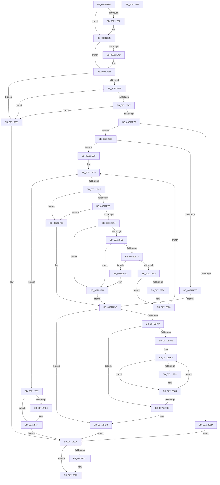

# EmpClientRuleRegisterNotification

- RVA: `0x00712DE4`–`0x0071304F` (길이 `619` bytes)
- VA: `0x0000000140712DE4`
- 실행 섹션: `PAGE`
- PDB 이름 있음: `예`; PDB Function 태그: `아니요`
- unwind 정보 RVA: `0x000855B4`
- 디코드: `164`개 명령, `619/619` bytes 표시
- 미해석 바이트: `0` (있으면 어셈블리에 `.byte`로 보존)

> 이 문서는 커널 이미지의 기계어와 PDB 기호를 분석해 생성했습니다. 4번과 5번은 함수 원형과 자료형을 바이너리 사용 방식에서 추정한 C 해석이며 원본 소스 복구 결과는 아닙니다.

## 1. Dependencies

- 직접 호출 지점: **12**; 고유 호출 대상: **10**
- 직접 호출자로 확인된 함수: **1**
- RIP 상대 이미지 참조: **2**

### Outgoing calls
- `0x00712E1E` → [KeAbPreAcquire](../../text/21/KeAbPreAcquire_function_00210230.md) (function, `0x00210230`)
- `0x00712E43` → [ExfAcquirePushLockExclusiveEx](../../text/20/ExfAcquirePushLockExclusiveEx_function_0020FC90.md) (function, `0x0020FC90`)
- `0x00712E80` → [ExAllocatePool2](../../poolcode/B8/ExAllocatePool2_function_00B820F0.md) (function, `0x00B820F0`)
- `0x00712EA7` → [ExAllocatePool2](../../poolcode/B8/ExAllocatePool2_function_00B820F0.md) (function, `0x00B820F0`)
- `0x00712EF4` → [EmpSearchRuleDatabase](../../text/45/EmpSearchRuleDatabase_function_00458A9C.md) (function, `0x00458A9C`)
- `0x00712F08` → [EmpSearchTargetRuleList](../../text/45/EmpSearchTargetRuleList_function_00456CE0.md) (function, `0x00456CE0`)
- `0x00712F81` → [EmpQueueRuleUpdateState](../../text/58/EmpQueueRuleUpdateState_function_005809B0.md) (function, `0x005809B0`)
- `0x00712FD3` → [ExFreePoolWithTag](../../poolcode/B8/ExFreePoolWithTag_function_00B82870.md) (function, `0x00B82870`)
- `0x00712FE0` → [ExFreePoolWithTag](../../poolcode/B8/ExFreePoolWithTag_function_00B82870.md) (function, `0x00B82870`)
- `0x00712FEF` → [ObfReferenceObject](../../text/20/ObfReferenceObject_function_0020FA20.md) (function, `0x0020FA20`)
- `0x0071301E` → [ExfTryToWakePushLock](../../text/26/ExfTryToWakePushLock_function_00265DD0.md) (function, `0x00265DD0`)
- `0x0071302A` → [KeAbPostRelease](../../text/2E/KeAbPostRelease_function_002E1600.md) (function, `0x002E1600`)

### Direct callers
- [EmClientRuleRegisterNotification](EmClientRuleRegisterNotification_function_00712DC0.md) at `0x00712DD0`

### Static image references
- `0x00712E12` → RVA `0x00F8F1E0` (`.data`; read)
- `0x00712E23` → RVA `0x00F8F1E0` (`.data`; read/write)

## 2. Other-region calls and transfers

- 다른 실행 섹션으로 향하는 call: **12**
  - `0x00712E1E` → [KeAbPreAcquire](../../text/21/KeAbPreAcquire_function_00210230.md) (`PAGE` → `.text`)
  - `0x00712E43` → [ExfAcquirePushLockExclusiveEx](../../text/20/ExfAcquirePushLockExclusiveEx_function_0020FC90.md) (`PAGE` → `.text`)
  - `0x00712E80` → [ExAllocatePool2](../../poolcode/B8/ExAllocatePool2_function_00B820F0.md) (`PAGE` → `POOLCODE`)
  - `0x00712EA7` → [ExAllocatePool2](../../poolcode/B8/ExAllocatePool2_function_00B820F0.md) (`PAGE` → `POOLCODE`)
  - `0x00712EF4` → [EmpSearchRuleDatabase](../../text/45/EmpSearchRuleDatabase_function_00458A9C.md) (`PAGE` → `.text`)
  - `0x00712F08` → [EmpSearchTargetRuleList](../../text/45/EmpSearchTargetRuleList_function_00456CE0.md) (`PAGE` → `.text`)
  - `0x00712F81` → [EmpQueueRuleUpdateState](../../text/58/EmpQueueRuleUpdateState_function_005809B0.md) (`PAGE` → `.text`)
  - `0x00712FD3` → [ExFreePoolWithTag](../../poolcode/B8/ExFreePoolWithTag_function_00B82870.md) (`PAGE` → `POOLCODE`)
  - `0x00712FE0` → [ExFreePoolWithTag](../../poolcode/B8/ExFreePoolWithTag_function_00B82870.md) (`PAGE` → `POOLCODE`)
  - `0x00712FEF` → [ObfReferenceObject](../../text/20/ObfReferenceObject_function_0020FA20.md) (`PAGE` → `.text`)
  - `0x0071301E` → [ExfTryToWakePushLock](../../text/26/ExfTryToWakePushLock_function_00265DD0.md) (`PAGE` → `.text`)
  - `0x0071302A` → [KeAbPostRelease](../../text/2E/KeAbPostRelease_function_002E1600.md) (`PAGE` → `.text`)
- 별도 외부 분기/꼬리 이동을 확인하지 못했습니다.

## 3. Assembly (complete function range)

```asm
00712DE4  48 8B C4                        mov rax, rsp
00712DE7  48 89 58 08                     mov qword ptr [rax + 8], rbx
00712DEB  48 89 68 10                     mov qword ptr [rax + 0x10], rbp
00712DEF  48 89 70 18                     mov qword ptr [rax + 0x18], rsi
00712DF3  4C 89 48 20                     mov qword ptr [rax + 0x20], r9
00712DF7  57                              push rdi
00712DF8  41 54                           push r12
00712DFA  41 55                           push r13
00712DFC  41 56                           push r14
00712DFE  41 57                           push r15
00712E00  48 83 EC 20                     sub rsp, 0x20
00712E04  45 8B F0                        mov r14d, r8d
00712E07  4C 8B E2                        mov r12, rdx
00712E0A  4C 8B F9                        mov r15, rcx
00712E0D  45 33 C0                        xor r8d, r8d
00712E10  33 D2                           xor edx, edx
00712E12  48 8D 0D C7 C3 87 00            lea rcx, [rip + 0x87c3c7]
00712E19  4D 8B E9                        mov r13, r9
00712E1C  33 FF                           xor edi, edi
00712E1E  E8 0D D4 AF FF                  call 0x140210230
00712E23  F0 48 0F BA 2D B3 C3 87 00 00   lock bts qword ptr [rip + 0x87c3b3], 0
00712E2D  48 8B D8                        mov rbx, rax
00712E30  73 16                           jae 0x140712e48
00712E32  4C 8D 05 A7 C3 87 00            lea r8, [rip + 0x87c3a7]
00712E39  48 8B D0                        mov rdx, rax
00712E3C  48 8D 0D 9D C3 87 00            lea rcx, [rip + 0x87c39d]
00712E43  E8 48 CE AF FF                  call 0x14020fc90
00712E48  48 85 DB                        test rbx, rbx
00712E4B  74 04                           je 0x140712e51
00712E4D  C6 43 0A 01                     mov byte ptr [rbx + 0xa], 1
00712E51  48 83 CB FF                     or rbx, 0xffffffffffffffff
00712E55  4D 85 ED                        test r13, r13
00712E58  0F 84 A3 01 00 00               je 0x140713001
00712E5E  45 85 F6                        test r14d, r14d
00712E61  0F 84 9A 01 00 00               je 0x140713001
00712E67  4D 85 E4                        test r12, r12
00712E6A  0F 84 91 01 00 00               je 0x140713001
00712E70  BD 00 01 00 00                  mov ebp, 0x100
00712E75  8D 53 19                        lea edx, [rbx + 0x19]
00712E78  8B CD                           mov ecx, ebp
00712E7A  41 B8 45 4D 63 6C               mov r8d, 0x6c634d45
00712E80  E8 6B F2 46 00                  call 0x140b820f0
00712E85  48 8B F0                        mov rsi, rax
00712E88  48 85 C0                        test rax, rax
00712E8B  75 0A                           jne 0x140712e97
00712E8D  BF 9A 00 00 C0                  mov edi, 0xc000009a
00712E92  E9 6F 01 00 00                  jmp 0x140713006
00712E97  43 8D 14 B6                     lea edx, [r14 + r14*4]
00712E9B  41 B8 45 4D 63 6C               mov r8d, 0x6c634d45
00712EA1  C1 E2 03                        shl edx, 3
00712EA4  48 8B CD                        mov rcx, rbp
00712EA7  E8 44 F2 46 00                  call 0x140b820f0
00712EAC  48 89 46 08                     mov qword ptr [rsi + 8], rax
00712EB0  48 85 C0                        test rax, rax
00712EB3  75 0A                           jne 0x140712ebf
00712EB5  BF 9A 00 00 C0                  mov edi, 0xc000009a
00712EBA  E9 E1 00 00 00                  jmp 0x140712fa0
00712EBF  44 89 76 10                     mov dword ptr [rsi + 0x10], r14d
00712EC3  33 ED                           xor ebp, ebp
00712EC5  41 3B EE                        cmp ebp, r14d
00712EC8  0F 83 19 01 00 00               jae 0x140712fe7
00712ECE  44 8B ED                        mov r13d, ebp
00712ED1  4C 8D 1C 6D 00 00 00 00         lea r11, [rbp*2]
00712ED9  4D 03 DD                        add r11, r13
00712EDC  4B 8B 0C DC                     mov rcx, qword ptr [r12 + r11*8]
00712EE0  48 85 C9                        test rcx, rcx
00712EE3  0F 84 B2 00 00 00               je 0x140712f9b
00712EE9  4B 39 7C DC 08                  cmp qword ptr [r12 + r11*8 + 8], rdi
00712EEE  0F 84 A7 00 00 00               je 0x140712f9b
00712EF4  E8 A3 5B D4 FF                  call 0x140458a9c
00712EF9  4C 8B D0                        mov r10, rax
00712EFC  48 85 C0                        test rax, rax
00712EFF  0F 84 8F 00 00 00               je 0x140712f94
00712F05  48 8B C8                        mov rcx, rax
00712F08  E8 D3 3D D4 FF                  call 0x140456ce0
00712F0D  4C 8B C0                        mov r8, rax
00712F10  48 85 C0                        test rax, rax
00712F13  74 7F                           je 0x140712f94
00712F15  48 8B 46 08                     mov rax, qword ptr [rsi + 8]
00712F19  48 8D 14 AD 00 00 00 00         lea rdx, [rbp*4]
00712F21  49 03 D5                        add rdx, r13
00712F24  4C 89 04 D0                     mov qword ptr [rax + rdx*8], r8
00712F28  48 8B 4E 08                     mov rcx, qword ptr [rsi + 8]
00712F2C  4B 8B 44 DC 08                  mov rax, qword ptr [r12 + r11*8 + 8]
00712F31  48 89 44 D1 08                  mov qword ptr [rcx + rdx*8 + 8], rax
00712F36  48 8B 4E 08                     mov rcx, qword ptr [rsi + 8]
00712F3A  4B 8B 44 DC 10                  mov rax, qword ptr [r12 + r11*8 + 0x10]
00712F3F  48 89 44 D1 10                  mov qword ptr [rcx + rdx*8 + 0x10], rax
00712F44  48 8B 46 08                     mov rax, qword ptr [rsi + 8]
00712F48  48 83 C0 18                     add rax, 0x18
00712F4C  48 8D 0C D0                     lea rcx, [rax + rdx*8]
00712F50  49 8D 42 50                     lea rax, [r10 + 0x50]
00712F54  48 8B 50 08                     mov rdx, qword ptr [rax + 8]
00712F58  48 39 02                        cmp qword ptr [rdx], rax
00712F5B  75 30                           jne 0x140712f8d
00712F5D  48 89 01                        mov qword ptr [rcx], rax
00712F60  48 89 51 08                     mov qword ptr [rcx + 8], rdx
00712F64  48 89 0A                        mov qword ptr [rdx], rcx
00712F67  48 89 48 08                     mov qword ptr [rax + 8], rcx
00712F6B  B8 01 00 00 00                  mov eax, 1
00712F70  F0 41 0F C1 00                  lock xadd dword ptr [r8], eax
00712F75  FF C0                           inc eax
00712F77  83 F8 01                        cmp eax, 1
00712F7A  75 0A                           jne 0x140712f86
00712F7C  33 D2                           xor edx, edx
00712F7E  49 8B CA                        mov rcx, r10
00712F81  E8 2A DA E6 FF                  call 0x1405809b0
00712F86  FF C5                           inc ebp
00712F88  E9 38 FF FF FF                  jmp 0x140712ec5
00712F8D  B9 03 00 00 00                  mov ecx, 3
00712F92  CD 29                           int 0x29
00712F94  BF 25 02 00 C0                  mov edi, 0xc0000225
00712F99  EB 05                           jmp 0x140712fa0
00712F9B  BF 0D 00 00 C0                  mov edi, 0xc000000d
00712FA0  48 8B 4E 08                     mov rcx, qword ptr [rsi + 8]
00712FA4  48 85 C9                        test rcx, rcx
00712FA7  74 2F                           je 0x140712fd8
00712FA9  45 85 F6                        test r14d, r14d
00712FAC  74 20                           je 0x140712fce
00712FAE  45 33 C0                        xor r8d, r8d
00712FB1  4D 8B CE                        mov r9, r14
00712FB4  49 8B 04 08                     mov rax, qword ptr [r8 + rcx]
00712FB8  48 85 C0                        test rax, rax
00712FBB  74 07                           je 0x140712fc4
00712FBD  F0 01 18                        lock add dword ptr [rax], ebx
00712FC0  48 8B 4E 08                     mov rcx, qword ptr [rsi + 8]
00712FC4  49 83 C0 28                     add r8, 0x28
00712FC8  49 83 E9 01                     sub r9, 1
00712FCC  75 E6                           jne 0x140712fb4
00712FCE  BA 45 4D 63 6C                  mov edx, 0x6c634d45
00712FD3  E8 98 F8 46 00                  call 0x140b82870
00712FD8  BA 45 4D 63 6C                  mov edx, 0x6c634d45
00712FDD  48 8B CE                        mov rcx, rsi
00712FE0  E8 8B F8 46 00                  call 0x140b82870
00712FE5  EB 1F                           jmp 0x140713006
00712FE7  4D 85 FF                        test r15, r15
00712FEA  74 08                           je 0x140712ff4
00712FEC  49 8B CF                        mov rcx, r15
00712FEF  E8 2C CA AF FF                  call 0x14020fa20
00712FF4  48 8B 44 24 68                  mov rax, qword ptr [rsp + 0x68]
00712FF9  4C 89 3E                        mov qword ptr [rsi], r15
00712FFC  48 89 30                        mov qword ptr [rax], rsi
00712FFF  EB 05                           jmp 0x140713006
00713001  BF 0D 00 00 C0                  mov edi, 0xc000000d
00713006  F0 48 0F C1 1D D1 C1 87 00      lock xadd qword ptr [rip + 0x87c1d1], rbx
0071300F  80 E3 06                        and bl, 6
00713012  80 FB 02                        cmp bl, 2
00713015  75 0C                           jne 0x140713023
00713017  48 8D 0D C2 C1 87 00            lea rcx, [rip + 0x87c1c2]
0071301E  E8 AD 2D B5 FF                  call 0x140265dd0
00713023  48 8D 0D B6 C1 87 00            lea rcx, [rip + 0x87c1b6]
0071302A  E8 D1 E5 BC FF                  call 0x1402e1600
0071302F  48 8B 5C 24 50                  mov rbx, qword ptr [rsp + 0x50]
00713034  8B C7                           mov eax, edi
00713036  48 8B 6C 24 58                  mov rbp, qword ptr [rsp + 0x58]
0071303B  48 8B 74 24 60                  mov rsi, qword ptr [rsp + 0x60]
00713040  48 83 C4 20                     add rsp, 0x20
00713044  41 5F                           pop r15
00713046  41 5E                           pop r14
00713048  41 5D                           pop r13
0071304A  41 5C                           pop r12
0071304C  5F                              pop rdi
0071304D  C3                              ret
0071304E  CC                              int3
```

## 4. C-style interpretation (structured pseudocode)

```c
__int64 __fastcall EmpClientRuleRegisterNotification(__int64 a1, __int64 a2, int a3, __int64 a4)
{
    __int64 result;
    __int64 v_r11;
    __int64 v_rbp;
    __int64 v_rbx;
    __int64 v_rdi;
    __int64 v_rsp;
    unsigned __int64 v_stack_p10;
    unsigned __int64 v_stack_p18;
    unsigned __int64 v_stack_p20;
    unsigned __int64 v_stack_p8;

    *(unsigned __int64 *)(v_rsp + 8) = v_rbx;
    *(unsigned __int64 *)(v_rsp + 16) = v_rbp;
    *(unsigned __int64 *)(v_rsp + 24) = v_rsi;
    *(unsigned __int64 *)(v_rsp + 32) = a4;
    v_rsp = (v_rsp) - (32);
    a3 = 0;
    a2 = 0;
    v_rdi = 0;
    result = KeAbPreAcquire(v_rip + 8897479, a2, a3, a4);
    if (!(condition_is_above_or_equal)) {
        a3 = v_rip + 8897447;
        a2 = result;
        a1 = v_rip + 8897437;
        result = ExfAcquirePushLockExclusiveEx(a1, a2, a3, a4);
    }
    if (result != 0) {
        *(unsigned __int8 *)(result + 10) = 1;
    }
    v_rbx = (result) | (-1);
    if (a4 == 0) goto loc_00713001;
    if ((unsigned int)((unsigned int)(a3)) == 0) goto loc_00713001;
    if (a2 == 0) goto loc_00713001;
    result = ExAllocatePool2(256, v_rbx + 25, (unsigned int)(0x6C634D45ULL), a4);
    if (result != 0) goto loc_00712E97;
    goto loc_00713006;
loc_00712E97:
    a2 = (unsigned int)(((unsigned int)(a3) + (unsigned int)(a3) * 4) << (3));
    result = ExAllocatePool2(256, a2, (unsigned int)(0x6C634D45ULL), a4);
    *(unsigned __int64 *)(result + 8) = result;
    if (result != 0) goto loc_00712EBF;
    goto loc_00712FA0;
loc_00712EBF:
    *(unsigned int *)(result + 16) = (unsigned int)((unsigned int)(a3));
    v_rbp = 0;
loc_00712EC5:
    if (0 >= ((unsigned int)((unsigned int)(a3)))) goto loc_00712FE7;
    v_r11 = (v_rbp * 2) + (0);
    if (*(unsigned __int64 *)(a2 + v_r11 * 8) == 0) goto loc_00712F9B;
    if ((*(unsigned __int64 *)(a2 + v_r11 * 8 + 8)) == ((unsigned int)(0xC000009AULL))) goto loc_00712F9B;
    result = EmpSearchRuleDatabase(*(unsigned __int64 *)(a2 + v_r11 * 8), a2, (unsigned int)(0x6C634D45ULL), a4);
    if (result == 0) goto loc_00712F94;
    result = EmpSearchTargetRuleList(result, a2, (unsigned int)(0x6C634D45ULL), a4);
    if (result == 0) goto loc_00712F94;
    a2 = (v_rbp * 4) + (0);
    *(unsigned __int64 *)(*(unsigned __int64 *)(result + 8) + a2 * 8) = result;
    *(unsigned __int64 *)(*(unsigned __int64 *)(result + 8) + a2 * 8 + 8) = *(unsigned __int64 *)(a2 + v_r11 * 8 + 8);
    *(unsigned __int64 *)(*(unsigned __int64 *)(result + 8) + a2 * 8 + 16) = *(unsigned __int64 *)(a2 + v_r11 * 8 + 16);
    result = (*(unsigned __int64 *)(result + 8)) + (24);
    if ((*(unsigned __int64 *)(*(unsigned __int64 *)(result + 80 + 8))) != (result + 80)) goto loc_00712F8D;
    *(unsigned __int64 *)(result + a2 * 8) = result + 80;
    *(unsigned __int64 *)(result + a2 * 8 + 8) = *(unsigned __int64 *)(result + 80 + 8);
    *(unsigned __int64 *)(*(unsigned __int64 *)(result + 80 + 8)) = result + a2 * 8;
    *(unsigned __int64 *)(result + 80 + 8) = result + a2 * 8;
    result = (unsigned int)((1) + 1);
    if (((unsigned int)(result)) == 1) {
        a2 = 0;
        a1 = result;
        result = EmpQueueRuleUpdateState(a1, a2, result, a4);
    }
    v_rbp = (unsigned int)((v_rbp) + 1);
    goto loc_00712EC5;
loc_00712F8D:
loc_00712F94:
    goto loc_00712FA0;
loc_00712F9B:
loc_00712FA0:
    if (*(unsigned __int64 *)(result + 8) == 0) goto loc_00712FD8;
    if ((unsigned int)((unsigned int)(a3)) == 0) goto loc_00712FCE;
    a3 = 0;
loc_00712FB4:
    if (*(unsigned __int64 *)(a3 + *(unsigned __int64 *)(result + 8) * 1) != 0) {
        a1 = *(unsigned __int64 *)(result + 8);
    }
    a3 = (a3) + (40);
    a4 = ((unsigned int)(a3)) - (1);
    if (condition_is_not_equal) goto loc_00712FB4;
loc_00712FCE:
    result = ExFreePoolWithTag(a1, (unsigned int)(0x6C634D45ULL), a3, a4);
loc_00712FD8:
    result = ExFreePoolWithTag(result, (unsigned int)(0x6C634D45ULL), a3, a4);
    goto loc_00713006;
loc_00712FE7:
    if (a1 != 0) {
        a1 = a1;
        result = ObfReferenceObject(a1, (unsigned int)(0x6C634D45ULL), a3, a4);
    }
    *(unsigned __int64 *)(result) = a1;
    *(unsigned __int64 *)(v_stack_p20) = result;
    goto loc_00713006;
loc_00713001:
loc_00713006:
    v_rbx = (unsigned __int8)((v_rbx) & (6));
    result = v_stack_p20;
    if (((unsigned __int8)(v_rbx)) == 2) {
        a1 = v_rip + 8896962;
        result = ExfTryToWakePushLock(a1, (unsigned int)(0x6C634D45ULL), a3, a4);
    }
    result = KeAbPostRelease(v_rip + 8896950, (unsigned int)(0x6C634D45ULL), a3, a4);
    v_rsp = (v_rsp) + (32);
    return (unsigned int)((unsigned int)((unsigned int)(0xC000000DULL)));
}
```

## 5. (Beta) C Style

```c
int64_t EmpClientRuleRegisterNotification(int64_t Arg1, int64_t Arg2, int32_t Arg3, int64_t Arg4)
{
    int64_t result;
    int64_t local_r11;
    int64_t local_rbp;
    int64_t local_rbx;
    int64_t local_rdi;
    int64_t local_rsp;
    uint64_t v_stack_p10;
    uint64_t v_stack_p18;
    uint64_t v_stack_p20;
    uint64_t v_stack_p8;

    *(uint64_t *)(local_rsp + 0x8) = local_rbx;
    *(uint64_t *)(local_rsp + 0x10) = local_rbp;
    *(uint64_t *)(local_rsp + 0x18) = local_rsi;
    *(uint64_t *)(local_rsp + 0x20) = Arg4;
    local_rsp = (local_rsp) - (32);
    Arg3 = 0;
    Arg2 = 0;
    local_rdi = 0;
    result = KeAbPreAcquire(v_rip + 8897479, Arg2, Arg3, Arg4);
    if (!(condition_is_above_or_equal)) {
        Arg3 = v_rip + 8897447;
        Arg2 = result;
        Arg1 = v_rip + 8897437;
        result = ExfAcquirePushLockExclusiveEx(Arg1, Arg2, Arg3, Arg4);
    }
    if (result != 0) {
        *(uint8_t *)(result + 0xA) = 1;
    }
    local_rbx = (result) | (-1);
    if (Arg4 == 0) goto loc_00713001;
    if ((uint32_t)((uint32_t)(Arg3)) == 0) goto loc_00713001;
    if (Arg2 == 0) goto loc_00713001;
    result = ExAllocatePool2(256, local_rbx + 25, (uint32_t)(0x6C634D45ULL), Arg4);
    if (result != 0) goto loc_00712E97;
    goto loc_00713006;
loc_00712E97:
    Arg2 = (uint32_t)(((uint32_t)(Arg3) + (uint32_t)(Arg3) * 4) << (3));
    result = ExAllocatePool2(256, Arg2, (uint32_t)(0x6C634D45ULL), Arg4);
    *(uint64_t *)(result + 0x8) = result;
    if (result != 0) goto loc_00712EBF;
    goto loc_00712FA0;
loc_00712EBF:
    *(uint32_t *)(result + 0x10) = (uint32_t)((uint32_t)(Arg3));
    local_rbp = 0;
loc_00712EC5:
    if (0 >= ((uint32_t)((uint32_t)(Arg3)))) goto loc_00712FE7;
    local_r11 = (local_rbp * 2) + (0);
    if (*(uint64_t *)(Arg2 + local_r11 * 8) == 0) goto loc_00712F9B;
    if ((*(uint64_t *)(Arg2 + local_r11 * 8 + 0x8)) == ((uint32_t)(0xC000009AULL))) goto loc_00712F9B;
    result = EmpSearchRuleDatabase(*(uint64_t *)(Arg2 + local_r11 * 8), Arg2, (uint32_t)(0x6C634D45ULL), Arg4);
    if (result == 0) goto loc_00712F94;
    result = EmpSearchTargetRuleList(result, Arg2, (uint32_t)(0x6C634D45ULL), Arg4);
    if (result == 0) goto loc_00712F94;
    Arg2 = (local_rbp * 4) + (0);
    *(uint64_t *)(*(uint64_t *)(result + 0x8) + Arg2 * 8) = result;
    *(uint64_t *)(*(uint64_t *)(result + 0x8) + Arg2 * 8 + 0x8) = *(uint64_t *)(Arg2 + local_r11 * 8 + 0x8);
    *(uint64_t *)(*(uint64_t *)(result + 0x8) + Arg2 * 8 + 0x10) = *(uint64_t *)(Arg2 + local_r11 * 8 + 0x10);
    result = (*(uint64_t *)(result + 0x8)) + (24);
    if ((*(uint64_t *)(*(uint64_t *)(result + 0x50 + 0x8))) != (result + 80)) goto loc_00712F8D;
    *(uint64_t *)(result + Arg2 * 8) = result + 80;
    *(uint64_t *)(result + Arg2 * 8 + 0x8) = *(uint64_t *)(result + 0x50 + 0x8);
    *(uint64_t *)(*(uint64_t *)(result + 0x50 + 0x8)) = result + Arg2 * 8;
    *(uint64_t *)(result + 0x50 + 0x8) = result + Arg2 * 8;
    result = (uint32_t)((1) + 1);
    if (((uint32_t)(result)) == 1) {
        Arg2 = 0;
        Arg1 = result;
        result = EmpQueueRuleUpdateState(Arg1, Arg2, result, Arg4);
    }
    local_rbp = (uint32_t)((local_rbp) + 1);
    goto loc_00712EC5;
loc_00712F8D:
loc_00712F94:
    goto loc_00712FA0;
loc_00712F9B:
loc_00712FA0:
    if (*(uint64_t *)(result + 0x8) == 0) goto loc_00712FD8;
    if ((uint32_t)((uint32_t)(Arg3)) == 0) goto loc_00712FCE;
    Arg3 = 0;
loc_00712FB4:
    if (*(uint64_t *)(Arg3 + *(uint64_t *)(result + 0x8) * 1) != 0) {
        Arg1 = *(uint64_t *)(result + 0x8);
    }
    Arg3 = (Arg3) + (40);
    Arg4 = ((uint32_t)(Arg3)) - (1);
    if (condition_is_not_equal) goto loc_00712FB4;
loc_00712FCE:
    result = ExFreePoolWithTag(Arg1, (uint32_t)(0x6C634D45ULL), Arg3, Arg4);
loc_00712FD8:
    result = ExFreePoolWithTag(result, (uint32_t)(0x6C634D45ULL), Arg3, Arg4);
    goto loc_00713006;
loc_00712FE7:
    if (Arg1 != 0) {
        Arg1 = Arg1;
        result = ObfReferenceObject(Arg1, (uint32_t)(0x6C634D45ULL), Arg3, Arg4);
    }
    *(uint64_t *)(result) = Arg1;
    *(uint64_t *)(v_stack_p20) = result;
    goto loc_00713006;
loc_00713001:
loc_00713006:
    local_rbx = (uint8_t)((local_rbx) & (6));
    result = v_stack_p20;
    if (((uint8_t)(local_rbx)) == 2) {
        Arg1 = v_rip + 8896962;
        result = ExfTryToWakePushLock(Arg1, (uint32_t)(0x6C634D45ULL), Arg3, Arg4);
    }
    result = KeAbPostRelease(v_rip + 8896950, (uint32_t)(0x6C634D45ULL), Arg3, Arg4);
    local_rsp = (local_rsp) + (32);
    return (uint32_t)((uint32_t)((uint32_t)(0xC000000DULL)));
}
```

## 6. Execution-region graph

[열기: 2D/3D 그래프와 함수 탐색 컨트롤 패널](../../../control-panel.html?section=page&rva=0x00712DE4&view=graph)

- 2D 그래프는 위에서 아래로 흐르고, 3D 그래프는 빈 공간을 드래그해 회전합니다. Shift+드래그는 이동, 휠은 확대·축소, 함수 노드 선택은 대상 보고서 이동입니다.

### Static fallback


