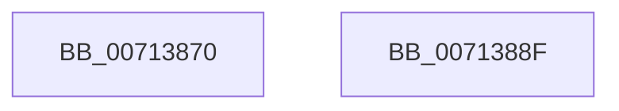

# FsRtlAllocateResource

- RVA: `0x00713870`–`0x00713890` (길이 `32` bytes)
- VA: `0x0000000140713870`
- 실행 섹션: `PAGE`
- PDB 이름 있음: `예`; PDB Function 태그: `아니요`
- unwind 정보 RVA: `0x000DB714`
- 디코드: `9`개 명령, `32/32` bytes 표시
- 미해석 바이트: `0` (있으면 어셈블리에 `.byte`로 보존)

> 이 문서는 커널 이미지의 기계어와 PDB 기호를 분석해 생성했습니다. 4번과 5번은 함수 원형과 자료형을 바이너리 사용 방식에서 추정한 C 해석이며 원본 소스 복구 결과는 아닙니다.

## 1. Dependencies

- 직접 호출 지점: **0**; 고유 호출 대상: **0**
- 직접 호출자로 확인된 함수: **0**
- RIP 상대 이미지 참조: **3**

### Outgoing calls
- 직접 디코드된 call 명령이 없습니다.

### Direct callers
- 이 함수 시작 RVA로 연결되는 직접 call은 확인되지 않았습니다. 간접 호출은 완전히 역산할 수 없습니다.

### Static image references
- `0x00713870` → RVA `0x00FD8280` (`PAGEDATA`; read)
- `0x00713881` → RVA `0x00FD8280` (`PAGEDATA`; write)
- `0x00713887` → RVA `0x00F8F0E8` (`.data`; read)

## 2. Other-region calls and transfers

- 다른 실행 섹션으로 향하는 call: **0**
- 별도 외부 분기/꼬리 이동을 확인하지 못했습니다.

## 3. Assembly (complete function range)

```asm
00713870  8B 0D 0A 4A 8C 00               mov ecx, dword ptr [rip + 0x8c4a0a]
00713876  8B C1                           mov eax, ecx
00713878  83 E0 0F                        and eax, 0xf
0071387B  FF C1                           inc ecx
0071387D  48 6B C0 68                     imul rax, rax, 0x68
00713881  89 0D F9 49 8C 00               mov dword ptr [rip + 0x8c49f9], ecx
00713887  48 03 05 5A B8 87 00            add rax, qword ptr [rip + 0x87b85a]
0071388E  C3                              ret
0071388F  CC                              int3
```

## 4. C-style interpretation (structured pseudocode)

```c
__int64 __fastcall FsRtlAllocateResource(void)
{
    __int64 result;

    result = (unsigned int)(((unsigned int)((unsigned int)((unsigned int)(*(unsigned int *)(v_rip + 9193994))))) & (15));
    a1 = (unsigned int)(((unsigned int)(*(unsigned int *)(v_rip + 9193994))) + 1);
    result = (result) * (result);
    *(unsigned int *)(v_rip + 9193977) = (unsigned int)(a1);
    result = (result) + (*(unsigned __int64 *)(v_rip + 8894554));
    return result;
}
```

## 5. (Beta) C Style

```c
void FsRtlAllocateResource(void)
{
    int64_t result;

    result = (uint32_t)(((uint32_t)((uint32_t)((uint32_t)(*(uint32_t *)(v_rip + 0x8C4A0A))))) & (15));
    a1 = (uint32_t)(((uint32_t)(*(uint32_t *)(v_rip + 0x8C4A0A))) + 1);
    result = (result) * (result);
    *(uint32_t *)(v_rip + 0x8C49F9) = (uint32_t)(a1);
    result = (result) + (*(uint64_t *)(v_rip + 0x87B85A));
    return result;
}
```

## 6. Execution-region graph

[열기: 2D/3D 그래프와 함수 탐색 컨트롤 패널](../../../control-panel.html?section=page&rva=0x00713870&view=graph)

- 2D 그래프는 위에서 아래로 흐르고, 3D 그래프는 빈 공간을 드래그해 회전합니다. Shift+드래그는 이동, 휠은 확대·축소, 함수 노드 선택은 대상 보고서 이동입니다.

### Static fallback


