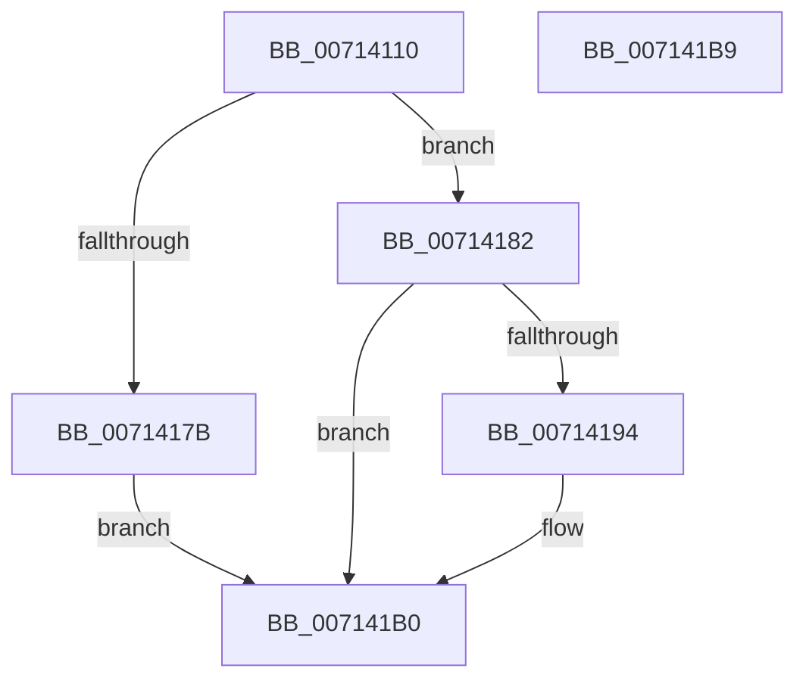

# FsRtlBalanceReads

- RVA: `0x00714110`–`0x007141BA` (길이 `170` bytes)
- VA: `0x0000000140714110`
- 실행 섹션: `PAGE`
- PDB 이름 있음: `예`; PDB Function 태그: `아니요`
- unwind 정보 RVA: `0x000BA960`
- 디코드: `44`개 명령, `170/170` bytes 표시
- 미해석 바이트: `0` (있으면 어셈블리에 `.byte`로 보존)

> 이 문서는 커널 이미지의 기계어와 PDB 기호를 분석해 생성했습니다. 4번과 5번은 함수 원형과 자료형을 바이너리 사용 방식에서 추정한 C 해석이며 원본 소스 복구 결과는 아닙니다.

## 1. Dependencies

- 직접 호출 지점: **4**; 고유 호출 대상: **4**
- 직접 호출자로 확인된 함수: **0**
- RIP 상대 이미지 참조: **0**

### Outgoing calls
- `0x0071413A` → [KeInitializeEvent](../../text/40/KeInitializeEvent_function_0040DD10.md) (function, `0x0040DD10`)
- `0x00714171` → [IoBuildDeviceIoControlRequest](../../text/20/IoBuildDeviceIoControlRequest_function_00204FD0.md) (function, `0x00204FD0`)
- `0x00714188` → [IofCallDriver](../../text/29/IofCallDriver_function_0029B4B0.md) (function, `0x0029B4B0`)
- `0x007141A7` → [KeWaitForSingleObject](../../text/20/KeWaitForSingleObject_function_0020E6B0.md) (function, `0x0020E6B0`)

### Direct callers
- 이 함수 시작 RVA로 연결되는 직접 call은 확인되지 않았습니다. 간접 호출은 완전히 역산할 수 없습니다.

### Static image references
- 디코드된 RIP-relative 메모리 참조가 없습니다.

## 2. Other-region calls and transfers

- 다른 실행 섹션으로 향하는 call: **4**
  - `0x0071413A` → [KeInitializeEvent](../../text/40/KeInitializeEvent_function_0040DD10.md) (`PAGE` → `.text`)
  - `0x00714171` → [IoBuildDeviceIoControlRequest](../../text/20/IoBuildDeviceIoControlRequest_function_00204FD0.md) (`PAGE` → `.text`)
  - `0x00714188` → [IofCallDriver](../../text/29/IofCallDriver_function_0029B4B0.md) (`PAGE` → `.text`)
  - `0x007141A7` → [KeWaitForSingleObject](../../text/20/KeWaitForSingleObject_function_0020E6B0.md) (`PAGE` → `.text`)
- 별도 외부 분기/꼬리 이동을 확인하지 못했습니다.

## 3. Assembly (complete function range)

```asm
00714110  40 53                           push rbx
00714112  48 81 EC 80 00 00 00            sub rsp, 0x80
00714119  0F 57 C0                        xorps xmm0, xmm0
0071411C  48 8B D9                        mov rbx, rcx
0071411F  33 C0                           xor eax, eax
00714121  48 8D 4C 24 60                  lea rcx, [rsp + 0x60]
00714126  45 33 C0                        xor r8d, r8d
00714129  48 89 44 24 70                  mov qword ptr [rsp + 0x70], rax
0071412E  33 D2                           xor edx, edx
00714130  0F 11 44 24 60                  movups xmmword ptr [rsp + 0x60], xmm0
00714135  0F 11 44 24 50                  movups xmmword ptr [rsp + 0x50], xmm0
0071413A  E8 D1 9B CF FF                  call 0x14040dd10
0071413F  48 8D 44 24 50                  lea rax, [rsp + 0x50]
00714144  45 33 C9                        xor r9d, r9d
00714147  48 89 44 24 40                  mov qword ptr [rsp + 0x40], rax
0071414C  45 33 C0                        xor r8d, r8d
0071414F  48 8D 44 24 60                  lea rax, [rsp + 0x60]
00714154  48 8B D3                        mov rdx, rbx
00714157  48 89 44 24 38                  mov qword ptr [rsp + 0x38], rax
0071415C  B9 1B 00 66 00                  mov ecx, 0x66001b
00714161  C6 44 24 30 00                  mov byte ptr [rsp + 0x30], 0
00714166  83 64 24 28 00                  and dword ptr [rsp + 0x28], 0
0071416B  48 83 64 24 20 00               and qword ptr [rsp + 0x20], 0
00714171  E8 5A 0E AF FF                  call 0x140204fd0
00714176  48 85 C0                        test rax, rax
00714179  75 07                           jne 0x140714182
0071417B  B8 9A 00 00 C0                  mov eax, 0xc000009a
00714180  EB 2E                           jmp 0x1407141b0
00714182  48 8B D0                        mov rdx, rax
00714185  48 8B CB                        mov rcx, rbx
00714188  E8 23 73 B8 FF                  call 0x14029b4b0
0071418D  3D 03 01 00 00                  cmp eax, 0x103
00714192  75 1C                           jne 0x1407141b0
00714194  48 83 64 24 20 00               and qword ptr [rsp + 0x20], 0
0071419A  48 8D 4C 24 60                  lea rcx, [rsp + 0x60]
0071419F  45 33 C9                        xor r9d, r9d
007141A2  45 33 C0                        xor r8d, r8d
007141A5  33 D2                           xor edx, edx
007141A7  E8 04 A5 AF FF                  call 0x14020e6b0
007141AC  8B 44 24 50                     mov eax, dword ptr [rsp + 0x50]
007141B0  48 81 C4 80 00 00 00            add rsp, 0x80
007141B7  5B                              pop rbx
007141B8  C3                              ret
007141B9  CC                              int3
```

## 4. C-style interpretation (structured pseudocode)

```c
__int64 __fastcall FsRtlBalanceReads(__int64 a1, int a2, int a3, int a4)
{
    __int64 result;
    __int64 v_rsp;
    unsigned __int64 v_stack_m18;
    unsigned __int64 v_stack_m28;
    unsigned __int64 v_stack_m38;
    unsigned __int64 v_stack_m48;
    unsigned __int64 v_stack_m50;
    unsigned __int8 v_stack_m58;
    unsigned int v_stack_m60;
    unsigned __int64 v_stack_m68;

    v_rsp = (v_rsp) - (128);
    result = 0;
    a3 = 0;
    v_stack_m18 = 0;
    a2 = 0;
    v_stack_m28 = v_xmm0;
    v_stack_m38 = v_xmm0;
    result = KeInitializeEvent(v_stack_m28, a2, a3, a4);
    a4 = 0;
    v_stack_m48 = v_stack_m38;
    a3 = 0;
    v_stack_m50 = v_stack_m28;
    v_stack_m58 = 0;
    result = IoBuildDeviceIoControlRequest((unsigned int)(0x66001BULL), a1, a3, a4);
    if (result != 0) goto loc_00714182;
    goto loc_007141B0;
loc_00714182:
    result = IofCallDriver(a1, (unsigned int)(0xC000009AULL), a3, a4);
    if (((unsigned int)(result)) == 259) {
        a1 = v_stack_m28;
        a4 = 0;
        a3 = 0;
        a2 = 0;
        result = KeWaitForSingleObject(a1, a2, a3, a4);
        result = v_stack_m38;
    }
    v_rsp = (v_rsp) + (128);
    return result;
}
```

## 5. (Beta) C Style

```c
int64_t FsRtlBalanceReads(int64_t Arg1, int32_t Arg2, int32_t Arg3, int32_t Arg4)
{
    int64_t result;
    int64_t local_rsp;
    uint64_t v_stack_m18;
    uint64_t v_stack_m28;
    uint64_t v_stack_m38;
    uint64_t v_stack_m48;
    uint64_t v_stack_m50;
    uint8_t v_stack_m58;
    uint32_t v_stack_m60;
    uint64_t v_stack_m68;

    local_rsp = (local_rsp) - (128);
    result = 0;
    Arg3 = 0;
    v_stack_m18 = 0;
    Arg2 = 0;
    v_stack_m28 = v_xmm0;
    v_stack_m38 = v_xmm0;
    result = KeInitializeEvent(v_stack_m28, Arg2, Arg3, Arg4);
    Arg4 = 0;
    v_stack_m48 = v_stack_m38;
    Arg3 = 0;
    v_stack_m50 = v_stack_m28;
    v_stack_m58 = 0;
    result = IoBuildDeviceIoControlRequest((uint32_t)(0x66001BULL), Arg1, Arg3, Arg4);
    if (result != 0) goto loc_00714182;
    goto loc_007141B0;
loc_00714182:
    result = IofCallDriver(Arg1, (uint32_t)(0xC000009AULL), Arg3, Arg4);
    if (((uint32_t)(result)) == 259) {
        Arg1 = v_stack_m28;
        Arg4 = 0;
        Arg3 = 0;
        Arg2 = 0;
        result = KeWaitForSingleObject(Arg1, Arg2, Arg3, Arg4);
        result = v_stack_m38;
    }
    local_rsp = (local_rsp) + (128);
    return result;
}
```

## 6. Execution-region graph

[열기: 2D/3D 그래프와 함수 탐색 컨트롤 패널](../../../control-panel.html?section=page&rva=0x00714110&view=graph)

- 2D 그래프는 위에서 아래로 흐르고, 3D 그래프는 빈 공간을 드래그해 회전합니다. Shift+드래그는 이동, 휠은 확대·축소, 함수 노드 선택은 대상 보고서 이동입니다.

### Static fallback


