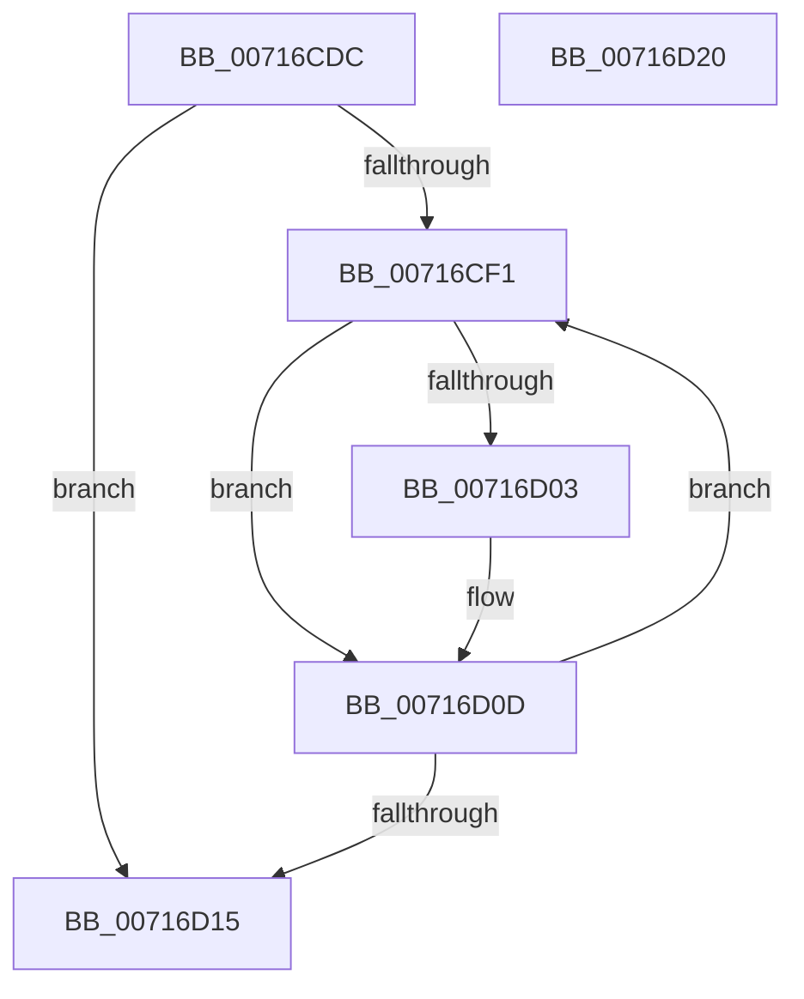

# FsRtlCheckNotifyForDeleteLite

- RVA: `0x00716CDC`–`0x00716D21` (길이 `69` bytes)
- VA: `0x0000000140716CDC`
- 실행 섹션: `PAGE`
- PDB 이름 있음: `예`; PDB Function 태그: `아니요`
- unwind 정보 RVA: `0x0005CAAC`
- 디코드: `22`개 명령, `69/69` bytes 표시
- 미해석 바이트: `0` (있으면 어셈블리에 `.byte`로 보존)

> 이 문서는 커널 이미지의 기계어와 PDB 기호를 분석해 생성했습니다. 4번과 5번은 함수 원형과 자료형을 바이너리 사용 방식에서 추정한 C 해석이며 원본 소스 복구 결과는 아닙니다.

## 1. Dependencies

- 직접 호출 지점: **1**; 고유 호출 대상: **1**
- 직접 호출자로 확인된 함수: **1**
- RIP 상대 이미지 참조: **0**

### Outgoing calls
- `0x00716D08` → [FsRtlNotifyCompleteIrpList](../A1/FsRtlNotifyCompleteIrpList_function_00A1F98C.md) (function, `0x00A1F98C`)

### Direct callers
- [FsRtlNotifyFilterChangeDirectoryLite](../AD/FsRtlNotifyFilterChangeDirectoryLite_function_00ADC950.md) at `0x00ADC9EC`

### Static image references
- 디코드된 RIP-relative 메모리 참조가 없습니다.

## 2. Other-region calls and transfers

- 다른 실행 섹션으로 향하는 call: **0**
- 별도 외부 분기/꼬리 이동을 확인하지 못했습니다.

## 3. Assembly (complete function range)

```asm
00716CDC  48 89 5C 24 08                  mov qword ptr [rsp + 8], rbx
00716CE1  57                              push rdi
00716CE2  48 83 EC 20                     sub rsp, 0x20
00716CE6  48 8B 19                        mov rbx, qword ptr [rcx]
00716CE9  48 8B F9                        mov rdi, rcx
00716CEC  48 3B D9                        cmp rbx, rcx
00716CEF  74 24                           je 0x140716d15
00716CF1  48 8D 4B E0                     lea rcx, [rbx - 0x20]
00716CF5  66 83 49 48 20                  or word ptr [rcx + 0x48], 0x20
00716CFA  48 8D 41 30                     lea rax, [rcx + 0x30]
00716CFE  48 39 00                        cmp qword ptr [rax], rax
00716D01  74 0A                           je 0x140716d0d
00716D03  BA 56 00 00 C0                  mov edx, 0xc0000056
00716D08  E8 7F 8C 30 00                  call 0x140a1f98c
00716D0D  48 8B 1B                        mov rbx, qword ptr [rbx]
00716D10  48 3B DF                        cmp rbx, rdi
00716D13  75 DC                           jne 0x140716cf1
00716D15  48 8B 5C 24 30                  mov rbx, qword ptr [rsp + 0x30]
00716D1A  48 83 C4 20                     add rsp, 0x20
00716D1E  5F                              pop rdi
00716D1F  C3                              ret
00716D20  CC                              int3
```

## 4. C-style interpretation (structured pseudocode)

```c
__int64 __fastcall FsRtlCheckNotifyForDeleteLite(__int64 a1)
{
    __int64 result;
    __int64 v_rsp;
    unsigned __int64 v_stack_p8;

    v_stack_p8 = v_rbx;
    v_rsp = (v_rsp) - (32);
    if ((*(unsigned __int64 *)(a1)) == a1) goto loc_00716D15;
loc_00716CF1:
    result = *(unsigned __int64 *)(a1) - 32 + 48;
    if ((*(unsigned __int64 *)(*(unsigned __int64 *)(a1) - 32 + 48)) != (*(unsigned __int64 *)(a1) - 32 + 48)) {
        a2 = 0xC0000056ULL;
        result = FsRtlNotifyCompleteIrpList(*(unsigned __int64 *)(a1) - 32, a2, a3, a4);
    }
    if ((*(unsigned __int64 *)(*(unsigned __int64 *)(a1))) != a1) goto loc_00716CF1;
loc_00716D15:
    v_rsp = (v_rsp) + (32);
    return result;
}
```

## 5. (Beta) C Style

```c
int64_t FsRtlCheckNotifyForDeleteLite(void *Arg1)
{
    uint8_t *arg1 = (uint8_t *)Arg1;

    int64_t result;
    int64_t local_rsp;
    uint64_t v_stack_p8;

    v_stack_p8 = local_rbx;
    local_rsp = (local_rsp) - (32);
    if ((*(uint64_t *)(arg1)) == Arg1) goto loc_00716D15;
loc_00716CF1:
    result = *(uint64_t *)(arg1) - 32 + 48;
    if ((*(uint64_t *)(*(uint64_t *)(arg1) - 0x20 + 0x30)) != (*(uint64_t *)(arg1) - 32 + 48)) {
        a2 = 0xC0000056ULL;
        result = FsRtlNotifyCompleteIrpList(*(uint64_t *)(arg1) - 32, a2, a3, a4);
    }
    if ((*(uint64_t *)(*(uint64_t *)(arg1))) != Arg1) goto loc_00716CF1;
loc_00716D15:
    local_rsp = (local_rsp) + (32);
    return result;
}
```

### 관측된 메모리 오프셋

구조체 형식이 확인되지 않은 접근은 인자 기준의 오프셋으로만 기록했습니다.

| 기준 인자 | 오프셋 표현 | 폭 (bit) | 접근 |
|---|---:|---:|---|
| `Arg1` | `+ 0x0` | `64` | `R` |

## 6. Execution-region graph

[열기: 2D/3D 그래프와 함수 탐색 컨트롤 패널](../../../control-panel.html?section=page&rva=0x00716CDC&view=graph)

- 2D 그래프는 위에서 아래로 흐르고, 3D 그래프는 빈 공간을 드래그해 회전합니다. Shift+드래그는 이동, 휠은 확대·축소, 함수 노드 선택은 대상 보고서 이동입니다.

### Static fallback


