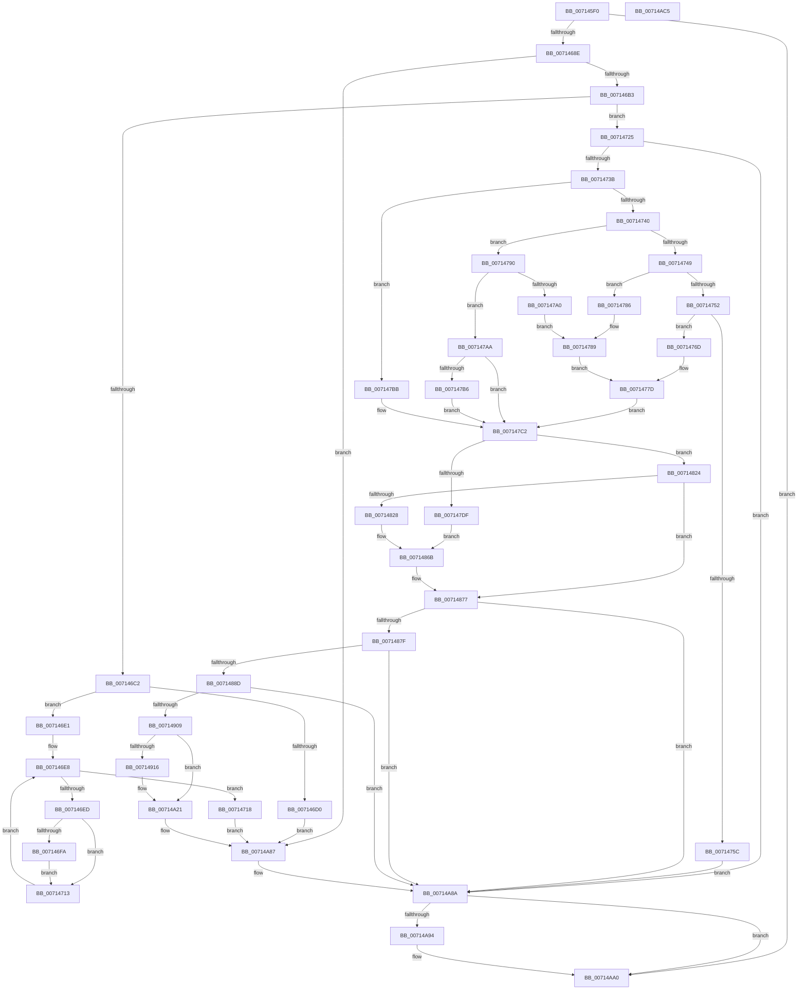

# FsRtlCheckUpperOplock

- RVA: `0x007145F0`–`0x00714AC6` (길이 `1,238` bytes)
- VA: `0x00000001407145F0`
- 실행 섹션: `PAGE`
- PDB 이름 있음: `예`; PDB Function 태그: `아니요`
- unwind 정보 RVA: `0x000C6048`
- 디코드: `254`개 명령, `1,238/1,238` bytes 표시
- 미해석 바이트: `0` (있으면 어셈블리에 `.byte`로 보존)

> 이 문서는 커널 이미지의 기계어와 PDB 기호를 분석해 생성했습니다. 4번과 5번은 함수 원형과 자료형을 바이너리 사용 방식에서 추정한 C 해석이며 원본 소스 복구 결과는 아닙니다.

## 1. Dependencies

- 직접 호출 지점: **12**; 고유 호출 대상: **11**
- 직접 호출자로 확인된 함수: **0**
- RIP 상대 이미지 참조: **3**

### Outgoing calls
- `0x0071467D` → [memset](../../text/6C/memset_function_006C6C40.md) (function, `0x006C6C40`)
- `0x00714695` → [ExAcquireFastMutexUnsafe](../../text/3F/ExAcquireFastMutexUnsafe_function_003F3720.md) (function, `0x003F3720`)
- `0x0071470C` → [FsRtlpRemoveAndCompleteReadOnlyIrp](../../text/4B/FsRtlpRemoveAndCompleteReadOnlyIrp_function_004B495C.md) (function, `0x004B495C`)
- `0x0071471B` → [FsRtlpComputeShareableOplockState](../../text/42/FsRtlpComputeShareableOplockState_function_004256EC.md) (function, `0x004256EC`)
- `0x0071472B` → [FsRtlpOplockUpperLowerCompatible](../A2/FsRtlpOplockUpperLowerCompatible_function_00A21E04.md) (function, `0x00A21E04`)
- `0x0071481D` → [FsRtlpOplockBreakToII](../../text/4B/FsRtlpOplockBreakToII_function_004BB824.md) (function, `0x004BB824`)
- `0x00714866` → [FsRtlpOplockBreakToNone](../../text/4F/FsRtlpOplockBreakToNone_function_004F8354.md) (function, `0x004F8354`)
- `0x007148EA` → [FsRtlpOplockBreakByCacheFlags](../../text/4E/FsRtlpOplockBreakByCacheFlags_function_004E4990.md) (function, `0x004E4990`)
- `0x00714A19` → [tlgWriteTransfer_EtwWriteTransfer](../../text/42/tlgWriteTransfer_EtwWriteTransfer_function_004260E0.md) (function, `0x004260E0`)
- `0x00714A79` → [FsRtlpOplockBreakByCacheFlags](../../text/4E/FsRtlpOplockBreakByCacheFlags_function_004E4990.md) (function, `0x004E4990`)
- `0x00714A9B` → [ExReleaseFastMutexUnsafe](../../text/25/ExReleaseFastMutexUnsafe_function_002503A0.md) (function, `0x002503A0`)
- `0x00714AAD` → [_security_check_cookie](../../text/6A/_security_check_cookie_function_006AC640.md) (function, `0x006AC640`)

### Direct callers
- 이 함수 시작 RVA로 연결되는 직접 call은 확인되지 않았습니다. 간접 호출은 완전히 역산할 수 없습니다.

### Static image references
- `0x00714605` → RVA `0x00E0A740` (`.data`; read)
- `0x00714909` → RVA `0x00E06C50` (`.data`; read)
- `0x00714A0B` → RVA `0x00045885` (`.rdata`; read)

## 2. Other-region calls and transfers

- 다른 실행 섹션으로 향하는 call: **11**
  - `0x0071467D` → [memset](../../text/6C/memset_function_006C6C40.md) (`PAGE` → `.text`)
  - `0x00714695` → [ExAcquireFastMutexUnsafe](../../text/3F/ExAcquireFastMutexUnsafe_function_003F3720.md) (`PAGE` → `.text`)
  - `0x0071470C` → [FsRtlpRemoveAndCompleteReadOnlyIrp](../../text/4B/FsRtlpRemoveAndCompleteReadOnlyIrp_function_004B495C.md) (`PAGE` → `.text`)
  - `0x0071471B` → [FsRtlpComputeShareableOplockState](../../text/42/FsRtlpComputeShareableOplockState_function_004256EC.md) (`PAGE` → `.text`)
  - `0x0071481D` → [FsRtlpOplockBreakToII](../../text/4B/FsRtlpOplockBreakToII_function_004BB824.md) (`PAGE` → `.text`)
  - `0x00714866` → [FsRtlpOplockBreakToNone](../../text/4F/FsRtlpOplockBreakToNone_function_004F8354.md) (`PAGE` → `.text`)
  - `0x007148EA` → [FsRtlpOplockBreakByCacheFlags](../../text/4E/FsRtlpOplockBreakByCacheFlags_function_004E4990.md) (`PAGE` → `.text`)
  - `0x00714A19` → [tlgWriteTransfer_EtwWriteTransfer](../../text/42/tlgWriteTransfer_EtwWriteTransfer_function_004260E0.md) (`PAGE` → `.text`)
  - `0x00714A79` → [FsRtlpOplockBreakByCacheFlags](../../text/4E/FsRtlpOplockBreakByCacheFlags_function_004E4990.md) (`PAGE` → `.text`)
  - `0x00714A9B` → [ExReleaseFastMutexUnsafe](../../text/25/ExReleaseFastMutexUnsafe_function_002503A0.md) (`PAGE` → `.text`)
  - `0x00714AAD` → [_security_check_cookie](../../text/6A/_security_check_cookie_function_006AC640.md) (`PAGE` → `.text`)
- 별도 외부 분기/꼬리 이동을 확인하지 못했습니다.

## 3. Assembly (complete function range)

```asm
007145F0  4C 8B DC                        mov r11, rsp
007145F3  53                              push rbx
007145F4  56                              push rsi
007145F5  57                              push rdi
007145F6  41 54                           push r12
007145F8  41 55                           push r13
007145FA  41 56                           push r14
007145FC  41 57                           push r15
007145FE  48 81 EC 90 01 00 00            sub rsp, 0x190
00714605  48 8B 05 34 61 6F 00            mov rax, qword ptr [rip + 0x6f6134]
0071460C  48 33 C4                        xor rax, rsp
0071460F  48 89 84 24 80 01 00 00         mov qword ptr [rsp + 0x180], rax
00714617  4C 89 8C 24 90 00 00 00         mov qword ptr [rsp + 0x90], r9
0071461F  4D 8B E8                        mov r13, r8
00714622  48 8B 84 24 F0 01 00 00         mov rax, qword ptr [rsp + 0x1f0]
0071462A  48 89 84 24 88 00 00 00         mov qword ptr [rsp + 0x88], rax
00714632  44 8B FA                        mov r15d, edx
00714635  41 83 E7 06                     and r15d, 6
00714639  41 C1 E7 0C                     shl r15d, 0xc
0071463D  83 E2 01                        and edx, 1
00714640  C1 E2 0C                        shl edx, 0xc
00714643  44 0B FA                        or r15d, edx
00714646  48 8B 39                        mov rdi, qword ptr [rcx]
00714649  48 89 BC 24 A8 00 00 00         mov qword ptr [rsp + 0xa8], rdi
00714651  45 33 E4                        xor r12d, r12d
00714654  45 88 A3 B8 FE FF FF            mov byte ptr [r11 - 0x148], r12b
0071465B  45 8A F4                        mov r14b, r12b
0071465E  45 88 A3 B9 FE FF FF            mov byte ptr [r11 - 0x147], r12b
00714665  41 8B F4                        mov esi, r12d
00714668  45 88 A3 BA FE FF FF            mov byte ptr [r11 - 0x146], r12b
0071466F  33 D2                           xor edx, edx
00714671  45 8D 44 24 48                  lea r8d, [r12 + 0x48]
00714676  49 8D 8B E8 FE FF FF            lea rcx, [r11 - 0x118]
0071467D  E8 BE 25 FB FF                  call 0x1406c6c40
00714682  41 8B DC                        mov ebx, r12d
00714685  48 85 FF                        test rdi, rdi
00714688  0F 84 12 04 00 00               je 0x140714aa0
0071468E  48 8B 8F 98 00 00 00            mov rcx, qword ptr [rdi + 0x98]
00714695  E8 86 F0 CD FF                  call 0x1403f3720
0071469A  C6 84 24 80 00 00 00 01         mov byte ptr [rsp + 0x80], 1
007146A2  44 8B 97 90 00 00 00            mov r10d, dword ptr [rdi + 0x90]
007146A9  41 83 FA 01                     cmp r10d, 1
007146AD  0F 84 D4 03 00 00               je 0x140714a87
007146B3  44 8B A4 24 F8 01 00 00         mov r12d, dword ptr [rsp + 0x1f8]
007146BB  41 0F BA E4 11                  bt r12d, 0x11
007146C0  73 63                           jae 0x140714725
007146C2  41 8D 82 00 F0 FF FF            lea eax, [r10 - 0x1000]
007146C9  A9 EF FF FF FF                  test eax, 0xffffffef
007146CE  74 11                           je 0x1407146e1
007146D0  BB 09 09 00 C0                  mov ebx, 0xc0000909
007146D5  89 9C 24 84 00 00 00            mov dword ptr [rsp + 0x84], ebx
007146DC  E9 A6 03 00 00                  jmp 0x140714a87
007146E1  4C 8D 77 28                     lea r14, [rdi + 0x28]
007146E5  49 8B 36                        mov rsi, qword ptr [r14]
007146E8  49 3B F6                        cmp rsi, r14
007146EB  74 2B                           je 0x140714718
007146ED  48 8B 46 10                     mov rax, qword ptr [rsi + 0x10]
007146F1  81 78 18 40 02 09 00            cmp dword ptr [rax + 0x18], 0x90240
007146F8  75 19                           jne 0x140714713
007146FA  48 8B 76 08                     mov rsi, qword ptr [rsi + 8]
007146FE  4C 8B CF                        mov r9, rdi
00714701  33 D2                           xor edx, edx
00714703  41 B8 00 10 00 00               mov r8d, 0x1000
00714709  48 8B 0E                        mov rcx, qword ptr [rsi]
0071470C  E8 4B 02 DA FF                  call 0x1404b495c
00714711  EB 00                           jmp 0x140714713
00714713  48 8B 36                        mov rsi, qword ptr [rsi]
00714716  EB D0                           jmp 0x1407146e8
00714718  48 8B CF                        mov rcx, rdi
0071471B  E8 CC 0F D1 FF                  call 0x1404256ec
00714720  E9 62 03 00 00                  jmp 0x140714a87
00714725  41 8B D7                        mov edx, r15d
00714728  41 8B CA                        mov ecx, r10d
0071472B  E8 D4 D6 30 00                  call 0x140a21e04
00714730  45 33 C0                        xor r8d, r8d
00714733  84 C0                           test al, al
00714735  0F 85 4F 03 00 00               jne 0x140714a8a
0071473B  45 85 FF                        test r15d, r15d
0071473E  74 7B                           je 0x1407147bb
00714740  41 81 FF 00 10 00 00            cmp r15d, 0x1000
00714747  74 47                           je 0x140714790
00714749  41 81 FF 00 30 00 00            cmp r15d, 0x3000
00714750  74 34                           je 0x140714786
00714752  B8 00 50 00 00                  mov eax, 0x5000
00714757  44 3B F8                        cmp r15d, eax
0071475A  74 11                           je 0x14071476d
0071475C  BB E3 00 00 C0                  mov ebx, 0xc00000e3
00714761  89 9C 24 84 00 00 00            mov dword ptr [rsp + 0x84], ebx
00714768  E9 1D 03 00 00                  jmp 0x140714a8a
0071476D  BE 00 20 00 00                  mov esi, 0x2000
00714772  45 8B F2                        mov r14d, r10d
00714775  41 C1 EE 02                     shr r14d, 2
00714779  41 80 E6 01                     and r14b, 1
0071477D  8A 84 24 81 00 00 00            mov al, byte ptr [rsp + 0x81]
00714784  EB 3C                           jmp 0x1407147c2
00714786  41 B6 01                        mov r14b, 1
00714789  BE 00 40 00 00                  mov esi, 0x4000
0071478E  EB ED                           jmp 0x14071477d
00714790  41 B6 01                        mov r14b, 1
00714793  B8 00 50 00 00                  mov eax, 0x5000
00714798  44 23 D0                        and r10d, eax
0071479B  44 3B D0                        cmp r10d, eax
0071479E  75 0A                           jne 0x1407147aa
007147A0  44 88 B4 24 82 00 00 00         mov byte ptr [rsp + 0x82], r14b
007147A8  EB DF                           jmp 0x140714789
007147AA  8A 84 24 81 00 00 00            mov al, byte ptr [rsp + 0x81]
007147B1  45 85 D2                        test r10d, r10d
007147B4  74 0C                           je 0x1407147c2
007147B6  41 8B F2                        mov esi, r10d
007147B9  EB 07                           jmp 0x1407147c2
007147BB  B0 01                           mov al, 1
007147BD  BE 00 70 00 00                  mov esi, 0x7000
007147C2  C6 84 24 B0 00 00 00 03         mov byte ptr [rsp + 0xb0], 3
007147CA  4C 8B BC 24 88 00 00 00         mov r15, qword ptr [rsp + 0x88]
007147D2  45 84 F6                        test r14b, r14b
007147D5  4C 8B B4 24 90 00 00 00         mov r14, qword ptr [rsp + 0x90]
007147DD  74 45                           je 0x140714824
007147DF  4C 89 44 24 60                  mov qword ptr [rsp + 0x60], r8
007147E4  48 8D 84 24 80 00 00 00         lea rax, [rsp + 0x80]
007147EC  48 89 44 24 58                  mov qword ptr [rsp + 0x58], rax
007147F1  4C 89 44 24 50                  mov qword ptr [rsp + 0x50], r8
007147F6  4C 89 44 24 48                  mov qword ptr [rsp + 0x48], r8
007147FB  4C 89 44 24 40                  mov qword ptr [rsp + 0x40], r8
00714800  4C 89 7C 24 38                  mov qword ptr [rsp + 0x38], r15
00714805  4C 89 74 24 30                  mov qword ptr [rsp + 0x30], r14
0071480A  4C 89 6C 24 28                  mov qword ptr [rsp + 0x28], r13
0071480F  45 8B CC                        mov r9d, r12d
00714812  48 8D 94 24 B0 00 00 00         lea rdx, [rsp + 0xb0]
0071481A  48 8B CF                        mov rcx, rdi
0071481D  E8 02 70 DA FF                  call 0x1404bb824
00714822  EB 47                           jmp 0x14071486b
00714824  84 C0                           test al, al
00714826  74 4F                           je 0x140714877
00714828  4C 89 44 24 60                  mov qword ptr [rsp + 0x60], r8
0071482D  48 8D 84 24 80 00 00 00         lea rax, [rsp + 0x80]
00714835  48 89 44 24 58                  mov qword ptr [rsp + 0x58], rax
0071483A  4C 89 44 24 50                  mov qword ptr [rsp + 0x50], r8
0071483F  4C 89 44 24 48                  mov qword ptr [rsp + 0x48], r8
00714844  4C 89 44 24 40                  mov qword ptr [rsp + 0x40], r8
00714849  4C 89 7C 24 38                  mov qword ptr [rsp + 0x38], r15
0071484E  4C 89 74 24 30                  mov qword ptr [rsp + 0x30], r14
00714853  4C 89 6C 24 28                  mov qword ptr [rsp + 0x28], r13
00714858  45 8B CC                        mov r9d, r12d
0071485B  48 8D 94 24 B0 00 00 00         lea rdx, [rsp + 0xb0]
00714863  48 8B CF                        mov rcx, rdi
00714866  E8 E9 3A DE FF                  call 0x1404f8354
0071486B  45 33 C0                        xor r8d, r8d
0071486E  89 84 24 84 00 00 00            mov dword ptr [rsp + 0x84], eax
00714875  8B D8                           mov ebx, eax
00714877  85 DB                           test ebx, ebx
00714879  0F 85 0B 02 00 00               jne 0x140714a8a
0071487F  8B 87 90 00 00 00               mov eax, dword ptr [rdi + 0x90]
00714885  85 C6                           test esi, eax
00714887  0F 84 FD 01 00 00               je 0x140714a8a
0071488D  44 0F B6 8C 24 82 00 00 00      movzx r9d, byte ptr [rsp + 0x82]
00714896  45 0B CC                        or r9d, r12d
00714899  4C 89 44 24 78                  mov qword ptr [rsp + 0x78], r8
0071489E  48 8D 84 24 80 00 00 00         lea rax, [rsp + 0x80]
007148A6  48 89 44 24 70                  mov qword ptr [rsp + 0x70], rax
007148AB  4C 89 44 24 68                  mov qword ptr [rsp + 0x68], r8
007148B0  4C 89 44 24 60                  mov qword ptr [rsp + 0x60], r8
007148B5  4C 89 44 24 58                  mov qword ptr [rsp + 0x58], r8
007148BA  4C 89 7C 24 50                  mov qword ptr [rsp + 0x50], r15
007148BF  4C 89 74 24 48                  mov qword ptr [rsp + 0x48], r14
007148C4  4C 89 6C 24 40                  mov qword ptr [rsp + 0x40], r13
007148C9  4C 89 44 24 38                  mov qword ptr [rsp + 0x38], r8
007148CE  4C 89 44 24 30                  mov qword ptr [rsp + 0x30], r8
007148D3  89 74 24 28                     mov dword ptr [rsp + 0x28], esi
007148D7  44 89 44 24 20                  mov dword ptr [rsp + 0x20], r8d
007148DC  45 33 C0                        xor r8d, r8d
007148DF  48 8D 94 24 B0 00 00 00         lea rdx, [rsp + 0xb0]
007148E7  48 8B CF                        mov rcx, rdi
007148EA  E8 A1 00 DD FF                  call 0x1404e4990
007148EF  8B D8                           mov ebx, eax
007148F1  89 84 24 84 00 00 00            mov dword ptr [rsp + 0x84], eax
007148F8  45 33 C0                        xor r8d, r8d
007148FB  44 38 84 24 82 00 00 00         cmp byte ptr [rsp + 0x82], r8b
00714903  0F 84 81 01 00 00               je 0x140714a8a
00714909  83 3D 40 23 6F 00 05            cmp dword ptr [rip + 0x6f2340], 5
00714910  0F 86 0B 01 00 00               jbe 0x140714a21
00714916  89 84 24 98 00 00 00            mov dword ptr [rsp + 0x98], eax
0071491D  48 8D 84 24 98 00 00 00         lea rax, [rsp + 0x98]
00714925  48 89 84 24 20 01 00 00         mov qword ptr [rsp + 0x120], rax
0071492D  48 C7 84 24 28 01 00 00 04 00 00 00  mov qword ptr [rsp + 0x128], 4
00714939  8A 84 24 80 00 00 00            mov al, byte ptr [rsp + 0x80]
00714940  88 84 24 82 00 00 00            mov byte ptr [rsp + 0x82], al
00714947  48 8D 84 24 82 00 00 00         lea rax, [rsp + 0x82]
0071494F  48 89 84 24 30 01 00 00         mov qword ptr [rsp + 0x130], rax
00714957  48 C7 84 24 38 01 00 00 01 00 00 00  mov qword ptr [rsp + 0x138], 1
00714963  44 89 A4 24 9C 00 00 00         mov dword ptr [rsp + 0x9c], r12d
0071496B  48 8D 84 24 9C 00 00 00         lea rax, [rsp + 0x9c]
00714973  48 89 84 24 40 01 00 00         mov qword ptr [rsp + 0x140], rax
0071497B  48 C7 84 24 48 01 00 00 04 00 00 00  mov qword ptr [rsp + 0x148], 4
00714987  89 B4 24 88 00 00 00            mov dword ptr [rsp + 0x88], esi
0071498E  48 8D 84 24 88 00 00 00         lea rax, [rsp + 0x88]
00714996  48 89 84 24 50 01 00 00         mov qword ptr [rsp + 0x150], rax
0071499E  48 C7 84 24 58 01 00 00 04 00 00 00  mov qword ptr [rsp + 0x158], 4
007149AA  48 89 BC 24 A0 00 00 00         mov qword ptr [rsp + 0xa0], rdi
007149B2  48 8D 84 24 A0 00 00 00         lea rax, [rsp + 0xa0]
007149BA  48 89 84 24 60 01 00 00         mov qword ptr [rsp + 0x160], rax
007149C2  41 8D 48 08                     lea ecx, [r8 + 8]
007149C6  48 89 8C 24 68 01 00 00         mov qword ptr [rsp + 0x168], rcx
007149CE  8B 87 90 00 00 00               mov eax, dword ptr [rdi + 0x90]
007149D4  89 84 24 90 00 00 00            mov dword ptr [rsp + 0x90], eax
007149DB  48 8D 84 24 90 00 00 00         lea rax, [rsp + 0x90]
007149E3  48 89 84 24 70 01 00 00         mov qword ptr [rsp + 0x170], rax
007149EB  48 C7 84 24 78 01 00 00 04 00 00 00  mov qword ptr [rsp + 0x178], 4
007149F7  48 8D 84 24 00 01 00 00         lea rax, [rsp + 0x100]
007149FF  48 89 44 24 28                  mov qword ptr [rsp + 0x28], rax
00714A04  89 4C 24 20                     mov dword ptr [rsp + 0x20], ecx
00714A08  45 33 C9                        xor r9d, r9d
00714A0B  48 8D 15 73 0E 93 FF            lea rdx, [rip - 0x6cf18d]
00714A12  48 8D 0D 37 22 6F 00            lea rcx, [rip + 0x6f2237]
00714A19  E8 C2 16 D1 FF                  call 0x1404260e0
00714A1E  45 33 C0                        xor r8d, r8d
00714A21  4C 89 44 24 78                  mov qword ptr [rsp + 0x78], r8
00714A26  48 8D 84 24 80 00 00 00         lea rax, [rsp + 0x80]
00714A2E  48 89 44 24 70                  mov qword ptr [rsp + 0x70], rax
00714A33  4C 89 44 24 68                  mov qword ptr [rsp + 0x68], r8
00714A38  4C 89 44 24 60                  mov qword ptr [rsp + 0x60], r8
00714A3D  4C 89 44 24 58                  mov qword ptr [rsp + 0x58], r8
00714A42  4C 89 7C 24 50                  mov qword ptr [rsp + 0x50], r15
00714A47  4C 89 74 24 48                  mov qword ptr [rsp + 0x48], r14
00714A4C  4C 89 6C 24 40                  mov qword ptr [rsp + 0x40], r13
00714A51  4C 89 44 24 38                  mov qword ptr [rsp + 0x38], r8
00714A56  4C 89 44 24 30                  mov qword ptr [rsp + 0x30], r8
00714A5B  C7 44 24 28 00 20 00 00         mov dword ptr [rsp + 0x28], 0x2000
00714A63  44 89 44 24 20                  mov dword ptr [rsp + 0x20], r8d
00714A68  45 8B CC                        mov r9d, r12d
00714A6B  45 33 C0                        xor r8d, r8d
00714A6E  48 8D 94 24 B0 00 00 00         lea rdx, [rsp + 0xb0]
00714A76  48 8B CF                        mov rcx, rdi
00714A79  E8 12 FF DC FF                  call 0x1404e4990
00714A7E  8B D8                           mov ebx, eax
00714A80  89 84 24 84 00 00 00            mov dword ptr [rsp + 0x84], eax
00714A87  45 33 C0                        xor r8d, r8d
00714A8A  44 38 84 24 80 00 00 00         cmp byte ptr [rsp + 0x80], r8b
00714A92  74 0C                           je 0x140714aa0
00714A94  48 8B 8F 98 00 00 00            mov rcx, qword ptr [rdi + 0x98]
00714A9B  E8 00 B9 B3 FF                  call 0x1402503a0
00714AA0  8B C3                           mov eax, ebx
00714AA2  48 8B 8C 24 80 01 00 00         mov rcx, qword ptr [rsp + 0x180]
00714AAA  48 33 CC                        xor rcx, rsp
00714AAD  E8 8E 7B F9 FF                  call 0x1406ac640
00714AB2  48 81 C4 90 01 00 00            add rsp, 0x190
00714AB9  41 5F                           pop r15
00714ABB  41 5E                           pop r14
00714ABD  41 5D                           pop r13
00714ABF  41 5C                           pop r12
00714AC1  5F                              pop rdi
00714AC2  5E                              pop rsi
00714AC3  5B                              pop rbx
00714AC4  C3                              ret
00714AC5  CC                              int3
```

## 4. C-style interpretation (structured pseudocode)

```c
__int64 __fastcall FsRtlCheckUpperOplock(__int64 a1, int a2, __int64 a3, __int64 a4, __int64 a5, unsigned int a6)
{
    __int64 result;
    __int64 v_r10;
    __int64 v_r12;
    __int64 v_r14;
    __int64 v_r15;
    __int64 v_rsp;
    unsigned __int8 v_stack_m118;
    unsigned __int64 v_stack_m120;
    unsigned __int64 v_stack_m128;
    unsigned int v_stack_m12C;
    unsigned int v_stack_m130;
    unsigned __int64 v_stack_m138;
    unsigned __int64 v_stack_m140;
    unsigned int v_stack_m144;
    unsigned __int8 v_stack_m146;
    unsigned __int8 v_stack_m147;
    unsigned __int8 v_stack_m148;
    unsigned __int64 v_stack_m150;
    unsigned __int64 v_stack_m158;
    unsigned __int64 v_stack_m160;
    unsigned __int64 v_stack_m168;
    unsigned __int64 v_stack_m170;
    unsigned __int64 v_stack_m178;
    unsigned __int64 v_stack_m180;
    unsigned __int64 v_stack_m188;
    unsigned __int64 v_stack_m190;
    unsigned __int64 v_stack_m198;
    unsigned __int64 v_stack_m1A0;
    unsigned int v_stack_m1A8;
    unsigned __int64 v_stack_m48;
    unsigned __int64 v_stack_m50;
    unsigned __int64 v_stack_m58;
    unsigned __int64 v_stack_m60;
    unsigned __int64 v_stack_m68;
    unsigned __int64 v_stack_m70;
    unsigned __int64 v_stack_m78;
    unsigned __int64 v_stack_m80;
    unsigned __int64 v_stack_m88;
    unsigned __int64 v_stack_m90;
    unsigned __int64 v_stack_m98;
    unsigned __int64 v_stack_mA0;
    unsigned __int64 v_stack_mA8;
    unsigned __int64 v_stack_mC8;

    v_rsp = (v_rsp) - (400);
    result = (*(unsigned __int64 *)(v_rip + 7299380)) ^ (v_rsp);
    v_stack_m48 = result;
    v_stack_m138 = a4;
    v_stack_m140 = a5;
    v_r15 = (unsigned int)(((unsigned int)(a2)) & (6));
    v_r15 = (unsigned int)((v_r15) << (12));
    a2 = (unsigned int)((a2) & (1));
    a2 = (unsigned int)((a2) << (12));
    v_r15 = (unsigned int)((v_r15) | (a2));
    v_stack_m120 = *(unsigned __int64 *)(a1);
    v_r12 = 0;
    *(unsigned __int8 *)(v_rsp - 328) = 0;
    *(unsigned __int8 *)(v_rsp - 327) = 0;
    *(unsigned __int8 *)(v_rsp - 326) = 0;
    a2 = 0;
    result = memset(v_rsp - 280, a2, v_r12 + 72, a4);
    if (*(unsigned __int64 *)(a1) == 0) goto loc_00714AA0;
    result = ExAcquireFastMutexUnsafe(*(unsigned __int64 *)(*(unsigned __int64 *)(a1) + 152), a2, v_r12 + 72, a4);
    v_stack_m148 = 1;
    if (((unsigned int)((unsigned int)(*(unsigned int *)(*(unsigned __int64 *)(a1) + 144)))) == 1) goto loc_00714A87;
    if (((unsigned int)((unsigned int)(*(unsigned int *)(*(unsigned __int64 *)(a1) + 144)))) >= 1) goto loc_00714725;
    if ((((unsigned int)((unsigned int)(*(unsigned int *)(*(unsigned __int64 *)(a1) + 144)) - 4096)) & (0xFFFFFFEFULL)) == 0) goto loc_007146E1;
    v_stack_m144 = (unsigned int)((unsigned int)(0xC0000909ULL));
    goto loc_00714A87;
loc_007146E1:
loc_007146E8:
    if ((*(unsigned __int64 *)(*(unsigned __int64 *)(a1) + 40)) == (*(unsigned __int64 *)(a1) + 40)) goto loc_00714718;
    if ((*(unsigned int *)(*(unsigned __int64 *)(*(unsigned __int64 *)(*(unsigned __int64 *)(a1) + 40) + 16) + 24)) != 0x90240ULL) goto loc_00714713;
    a2 = 0;
    result = FsRtlpRemoveAndCompleteReadOnlyIrp(*(unsigned __int64 *)(*(unsigned __int64 *)(*(unsigned __int64 *)(*(unsigned __int64 *)(a1) + 40) + 8)), a2, (unsigned int)(0x1000ULL), *(unsigned __int64 *)(a1));
    goto loc_00714713;
loc_00714713:
    goto loc_007146E8;
loc_00714718:
    result = FsRtlpComputeShareableOplockState(*(unsigned __int64 *)(a1), a2, (unsigned int)(0x1000ULL), *(unsigned __int64 *)(a1));
    goto loc_00714A87;
loc_00714725:
    result = FsRtlpOplockUpperLowerCompatible((unsigned int)((unsigned int)((unsigned int)(*(unsigned int *)(*(unsigned __int64 *)(a1) + 144)))), (unsigned int)((unsigned int)(v_r15)), (unsigned int)(0x1000ULL), *(unsigned __int64 *)(a1));
    a3 = 0;
    if ((unsigned __int8)(result) != 0) goto loc_00714A8A;
    if ((unsigned int)(v_r15) == 0) goto loc_007147BB;
    if (((unsigned int)(v_r15)) == 0x1000ULL) goto loc_00714790;
    if (((unsigned int)(v_r15)) == 0x3000ULL) goto loc_00714786;
    if (((unsigned int)(v_r15)) == ((unsigned int)((unsigned int)(0x5000ULL)))) goto loc_0071476D;
    v_stack_m144 = (unsigned int)((unsigned int)(0xC00000E3ULL));
    goto loc_00714A8A;
loc_0071476D:
    v_r14 = (unsigned int)(((unsigned int)((unsigned int)((unsigned int)(*(unsigned int *)(*(unsigned __int64 *)(a1) + 144))))) >> (2));
    v_r14 = (unsigned __int8)((v_r14) & (1));
loc_0071477D:
    goto loc_007147C2;
loc_00714786:
loc_00714789:
    goto loc_0071477D;
loc_00714790:
    v_r10 = (unsigned int)(((unsigned int)(*(unsigned int *)(*(unsigned __int64 *)(a1) + 144))) & ((unsigned int)((unsigned int)(0x5000ULL))));
    if (((unsigned int)(v_r10)) != ((unsigned int)((unsigned int)(0x5000ULL)))) goto loc_007147AA;
    v_stack_m146 = 1;
    goto loc_00714789;
loc_007147AA:
    if ((unsigned int)(v_r10) == 0) goto loc_007147C2;
    goto loc_007147C2;
loc_007147BB:
loc_007147C2:
    v_stack_m118 = 3;
    if (1 == 0) goto loc_00714824;
    v_stack_m168 = 0;
    v_stack_m170 = v_stack_m148;
    v_stack_m178 = 0;
    v_stack_m180 = 0;
    v_stack_m188 = 0;
    v_stack_m190 = v_stack_m140;
    v_stack_m198 = v_stack_m138;
    v_stack_m1A0 = 0;
    result = FsRtlpOplockBreakToII(*(unsigned __int64 *)(a1), v_stack_m118, a3, (unsigned int)((unsigned int)((unsigned int)(a6))));
    goto loc_0071486B;
loc_00714824:
    if ((unsigned __int8)(result) == 0) goto loc_00714877;
    v_stack_m168 = 0;
    v_stack_m170 = v_stack_m148;
    v_stack_m178 = 0;
    v_stack_m180 = 0;
    v_stack_m188 = 0;
    v_stack_m190 = v_stack_m140;
    v_stack_m198 = v_stack_m138;
    v_stack_m1A0 = 0;
    result = FsRtlpOplockBreakToNone(*(unsigned __int64 *)(a1), v_stack_m118, a3, (unsigned int)((unsigned int)((unsigned int)(a6))));
loc_0071486B:
    a3 = 0;
    v_stack_m144 = (unsigned int)(result);
loc_00714877:
    if ((unsigned int)((unsigned int)((unsigned int)(result))) != 0) goto loc_00714A8A;
    if ((((unsigned int)((unsigned int)(0x7000ULL))) & ((unsigned int)((unsigned int)(*(unsigned int *)(*(unsigned __int64 *)(a1) + 144))))) == 0) goto loc_00714A8A;
    a4 = (unsigned int)((v_stack_m146) | ((unsigned int)((unsigned int)(a6))));
    v_stack_m150 = 0;
    v_stack_m158 = v_stack_m148;
    v_stack_m160 = 0;
    v_stack_m168 = 0;
    v_stack_m170 = 0;
    v_stack_m178 = v_stack_m140;
    v_stack_m180 = v_stack_m138;
    v_stack_m188 = 0;
    v_stack_m190 = 0;
    v_stack_m198 = 0;
    v_stack_m1A0 = (unsigned int)((unsigned int)(0x7000ULL));
    v_stack_m1A8 = 0;
    a3 = 0;
    result = FsRtlpOplockBreakByCacheFlags(*(unsigned __int64 *)(a1), v_stack_m118, a3, a4);
    v_stack_m144 = (unsigned int)(result);
    a3 = 0;
    if (v_stack_m146 == 0) goto loc_00714A8A;
    if ((*(unsigned int *)(v_rip + 7283520)) >= = 5) {
        v_stack_m130 = (unsigned int)(result);
        result = v_stack_m130;
        v_stack_mA8 = result;
        v_stack_mA0 = 4;
        result = v_stack_m148;
        v_stack_m146 = (unsigned __int8)(result);
        result = v_stack_m146;
        v_stack_m98 = result;
        v_stack_m90 = 1;
        v_stack_m12C = (unsigned int)((unsigned int)(a6));
        result = v_stack_m12C;
        v_stack_m88 = result;
        v_stack_m80 = 4;
        v_stack_m140 = (unsigned int)((unsigned int)(0x7000ULL));
        result = v_stack_m140;
        v_stack_m78 = result;
        v_stack_m70 = 4;
        v_stack_m128 = *(unsigned __int64 *)(a1);
        result = v_stack_m128;
        v_stack_m68 = result;
        a1 = a3 + 8;
        v_stack_m60 = a1;
        result = *(unsigned int *)(*(unsigned __int64 *)(a1) + 144);
        v_stack_m138 = (unsigned int)(result);
        result = v_stack_m138;
        v_stack_m58 = result;
        v_stack_m50 = 4;
        result = v_stack_mC8;
        v_stack_m1A0 = result;
        v_stack_m1A8 = (unsigned int)(a1);
        a4 = 0;
        a2 = v_rip - 7139725;
        a1 = v_rip + 7283255;
        result = tlgWriteTransfer_EtwWriteTransfer(a1, a2, a3, a4);
        a3 = 0;
    }
    v_stack_m150 = 0;
    v_stack_m158 = v_stack_m148;
    v_stack_m160 = 0;
    v_stack_m168 = 0;
    v_stack_m170 = 0;
    v_stack_m178 = v_stack_m140;
    v_stack_m180 = v_stack_m138;
    v_stack_m188 = 0;
    v_stack_m190 = 0;
    v_stack_m198 = 0;
    v_stack_m1A0 = 0x2000ULL;
    v_stack_m1A8 = 0;
    a3 = 0;
    result = FsRtlpOplockBreakByCacheFlags(*(unsigned __int64 *)(a1), v_stack_m118, a3, (unsigned int)((unsigned int)((unsigned int)(a6))));
    v_stack_m144 = (unsigned int)(result);
loc_00714A87:
    a3 = 0;
loc_00714A8A:
    if (v_stack_m148 != 0) {
        a1 = *(unsigned __int64 *)(*(unsigned __int64 *)(a1) + 152);
        result = ExReleaseFastMutexUnsafe(a1, v_stack_m118, a3, (unsigned int)((unsigned int)((unsigned int)(a6))));
    }
    a1 = (v_stack_m48) ^ (v_rsp);
    result = _security_check_cookie(a1, v_stack_m118, a3, (unsigned int)((unsigned int)((unsigned int)(a6))));
    v_rsp = (v_rsp) + (400);
    return result;
}
```

## 5. (Beta) C Style

```c
int64_t FsRtlCheckUpperOplock(void *Arg1, int32_t Arg2, int64_t Arg3, int64_t Arg4, int64_t Arg5, uint32_t Arg6)
{
    uint8_t *arg1 = (uint8_t *)Arg1;

    int64_t result;
    int64_t local_r10;
    int64_t local_r12;
    int64_t local_r14;
    int64_t local_r15;
    int64_t local_rsp;
    uint8_t v_stack_m118;
    uint64_t v_stack_m120;
    uint64_t v_stack_m128;
    uint32_t v_stack_m12C;
    uint32_t v_stack_m130;
    uint64_t v_stack_m138;
    uint64_t v_stack_m140;
    uint32_t v_stack_m144;
    uint8_t v_stack_m146;
    uint8_t v_stack_m147;
    uint8_t v_stack_m148;
    uint64_t v_stack_m150;
    uint64_t v_stack_m158;
    uint64_t v_stack_m160;
    uint64_t v_stack_m168;
    uint64_t v_stack_m170;
    uint64_t v_stack_m178;
    uint64_t v_stack_m180;
    uint64_t v_stack_m188;
    uint64_t v_stack_m190;
    uint64_t v_stack_m198;
    uint64_t v_stack_m1A0;
    uint32_t v_stack_m1A8;
    uint64_t v_stack_m48;
    uint64_t v_stack_m50;
    uint64_t v_stack_m58;
    uint64_t v_stack_m60;
    uint64_t v_stack_m68;
    uint64_t v_stack_m70;
    uint64_t v_stack_m78;
    uint64_t v_stack_m80;
    uint64_t v_stack_m88;
    uint64_t v_stack_m90;
    uint64_t v_stack_m98;
    uint64_t v_stack_mA0;
    uint64_t v_stack_mA8;
    uint64_t v_stack_mC8;

    local_rsp = (local_rsp) - (400);
    result = (*(uint64_t *)(v_rip + 0x6F6134)) ^ (local_rsp);
    v_stack_m48 = result;
    v_stack_m138 = Arg4;
    v_stack_m140 = Arg5;
    local_r15 = (uint32_t)(((uint32_t)(Arg2)) & (6));
    local_r15 = (uint32_t)((local_r15) << (12));
    Arg2 = (uint32_t)((Arg2) & (1));
    Arg2 = (uint32_t)((Arg2) << (12));
    local_r15 = (uint32_t)((local_r15) | (Arg2));
    v_stack_m120 = *(uint64_t *)(arg1);
    local_r12 = 0;
    *(uint8_t *)(local_rsp - 0x148) = 0;
    *(uint8_t *)(local_rsp - 0x147) = 0;
    *(uint8_t *)(local_rsp - 0x146) = 0;
    Arg2 = 0;
    result = memset(local_rsp - 280, Arg2, local_r12 + 72, Arg4);
    if (*(uint64_t *)(arg1) == 0) goto loc_00714AA0;
    result = ExAcquireFastMutexUnsafe(*(uint64_t *)(*(uint64_t *)(arg1) + 0x98), Arg2, local_r12 + 72, Arg4);
    v_stack_m148 = 1;
    if (((uint32_t)((uint32_t)(*(uint32_t *)(*(uint64_t *)(arg1) + 0x90)))) == 1) goto loc_00714A87;
    if (((uint32_t)((uint32_t)(*(uint32_t *)(*(uint64_t *)(arg1) + 0x90)))) >= 1) goto loc_00714725;
    if ((((uint32_t)((uint32_t)(*(uint32_t *)(*(uint64_t *)(arg1) + 0x90)) - 4096)) & (0xFFFFFFEFULL)) == 0) goto loc_007146E1;
    v_stack_m144 = (uint32_t)((uint32_t)(0xC0000909ULL));
    goto loc_00714A87;
loc_007146E1:
loc_007146E8:
    if ((*(uint64_t *)(*(uint64_t *)(arg1) + 0x28)) == (*(uint64_t *)(arg1) + 40)) goto loc_00714718;
    if ((*(uint32_t *)(*(uint64_t *)(*(uint64_t *)(*(uint64_t *)(arg1) + 0x28) + 0x10) + 0x18)) != 0x90240ULL) goto loc_00714713;
    Arg2 = 0;
    result = FsRtlpRemoveAndCompleteReadOnlyIrp(*(uint64_t *)(*(uint64_t *)(*(uint64_t *)(*(uint64_t *)(arg1) + 0x28) + 0x8)), Arg2, (uint32_t)(0x1000ULL), *(uint64_t *)(arg1));
    goto loc_00714713;
loc_00714713:
    goto loc_007146E8;
loc_00714718:
    result = FsRtlpComputeShareableOplockState(*(uint64_t *)(arg1), Arg2, (uint32_t)(0x1000ULL), *(uint64_t *)(arg1));
    goto loc_00714A87;
loc_00714725:
    result = FsRtlpOplockUpperLowerCompatible((uint32_t)((uint32_t)((uint32_t)(*(uint32_t *)(*(uint64_t *)(arg1) + 0x90)))), (uint32_t)((uint32_t)(local_r15)), (uint32_t)(0x1000ULL), *(uint64_t *)(arg1));
    Arg3 = 0;
    if ((uint8_t)(result) != 0) goto loc_00714A8A;
    if ((uint32_t)(local_r15) == 0) goto loc_007147BB;
    if (((uint32_t)(local_r15)) == 0x1000ULL) goto loc_00714790;
    if (((uint32_t)(local_r15)) == 0x3000ULL) goto loc_00714786;
    if (((uint32_t)(local_r15)) == ((uint32_t)((uint32_t)(0x5000ULL)))) goto loc_0071476D;
    v_stack_m144 = (uint32_t)((uint32_t)(0xC00000E3ULL));
    goto loc_00714A8A;
loc_0071476D:
    local_r14 = (uint32_t)(((uint32_t)((uint32_t)((uint32_t)(*(uint32_t *)(*(uint64_t *)(arg1) + 0x90))))) >> (2));
    local_r14 = (uint8_t)((local_r14) & (1));
loc_0071477D:
    goto loc_007147C2;
loc_00714786:
loc_00714789:
    goto loc_0071477D;
loc_00714790:
    local_r10 = (uint32_t)(((uint32_t)(*(uint32_t *)(*(uint64_t *)(arg1) + 0x90))) & ((uint32_t)((uint32_t)(0x5000ULL))));
    if (((uint32_t)(local_r10)) != ((uint32_t)((uint32_t)(0x5000ULL)))) goto loc_007147AA;
    v_stack_m146 = 1;
    goto loc_00714789;
loc_007147AA:
    if ((uint32_t)(local_r10) == 0) goto loc_007147C2;
    goto loc_007147C2;
loc_007147BB:
loc_007147C2:
    v_stack_m118 = 3;
    if (1 == 0) goto loc_00714824;
    v_stack_m168 = 0;
    v_stack_m170 = v_stack_m148;
    v_stack_m178 = 0;
    v_stack_m180 = 0;
    v_stack_m188 = 0;
    v_stack_m190 = v_stack_m140;
    v_stack_m198 = v_stack_m138;
    v_stack_m1A0 = 0;
    result = FsRtlpOplockBreakToII(*(uint64_t *)(arg1), v_stack_m118, Arg3, (uint32_t)((uint32_t)((uint32_t)(Arg6))));
    goto loc_0071486B;
loc_00714824:
    if ((uint8_t)(result) == 0) goto loc_00714877;
    v_stack_m168 = 0;
    v_stack_m170 = v_stack_m148;
    v_stack_m178 = 0;
    v_stack_m180 = 0;
    v_stack_m188 = 0;
    v_stack_m190 = v_stack_m140;
    v_stack_m198 = v_stack_m138;
    v_stack_m1A0 = 0;
    result = FsRtlpOplockBreakToNone(*(uint64_t *)(arg1), v_stack_m118, Arg3, (uint32_t)((uint32_t)((uint32_t)(Arg6))));
loc_0071486B:
    Arg3 = 0;
    v_stack_m144 = (uint32_t)(result);
loc_00714877:
    if ((uint32_t)((uint32_t)((uint32_t)(result))) != 0) goto loc_00714A8A;
    if ((((uint32_t)((uint32_t)(0x7000ULL))) & ((uint32_t)((uint32_t)(*(uint32_t *)(*(uint64_t *)(arg1) + 0x90))))) == 0) goto loc_00714A8A;
    Arg4 = (uint32_t)((v_stack_m146) | ((uint32_t)((uint32_t)(Arg6))));
    v_stack_m150 = 0;
    v_stack_m158 = v_stack_m148;
    v_stack_m160 = 0;
    v_stack_m168 = 0;
    v_stack_m170 = 0;
    v_stack_m178 = v_stack_m140;
    v_stack_m180 = v_stack_m138;
    v_stack_m188 = 0;
    v_stack_m190 = 0;
    v_stack_m198 = 0;
    v_stack_m1A0 = (uint32_t)((uint32_t)(0x7000ULL));
    v_stack_m1A8 = 0;
    Arg3 = 0;
    result = FsRtlpOplockBreakByCacheFlags(*(uint64_t *)(arg1), v_stack_m118, Arg3, Arg4);
    v_stack_m144 = (uint32_t)(result);
    Arg3 = 0;
    if (v_stack_m146 == 0) goto loc_00714A8A;
    if ((*(uint32_t *)(v_rip + 0x6F2340)) >= = 5) {
        v_stack_m130 = (uint32_t)(result);
        result = v_stack_m130;
        v_stack_mA8 = result;
        v_stack_mA0 = 4;
        result = v_stack_m148;
        v_stack_m146 = (uint8_t)(result);
        result = v_stack_m146;
        v_stack_m98 = result;
        v_stack_m90 = 1;
        v_stack_m12C = (uint32_t)((uint32_t)(Arg6));
        result = v_stack_m12C;
        v_stack_m88 = result;
        v_stack_m80 = 4;
        v_stack_m140 = (uint32_t)((uint32_t)(0x7000ULL));
        result = v_stack_m140;
        v_stack_m78 = result;
        v_stack_m70 = 4;
        v_stack_m128 = *(uint64_t *)(arg1);
        result = v_stack_m128;
        v_stack_m68 = result;
        Arg1 = Arg3 + 8;
        v_stack_m60 = Arg1;
        result = *(uint32_t *)(*(uint64_t *)(arg1) + 0x90);
        v_stack_m138 = (uint32_t)(result);
        result = v_stack_m138;
        v_stack_m58 = result;
        v_stack_m50 = 4;
        result = v_stack_mC8;
        v_stack_m1A0 = result;
        v_stack_m1A8 = (uint32_t)(Arg1);
        Arg4 = 0;
        Arg2 = v_rip - 7139725;
        Arg1 = v_rip + 7283255;
        result = tlgWriteTransfer_EtwWriteTransfer(Arg1, Arg2, Arg3, Arg4);
        Arg3 = 0;
    }
    v_stack_m150 = 0;
    v_stack_m158 = v_stack_m148;
    v_stack_m160 = 0;
    v_stack_m168 = 0;
    v_stack_m170 = 0;
    v_stack_m178 = v_stack_m140;
    v_stack_m180 = v_stack_m138;
    v_stack_m188 = 0;
    v_stack_m190 = 0;
    v_stack_m198 = 0;
    v_stack_m1A0 = 0x2000ULL;
    v_stack_m1A8 = 0;
    Arg3 = 0;
    result = FsRtlpOplockBreakByCacheFlags(*(uint64_t *)(arg1), v_stack_m118, Arg3, (uint32_t)((uint32_t)((uint32_t)(Arg6))));
    v_stack_m144 = (uint32_t)(result);
loc_00714A87:
    Arg3 = 0;
loc_00714A8A:
    if (v_stack_m148 != 0) {
        Arg1 = *(uint64_t *)(*(uint64_t *)(arg1) + 0x98);
        result = ExReleaseFastMutexUnsafe(Arg1, v_stack_m118, Arg3, (uint32_t)((uint32_t)((uint32_t)(Arg6))));
    }
    Arg1 = (v_stack_m48) ^ (local_rsp);
    result = _security_check_cookie(Arg1, v_stack_m118, Arg3, (uint32_t)((uint32_t)((uint32_t)(Arg6))));
    local_rsp = (local_rsp) + (400);
    return result;
}
```

### 관측된 메모리 오프셋

구조체 형식이 확인되지 않은 접근은 인자 기준의 오프셋으로만 기록했습니다.

| 기준 인자 | 오프셋 표현 | 폭 (bit) | 접근 |
|---|---:|---:|---|
| `Arg1` | `+ 0x0` | `64` | `R` |

## 6. Execution-region graph

[열기: 2D/3D 그래프와 함수 탐색 컨트롤 패널](../../../control-panel.html?section=page&rva=0x007145F0&view=graph)

- 2D 그래프는 위에서 아래로 흐르고, 3D 그래프는 빈 공간을 드래그해 회전합니다. Shift+드래그는 이동, 휠은 확대·축소, 함수 노드 선택은 대상 보고서 이동입니다.

### Static fallback


