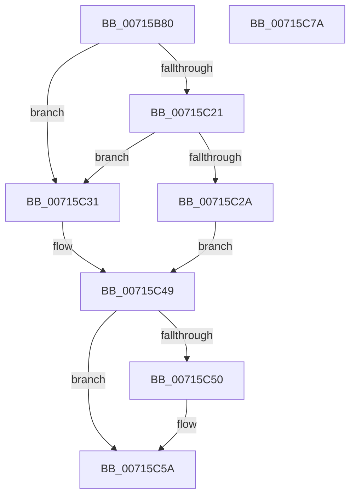

# FsRtlDedupChangeInit

- RVA: `0x00715B80`–`0x00715C7B` (길이 `251` bytes)
- VA: `0x0000000140715B80`
- 실행 섹션: `PAGE`
- PDB 이름 있음: `예`; PDB Function 태그: `아니요`
- unwind 정보 RVA: `0x000C613C`
- 디코드: `72`개 명령, `251/251` bytes 표시
- 미해석 바이트: `0` (있으면 어셈블리에 `.byte`로 보존)

> 이 문서는 커널 이미지의 기계어와 PDB 기호를 분석해 생성했습니다. 4번과 5번은 함수 원형과 자료형을 바이너리 사용 방식에서 추정한 C 해석이며 원본 소스 복구 결과는 아닙니다.

## 1. Dependencies

- 직접 호출 지점: **4**; 고유 호출 대상: **4**
- 직접 호출자로 확인된 함수: **0**
- RIP 상대 이미지 참조: **3**

### Outgoing calls
- `0x00715C14` → [FsRtlpDedupChangeQueryValueKey](FsRtlpDedupChangeQueryValueKey_function_00715E34.md) (function, `0x00715E34`)
- `0x00715C42` → [FsRtlpDedupChangeRegisterVolume](FsRtlpDedupChangeRegisterVolume_function_00715F70.md) (function, `0x00715F70`)
- `0x00715C55` → [ExFreePoolWithTag](../../poolcode/B8/ExFreePoolWithTag_function_00B82870.md) (function, `0x00B82870`)
- `0x00715C63` → [_security_check_cookie](../../text/6A/_security_check_cookie_function_006AC640.md) (function, `0x006AC640`)

### Direct callers
- 이 함수 시작 RVA로 연결되는 직접 call은 확인되지 않았습니다. 간접 호출은 완전히 역산할 수 없습니다.

### Static image references
- `0x00715B97` → RVA `0x00E0A740` (`.data`; read)
- `0x00715BD1` → RVA `0x00AFBF00` (` ?? ::NNGAKEGL::`string'`; read)
- `0x00715BE6` → RVA `0x00AFBEF0` (` ?? ::NNGAKEGL::`string'`; read)

## 2. Other-region calls and transfers

- 다른 실행 섹션으로 향하는 call: **2**
  - `0x00715C55` → [ExFreePoolWithTag](../../poolcode/B8/ExFreePoolWithTag_function_00B82870.md) (`PAGE` → `POOLCODE`)
  - `0x00715C63` → [_security_check_cookie](../../text/6A/_security_check_cookie_function_006AC640.md) (`PAGE` → `.text`)
- 별도 외부 분기/꼬리 이동을 확인하지 못했습니다.

## 3. Assembly (complete function range)

```asm
00715B80  40 55                           push rbp
00715B82  53                              push rbx
00715B83  56                              push rsi
00715B84  57                              push rdi
00715B85  41 54                           push r12
00715B87  41 56                           push r14
00715B89  41 57                           push r15
00715B8B  48 8D 6C 24 E1                  lea rbp, [rsp - 0x1f]
00715B90  48 81 EC D0 00 00 00            sub rsp, 0xd0
00715B97  48 8B 05 A2 4B 6F 00            mov rax, qword ptr [rip + 0x6f4ba2]
00715B9E  48 33 C4                        xor rax, rsp
00715BA1  48 89 45 0F                     mov qword ptr [rbp + 0xf], rax
00715BA5  4C 8B 65 7F                     mov r12, qword ptr [rbp + 0x7f]
00715BA9  33 C0                           xor eax, eax
00715BAB  83 65 A3 00                     and dword ptr [rbp - 0x5d], 0
00715BAF  41 8A F1                        mov sil, r9b
00715BB2  83 65 93 00                     and dword ptr [rbp - 0x6d], 0
00715BB6  4C 8D 4D 87                     lea r9, [rbp - 0x79]
00715BBA  48 89 01                        mov qword ptr [rcx], rax
00715BBD  4D 8B F8                        mov r15, r8
00715BC0  48 8D 45 AF                     lea rax, [rbp - 0x51]
00715BC4  C6 44 24 30 00                  mov byte ptr [rsp + 0x30], 0
00715BC9  48 89 45 87                     mov qword ptr [rbp - 0x79], rax
00715BCD  4C 8D 45 83                     lea r8, [rbp - 0x7d]
00715BD1  48 8D 05 28 63 3E 00            lea rax, [rip + 0x3e6328]
00715BD8  C7 45 83 5C 00 00 00            mov dword ptr [rbp - 0x7d], 0x5c
00715BDF  48 89 45 A7                     mov qword ptr [rbp - 0x59], rax
00715BE3  4C 8B F2                        mov r14, rdx
00715BE6  48 8D 05 03 63 3E 00            lea rax, [rip + 0x3e6303]
00715BED  C7 45 9F 7C 00 7E 00            mov dword ptr [rbp - 0x61], 0x7e007c
00715BF4  48 89 45 97                     mov qword ptr [rbp - 0x69], rax
00715BF8  48 8D 55 8F                     lea rdx, [rbp - 0x71]
00715BFC  48 8D 44 24 30                  lea rax, [rsp + 0x30]
00715C01  C7 45 8F 0E 00 10 00            mov dword ptr [rbp - 0x71], 0x10000e
00715C08  48 8B D9                        mov rbx, rcx
00715C0B  48 89 44 24 20                  mov qword ptr [rsp + 0x20], rax
00715C10  48 8D 4D 9F                     lea rcx, [rbp - 0x61]
00715C14  E8 1B 02 00 00                  call 0x140715e34
00715C19  48 8B 7D 87                     mov rdi, qword ptr [rbp - 0x79]
00715C1D  85 C0                           test eax, eax
00715C1F  78 10                           js 0x140715c31
00715C21  8B 47 08                        mov eax, dword ptr [rdi + 8]
00715C24  83 3C 38 00                     cmp dword ptr [rax + rdi], 0
00715C28  75 07                           jne 0x140715c31
00715C2A  BB 01 00 00 C0                  mov ebx, 0xc0000001
00715C2F  EB 18                           jmp 0x140715c49
00715C31  4D 8B CC                        mov r9, r12
00715C34  48 89 5C 24 20                  mov qword ptr [rsp + 0x20], rbx
00715C39  44 8A C6                        mov r8b, sil
00715C3C  49 8B D7                        mov rdx, r15
00715C3F  49 8B CE                        mov rcx, r14
00715C42  E8 29 03 00 00                  call 0x140715f70
00715C47  8B D8                           mov ebx, eax
00715C49  80 7C 24 30 00                  cmp byte ptr [rsp + 0x30], 0
00715C4E  74 0A                           je 0x140715c5a
00715C50  33 D2                           xor edx, edx
00715C52  48 8B CF                        mov rcx, rdi
00715C55  E8 16 CC 46 00                  call 0x140b82870
00715C5A  8B C3                           mov eax, ebx
00715C5C  48 8B 4D 0F                     mov rcx, qword ptr [rbp + 0xf]
00715C60  48 33 CC                        xor rcx, rsp
00715C63  E8 D8 69 F9 FF                  call 0x1406ac640
00715C68  48 81 C4 D0 00 00 00            add rsp, 0xd0
00715C6F  41 5F                           pop r15
00715C71  41 5E                           pop r14
00715C73  41 5C                           pop r12
00715C75  5F                              pop rdi
00715C76  5E                              pop rsi
00715C77  5B                              pop rbx
00715C78  5D                              pop rbp
00715C79  C3                              ret
00715C7A  CC                              int3
```

## 4. C-style interpretation (structured pseudocode)

```c
__int64 __fastcall FsRtlDedupChangeInit(__int64 a1, __int64 a2, __int64 a3, unsigned __int8 a4, __int64 a5)
{
    __int64 result;
    __int64 v_rsp;
    unsigned __int64 v_stack_m48;
    unsigned __int64 v_stack_m57;
    unsigned __int64 v_stack_mA8;
    unsigned __int64 v_stack_mB0;
    unsigned int v_stack_mB4;
    unsigned int v_stack_mB8;
    unsigned __int64 v_stack_mC0;
    unsigned int v_stack_mC4;
    unsigned __int64 v_stack_mC8;
    unsigned __int64 v_stack_mD0;
    unsigned __int64 v_stack_mD4;
    unsigned __int8 v_stack_mD8;
    unsigned __int64 v_stack_mE8;

    v_rsp = (v_rsp) - (208);
    result = (*(unsigned __int64 *)(v_rip + 7293858)) ^ (v_rsp);
    v_stack_m48 = result;
    result = 0;
    *(unsigned __int64 *)(a1) = 0;
    v_stack_mD8 = 0;
    v_stack_mD0 = v_stack_mA8;
    v_stack_mD4 = 92;
    v_stack_mB0 = v_rip + 4088616;
    v_stack_mB8 = 0x7E007CULL;
    v_stack_mC0 = v_rip + 4088579;
    v_stack_mC8 = 0x10000EULL;
    v_stack_mE8 = v_stack_mD8;
    result = FsRtlpDedupChangeQueryValueKey(v_stack_mB8, v_stack_mC8, v_stack_mD4, v_stack_mD0);
    if (sign_flag) goto loc_00715C31;
    if ((*(unsigned int *)((unsigned int)(*(unsigned int *)(v_stack_mD0 + 8)) + v_stack_mD0 * 1)) != 0) goto loc_00715C31;
    goto loc_00715C49;
loc_00715C31:
    v_stack_mE8 = (unsigned int)(0xC0000001ULL);
    result = FsRtlpDedupChangeRegisterVolume(a2, a3, a4, a5);
loc_00715C49:
    if (v_stack_mD8 != 0) {
        a2 = 0;
        a1 = v_stack_mD0;
        result = ExFreePoolWithTag(a1, a2, a4, a5);
    }
    a1 = (v_stack_m48) ^ (v_rsp);
    result = _security_check_cookie(a1, a2, a4, a5);
    v_rsp = (v_rsp) + (208);
    return result;
}
```

## 5. (Beta) C Style

```c
int64_t FsRtlDedupChangeInit(void *Arg1, int64_t Arg2, int64_t Arg3, uint8_t Arg4, int64_t Arg5)
{
    uint8_t *arg1 = (uint8_t *)Arg1;

    int64_t result;
    int64_t local_rsp;
    uint64_t v_stack_m48;
    uint64_t v_stack_m57;
    uint64_t v_stack_mA8;
    uint64_t v_stack_mB0;
    uint32_t v_stack_mB4;
    uint32_t v_stack_mB8;
    uint64_t v_stack_mC0;
    uint32_t v_stack_mC4;
    uint64_t v_stack_mC8;
    uint64_t v_stack_mD0;
    uint64_t v_stack_mD4;
    uint8_t v_stack_mD8;
    uint64_t v_stack_mE8;

    local_rsp = (local_rsp) - (208);
    result = (*(uint64_t *)(v_rip + 0x6F4BA2)) ^ (local_rsp);
    v_stack_m48 = result;
    result = 0;
    *(uint64_t *)(arg1) = 0;
    v_stack_mD8 = 0;
    v_stack_mD0 = v_stack_mA8;
    v_stack_mD4 = 92;
    v_stack_mB0 = v_rip + 4088616;
    v_stack_mB8 = 0x7E007CULL;
    v_stack_mC0 = v_rip + 4088579;
    v_stack_mC8 = 0x10000EULL;
    v_stack_mE8 = v_stack_mD8;
    result = FsRtlpDedupChangeQueryValueKey(v_stack_mB8, v_stack_mC8, v_stack_mD4, v_stack_mD0);
    if (sign_flag) goto loc_00715C31;
    if ((*(uint32_t *)((uint32_t)(*(uint32_t *)(v_stack_mD0 + 0x8)) + v_stack_mD0 * 1)) != 0) goto loc_00715C31;
    goto loc_00715C49;
loc_00715C31:
    v_stack_mE8 = (uint32_t)(0xC0000001ULL);
    result = FsRtlpDedupChangeRegisterVolume(Arg2, Arg3, Arg4, Arg5);
loc_00715C49:
    if (v_stack_mD8 != 0) {
        Arg2 = 0;
        Arg1 = v_stack_mD0;
        result = ExFreePoolWithTag(Arg1, Arg2, Arg4, Arg5);
    }
    Arg1 = (v_stack_m48) ^ (local_rsp);
    result = _security_check_cookie(Arg1, Arg2, Arg4, Arg5);
    local_rsp = (local_rsp) + (208);
    return result;
}
```

### 관측된 메모리 오프셋

구조체 형식이 확인되지 않은 접근은 인자 기준의 오프셋으로만 기록했습니다.

| 기준 인자 | 오프셋 표현 | 폭 (bit) | 접근 |
|---|---:|---:|---|
| `Arg1` | `+ 0x0` | `64` | `W` |

## 6. Execution-region graph

[열기: 2D/3D 그래프와 함수 탐색 컨트롤 패널](../../../control-panel.html?section=page&rva=0x00715B80&view=graph)

- 2D 그래프는 위에서 아래로 흐르고, 3D 그래프는 빈 공간을 드래그해 회전합니다. Shift+드래그는 이동, 휠은 확대·축소, 함수 노드 선택은 대상 보고서 이동입니다.

### Static fallback


