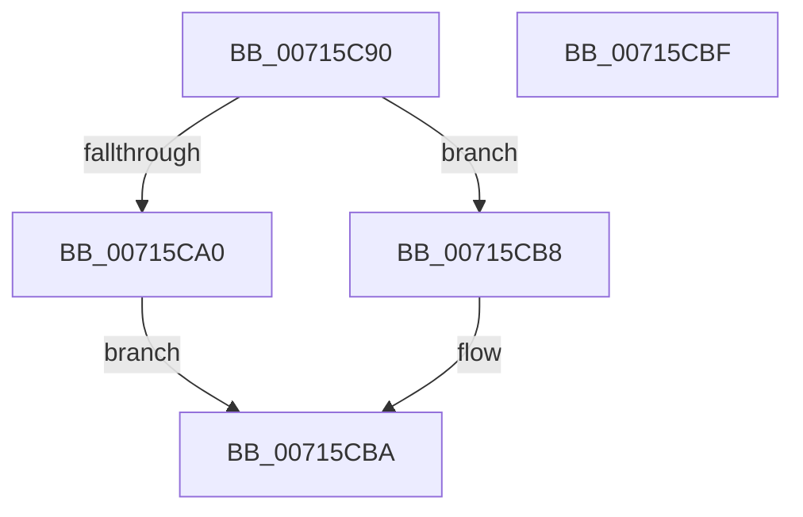

# FsRtlDedupChangeLogOverwriteOrFree

- RVA: `0x00715C90`–`0x00715CC0` (길이 `48` bytes)
- VA: `0x0000000140715C90`
- 실행 섹션: `PAGE`
- PDB 이름 있음: `예`; PDB Function 태그: `아니요`
- unwind 정보 RVA: `0x0005D2F4`
- 디코드: `15`개 명령, `48/48` bytes 표시
- 미해석 바이트: `0` (있으면 어셈블리에 `.byte`로 보존)

> 이 문서는 커널 이미지의 기계어와 PDB 기호를 분석해 생성했습니다. 4번과 5번은 함수 원형과 자료형을 바이너리 사용 방식에서 추정한 C 해석이며 원본 소스 복구 결과는 아닙니다.

## 1. Dependencies

- 직접 호출 지점: **1**; 고유 호출 대상: **1**
- 직접 호출자로 확인된 함수: **0**
- RIP 상대 이미지 참조: **1**

### Outgoing calls
- `0x00715CB1` → [McTemplateK0xxq_EtwWriteTransfer](../../text/58/McTemplateK0xxq_EtwWriteTransfer_function_00582E54.md) (function, `0x00582E54`)

### Direct callers
- 이 함수 시작 RVA로 연결되는 직접 call은 확인되지 않았습니다. 간접 호출은 완전히 역산할 수 없습니다.

### Static image references
- `0x00715C94` → RVA `0x00F8EF98` (`.data`; read)

## 2. Other-region calls and transfers

- 다른 실행 섹션으로 향하는 call: **1**
  - `0x00715CB1` → [McTemplateK0xxq_EtwWriteTransfer](../../text/58/McTemplateK0xxq_EtwWriteTransfer_function_00582E54.md) (`PAGE` → `.text`)
- 별도 외부 분기/꼬리 이동을 확인하지 못했습니다.

## 3. Assembly (complete function range)

```asm
00715C90  48 83 EC 38                     sub rsp, 0x38
00715C94  F6 05 FD 92 87 00 04            test byte ptr [rip + 0x8792fd], 4
00715C9B  4D 8B D1                        mov r10, r9
00715C9E  74 18                           je 0x140715cb8
00715CA0  8B 01                           mov eax, dword ptr [rcx]
00715CA2  4C 8B CA                        mov r9, rdx
00715CA5  89 44 24 28                     mov dword ptr [rsp + 0x28], eax
00715CA9  4C 89 44 24 20                  mov qword ptr [rsp + 0x20], r8
00715CAE  4D 8B C2                        mov r8, r10
00715CB1  E8 9E D1 E6 FF                  call 0x140582e54
00715CB6  EB 02                           jmp 0x140715cba
00715CB8  33 C0                           xor eax, eax
00715CBA  48 83 C4 38                     add rsp, 0x38
00715CBE  C3                              ret
00715CBF  CC                              int3
```

## 4. C-style interpretation (structured pseudocode)

```c
__int64 __fastcall FsRtlDedupChangeLogOverwriteOrFree(__int64 a1, __int64 a2, __int64 a3, __int64 a4)
{
    __int64 result;
    __int64 v_rsp;
    unsigned int v_stack_m10;
    unsigned __int64 v_stack_m18;

    v_rsp = (v_rsp) - (56);
    if (((*(unsigned __int8 *)(v_rip + 8884989)) & (4)) == 0) goto loc_00715CB8;
    v_stack_m10 = (unsigned int)((unsigned int)(*(unsigned int *)(a1)));
    v_stack_m18 = a3;
    result = McTemplateK0xxq_EtwWriteTransfer(a1, a2, a4, a2);
    goto loc_00715CBA;
loc_00715CB8:
    result = 0;
loc_00715CBA:
    v_rsp = (v_rsp) + (56);
    return result;
}
```

## 5. (Beta) C Style

```c
int64_t FsRtlDedupChangeLogOverwriteOrFree(void *Arg1, int64_t Arg2, int64_t Arg3, int64_t Arg4)
{
    uint8_t *arg1 = (uint8_t *)Arg1;

    int64_t result;
    int64_t local_rsp;
    uint32_t v_stack_m10;
    uint64_t v_stack_m18;

    local_rsp = (local_rsp) - (56);
    if (((*(uint8_t *)(v_rip + 0x8792FD)) & (4)) == 0) goto loc_00715CB8;
    v_stack_m10 = (uint32_t)((uint32_t)(*(uint32_t *)(arg1)));
    v_stack_m18 = Arg3;
    result = McTemplateK0xxq_EtwWriteTransfer(Arg1, Arg2, Arg4, Arg2);
    goto loc_00715CBA;
loc_00715CB8:
    result = 0;
loc_00715CBA:
    local_rsp = (local_rsp) + (56);
    return result;
}
```

### 관측된 메모리 오프셋

구조체 형식이 확인되지 않은 접근은 인자 기준의 오프셋으로만 기록했습니다.

| 기준 인자 | 오프셋 표현 | 폭 (bit) | 접근 |
|---|---:|---:|---|
| `Arg1` | `+ 0x0` | `32` | `R` |

## 6. Execution-region graph

[열기: 2D/3D 그래프와 함수 탐색 컨트롤 패널](../../../control-panel.html?section=page&rva=0x00715C90&view=graph)

- 2D 그래프는 위에서 아래로 흐르고, 3D 그래프는 빈 공간을 드래그해 회전합니다. Shift+드래그는 이동, 휠은 확대·축소, 함수 노드 선택은 대상 보고서 이동입니다.

### Static fallback


