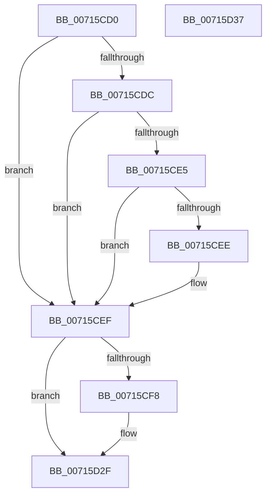

# FsRtlDedupChangeLogWrite

- RVA: `0x00715CD0`–`0x00715D38` (길이 `104` bytes)
- VA: `0x0000000140715CD0`
- 실행 섹션: `PAGE`
- PDB 이름 있음: `예`; PDB Function 태그: `아니요`
- unwind 정보 RVA: `0x00063458`
- 디코드: `27`개 명령, `104/104` bytes 표시
- 미해석 바이트: `0` (있으면 어셈블리에 `.byte`로 보존)

> 이 문서는 커널 이미지의 기계어와 PDB 기호를 분석해 생성했습니다. 4번과 5번은 함수 원형과 자료형을 바이너리 사용 방식에서 추정한 C 해석이며 원본 소스 복구 결과는 아닙니다.

## 1. Dependencies

- 직접 호출 지점: **1**; 고유 호출 대상: **1**
- 직접 호출자로 확인된 함수: **0**
- RIP 상대 이미지 참조: **5**

### Outgoing calls
- `0x00715D27` → [McTemplateK0xxxqq_EtwWriteTransfer](../../text/58/McTemplateK0xxxqq_EtwWriteTransfer_function_00582EDC.md) (function, `0x00582EDC`)

### Direct callers
- 이 함수 시작 RVA로 연결되는 직접 call은 확인되지 않았습니다. 간접 호출은 완전히 역산할 수 없습니다.

### Static image references
- `0x00715CDC` → RVA `0x00F475F8` (`.data`; read)
- `0x00715CE5` → RVA `0x00F475DC` (`.data`; read)
- `0x00715CEF` → RVA `0x00F8EF98` (`.data`; read)
- `0x00715CFA` → RVA `0x00E06C90` (`.data`; read)
- `0x00715D1B` → RVA `0x00026400` (`.rdata`; read)

## 2. Other-region calls and transfers

- 다른 실행 섹션으로 향하는 call: **1**
  - `0x00715D27` → [McTemplateK0xxxqq_EtwWriteTransfer](../../text/58/McTemplateK0xxxqq_EtwWriteTransfer_function_00582EDC.md) (`PAGE` → `.text`)
- 별도 외부 분기/꼬리 이동을 확인하지 못했습니다.

## 3. Assembly (complete function range)

```asm
00715CD0  48 83 EC 48                     sub rsp, 0x48
00715CD4  45 33 D2                        xor r10d, r10d
00715CD7  44 39 11                        cmp dword ptr [rcx], r10d
00715CDA  75 13                           jne 0x140715cef
00715CDC  44 38 15 15 19 83 00            cmp byte ptr [rip + 0x831915], r10b
00715CE3  74 0A                           je 0x140715cef
00715CE5  44 38 15 F0 18 83 00            cmp byte ptr [rip + 0x8318f0], r10b
00715CEC  75 01                           jne 0x140715cef
00715CEE  CC                              int3
00715CEF  F6 05 A2 92 87 00 02            test byte ptr [rip + 0x8792a2], 2
00715CF6  74 37                           je 0x140715d2f
00715CF8  8B 01                           mov eax, dword ptr [rcx]
00715CFA  48 8D 0D 8F 0F 6F 00            lea rcx, [rip + 0x6f0f8f]
00715D01  89 44 24 38                     mov dword ptr [rsp + 0x38], eax
00715D05  49 8B 41 08                     mov rax, qword ptr [r9 + 8]
00715D09  4D 8B 09                        mov r9, qword ptr [r9]
00715D0C  44 89 44 24 30                  mov dword ptr [rsp + 0x30], r8d
00715D11  4C 8B 44 24 70                  mov r8, qword ptr [rsp + 0x70]
00715D16  48 89 54 24 28                  mov qword ptr [rsp + 0x28], rdx
00715D1B  48 8D 15 DE 06 91 FF            lea rdx, [rip - 0x6ef922]
00715D22  48 89 44 24 20                  mov qword ptr [rsp + 0x20], rax
00715D27  E8 B0 D1 E6 FF                  call 0x140582edc
00715D2C  44 8B D0                        mov r10d, eax
00715D2F  41 8B C2                        mov eax, r10d
00715D32  48 83 C4 48                     add rsp, 0x48
00715D36  C3                              ret
00715D37  CC                              int3
```

## 4. C-style interpretation (structured pseudocode)

```c
__int64 __fastcall FsRtlDedupChangeLogWrite(__int64 a1, __int64 a2, int a3, __int64 a4, __int64 a5)
{
    __int64 result;
    __int64 v_r10;
    __int64 v_rsp;
    unsigned int v_stack_m10;
    unsigned int v_stack_m18;
    unsigned __int64 v_stack_m20;
    unsigned __int64 v_stack_m28;

    v_rsp = (v_rsp) - (72);
    v_r10 = 0;
    if ((*(unsigned int *)(a1)) != 0) goto loc_00715CEF;
    if ((*(unsigned __int8 *)(v_rip + 8591637)) == 0) goto loc_00715CEF;
    if ((*(unsigned __int8 *)(v_rip + 8591600)) == 0) {
    }
    if (((*(unsigned __int8 *)(v_rip + 8884898)) & (2)) != 0) {
        result = *(unsigned int *)(a1);
        a1 = v_rip + 7278479;
        v_stack_m10 = (unsigned int)(result);
        result = *(unsigned __int64 *)(a4 + 8);
        a4 = *(unsigned __int64 *)(a4);
        v_stack_m18 = a3;
        a3 = a5;
        v_stack_m20 = a2;
        a2 = v_rip - 7272738;
        v_stack_m28 = result;
        result = McTemplateK0xxxqq_EtwWriteTransfer(a1, a2, a3, a4);
        v_r10 = (unsigned int)(result);
    }
    v_rsp = (v_rsp) + (72);
    return (unsigned int)((unsigned int)(v_r10));
}
```

## 5. (Beta) C Style

```c
int64_t FsRtlDedupChangeLogWrite(void *Arg1, int64_t Arg2, int32_t Arg3, void *Arg4, int64_t Arg5)
{
    uint8_t *arg1 = (uint8_t *)Arg1;
    uint8_t *arg4 = (uint8_t *)Arg4;

    int64_t result;
    int64_t local_r10;
    int64_t local_rsp;
    uint32_t v_stack_m10;
    uint32_t v_stack_m18;
    uint64_t v_stack_m20;
    uint64_t v_stack_m28;

    local_rsp = (local_rsp) - (72);
    local_r10 = 0;
    if ((*(uint32_t *)(arg1)) != 0) goto loc_00715CEF;
    if ((*(uint8_t *)(v_rip + 0x831915)) == 0) goto loc_00715CEF;
    if ((*(uint8_t *)(v_rip + 0x8318F0)) == 0) {
    }
    if (((*(uint8_t *)(v_rip + 0x8792A2)) & (2)) != 0) {
        result = *(uint32_t *)(arg1);
        Arg1 = v_rip + 7278479;
        v_stack_m10 = (uint32_t)(result);
        result = *(uint64_t *)(arg4 + 0x8);
        Arg4 = *(uint64_t *)(arg4);
        v_stack_m18 = Arg3;
        Arg3 = Arg5;
        v_stack_m20 = Arg2;
        Arg2 = v_rip - 7272738;
        v_stack_m28 = result;
        result = McTemplateK0xxxqq_EtwWriteTransfer(Arg1, Arg2, Arg3, Arg4);
        local_r10 = (uint32_t)(result);
    }
    local_rsp = (local_rsp) + (72);
    return (uint32_t)((uint32_t)(local_r10));
}
```

### 관측된 메모리 오프셋

구조체 형식이 확인되지 않은 접근은 인자 기준의 오프셋으로만 기록했습니다.

| 기준 인자 | 오프셋 표현 | 폭 (bit) | 접근 |
|---|---:|---:|---|
| `Arg1` | `+ 0x0` | `32` | `R` |
| `Arg4` | `+ 0x0` | `64` | `R` |
| `Arg4` | `+ 0x8` | `64` | `R` |

## 6. Execution-region graph

[열기: 2D/3D 그래프와 함수 탐색 컨트롤 패널](../../../control-panel.html?section=page&rva=0x00715CD0&view=graph)

- 2D 그래프는 위에서 아래로 흐르고, 3D 그래프는 빈 공간을 드래그해 회전합니다. Shift+드래그는 이동, 휠은 확대·축소, 함수 노드 선택은 대상 보고서 이동입니다.

### Static fallback


