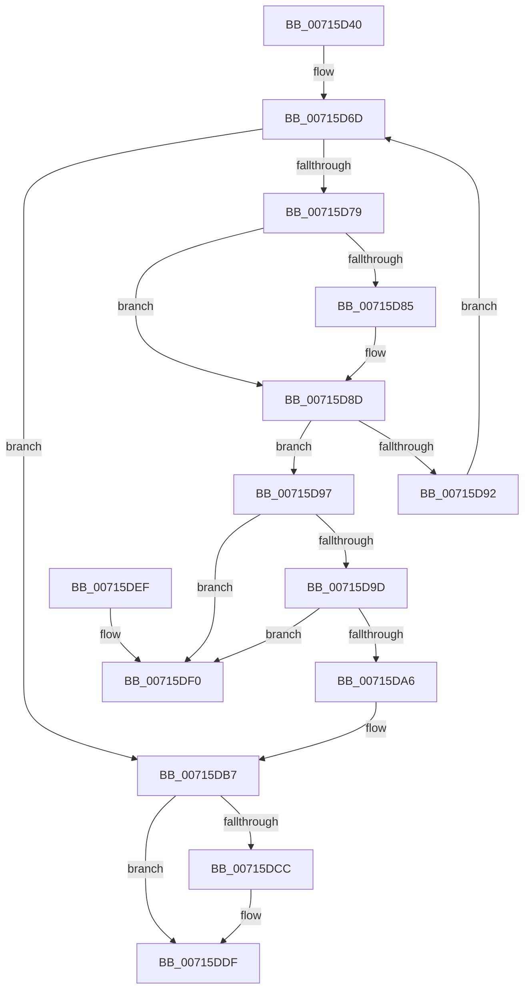

# FsRtlDedupChangeUninit

- RVA: `0x00715D40`–`0x00715DF7` (길이 `183` bytes)
- VA: `0x0000000140715D40`
- 실행 섹션: `PAGE`
- PDB 이름 있음: `예`; PDB Function 태그: `아니요`
- unwind 정보 RVA: `0x00069D68`
- 디코드: `50`개 명령, `183/183` bytes 표시
- 미해석 바이트: `0` (있으면 어셈블리에 `.byte`로 보존)

> 이 문서는 커널 이미지의 기계어와 PDB 기호를 분석해 생성했습니다. 4번과 5번은 함수 원형과 자료형을 바이너리 사용 방식에서 추정한 C 해석이며 원본 소스 복구 결과는 아닙니다.

## 1. Dependencies

- 직접 호출 지점: **4**; 고유 호출 대상: **4**
- 직접 호출자로 확인된 함수: **0**
- RIP 상대 이미지 참조: **3**

### Outgoing calls
- `0x00715D61` → [ExAcquireResourceExclusiveLite](../../text/21/ExAcquireResourceExclusiveLite_function_00214E20.md) (function, `0x00214E20`)
- `0x00715DB2` → [ExFreePoolWithTag](../../poolcode/B8/ExFreePoolWithTag_function_00B82870.md) (function, `0x00B82870`)
- `0x00715DBE` → [ExReleaseResourceLite](../../text/25/ExReleaseResourceLite_function_0025FA10.md) (function, `0x0025FA10`)
- `0x00715DDA` → [McTemplateK0jjq_EtwWriteTransfer](../../text/58/McTemplateK0jjq_EtwWriteTransfer_function_00582D3C.md) (function, `0x00582D3C`)

### Direct callers
- 이 함수 시작 RVA로 연결되는 직접 call은 확인되지 않았습니다. 간접 호출은 완전히 역산할 수 없습니다.

### Static image references
- `0x00715D57` → RVA `0x00F8EFB0` (`.data`; read)
- `0x00715D66` → RVA `0x00F8EFA0` (`.data`; read)
- `0x00715DC3` → RVA `0x00F8EF98` (`.data`; read)

## 2. Other-region calls and transfers

- 다른 실행 섹션으로 향하는 call: **4**
  - `0x00715D61` → [ExAcquireResourceExclusiveLite](../../text/21/ExAcquireResourceExclusiveLite_function_00214E20.md) (`PAGE` → `.text`)
  - `0x00715DB2` → [ExFreePoolWithTag](../../poolcode/B8/ExFreePoolWithTag_function_00B82870.md) (`PAGE` → `POOLCODE`)
  - `0x00715DBE` → [ExReleaseResourceLite](../../text/25/ExReleaseResourceLite_function_0025FA10.md) (`PAGE` → `.text`)
  - `0x00715DDA` → [McTemplateK0jjq_EtwWriteTransfer](../../text/58/McTemplateK0jjq_EtwWriteTransfer_function_00582D3C.md) (`PAGE` → `.text`)
- 별도 외부 분기/꼬리 이동을 확인하지 못했습니다.

## 3. Assembly (complete function range)

```asm
00715D40  48 89 5C 24 08                  mov qword ptr [rsp + 8], rbx
00715D45  48 89 74 24 10                  mov qword ptr [rsp + 0x10], rsi
00715D4A  57                              push rdi
00715D4B  48 83 EC 30                     sub rsp, 0x30
00715D4F  48 8B DA                        mov rbx, rdx
00715D52  48 8B F1                        mov rsi, rcx
00715D55  B2 01                           mov dl, 1
00715D57  48 8D 0D 52 92 87 00            lea rcx, [rip + 0x879252]
00715D5E  49 8B F8                        mov rdi, r8
00715D61  E8 BA F0 AF FF                  call 0x140214e20
00715D66  48 8B 0D 33 92 87 00            mov rcx, qword ptr [rip + 0x879233]
00715D6D  48 8D 05 2C 92 87 00            lea rax, [rip + 0x87922c]
00715D74  48 3B C8                        cmp rcx, rax
00715D77  74 3E                           je 0x140715db7
00715D79  48 8B 51 10                     mov rdx, qword ptr [rcx + 0x10]
00715D7D  4C 8B 01                        mov r8, qword ptr [rcx]
00715D80  48 2B 13                        sub rdx, qword ptr [rbx]
00715D83  75 08                           jne 0x140715d8d
00715D85  48 8B 51 18                     mov rdx, qword ptr [rcx + 0x18]
00715D89  48 2B 53 08                     sub rdx, qword ptr [rbx + 8]
00715D8D  48 85 D2                        test rdx, rdx
00715D90  74 05                           je 0x140715d97
00715D92  49 8B C8                        mov rcx, r8
00715D95  EB D6                           jmp 0x140715d6d
00715D97  49 39 48 08                     cmp qword ptr [r8 + 8], rcx
00715D9B  75 53                           jne 0x140715df0
00715D9D  48 8B 41 08                     mov rax, qword ptr [rcx + 8]
00715DA1  48 39 08                        cmp qword ptr [rax], rcx
00715DA4  75 4A                           jne 0x140715df0
00715DA6  4C 89 00                        mov qword ptr [rax], r8
00715DA9  BA 44 65 43 68                  mov edx, 0x68436544
00715DAE  49 89 40 08                     mov qword ptr [r8 + 8], rax
00715DB2  E8 B9 CA 46 00                  call 0x140b82870
00715DB7  48 8D 0D F2 91 87 00            lea rcx, [rip + 0x8791f2]
00715DBE  E8 4D 9C B4 FF                  call 0x14025fa10
00715DC3  F6 05 CE 91 87 00 08            test byte ptr [rip + 0x8791ce], 8
00715DCA  74 13                           je 0x140715ddf
00715DCC  8B 06                           mov eax, dword ptr [rsi]
00715DCE  4C 8B CB                        mov r9, rbx
00715DD1  89 44 24 28                     mov dword ptr [rsp + 0x28], eax
00715DD5  48 89 7C 24 20                  mov qword ptr [rsp + 0x20], rdi
00715DDA  E8 5D CF E6 FF                  call 0x140582d3c
00715DDF  48 8B 5C 24 40                  mov rbx, qword ptr [rsp + 0x40]
00715DE4  48 8B 74 24 48                  mov rsi, qword ptr [rsp + 0x48]
00715DE9  48 83 C4 30                     add rsp, 0x30
00715DED  5F                              pop rdi
00715DEE  C3                              ret
00715DEF  CC                              int3
00715DF0  B9 03 00 00 00                  mov ecx, 3
00715DF5  CD 29                           int 0x29
```

## 4. C-style interpretation (structured pseudocode)

```c
__int64 __fastcall FsRtlDedupChangeUninit(__int64 a1, __int64 a2, __int64 a3)
{
    __int64 result;
    __int64 v_rsp;
    unsigned int v_stack_m10;
    unsigned __int64 v_stack_m18;
    unsigned __int64 v_stack_p10;
    unsigned __int64 v_stack_p8;

    v_stack_p8 = v_rbx;
    v_stack_p10 = v_rsi;
    v_rsp = (v_rsp) - (48);
    result = ExAcquireResourceExclusiveLite(v_rip + 8884818, 1, a3, a4);
loc_00715D6D:
    if ((*(unsigned __int64 *)(v_rip + 8884787)) == (v_rip + 8884780)) goto loc_00715DB7;
    a2 = (*(unsigned __int64 *)(*(unsigned __int64 *)(v_rip + 8884787) + 16)) - (*(unsigned __int64 *)(a2));
    if (!(condition_is_not_equal)) {
        a2 = *(unsigned __int64 *)(*(unsigned __int64 *)(v_rip + 8884787) + 24);
        a2 = (a2) - (*(unsigned __int64 *)(a2 + 8));
    }
    if (a2 == 0) goto loc_00715D97;
    goto loc_00715D6D;
loc_00715D97:
    if ((*(unsigned __int64 *)(*(unsigned __int64 *)(*(unsigned __int64 *)(v_rip + 8884787)) + 8)) != (*(unsigned __int64 *)(*(unsigned __int64 *)(v_rip + 8884787)))) goto loc_00715DF0;
    if ((*(unsigned __int64 *)(*(unsigned __int64 *)(*(unsigned __int64 *)(*(unsigned __int64 *)(v_rip + 8884787)) + 8))) != (*(unsigned __int64 *)(*(unsigned __int64 *)(v_rip + 8884787)))) goto loc_00715DF0;
    *(unsigned __int64 *)(*(unsigned __int64 *)(*(unsigned __int64 *)(*(unsigned __int64 *)(v_rip + 8884787)) + 8)) = *(unsigned __int64 *)(*(unsigned __int64 *)(v_rip + 8884787));
    *(unsigned __int64 *)(*(unsigned __int64 *)(*(unsigned __int64 *)(v_rip + 8884787)) + 8) = *(unsigned __int64 *)(*(unsigned __int64 *)(*(unsigned __int64 *)(v_rip + 8884787)) + 8);
    result = ExFreePoolWithTag(*(unsigned __int64 *)(*(unsigned __int64 *)(v_rip + 8884787)), (unsigned int)(0x68436544ULL), *(unsigned __int64 *)(*(unsigned __int64 *)(v_rip + 8884787)), a4);
loc_00715DB7:
    result = ExReleaseResourceLite(v_rip + 8884722, (unsigned int)(0x68436544ULL), *(unsigned __int64 *)(*(unsigned __int64 *)(v_rip + 8884787)), a4);
    if (((*(unsigned __int8 *)(v_rip + 8884686)) & (8)) != 0) {
        result = *(unsigned int *)(a1);
        a4 = a2;
        v_stack_m10 = (unsigned int)(result);
        v_stack_m18 = a3;
        result = McTemplateK0jjq_EtwWriteTransfer(v_rip + 8884722, (unsigned int)(0x68436544ULL), *(unsigned __int64 *)(*(unsigned __int64 *)(v_rip + 8884787)), a4);
    }
    v_rsp = (v_rsp) + (48);
    return result;
loc_00715DF0:
    return result;
}
```

## 5. (Beta) C Style

```c
int64_t FsRtlDedupChangeUninit(void *Arg1, void *Arg2, int64_t Arg3)
{
    uint8_t *arg1 = (uint8_t *)Arg1;
    uint8_t *arg2 = (uint8_t *)Arg2;

    int64_t result;
    int64_t local_rsp;
    uint32_t v_stack_m10;
    uint64_t v_stack_m18;
    uint64_t v_stack_p10;
    uint64_t v_stack_p8;

    v_stack_p8 = local_rbx;
    v_stack_p10 = local_rsi;
    local_rsp = (local_rsp) - (48);
    result = ExAcquireResourceExclusiveLite(v_rip + 8884818, 1, Arg3, a4);
loc_00715D6D:
    if ((*(uint64_t *)(v_rip + 0x879233)) == (v_rip + 8884780)) goto loc_00715DB7;
    Arg2 = (*(uint64_t *)(*(uint64_t *)(v_rip + 0x879233) + 0x10)) - (*(uint64_t *)(arg2));
    if (!(condition_is_not_equal)) {
        Arg2 = *(uint64_t *)(*(uint64_t *)(v_rip + 0x879233) + 0x18);
        Arg2 = (Arg2) - (*(uint64_t *)(arg2 + 0x8));
    }
    if (Arg2 == NULL) goto loc_00715D97;
    goto loc_00715D6D;
loc_00715D97:
    if ((*(uint64_t *)(*(uint64_t *)(*(uint64_t *)(v_rip + 0x879233)) + 0x8)) != (*(uint64_t *)(*(uint64_t *)(v_rip + 0x879233)))) goto loc_00715DF0;
    if ((*(uint64_t *)(*(uint64_t *)(*(uint64_t *)(*(uint64_t *)(v_rip + 0x879233)) + 0x8))) != (*(uint64_t *)(*(uint64_t *)(v_rip + 0x879233)))) goto loc_00715DF0;
    *(uint64_t *)(*(uint64_t *)(*(uint64_t *)(*(uint64_t *)(v_rip + 0x879233)) + 0x8)) = *(uint64_t *)(*(uint64_t *)(v_rip + 0x879233));
    *(uint64_t *)(*(uint64_t *)(*(uint64_t *)(v_rip + 0x879233)) + 0x8) = *(uint64_t *)(*(uint64_t *)(*(uint64_t *)(v_rip + 0x879233)) + 0x8);
    result = ExFreePoolWithTag(*(uint64_t *)(*(uint64_t *)(v_rip + 0x879233)), (uint32_t)(0x68436544ULL), *(uint64_t *)(*(uint64_t *)(v_rip + 0x879233)), a4);
loc_00715DB7:
    result = ExReleaseResourceLite(v_rip + 8884722, (uint32_t)(0x68436544ULL), *(uint64_t *)(*(uint64_t *)(v_rip + 0x879233)), a4);
    if (((*(uint8_t *)(v_rip + 0x8791CE)) & (8)) != 0) {
        result = *(uint32_t *)(arg1);
        a4 = Arg2;
        v_stack_m10 = (uint32_t)(result);
        v_stack_m18 = Arg3;
        result = McTemplateK0jjq_EtwWriteTransfer(v_rip + 8884722, (uint32_t)(0x68436544ULL), *(uint64_t *)(*(uint64_t *)(v_rip + 0x879233)), a4);
    }
    local_rsp = (local_rsp) + (48);
    return result;
loc_00715DF0:
    return result;
}
```

### 관측된 메모리 오프셋

구조체 형식이 확인되지 않은 접근은 인자 기준의 오프셋으로만 기록했습니다.

| 기준 인자 | 오프셋 표현 | 폭 (bit) | 접근 |
|---|---:|---:|---|
| `Arg1` | `+ 0x0` | `32` | `R` |
| `Arg2` | `+ 0x0` | `64` | `R` |
| `Arg2` | `+ 0x8` | `64` | `R` |

## 6. Execution-region graph

[열기: 2D/3D 그래프와 함수 탐색 컨트롤 패널](../../../control-panel.html?section=page&rva=0x00715D40&view=graph)

- 2D 그래프는 위에서 아래로 흐르고, 3D 그래프는 빈 공간을 드래그해 회전합니다. Shift+드래그는 이동, 휠은 확대·축소, 함수 노드 선택은 대상 보고서 이동입니다.

### Static fallback


