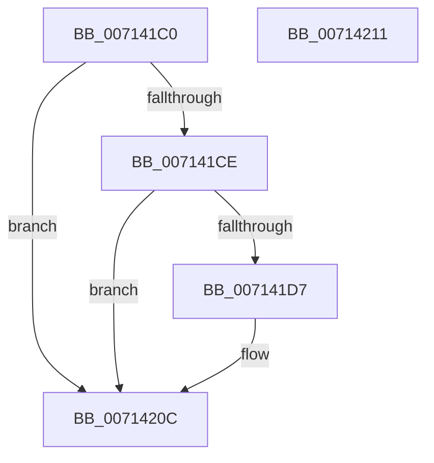

# FsRtlDeregisterUncProvider

- RVA: `0x007141C0`–`0x00714212` (길이 `82` bytes)
- VA: `0x00000001407141C0`
- 실행 섹션: `PAGE`
- PDB 이름 있음: `예`; PDB Function 태그: `아니요`
- unwind 정보 RVA: `0x0005D2F4`
- 디코드: `22`개 명령, `82/82` bytes 표시
- 미해석 바이트: `0` (있으면 어셈블리에 `.byte`로 보존)

> 이 문서는 커널 이미지의 기계어와 PDB 기호를 분석해 생성했습니다. 4번과 5번은 함수 원형과 자료형을 바이너리 사용 방식에서 추정한 C 해석이며 원본 소스 복구 결과는 아닙니다.

## 1. Dependencies

- 직접 호출 지점: **3**; 고유 호출 대상: **3**
- 직접 호출자로 확인된 함수: **0**
- RIP 상대 이미지 참조: **2**

### Outgoing calls
- `0x007141CE` → [ZwClose](../../text/6A/ZwClose_function_006AD2B0.md) (function, `0x006AD2B0`)
- `0x007141EC` → [KeWaitForSingleObject](../../text/20/KeWaitForSingleObject_function_0020E6B0.md) (function, `0x0020E6B0`)
- `0x00714207` → [KeReleaseSemaphore](../../text/39/KeReleaseSemaphore_function_00397080.md) (function, `0x00397080`)

### Direct callers
- 이 함수 시작 RVA로 연결되는 직접 call은 확인되지 않았습니다. 간접 호출은 완전히 역산할 수 없습니다.

### Static image references
- `0x007141DD` → RVA `0x00F8F080` (`.data`; read)
- `0x007141F1` → RVA `0x00FD81A8` (`PAGEDATA`; read/write)

## 2. Other-region calls and transfers

- 다른 실행 섹션으로 향하는 call: **3**
  - `0x007141CE` → [ZwClose](../../text/6A/ZwClose_function_006AD2B0.md) (`PAGE` → `.text`)
  - `0x007141EC` → [KeWaitForSingleObject](../../text/20/KeWaitForSingleObject_function_0020E6B0.md) (`PAGE` → `.text`)
  - `0x00714207` → [KeReleaseSemaphore](../../text/39/KeReleaseSemaphore_function_00397080.md) (`PAGE` → `.text`)
- 별도 외부 분기/꼬리 이동을 확인하지 못했습니다.

## 3. Assembly (complete function range)

```asm
007141C0  48 83 EC 38                     sub rsp, 0x38
007141C4  48 8D 41 FF                     lea rax, [rcx - 1]
007141C8  48 83 F8 FD                     cmp rax, -3
007141CC  77 3E                           ja 0x14071420c
007141CE  E8 DD 90 F9 FF                  call 0x1406ad2b0
007141D3  85 C0                           test eax, eax
007141D5  78 35                           js 0x14071420c
007141D7  48 83 64 24 20 00               and qword ptr [rsp + 0x20], 0
007141DD  48 8D 0D 9C AE 87 00            lea rcx, [rip + 0x87ae9c]
007141E4  45 33 C9                        xor r9d, r9d
007141E7  45 33 C0                        xor r8d, r8d
007141EA  33 D2                           xor edx, edx
007141EC  E8 BF A4 AF FF                  call 0x14020e6b0
007141F1  FF 0D B1 3F 8C 00               dec dword ptr [rip + 0x8c3fb1]
007141F7  48 8D 0D 82 AE 87 00            lea rcx, [rip + 0x87ae82]
007141FE  45 33 C9                        xor r9d, r9d
00714201  33 D2                           xor edx, edx
00714203  45 8D 41 01                     lea r8d, [r9 + 1]
00714207  E8 74 2E C8 FF                  call 0x140397080
0071420C  48 83 C4 38                     add rsp, 0x38
00714210  C3                              ret
00714211  CC                              int3
```

## 4. C-style interpretation (structured pseudocode)

```c
__int64 __fastcall FsRtlDeregisterUncProvider(__int64 a1, int a2, int a3, int a4)
{
    __int64 result;
    __int64 v_rsp;
    unsigned __int64 v_stack_m18;

    v_rsp = (v_rsp) - (56);
    if ((a1 - 1) > -3) goto loc_0071420C;
    result = ZwClose(a1, a2, a3, a4);
    if (!(sign_flag)) {
        a1 = v_rip + 8892060;
        a4 = 0;
        a3 = 0;
        a2 = 0;
        result = KeWaitForSingleObject(a1, a2, a3, a4);
        a1 = v_rip + 8892034;
        a4 = 0;
        a2 = 0;
        a3 = a4 + 1;
        result = KeReleaseSemaphore(a1, a2, a3, a4);
    }
    v_rsp = (v_rsp) + (56);
    return result;
}
```

## 5. (Beta) C Style

```c
int64_t FsRtlDeregisterUncProvider(void *Arg1, int32_t Arg2, int32_t Arg3, int32_t Arg4)
{
    uint8_t *arg1 = (uint8_t *)Arg1;

    int64_t result;
    int64_t local_rsp;
    uint64_t v_stack_m18;

    local_rsp = (local_rsp) - (56);
    if ((Arg1 - 1) > -3) goto loc_0071420C;
    result = ZwClose(Arg1, Arg2, Arg3, Arg4);
    if (!(sign_flag)) {
        Arg1 = v_rip + 8892060;
        Arg4 = 0;
        Arg3 = 0;
        Arg2 = 0;
        result = KeWaitForSingleObject(Arg1, Arg2, Arg3, Arg4);
        Arg1 = v_rip + 8892034;
        Arg4 = 0;
        Arg2 = 0;
        Arg3 = Arg4 + 1;
        result = KeReleaseSemaphore(Arg1, Arg2, Arg3, Arg4);
    }
    local_rsp = (local_rsp) + (56);
    return result;
}
```

### 관측된 메모리 오프셋

구조체 형식이 확인되지 않은 접근은 인자 기준의 오프셋으로만 기록했습니다.

| 기준 인자 | 오프셋 표현 | 폭 (bit) | 접근 |
|---|---:|---:|---|
| `Arg1` | `- 0x1` | `64` | `R` |

## 6. Execution-region graph

[열기: 2D/3D 그래프와 함수 탐색 컨트롤 패널](../../../control-panel.html?section=page&rva=0x007141C0&view=graph)

- 2D 그래프는 위에서 아래로 흐르고, 3D 그래프는 빈 공간을 드래그해 회전합니다. Shift+드래그는 이동, 휠은 확대·축소, 함수 노드 선택은 대상 보고서 이동입니다.

### Static fallback


