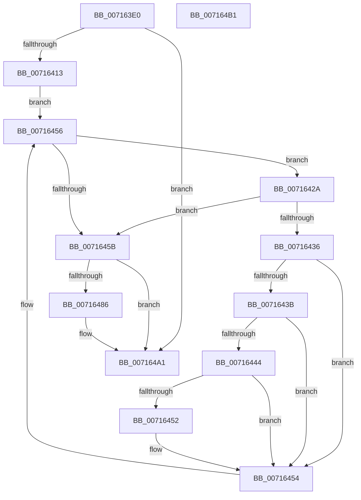

# FsRtlDissectDbcs

- RVA: `0x007163E0`–`0x007164B2` (길이 `210` bytes)
- VA: `0x00000001407163E0`
- 실행 섹션: `PAGE`
- PDB 이름 있음: `예`; PDB Function 태그: `아니요`
- unwind 정보 RVA: `0x00069588`
- 디코드: `60`개 명령, `210/210` bytes 표시
- 미해석 바이트: `0` (있으면 어셈블리에 `.byte`로 보존)

> 이 문서는 커널 이미지의 기계어와 PDB 기호를 분석해 생성했습니다. 4번과 5번은 함수 원형과 자료형을 바이너리 사용 방식에서 추정한 C 해석이며 원본 소스 복구 결과는 아닙니다.

## 1. Dependencies

- 직접 호출 지점: **0**; 고유 호출 대상: **0**
- 직접 호출자로 확인된 함수: **2**
- RIP 상대 이미지 참조: **2**

### Outgoing calls
- 직접 디코드된 call 명령이 없습니다.

### Direct callers
- [FsRtlIsHpfsDbcsLegal](FsRtlIsHpfsDbcsLegal_function_007164C0.md) at `0x007165B9`
- [sub_00B2FBD0](../B2/Unknown_function_00B2FBD0.md) at `0x00B2FC20`

### Static image references
- `0x0071643B` → RVA `0x00FD8000` (`PAGEDATA`; read)
- `0x00716444` → RVA `0x00FD8090` (`PAGEDATA`; read)

## 2. Other-region calls and transfers

- 다른 실행 섹션으로 향하는 call: **0**
- 별도 외부 분기/꼬리 이동을 확인하지 못했습니다.

## 3. Assembly (complete function range)

```asm
007163E0  48 89 5C 24 08                  mov qword ptr [rsp + 8], rbx
007163E5  48 89 74 24 10                  mov qword ptr [rsp + 0x10], rsi
007163EA  48 89 7C 24 18                  mov qword ptr [rsp + 0x18], rdi
007163EF  45 33 C9                        xor r9d, r9d
007163F2  4D 8B D0                        mov r10, r8
007163F5  44 89 0A                        mov dword ptr [rdx], r9d
007163F8  48 8B DA                        mov rbx, rdx
007163FB  4C 89 4A 08                     mov qword ptr [rdx + 8], r9
007163FF  45 89 08                        mov dword ptr [r8], r9d
00716402  4D 89 48 08                     mov qword ptr [r8 + 8], r9
00716406  44 0F B7 01                     movzx r8d, word ptr [rcx]
0071640A  45 85 C0                        test r8d, r8d
0071640D  0F 84 8E 00 00 00               je 0x1407164a1
00716413  4C 8B 59 08                     mov r11, qword ptr [rcx + 8]
00716417  41 8D 71 01                     lea esi, [r9 + 1]
0071641B  41 8B D1                        mov edx, r9d
0071641E  41 8A 3B                        mov dil, byte ptr [r11]
00716421  40 80 FF 5C                     cmp dil, 0x5c
00716425  0F 94 C2                        sete dl
00716428  EB 2C                           jmp 0x140716456
0071642A  8B C2                           mov eax, edx
0071642C  42 0F B6 0C 18                  movzx ecx, byte ptr [rax + r11]
00716431  80 F9 5C                        cmp cl, 0x5c
00716434  74 25                           je 0x14071645b
00716436  80 F9 80                        cmp cl, 0x80
00716439  72 19                           jb 0x140716454
0071643B  44 38 0D BE 1B 8C 00            cmp byte ptr [rip + 0x8c1bbe], r9b
00716442  74 10                           je 0x140716454
00716444  48 8B 05 45 1C 8C 00            mov rax, qword ptr [rip + 0x8c1c45]
0071644B  66 44 39 0C 48                  cmp word ptr [rax + rcx*2], r9w
00716450  74 02                           je 0x140716454
00716452  03 D6                           add edx, esi
00716454  03 D6                           add edx, esi
00716456  41 3B D0                        cmp edx, r8d
00716459  72 CF                           jb 0x14071642a
0071645B  41 8B C1                        mov eax, r9d
0071645E  40 80 FF 5C                     cmp dil, 0x5c
00716462  0F B7 CA                        movzx ecx, dx
00716465  0F 94 C0                        sete al
00716468  66 2B C8                        sub cx, ax
0071646B  40 80 FF 5C                     cmp dil, 0x5c
0071646F  66 89 0B                        mov word ptr [rbx], cx
00716472  66 89 4B 02                     mov word ptr [rbx + 2], cx
00716476  41 0F 94 C1                     sete r9b
0071647A  4D 03 CB                        add r9, r11
0071647D  4C 89 4B 08                     mov qword ptr [rbx + 8], r9
00716481  41 3B D0                        cmp edx, r8d
00716484  73 1B                           jae 0x1407164a1
00716486  66 44 2B C2                     sub r8w, dx
0071648A  8D 4A 01                        lea ecx, [rdx + 1]
0071648D  66 44 2B C6                     sub r8w, si
00716491  49 03 CB                        add rcx, r11
00716494  66 45 89 02                     mov word ptr [r10], r8w
00716498  49 89 4A 08                     mov qword ptr [r10 + 8], rcx
0071649C  66 45 89 42 02                  mov word ptr [r10 + 2], r8w
007164A1  48 8B 5C 24 08                  mov rbx, qword ptr [rsp + 8]
007164A6  48 8B 74 24 10                  mov rsi, qword ptr [rsp + 0x10]
007164AB  48 8B 7C 24 18                  mov rdi, qword ptr [rsp + 0x18]
007164B0  C3                              ret
007164B1  CC                              int3
```

## 4. C-style interpretation (structured pseudocode)

```c
__int64 __fastcall FsRtlDissectDbcs(__int64 a1, __int64 a2, __int64 a3, int a4)
{
    __int64 result;
    unsigned __int64 v_stack_p10;
    unsigned __int64 v_stack_p18;
    unsigned __int64 v_stack_p8;

    v_stack_p8 = v_rbx;
    v_stack_p10 = v_rsi;
    v_stack_p18 = v_rdi;
    a4 = 0;
    *(unsigned int *)(a2) = 0;
    *(unsigned __int64 *)(a2 + 8) = 0;
    *(unsigned int *)(a3) = 0;
    *(unsigned __int64 *)(a3 + 8) = 0;
    if ((unsigned int)(*(unsigned __int16 *)(a1)) == 0) goto loc_007164A1;
    a2 = (((unsigned __int8)(*(unsigned __int8 *)(*(unsigned __int64 *)(a1 + 8)))) == 92) ? 1 : 0;
    goto loc_00716456;
loc_0071642A:
    if (((unsigned __int8)(*(unsigned __int8 *)((unsigned int)((unsigned int)(a2)) + *(unsigned __int64 *)(a1 + 8) * 1))) == 92) goto loc_0071645B;
    if (((unsigned __int8)(*(unsigned __int8 *)((unsigned int)((unsigned int)(a2)) + *(unsigned __int64 *)(a1 + 8) * 1))) < 128) goto loc_00716454;
    if ((*(unsigned __int8 *)(v_rip + 9182142)) == 0) goto loc_00716454;
    if ((*(unsigned __int16 *)(*(unsigned __int64 *)(v_rip + 9182277) + *(unsigned __int8 *)((unsigned int)((unsigned int)(a2)) + *(unsigned __int64 *)(a1 + 8) * 1) * 2)) != 0) {
        a2 = (unsigned int)((a2) + ((unsigned int)(a4 + 1)));
    }
    a2 = (unsigned int)((a2) + ((unsigned int)(a4 + 1)));
loc_00716456:
    if (((unsigned int)(a2)) < ((unsigned int)(*(unsigned __int16 *)(a1)))) goto loc_0071642A;
loc_0071645B:
    result = (((unsigned __int8)(*(unsigned __int8 *)(*(unsigned __int64 *)(a1 + 8)))) == 92) ? 1 : 0;
    a1 = (unsigned __int16)(((unsigned __int16)(a2)) - ((unsigned __int16)(result)));
    *(unsigned __int16 *)(a2) = (unsigned __int16)(a1);
    *(unsigned __int16 *)(a2 + 2) = (unsigned __int16)(a1);
    a4 = (((unsigned __int8)(*(unsigned __int8 *)(*(unsigned __int64 *)(a1 + 8)))) == 92) ? 1 : 0;
    a4 = (a4) + (*(unsigned __int64 *)(a1 + 8));
    *(unsigned __int64 *)(a2 + 8) = a4;
    if (((unsigned int)(a2)) < ((unsigned int)(*(unsigned __int16 *)(a1)))) {
        a3 = (unsigned __int16)((*(unsigned __int16 *)(a1)) - ((unsigned __int16)(a2)));
        a1 = a2 + 1;
        a3 = (unsigned __int16)((a3) - ((unsigned __int16)(a4 + 1)));
        a1 = (a1) + (*(unsigned __int64 *)(a1 + 8));
        *(unsigned __int16 *)(a3) = (unsigned __int16)(a3);
        *(unsigned __int64 *)(a3 + 8) = a1;
        *(unsigned __int16 *)(a3 + 2) = (unsigned __int16)(a3);
    }
    return result;
}
```

## 5. (Beta) C Style

```c
int64_t FsRtlDissectDbcs(void *Arg1, void *Arg2, void *Arg3, int32_t Arg4)
{
    uint8_t *arg1 = (uint8_t *)Arg1;
    uint8_t *arg2 = (uint8_t *)Arg2;
    uint8_t *arg3 = (uint8_t *)Arg3;

    int64_t result;
    uint64_t v_stack_p10;
    uint64_t v_stack_p18;
    uint64_t v_stack_p8;

    v_stack_p8 = local_rbx;
    v_stack_p10 = local_rsi;
    v_stack_p18 = local_rdi;
    Arg4 = 0;
    *(uint32_t *)(arg2) = 0;
    *(uint64_t *)(arg2 + 0x8) = 0;
    *(uint32_t *)(arg3) = 0;
    *(uint64_t *)(arg3 + 0x8) = 0;
    if ((uint32_t)(*(uint16_t *)(arg1)) == 0) goto loc_007164A1;
    Arg2 = (((uint8_t)(*(uint8_t *)(*(uint64_t *)(arg1 + 0x8)))) == 92) ? 1 : 0;
    goto loc_00716456;
loc_0071642A:
    if (((uint8_t)(*(uint8_t *)((uint32_t)((uint32_t)(arg2)) + *(uint64_t *)(arg1 + 0x8) * 1))) == 92) goto loc_0071645B;
    if (((uint8_t)(*(uint8_t *)((uint32_t)((uint32_t)(arg2)) + *(uint64_t *)(arg1 + 0x8) * 1))) < 128) goto loc_00716454;
    if ((*(uint8_t *)(v_rip + 0x8C1BBE)) == 0) goto loc_00716454;
    if ((*(uint16_t *)(*(uint64_t *)(v_rip + 0x8C1C45) + *(uint8_t *)((uint32_t)((uint32_t)(arg2)) + *(uint64_t *)(arg1 + 0x8) * 1) * 2)) != 0) {
        Arg2 = (uint32_t)((Arg2) + ((uint32_t)(Arg4 + 1)));
    }
    Arg2 = (uint32_t)((Arg2) + ((uint32_t)(Arg4 + 1)));
loc_00716456:
    if (((uint32_t)(Arg2)) < ((uint32_t)(*(uint16_t *)(arg1)))) goto loc_0071642A;
loc_0071645B:
    result = (((uint8_t)(*(uint8_t *)(*(uint64_t *)(arg1 + 0x8)))) == 92) ? 1 : 0;
    Arg1 = (uint16_t)(((uint16_t)(Arg2)) - ((uint16_t)(result)));
    *(uint16_t *)(arg2) = (uint16_t)(Arg1);
    *(uint16_t *)(arg2 + 0x2) = (uint16_t)(Arg1);
    Arg4 = (((uint8_t)(*(uint8_t *)(*(uint64_t *)(arg1 + 0x8)))) == 92) ? 1 : 0;
    Arg4 = (Arg4) + (*(uint64_t *)(arg1 + 0x8));
    *(uint64_t *)(arg2 + 0x8) = Arg4;
    if (((uint32_t)(Arg2)) < ((uint32_t)(*(uint16_t *)(arg1)))) {
        Arg3 = (uint16_t)((*(uint16_t *)(arg1)) - ((uint16_t)(Arg2)));
        Arg1 = Arg2 + 1;
        Arg3 = (uint16_t)((Arg3) - ((uint16_t)(Arg4 + 1)));
        Arg1 = (Arg1) + (*(uint64_t *)(arg1 + 0x8));
        *(uint16_t *)(arg3) = (uint16_t)(Arg3);
        *(void **)(arg3 + 0x8) = Arg1;
        *(uint16_t *)(arg3 + 0x2) = (uint16_t)(Arg3);
    }
    return result;
}
```

### 관측된 메모리 오프셋

구조체 형식이 확인되지 않은 접근은 인자 기준의 오프셋으로만 기록했습니다.

| 기준 인자 | 오프셋 표현 | 폭 (bit) | 접근 |
|---|---:|---:|---|
| `Arg1` | `+ 0x0` | `16` | `R` |
| `Arg1` | `+ 0x8` | `64` | `R` |
| `Arg2` | `+ 0x0` | `16` | `W` |
| `Arg2` | `+ 0x0` | `32` | `W` |
| `Arg2` | `+ 0x2` | `16` | `W` |
| `Arg2` | `+ 0x8` | `64` | `W` |
| `Arg3` | `+ 0x0` | `16` | `W` |
| `Arg3` | `+ 0x0` | `32` | `W` |
| `Arg3` | `+ 0x2` | `16` | `W` |
| `Arg3` | `+ 0x8` | `64` | `W` |

## 6. Execution-region graph

[열기: 2D/3D 그래프와 함수 탐색 컨트롤 패널](../../../control-panel.html?section=page&rva=0x007163E0&view=graph)

- 2D 그래프는 위에서 아래로 흐르고, 3D 그래프는 빈 공간을 드래그해 회전합니다. Shift+드래그는 이동, 휠은 확대·축소, 함수 노드 선택은 대상 보고서 이동입니다.

### Static fallback


