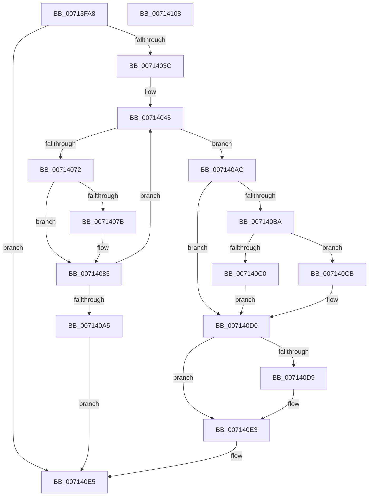

# FsRtlGetTunnelParameterValue

- RVA: `0x00713FA8`–`0x00714109` (길이 `353` bytes)
- VA: `0x0000000140713FA8`
- 실행 섹션: `PAGE`
- PDB 이름 있음: `예`; PDB Function 태그: `아니요`
- unwind 정보 RVA: `0x000C5C6C`
- 디코드: `93`개 명령, `353/353` bytes 표시
- 미해석 바이트: `0` (있으면 어셈블리에 `.byte`로 보존)

> 이 문서는 커널 이미지의 기계어와 PDB 기호를 분석해 생성했습니다. 4번과 5번은 함수 원형과 자료형을 바이너리 사용 방식에서 추정한 C 해석이며 원본 소스 복구 결과는 아닙니다.

## 1. Dependencies

- 직접 호출 지점: **7**; 고유 호출 대상: **6**
- 직접 호출자로 확인된 함수: **1**
- RIP 상대 이미지 참조: **2**

### Outgoing calls
- `0x0071402F` → [ZwOpenKey](../../text/6A/ZwOpenKey_function_006AD310.md) (function, `0x006AD310`)
- `0x00714064` → [ZwQueryValueKey](../../text/6A/ZwQueryValueKey_function_006AD3B0.md) (function, `0x006AD3B0`)
- `0x00714080` → [ExFreePoolWithTag](../../poolcode/B8/ExFreePoolWithTag_function_00B82870.md) (function, `0x00B82870`)
- `0x00714098` → [ExAllocatePool2](../../poolcode/B8/ExAllocatePool2_function_00B820F0.md) (function, `0x00B820F0`)
- `0x007140B1` → [ZwClose](../../text/6A/ZwClose_function_006AD2B0.md) (function, `0x006AD2B0`)
- `0x007140DE` → [ExFreePoolWithTag](../../poolcode/B8/ExFreePoolWithTag_function_00B82870.md) (function, `0x00B82870`)
- `0x007140EC` → [_security_check_cookie](../../text/6A/_security_check_cookie_function_006AC640.md) (function, `0x006AC640`)

### Direct callers
- [FsRtlInitializeTunnels](../../init/C2/FsRtlInitializeTunnels_function_00C291D0.md) at `0x00C2920E`
- [FsRtlInitializeTunnels](../../init/C2/FsRtlInitializeTunnels_function_00C291D0.md) at `0x00C29233`

### Static image references
- `0x00713FC0` → RVA `0x00E0A740` (`.data`; read)
- `0x00713FD4` → RVA `0x00AFBD10` (` ?? ::NNGAKEGL::`string'`; read)

## 2. Other-region calls and transfers

- 다른 실행 섹션으로 향하는 call: **7**
  - `0x0071402F` → [ZwOpenKey](../../text/6A/ZwOpenKey_function_006AD310.md) (`PAGE` → `.text`)
  - `0x00714064` → [ZwQueryValueKey](../../text/6A/ZwQueryValueKey_function_006AD3B0.md) (`PAGE` → `.text`)
  - `0x00714080` → [ExFreePoolWithTag](../../poolcode/B8/ExFreePoolWithTag_function_00B82870.md) (`PAGE` → `POOLCODE`)
  - `0x00714098` → [ExAllocatePool2](../../poolcode/B8/ExAllocatePool2_function_00B820F0.md) (`PAGE` → `POOLCODE`)
  - `0x007140B1` → [ZwClose](../../text/6A/ZwClose_function_006AD2B0.md) (`PAGE` → `.text`)
  - `0x007140DE` → [ExFreePoolWithTag](../../poolcode/B8/ExFreePoolWithTag_function_00B82870.md) (`PAGE` → `POOLCODE`)
  - `0x007140EC` → [_security_check_cookie](../../text/6A/_security_check_cookie_function_006AC640.md) (`PAGE` → `.text`)
- 별도 외부 분기/꼬리 이동을 확인하지 못했습니다.

## 3. Assembly (complete function range)

```asm
00713FA8  48 89 5C 24 18                  mov qword ptr [rsp + 0x18], rbx
00713FAD  55                              push rbp
00713FAE  56                              push rsi
00713FAF  57                              push rdi
00713FB0  41 56                           push r14
00713FB2  41 57                           push r15
00713FB4  48 8D 6C 24 C9                  lea rbp, [rsp - 0x37]
00713FB9  48 81 EC F0 00 00 00            sub rsp, 0xf0
00713FC0  48 8B 05 79 67 6F 00            mov rax, qword ptr [rip + 0x6f6779]
00713FC7  48 33 C4                        xor rax, rsp
00713FCA  48 89 45 27                     mov qword ptr [rbp + 0x27], rax
00713FCE  48 83 64 24 38 00               and qword ptr [rsp + 0x38], 0
00713FD4  48 8D 05 35 7D 3E 00            lea rax, [rip + 0x3e7d35]
00713FDB  83 64 24 30 00                  and dword ptr [rsp + 0x30], 0
00713FE0  4C 8D 45 97                     lea r8, [rbp - 0x69]
00713FE4  83 65 8B 00                     and dword ptr [rbp - 0x75], 0
00713FE8  4C 8B F2                        mov r14, rdx
00713FEB  83 65 B3 00                     and dword ptr [rbp - 0x4d], 0
00713FEF  4C 8B F9                        mov r15, rcx
00713FF2  48 83 65 9F 00                  and qword ptr [rbp - 0x61], 0
00713FF7  48 8D 4C 24 38                  lea rcx, [rsp + 0x38]
00713FFC  48 89 45 8F                     mov qword ptr [rbp - 0x71], rax
00714000  0F 57 C0                        xorps xmm0, xmm0
00714003  48 8D 45 87                     lea rax, [rbp - 0x79]
00714007  48 C7 45 97 30 00 00 00         mov qword ptr [rbp - 0x69], 0x30
0071400F  83 65 9B 00                     and dword ptr [rbp - 0x65], 0
00714013  BA 19 00 02 00                  mov edx, 0x20019
00714018  48 89 45 A7                     mov qword ptr [rbp - 0x59], rax
0071401C  C7 45 87 7A 00 7C 00            mov dword ptr [rbp - 0x79], 0x7c007a
00714023  C7 45 AF 40 00 00 00            mov dword ptr [rbp - 0x51], 0x40
0071402A  F3 0F 7F 45 B7                  movdqu xmmword ptr [rbp - 0x49], xmm0
0071402F  E8 DC 92 F9 FF                  call 0x1406ad310
00714034  85 C0                           test eax, eax
00714036  0F 88 A9 00 00 00               js 0x1407140e5
0071403C  BE 5C 00 00 00                  mov esi, 0x5c
00714041  48 8D 5D C7                     lea rbx, [rbp - 0x39]
00714045  48 8B 4C 24 38                  mov rcx, qword ptr [rsp + 0x38]
0071404A  48 8D 44 24 30                  lea rax, [rsp + 0x30]
0071404F  48 89 44 24 28                  mov qword ptr [rsp + 0x28], rax
00714054  4C 8B CB                        mov r9, rbx
00714057  41 B8 01 00 00 00               mov r8d, 1
0071405D  89 74 24 20                     mov dword ptr [rsp + 0x20], esi
00714061  49 8B D7                        mov rdx, r15
00714064  E8 47 93 F9 FF                  call 0x1406ad3b0
00714069  8B F8                           mov edi, eax
0071406B  3D 05 00 00 80                  cmp eax, 0x80000005
00714070  75 3A                           jne 0x1407140ac
00714072  48 8D 45 C7                     lea rax, [rbp - 0x39]
00714076  48 3B D8                        cmp rbx, rax
00714079  74 0A                           je 0x140714085
0071407B  33 D2                           xor edx, edx
0071407D  48 8B CB                        mov rcx, rbx
00714080  E8 EB E7 46 00                  call 0x140b82870
00714085  81 C6 00 01 00 00               add esi, 0x100
0071408B  B9 00 01 00 00                  mov ecx, 0x100
00714090  8B D6                           mov edx, esi
00714092  41 B8 54 75 6E 4B               mov r8d, 0x4b6e7554
00714098  E8 53 E0 46 00                  call 0x140b820f0
0071409D  48 8B D8                        mov rbx, rax
007140A0  48 85 C0                        test rax, rax
007140A3  75 A0                           jne 0x140714045
007140A5  B8 17 00 00 C0                  mov eax, 0xc0000017
007140AA  EB 39                           jmp 0x1407140e5
007140AC  48 8B 4C 24 38                  mov rcx, qword ptr [rsp + 0x38]
007140B1  E8 FA 91 F9 FF                  call 0x1406ad2b0
007140B6  85 FF                           test edi, edi
007140B8  78 16                           js 0x1407140d0
007140BA  83 7B 0C 00                     cmp dword ptr [rbx + 0xc], 0
007140BE  74 0B                           je 0x1407140cb
007140C0  8B 43 08                        mov eax, dword ptr [rbx + 8]
007140C3  8B 0C 18                        mov ecx, dword ptr [rax + rbx]
007140C6  41 89 0E                        mov dword ptr [r14], ecx
007140C9  EB 05                           jmp 0x1407140d0
007140CB  BF 34 00 00 C0                  mov edi, 0xc0000034
007140D0  48 8D 45 C7                     lea rax, [rbp - 0x39]
007140D4  48 3B D8                        cmp rbx, rax
007140D7  74 0A                           je 0x1407140e3
007140D9  33 D2                           xor edx, edx
007140DB  48 8B CB                        mov rcx, rbx
007140DE  E8 8D E7 46 00                  call 0x140b82870
007140E3  8B C7                           mov eax, edi
007140E5  48 8B 4D 27                     mov rcx, qword ptr [rbp + 0x27]
007140E9  48 33 CC                        xor rcx, rsp
007140EC  E8 4F 85 F9 FF                  call 0x1406ac640
007140F1  48 8B 9C 24 30 01 00 00         mov rbx, qword ptr [rsp + 0x130]
007140F9  48 81 C4 F0 00 00 00            add rsp, 0xf0
00714100  41 5F                           pop r15
00714102  41 5E                           pop r14
00714104  5F                              pop rdi
00714105  5E                              pop rsi
00714106  5D                              pop rbp
00714107  C3                              ret
00714108  CC                              int3
```

## 4. C-style interpretation (structured pseudocode)

```c
__int64 __fastcall FsRtlGetTunnelParameterValue(__int64 a1, __int64 a2)
{
    __int64 result;
    __int64 v_rsi;
    __int64 v_rsp;
    unsigned __int64 v_stack_m38;
    unsigned __int64 v_stack_m5F;
    unsigned __int64 v_stack_m98;
    unsigned __int64 v_stack_mA8;
    unsigned int v_stack_mAC;
    unsigned int v_stack_mB0;
    unsigned __int64 v_stack_mB8;
    unsigned __int64 v_stack_mC0;
    unsigned int v_stack_mC4;
    unsigned __int64 v_stack_mC8;
    unsigned __int64 v_stack_mD0;
    unsigned int v_stack_mD4;
    unsigned __int64 v_stack_mD8;
    unsigned __int64 v_stack_mE0;
    unsigned int v_stack_mE8;
    unsigned __int64 v_stack_mF0;
    unsigned int v_stack_mF8;
    unsigned __int64 v_stack_p18;

    v_stack_p18 = v_rbx;
    v_rsp = (v_rsp) - (240);
    result = (*(unsigned __int64 *)(v_rip + 7300985)) ^ (v_rsp);
    v_stack_m38 = result;
    v_stack_mD0 = v_rip + 4095285;
    v_stack_mC8 = 48;
    v_stack_mB8 = v_stack_mD8;
    v_stack_mD8 = 0x7C007AULL;
    v_stack_mB0 = 64;
    v_stack_mA8 = v_xmm0;
    result = ZwOpenKey(v_stack_mE0, (unsigned int)(0x20019ULL), v_stack_mC8, a4);
    if (sign_flag) goto loc_007140E5;
loc_00714045:
    v_stack_mF0 = v_stack_mE8;
    v_stack_mF8 = 92;
    result = ZwQueryValueKey(v_stack_mE0, a1, 1, v_stack_m98);
    if (((unsigned int)(result)) != 0x80000005ULL) goto loc_007140AC;
    result = v_stack_m98;
    if (v_stack_m98 != v_stack_m98) {
        a2 = 0;
        a1 = v_stack_m98;
        result = ExFreePoolWithTag(a1, a2, 1, v_stack_m98);
    }
    v_rsi = (unsigned int)((92) + (256));
    result = ExAllocatePool2(256, (unsigned int)((unsigned int)(v_rsi)), (unsigned int)(0x4B6E7554ULL), v_stack_m98);
    if (result != 0) goto loc_00714045;
    goto loc_007140E5;
loc_007140AC:
    result = ZwClose(v_stack_mE0, (unsigned int)((unsigned int)(v_rsi)), (unsigned int)(0x4B6E7554ULL), v_stack_m98);
    if (sign_flag) goto loc_007140D0;
    if ((*(unsigned int *)(result + 12)) == 0) goto loc_007140CB;
    *(unsigned int *)(a2) = (unsigned int)((unsigned int)(*(unsigned int *)((unsigned int)(*(unsigned int *)(result + 8)) + result * 1)));
    goto loc_007140D0;
loc_007140CB:
loc_007140D0:
    result = v_stack_m98;
    if (result != v_stack_m98) {
        a2 = 0;
        a1 = result;
        result = ExFreePoolWithTag(a1, a2, (unsigned int)(0x4B6E7554ULL), v_stack_m98);
    }
loc_007140E5:
    a1 = (v_stack_m38) ^ (v_rsp);
    result = _security_check_cookie(a1, a2, (unsigned int)(0x4B6E7554ULL), v_stack_m98);
    v_rsp = (v_rsp) + (240);
    return result;
}
```

## 5. (Beta) C Style

```c
int64_t FsRtlGetTunnelParameterValue(int64_t Arg1, void *Arg2)
{
    uint8_t *arg2 = (uint8_t *)Arg2;

    int64_t result;
    int64_t local_rsi;
    int64_t local_rsp;
    uint64_t v_stack_m38;
    uint64_t v_stack_m5F;
    uint64_t v_stack_m98;
    uint64_t v_stack_mA8;
    uint32_t v_stack_mAC;
    uint32_t v_stack_mB0;
    uint64_t v_stack_mB8;
    uint64_t v_stack_mC0;
    uint32_t v_stack_mC4;
    uint64_t v_stack_mC8;
    uint64_t v_stack_mD0;
    uint32_t v_stack_mD4;
    uint64_t v_stack_mD8;
    uint64_t v_stack_mE0;
    uint32_t v_stack_mE8;
    uint64_t v_stack_mF0;
    uint32_t v_stack_mF8;
    uint64_t v_stack_p18;

    v_stack_p18 = local_rbx;
    local_rsp = (local_rsp) - (240);
    result = (*(uint64_t *)(v_rip + 0x6F6779)) ^ (local_rsp);
    v_stack_m38 = result;
    v_stack_mD0 = v_rip + 4095285;
    v_stack_mC8 = 48;
    v_stack_mB8 = v_stack_mD8;
    v_stack_mD8 = 0x7C007AULL;
    v_stack_mB0 = 64;
    v_stack_mA8 = v_xmm0;
    result = ZwOpenKey(v_stack_mE0, (uint32_t)(0x20019ULL), v_stack_mC8, a4);
    if (sign_flag) goto loc_007140E5;
loc_00714045:
    v_stack_mF0 = v_stack_mE8;
    v_stack_mF8 = 92;
    result = ZwQueryValueKey(v_stack_mE0, Arg1, 1, v_stack_m98);
    if (((uint32_t)(result)) != 0x80000005ULL) goto loc_007140AC;
    result = v_stack_m98;
    if (v_stack_m98 != v_stack_m98) {
        Arg2 = 0;
        Arg1 = v_stack_m98;
        result = ExFreePoolWithTag(Arg1, Arg2, 1, v_stack_m98);
    }
    local_rsi = (uint32_t)((92) + (256));
    result = ExAllocatePool2(256, (uint32_t)((uint32_t)(local_rsi)), (uint32_t)(0x4B6E7554ULL), v_stack_m98);
    if (result != 0) goto loc_00714045;
    goto loc_007140E5;
loc_007140AC:
    result = ZwClose(v_stack_mE0, (uint32_t)((uint32_t)(local_rsi)), (uint32_t)(0x4B6E7554ULL), v_stack_m98);
    if (sign_flag) goto loc_007140D0;
    if ((*(uint32_t *)(result + 0xC)) == 0) goto loc_007140CB;
    *(uint32_t *)(arg2) = (uint32_t)((uint32_t)(*(uint32_t *)((uint32_t)(*(uint32_t *)(result + 0x8)) + result * 1)));
    goto loc_007140D0;
loc_007140CB:
loc_007140D0:
    result = v_stack_m98;
    if (result != v_stack_m98) {
        Arg2 = 0;
        Arg1 = result;
        result = ExFreePoolWithTag(Arg1, Arg2, (uint32_t)(0x4B6E7554ULL), v_stack_m98);
    }
loc_007140E5:
    Arg1 = (v_stack_m38) ^ (local_rsp);
    result = _security_check_cookie(Arg1, Arg2, (uint32_t)(0x4B6E7554ULL), v_stack_m98);
    local_rsp = (local_rsp) + (240);
    return result;
}
```

### 관측된 메모리 오프셋

구조체 형식이 확인되지 않은 접근은 인자 기준의 오프셋으로만 기록했습니다.

| 기준 인자 | 오프셋 표현 | 폭 (bit) | 접근 |
|---|---:|---:|---|
| `Arg2` | `+ 0x0` | `32` | `W` |

## 6. Execution-region graph

[열기: 2D/3D 그래프와 함수 탐색 컨트롤 패널](../../../control-panel.html?section=page&rva=0x00713FA8&view=graph)

- 2D 그래프는 위에서 아래로 흐르고, 3D 그래프는 빈 공간을 드래그해 회전합니다. Shift+드래그는 이동, 휠은 확대·축소, 함수 노드 선택은 대상 보고서 이동입니다.

### Static fallback


